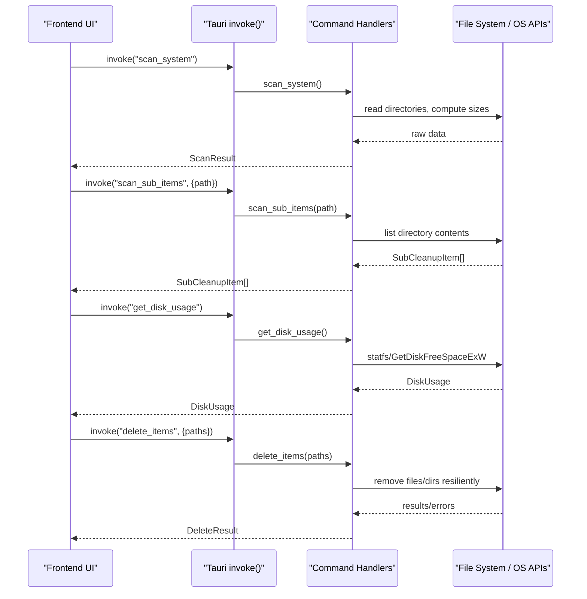
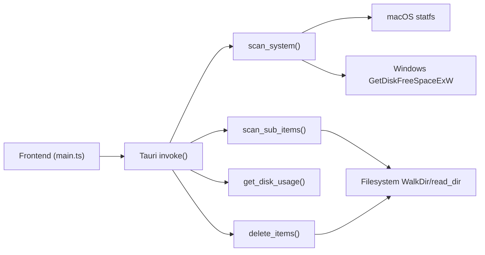

# API Reference

<cite>
**Referenced Files in This Document**
- [lib.rs](file://src-tauri/src/lib.rs)
- [main.rs](file://src-tauri/src/main.rs)
- [tauri.conf.json](file://src-tauri/tauri.conf.json)
- [package.json](file://package.json)
- [tsconfig.json](file://tsconfig.json)
- [main.ts](file://src/main.ts)
</cite>

## Table of Contents
1. [Introduction](#introduction)
2. [Project Structure](#project-structure)
3. [Core Components](#core-components)
4. [Architecture Overview](#architecture-overview)
5. [Detailed Component Analysis](#detailed-component-analysis)
6. [Dependency Analysis](#dependency-analysis)
7. [Performance Considerations](#performance-considerations)
8. [Troubleshooting Guide](#troubleshooting-guide)
9. [Conclusion](#conclusion)
10. [Appendices](#appendices)

## Introduction
This document provides comprehensive API documentation for the FreeSpaceMacos Tauri application’s backend commands and frontend interfaces. It covers:
- All exposed Tauri commands, including scan_system(), scan_sub_items(), get_disk_usage(), and delete_items() (the deletion command used by the UI).
- TypeScript interface definitions for data models such as CleanupItem, SubCleanupItem, ScanResult, DiskUsage, DeleteResult, and PlatformInfo.
- IPC communication protocol details, message formats, and event patterns.
- Authentication and permission requirements for system-level operations.
- Rate limiting, timeout handling, and progress reporting mechanisms.
- Migration guidance for API versioning and backwards compatibility considerations.

The backend is implemented in Rust using Tauri v2, with a Vite + TypeScript frontend invoking commands via @tauri-apps/api.

## Project Structure
The project consists of:
- A Rust backend under src-tauri that defines Tauri commands and data types.
- A TypeScript frontend under src that consumes these commands through Tauri’s invoke API.
- Configuration files for Tauri and the frontend build toolchain.

```mermaid
graph TB
subgraph "Frontend"
FE_TS["src/main.ts<br/>TypeScript UI"]
end
subgraph "Tauri Runtime"
Tauri["tauri::Builder<br/>invoke_handler"]
end
subgraph "Backend (Rust)"
Lib["src-tauri/src/lib.rs<br/>Commands & Types"]
Main["src-tauri/src/main.rs<br/>Entry point"]
end
FE_TS --> |invoke("scan_system")| Tauri
FE_TS --> |invoke("scan_sub_items")| Tauri
FE_TS --> |invoke("get_disk_usage")| Tauri
FE_TS --> |invoke("delete_items")| Tauri
Tauri --> Lib
Main --> Lib
```

**Diagram sources**
- [main.ts:837-896](file://src/main.ts#L837-L896)
- [lib.rs:328-408](file://src-tauri/src/lib.rs#L328-L408)
- [lib.rs:1086-1099](file://src-tauri/src/lib.rs#L1086-L1099)
- [main.rs:4-6](file://src-tauri/src/main.rs#L4-L6)

**Section sources**
- [main.rs:4-6](file://src-tauri/src/main.rs#L4-L6)
- [lib.rs:1086-1099](file://src-tauri/src/lib.rs#L1086-L1099)
- [tauri.conf.json:1-46](file://src-tauri/tauri.conf.json#L1-L46)
- [package.json:1-22](file://package.json#L1-L22)
- [tsconfig.json:1-24](file://tsconfig.json#L1-L24)

## Core Components
This section documents the core data models and their usage across the API.

### Data Models
- SafetyLevel: Enum indicating whether an item is safe to delete or needs review.
- SubCleanupItem: Represents a single file or directory within a scanned category.
- CleanupItem: Represents a top-level cleanup category with metadata and nested children.
- DiskUsage: Aggregated disk statistics (total, used, free, percentage_used).
- ScanResult: Aggregates disk usage and categorized cleanup items.
- DeleteResult: Reports deletion outcomes including success flag, counts, freed bytes, and errors.
- PlatformInfo: Provides OS name and disk label for UI localization.

These models are defined in the backend and mirrored in the frontend TypeScript code.

**Section sources**
- [lib.rs:8-66](file://src-tauri/src/lib.rs#L8-L66)
- [lib.rs:44-58](file://src-tauri/src/lib.rs#L44-L58)
- [lib.rs:748-786](file://src-tauri/src/lib.rs#L748-L786)
- [main.ts:5-57](file://src/main.ts#L5-L57)

## Architecture Overview
The application follows a standard Tauri architecture:
- The frontend invokes commands via Tauri’s invoke API.
- The backend exposes commands annotated with #[tauri::command].
- Commands perform system-level operations (e.g., scanning directories, reading disk stats) and return structured results.



**Diagram sources**
- [main.ts:837-896](file://src/main.ts#L837-L896)
- [main.ts:900-941](file://src/main.ts#L900-L941)
- [lib.rs:328-408](file://src-tauri/src/lib.rs#L328-L408)
- [lib.rs:1056-1082](file://src-tauri/src/lib.rs#L1056-L1082)

## Detailed Component Analysis

### Command: scan_system()
Purpose:
- Scans system-specific cache and temporary locations to identify reclaimable space.
- Returns categorized items (safe vs. needs review) along with aggregated totals and current disk usage.

Parameters:
- None.

Return Type:
- ScanResult containing:
  - disk_usage: DiskUsage
  - safe_items: Vec<CleanupItem>
  - review_items: Vec<CleanupItem>
  - total_safe_size: u64
  - total_review_size: u64

Error Conditions:
- Returns Err(String) if underlying platform calls fail (e.g., inability to query disk usage).

Notes:
- On macOS, uses libc::statfs; on Windows, uses GetDiskFreeSpaceExW.
- Categories differ per platform but share the same response schema.

Example Invocation (Frontend):
- See runScan() in main.ts which invokes "scan_system" and handles errors.

**Section sources**
- [lib.rs:410-744](file://src-tauri/src/lib.rs#L410-L744)
- [main.ts:837-896](file://src/main.ts#L837-L896)

### Command: scan_sub_items(path: String)
Purpose:
- Lists immediate children of a given path, computing size and file count for each entry.
- Used by the UI to lazily expand directories.

Parameters:
- path: String representing the absolute or user-home-relative path to scan.

Return Type:
- Vec<SubCleanupItem>, sorted by size descending.

Error Conditions:
- Returns Ok(empty vector) if path does not exist or cannot be read.

Notes:
- Skips certain hidden/system files like .DS_Store and .localized.
- For directories, computes size recursively up to a depth limit.

Example Invocation (Frontend):
- See toggleNodeExpand() in main.ts which invokes "scan_sub_items" when expanding a node.

**Section sources**
- [lib.rs:401-408](file://src-tauri/src/lib.rs#L401-L408)
- [lib.rs:108-161](file://src-tauri/src/lib.rs#L108-L161)
- [main.ts:472-558](file://src/main.ts#L472-L558)

### Command: get_disk_usage()
Purpose:
- Retrieves current disk usage statistics for the root volume.

Parameters:
- None.

Return Type:
- DiskUsage with fields:
  - total: u64
  - used: u64
  - free: u64
  - percentage_used: f64

Error Conditions:
- Returns Err(String) if unable to query disk information.

Platform Behavior:
- macOS: Uses libc::statfs.
- Windows: Uses GetDiskFreeSpaceExW.

Example Invocation (Frontend):
- See initial load in main.ts which invokes "get_disk_usage" to populate disk usage UI.

**Section sources**
- [lib.rs:328-399](file://src-tauri/src/lib.rs#L328-L399)
- [main.ts:945-970](file://src/main.ts#L945-L970)

### Command: delete_items(paths: Vec<String>)
Purpose:
- Deletes selected paths resiliently, returning aggregated results and any errors encountered.

Parameters:
- paths: Array of strings representing absolute paths to delete.

Return Type:
- DeleteResult with fields:
  - success: bool
  - deleted_count: u32
  - freed_bytes: u64
  - errors: Vec<String>

Error Conditions:
- Individual failures are captured in errors; overall success reflects whether any errors occurred.

Notes:
- Special handling for known “category roots” ensures safe deletion strategies.
- Directory deletion attempts full removal first, then falls back to resilient content deletion.

Example Invocation (Frontend):
- See runClean() in main.ts which invokes "delete_items" after user confirmation.

**Section sources**
- [lib.rs:1056-1082](file://src-tauri/src/lib.rs#L1056-L1082)
- [lib.rs:261-324](file://src-tauri/src/lib.rs#L261-L324)
- [main.ts:900-941](file://src/main.ts#L900-L941)

### Command: get_platform_info()
Purpose:
- Returns platform-specific information for UI localization and labeling.

Parameters:
- None.

Return Type:
- PlatformInfo with fields:
  - os: string
  - os_name: string
  - disk_label: string

Example Invocation (Frontend):
- See initial load in main.ts which invokes "get_platform_info".

**Section sources**
- [lib.rs:748-786](file://src-tauri/src/lib.rs#L748-L786)
- [main.ts:945-963](file://src/main.ts#L945-L963)

## Dependency Analysis
The following diagram shows how the frontend interacts with the backend commands and how the backend depends on system APIs.



**Diagram sources**
- [main.ts:837-896](file://src/main.ts#L837-L896)
- [lib.rs:328-408](file://src-tauri/src/lib.rs#L328-L408)
- [lib.rs:1056-1082](file://src-tauri/src/lib.rs#L1056-L1082)

**Section sources**
- [lib.rs:1086-1099](file://src-tauri/src/lib.rs#L1086-L1099)
- [main.ts:1-2](file://src/main.ts#L1-L2)

## Performance Considerations
- Directory scanning uses recursive traversal with a maximum depth limit to avoid excessive I/O.
- Sorting of sub-items is performed by size to prioritize larger targets in the UI.
- Deletion logic includes resilience fallbacks to handle locked or partially accessible directories.
- No built-in rate limiting or timeouts are implemented at the command level; callers should manage long-running operations and provide user feedback.

Recommendations:
- Introduce explicit timeouts for long-running scans and deletions.
- Add progress events for large directory traversals to improve UX.
- Consider batching deletions and reporting incremental progress.

[No sources needed since this section provides general guidance]

## Troubleshooting Guide
Common issues and resolutions:
- Permission errors during deletion: Some paths may require elevated privileges (e.g., Windows admin rights). Ensure the app runs with appropriate permissions.
- Empty results from scan_sub_items: Indicates inaccessible or non-existent paths; verify path correctness and permissions.
- Disk usage queries failing: Check platform-specific system call availability and permissions.

Operational tips:
- Use the error arrays in DeleteResult to present specific failure messages to users.
- Validate paths before invoking delete_items to reduce unnecessary errors.

**Section sources**
- [lib.rs:261-324](file://src-tauri/src/lib.rs#L261-L324)
- [lib.rs:1056-1082](file://src-tauri/src/lib.rs#L1056-L1082)

## Conclusion
FreeSpaceMacos exposes a clear set of Tauri commands for scanning system caches, retrieving disk usage, and performing resilient deletions. The frontend mirrors backend data models in TypeScript and orchestrates user interactions around these commands. While the current implementation lacks explicit rate limiting, timeouts, and streaming progress, it provides a solid foundation for further enhancements.

[No sources needed since this section summarizes without analyzing specific files]

## Appendices

### IPC Communication Protocol
- Transport: Tauri’s invoke mechanism over the internal IPC channel.
- Message Format: JSON-serialized payloads matching the Rust structs.
- Event Patterns: Commands are synchronous from the frontend perspective; no dedicated event bus is used for progress updates.

Invocation Examples:
- Frontend calls:
  - invoke<ScanResult>("scan_system")
  - invoke<SubCleanupItem[]>("scan_sub_items", { path })
  - invoke<DiskUsage>("get_disk_usage")
  - invoke<DeleteResult>("delete_items", { paths })

Error Handling:
- Errors are returned as strings from backend commands and caught in frontend try/catch blocks.

**Section sources**
- [main.ts:837-896](file://src/main.ts#L837-L896)
- [main.ts:900-941](file://src/main.ts#L900-L941)
- [lib.rs:328-408](file://src-tauri/src/lib.rs#L328-L408)
- [lib.rs:1056-1082](file://src-tauri/src/lib.rs#L1056-L1082)

### Authentication and Permissions
- macOS: Access to system directories and trash requires appropriate filesystem permissions.
- Windows: Certain operations (e.g., clearing Recycle Bin, Windows Update cache) may require administrator privileges.
- The app does not implement its own authentication; rely on OS-level access controls.

**Section sources**
- [lib.rs:261-324](file://src-tauri/src/lib.rs#L261-L324)

### Rate Limiting, Timeouts, and Progress Reporting
- Current state: No explicit rate limiting or timeouts; no streaming progress events.
- Suggested improvements:
  - Implement timeouts for scan_system and delete_items.
  - Emit progress events for large directory scans and deletions.
  - Debounce repeated invocations to prevent redundant work.

[No sources needed since this section provides general guidance]

### Migration Guide and Backwards Compatibility
- Versioning: The Tauri app version is defined in tauri.conf.json; update this field when introducing breaking changes.
- API Stability:
  - Maintain consistent command names and payload shapes.
  - If adding new fields to existing models, ensure they are optional or have defaults to preserve compatibility.
- Deprecation Strategy:
  - Keep deprecated commands functional for one major version cycle.
  - Provide migration notices in release notes and UI prompts.

**Section sources**
- [tauri.conf.json:1-10](file://src-tauri/tauri.conf.json#L1-L10)