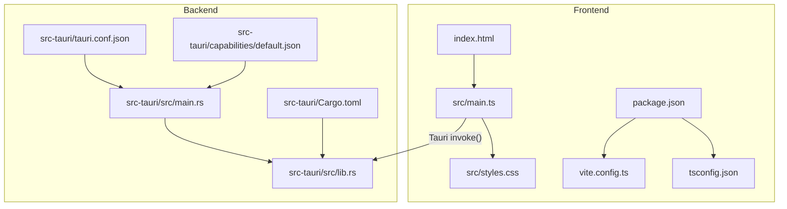
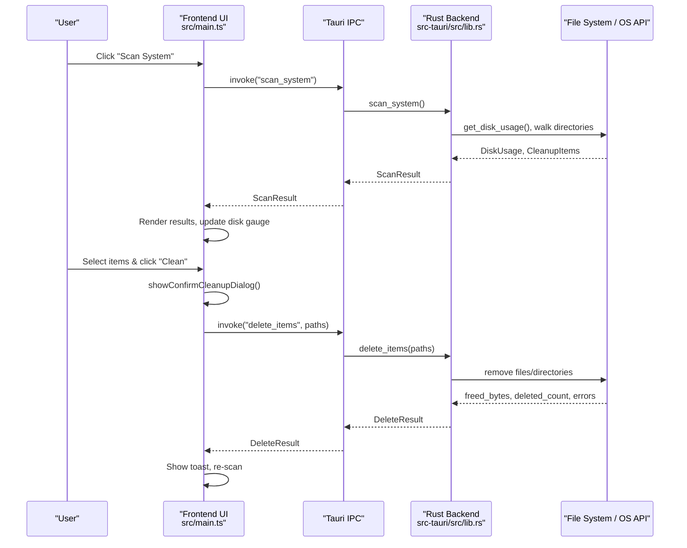
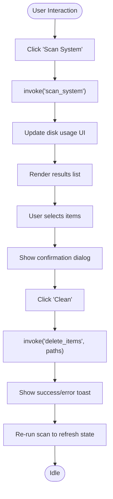
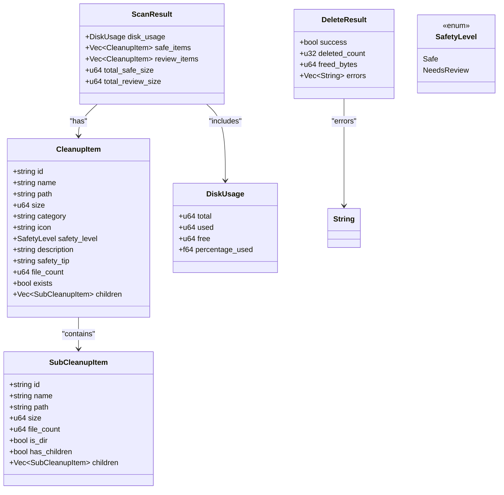
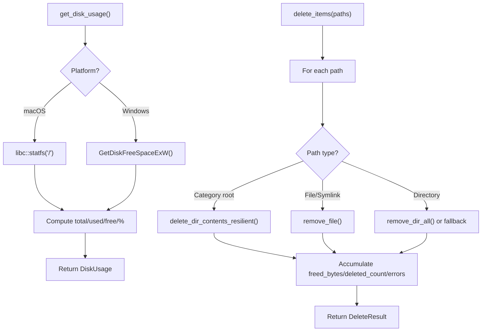
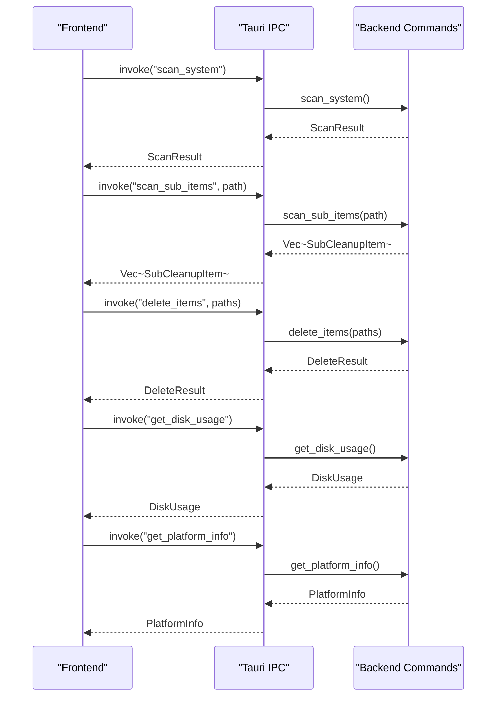
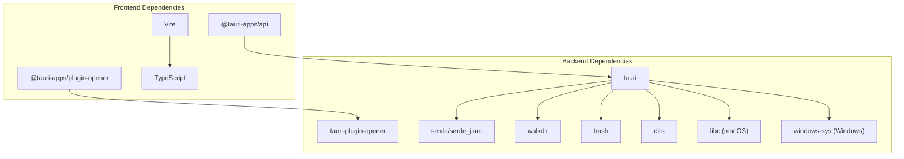

# Architecture Overview

<cite>
**Referenced Files in This Document**
- [README.md](file://README.md)
- [package.json](file://package.json)
- [vite.config.ts](file://vite.config.ts)
- [tsconfig.json](file://tsconfig.json)
- [index.html](file://index.html)
- [src/main.ts](file://src/main.ts)
- [src/styles.css](file://src/styles.css)
- [src-tauri/Cargo.toml](file://src-tauri/Cargo.toml)
- [src-tauri/tauri.conf.json](file://src-tauri/tauri.conf.json)
- [src-tauri/capabilities/default.json](file://src-tauri/capabilities/default.json)
- [src-tauri/src/main.rs](file://src-tauri/src/main.rs)
- [src-tauri/src/lib.rs](file://src-tauri/src/lib.rs)
</cite>

## Table of Contents
1. [Introduction](#introduction)
2. [Project Structure](#project-structure)
3. [Core Components](#core-components)
4. [Architecture Overview](#architecture-overview)
5. [Detailed Component Analysis](#detailed-component-analysis)
6. [Dependency Analysis](#dependency-analysis)
7. [Performance Considerations](#performance-considerations)
8. [Troubleshooting Guide](#troubleshooting-guide)
9. [Conclusion](#conclusion)

## Introduction
FreeSpaceMacos is a macOS-focused storage cleanup and disk analyzer desktop application built with Tauri 2. It combines a Rust backend for safe, high-performance file system operations with a TypeScript frontend using HTML5 and CSS for a modern user interface. The app scans user caches, logs, developer artifacts, and other reclaimable locations, categorizes them by safety level, and allows users to selectively delete items after confirmation.

The project uses:
- Tauri 2 as the cross-platform desktop framework
- Rust for native system integration (disk usage, directory scanning, deletion)
- TypeScript + Vite for the UI layer
- macOS-native APIs via libc on macOS and Windows APIs via windows-sys on Windows

This document explains the layered architecture, IPC patterns through Tauri commands, data flows from user interaction to file system operations, and cross-cutting concerns such as security permissions, error handling, and platform abstraction.

## Project Structure
The repository is organized into two main layers:
- Frontend: src/index.html, src/main.ts, src/styles.css, plus build configuration files
- Backend: src-tauri with Rust code, Tauri configuration, capabilities, and dependencies

**Diagram sources**
- [index.html:1-141](file://index.html#L1-L141)
- [src/main.ts:1-1009](file://src/main.ts#L1-L1009)
- [src/styles.css:1-1298](file://src/styles.css#L1-L1298)
- [vite.config.ts:1-31](file://vite.config.ts#L1-L31)
- [tsconfig.json:1-24](file://tsconfig.json#L1-L24)
- [package.json:1-22](file://package.json#L1-L22)
- [src-tauri/src/main.rs:1-7](file://src-tauri/src/main.rs#L1-L7)
- [src-tauri/src/lib.rs:1-1100](file://src-tauri/src/lib.rs#L1-L1100)
- [src-tauri/Cargo.toml:1-29](file://src-tauri/Cargo.toml#L1-L29)
- [src-tauri/tauri.conf.json:1-46](file://src-tauri/tauri.conf.json#L1-L46)
- [src-tauri/capabilities/default.json:1-11](file://src-tauri/capabilities/default.json#L1-L11)

**Section sources**
- [README.md:1-74](file://README.md#L1-L74)
- [package.json:1-22](file://package.json#L1-L22)
- [vite.config.ts:1-31](file://vite.config.ts#L1-L31)
- [tsconfig.json:1-24](file://tsconfig.json#L1-L24)
- [index.html:1-141](file://index.html#L1-L141)
- [src/main.ts:1-1009](file://src/main.ts#L1-L1009)
- [src/styles.css:1-1298](file://src/styles.css#L1-L1298)
- [src-tauri/Cargo.toml:1-29](file://src-tauri/Cargo.toml#L1-L29)
- [src-tauri/tauri.conf.json:1-46](file://src-tauri/tauri.conf.json#L1-L46)
- [src-tauri/capabilities/default.json:1-11](file://src-tauri/capabilities/default.json#L1-L11)
- [src-tauri/src/main.rs:1-7](file://src-tauri/src/main.rs#L1-L7)
- [src-tauri/src/lib.rs:1-1100](file://src-tauri/src/lib.rs#L1-L1100)

## Core Components
The application follows a layered architecture:
- Presentation Layer (TypeScript/HTML5/CSS): Renders UI, manages state, handles user interactions, and invokes backend commands.
- Business Logic Layer (Rust): Implements scanning logic, categorization of cleanup targets, size calculation, and deletion strategies.
- System Integration Layer (Rust): Accesses OS-specific APIs for disk usage and file system operations.

Key responsibilities:
- Frontend: DOM manipulation, tree selection model, toast notifications, confirmation dialogs, and IPC calls via Tauri.
- Backend: Command handlers for disk usage, scanning, sub-item enumeration, platform info, and deletion; platform-specific implementations.

**Section sources**
- [src/main.ts:1-1009](file://src/main.ts#L1-L1009)
- [src-tauri/src/lib.rs:1-1100](file://src-tauri/src/lib.rs#L1-L1100)

## Architecture Overview
The system separates UI and system access through Tauri’s command invocation pattern. The frontend triggers actions like scanning or deleting, which are handled by Rust commands that interact with the file system and OS APIs.

**Diagram sources**
- [src/main.ts:837-941](file://src/main.ts#L837-L941)
- [src-tauri/src/lib.rs:328-408](file://src-tauri/src/lib.rs#L328-L408)
- [src-tauri/src/lib.rs:410-744](file://src-tauri/src/lib.rs#L410-L744)
- [src-tauri/src/lib.rs:1056-1082](file://src-tauri/src/lib.rs#L1056-L1082)

## Detailed Component Analysis

### Presentation Layer (TypeScript/HTML5/CSS)
Responsibilities:
- Rendering disk usage gauge and statistics
- Managing hierarchical selection state across categories and sub-items
- Handling user interactions (scan, clean, select all)
- Displaying toasts and confirmation dialogs
- Invoking Tauri commands for backend operations

Key implementation highlights:
- Tree node model with parent-child relationships, tri-state checkboxes, and lazy loading of sub-items
- Safe vs NeedsReview categorization reflected in UI badges and default selection states
- Confirmation dialog showing breakdown of selected items before deletion

**Diagram sources**
- [src/main.ts:837-941](file://src/main.ts#L837-L941)
- [src/main.ts:945-1009](file://src/main.ts#L945-L1009)

**Section sources**
- [index.html:1-141](file://index.html#L1-L141)
- [src/main.ts:1-1009](file://src/main.ts#L1-L1009)
- [src/styles.css:1-1298](file://src/styles.css#L1-L1298)

### Business Logic Layer (Rust)
Responsibilities:
- Scanning predefined locations for caches, logs, and developer artifacts
- Categorizing items as Safe or NeedsReview
- Calculating directory sizes and file counts
- Providing platform-specific behavior for disk usage and scan targets

Key implementation highlights:
- Data models for SubCleanupItem, CleanupItem, DiskUsage, ScanResult, DeleteResult
- Helper functions for directory traversal and size computation
- Platform-aware scan lists and deletion strategies

**Diagram sources**
- [src-tauri/src/lib.rs:8-66](file://src-tauri/src/lib.rs#L8-L66)

**Section sources**
- [src-tauri/src/lib.rs:1-1100](file://src-tauri/src/lib.rs#L1-L1100)

### System Integration Layer (Rust)
Responsibilities:
- Accessing OS-specific APIs for disk usage
- Performing resilient file system deletions
- Exposing commands to the frontend via Tauri

Key implementation highlights:
- Platform-specific disk usage retrieval using libc on macOS and windows-sys on Windows
- Resilient deletion strategy that attempts direct removal and falls back to recursive content deletion
- Command registration for get_platform_info, get_disk_usage, scan_system, scan_sub_items, delete_items

**Diagram sources**
- [src-tauri/src/lib.rs:328-399](file://src-tauri/src/lib.rs#L328-L399)
- [src-tauri/src/lib.rs:261-324](file://src-tauri/src/lib.rs#L261-L324)
- [src-tauri/src/lib.rs:1056-1082](file://src-tauri/src/lib.rs#L1056-L1082)

**Section sources**
- [src-tauri/src/lib.rs:328-399](file://src-tauri/src/lib.rs#L328-L399)
- [src-tauri/src/lib.rs:261-324](file://src-tauri/src/lib.rs#L261-L324)
- [src-tauri/src/lib.rs:1056-1082](file://src-tauri/src/lib.rs#L1056-L1082)

### IPC Communication Patterns
The frontend communicates with the backend exclusively through Tauri commands:
- scan_system: Returns categorized cleanup items and disk usage
- scan_sub_items: Lazily loads sub-items when expanding a directory
- delete_items: Deletes selected paths and returns summary metrics
- get_disk_usage: Retrieves current disk usage stats
- get_platform_info: Detects platform and adapts UI labels

**Diagram sources**
- [src/main.ts:837-941](file://src/main.ts#L837-L941)
- [src-tauri/src/lib.rs:328-408](file://src-tauri/src/lib.rs#L328-L408)
- [src-tauri/src/lib.rs:410-744](file://src-tauri/src/lib.rs#L410-L744)
- [src-tauri/src/lib.rs:1056-1082](file://src-tauri/src/lib.rs#L1056-L1082)

**Section sources**
- [src/main.ts:1-1009](file://src/main.ts#L1-L1009)
- [src-tauri/src/lib.rs:1-1100](file://src-tauri/src/lib.rs#L1-L1100)

## Dependency Analysis
The project’s dependencies reflect a clear separation between frontend and backend toolchains:
- Frontend: TypeScript, Vite, Tauri client API, opener plugin
- Backend: Tauri runtime, serde for serialization, walkdir for directory traversal, trash for deletion, dirs for home directory resolution, libc for macOS syscalls, windows-sys for Windows APIs

**Diagram sources**
- [package.json:12-20](file://package.json#L12-L20)
- [src-tauri/Cargo.toml:15-29](file://src-tauri/Cargo.toml#L15-L29)

**Section sources**
- [package.json:1-22](file://package.json#L1-L22)
- [src-tauri/Cargo.toml:1-29](file://src-tauri/Cargo.toml#L1-L29)

## Performance Considerations
- Directory scanning uses walkdir with a max depth limit to avoid excessive traversal overhead.
- Sub-item loading is lazy, triggered only when a user expands a node, reducing initial load time.
- Deletion is resilient: it attempts fast removal first and falls back to recursive processing if needed, minimizing blocking operations.
- UI updates are batched where possible, and animations are lightweight CSS transitions.

[No sources needed since this section provides general guidance]

## Troubleshooting Guide
Common issues and resolutions:
- Scan fails due to permission errors: Ensure the app has appropriate read access to target directories. On Windows, some operations may require elevated privileges.
- Deletion partially succeeds: Check the DeleteResult.errors array for specific failures; some files may be locked by other processes.
- UI not updating after deletion: The frontend automatically re-scans after deletion; verify network/IPC connectivity and console logs for errors.

**Section sources**
- [src/main.ts:884-886](file://src/main.ts#L884-L886)
- [src/main.ts:934-936](file://src/main.ts#L934-L936)
- [src-tauri/src/lib.rs:1056-1082](file://src-tauri/src/lib.rs#L1056-L1082)

## Conclusion
FreeSpaceMacos demonstrates a clean separation of concerns using Tauri to bridge a TypeScript frontend with a Rust backend. The layered architecture ensures maintainability, performance, and safety. Tauri was chosen over Electron for its smaller footprint, native performance, and efficient IPC model, making it well-suited for system-level tasks like disk analysis and cleanup. The design supports cross-platform considerations while focusing on macOS-specific optimizations.

[No sources needed since this section summarizes without analyzing specific files]