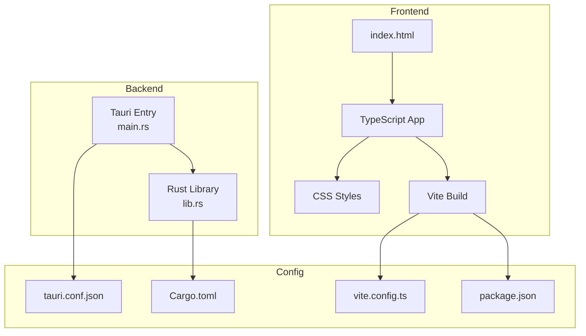
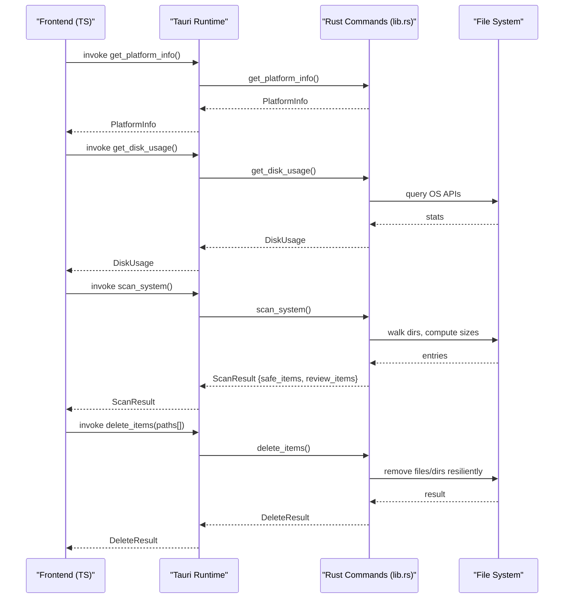
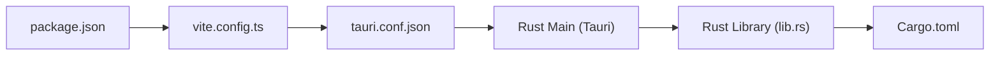

# Configuration and Customization

<cite>
**Referenced Files in This Document**
- [tauri.conf.json](file://src-tauri/tauri.conf.json)
- [Cargo.toml](file://src-tauri/Cargo.toml)
- [vite.config.ts](file://vite.config.ts)
- [lib.rs](file://src-tauri/src/lib.rs)
- [package.json](file://package.json)
- [README.md](file://README.md)
</cite>

## Table of Contents
1. [Introduction](#introduction)
2. [Project Structure](#project-structure)
3. [Core Components](#core-components)
4. [Architecture Overview](#architecture-overview)
5. [Detailed Component Analysis](#detailed-component-analysis)
6. [Dependency Analysis](#dependency-analysis)
7. [Performance Considerations](#performance-considerations)
8. [Troubleshooting Guide](#troubleshooting-guide)
9. [Conclusion](#conclusion)
10. [Appendices](#appendices)

## Introduction
This document explains how to configure and customize FreeSpaceMacos, a Tauri 2 application that scans and cleans disk usage on macOS (with Windows support). It covers:
- Tauri configuration options in tauri.conf.json for window behavior, security policies, and bundle settings
- How to add new cache categories by editing the safe_items and review_items arrays in lib.rs
- Rust dependencies in Cargo.toml and how to extend functionality with new crates
- Vite configuration for frontend build customization
- Guidelines for customizing the glassmorphism theme, adding UI components, and extending safety classification logic
- Best practices for maintaining cross-platform compatibility and testing changes

## Project Structure
FreeSpaceMacos is a Tauri 2 app composed of:
- Frontend: TypeScript + HTML/CSS built with Vite
- Backend: Rust using Tauri commands for system scanning and file operations
- Configuration: tauri.conf.json for app packaging and windowing; vite.config.ts for frontend build; Cargo.toml for Rust dependencies

**Diagram sources**
- [tauri.conf.json:1-46](file://src-tauri/tauri.conf.json#L1-L46)
- [vite.config.ts:1-31](file://vite.config.ts#L1-L31)
- [Cargo.toml:1-29](file://src-tauri/Cargo.toml#L1-L29)
- [lib.rs:1-1100](file://src-tauri/src/lib.rs#L1-L1100)
- [package.json:1-22](file://package.json#L1-L22)

**Section sources**
- [README.md:1-74](file://README.md#L1-L74)

## Core Components
- Tauri app configuration: defines product metadata, dev/build commands, window properties, CSP policy, and bundle targets/icons
- Rust backend: exposes Tauri commands for platform info, disk usage, scanning, sub-item enumeration, and deletion
- Frontend build: Vite config tailored for Tauri dev server port and HMR
- Package management: npm scripts and dependencies for frontend tooling

Key responsibilities:
- Window and security configuration are centralized in tauri.conf.json
- Safety classification and scan results are defined in lib.rs via safe_items and review_items
- Dependencies and target-specific crates are declared in Cargo.toml
- Frontend development server and bundling are configured in vite.config.ts and package.json

**Section sources**
- [tauri.conf.json:1-46](file://src-tauri/tauri.conf.json#L1-L46)
- [lib.rs:1-1100](file://src-tauri/src/lib.rs#L1-L1100)
- [Cargo.toml:1-29](file://src-tauri/Cargo.toml#L1-L29)
- [vite.config.ts:1-31](file://vite.config.ts#L1-L31)
- [package.json:1-22](file://package.json#L1-L22)

## Architecture Overview
The app uses Tauri’s command pattern to bridge the frontend and Rust backend. The frontend requests disk usage and scan results; the backend computes sizes, categorizes items as Safe or NeedsReview, and returns structured data. Deletion operations are performed through a resilient delete pipeline that handles directories and files safely.

**Diagram sources**
- [lib.rs:328-399](file://src-tauri/src/lib.rs#L328-L399)
- [lib.rs:410-744](file://src-tauri/src/lib.rs#L410-L744)
- [lib.rs:783-786](file://src-tauri/src/lib.rs#L783-L786)
- [lib.rs:1056-1082](file://src-tauri/src/lib.rs#L1056-L1082)
- [lib.rs:1086-1099](file://src-tauri/src/lib.rs#L1086-L1099)

## Detailed Component Analysis

### Tauri Configuration (tauri.conf.json)
This file controls the app’s runtime and packaging behavior.

- Product and identity
  - productName: sets the app name
  - version: semantic version
  - identifier: unique bundle ID

- Build pipeline
  - beforeDevCommand: runs the frontend dev server
  - devUrl: local dev server URL used by Tauri
  - beforeBuildCommand: builds the frontend before packaging
  - frontendDist: path to the built frontend assets

- App and windows
  - withGlobalTauri: enables global Tauri API access from the renderer
  - windows[].label/title: window identity and title
  - width/height/minWidth/minHeight: initial and minimum window dimensions
  - center/resizable: default positioning and resizing behavior
  - titleBarStyle/hiddenTitle/decorations/transparent: macOS title bar and visual style

- Security
  - security.csp: content security policy; currently disabled (null)

- Bundle
  - active/targets: enable bundling and target all platforms
  - icon: list of icons for various formats and resolutions

Customization tips:
- Adjust window dimensions and titleBarStyle to match your UX goals
- Enable CSP by setting a strict policy string if you need stricter security
- Update icon paths when changing app branding

**Section sources**
- [tauri.conf.json:1-46](file://src-tauri/tauri.conf.json#L1-L46)

### Rust Backend and Safety Classification (lib.rs)
The backend defines data models and Tauri commands.

Data models:
- SafetyLevel: enum with Safe and NeedsReview
- CleanupItem: represents a scannable location with metadata and children
- SubCleanupItem: child entry within a directory
- DiskUsage: total/used/free space and percentage
- ScanResult: aggregates disk usage and categorized items
- DeleteResult: reports success, counts, freed bytes, and errors

Core functions:
- get_dir_size(path): calculates size and file count up to a depth limit
- expand_home(path_str): resolves ~ to home directory
- scan_children_direct(path): enumerates immediate children, skipping system artifacts
- scan_location(...): constructs a CleanupItem for a given path with category, icon, safety level, description, and tip
- is_category_root(path_str): determines if a path matches known root patterns for safe deletion
- delete_target(path): deletes files/directories with resilience and error reporting
- delete_dir_contents_resilient(path): recursively removes contents while tracking freed space and errors

Tauri commands:
- get_platform_info(): returns OS details
- get_disk_usage(): queries OS-specific APIs to compute disk stats
- scan_sub_items(path): lists sub-items under a directory
- scan_system(): builds safe_items and review_items based on predefined paths
- delete_items(paths[]): performs deletion across multiple paths

Adding new cache categories:
- To add a new category, append an item to either safe_items or review_items inside the appropriate scan_system implementation (macOS or Windows)
- Use scan_location with:
  - id: unique identifier
  - name: display name
  - path: user-resolved path (supports ~/)
  - category: grouping label
  - icon: emoji or icon token
  - safety_level: SafetyLevel::Safe or SafetyLevel::NeedsReview
  - description: explanation for users
  - safety_tip: guidance about impact and re-generation

Safety classification guidelines:
- Safe: caches/logs/temp that apps/system recreate automatically without data loss
- NeedsReview: developer artifacts, simulators, downloads, or large caches that may require regeneration or user confirmation

Cross-platform considerations:
- macOS and Windows have separate scan_system implementations
- Paths differ per OS; ensure correct expansion and normalization
- is_category_root supports both platforms by normalizing separators and case

Error handling:
- Filesystem operations return detailed errors collected in DeleteResult.errors
- Resilient deletion attempts removal and falls back to recursive cleanup when necessary

**Section sources**
- [lib.rs:8-66](file://src-tauri/src/lib.rs#L8-L66)
- [lib.rs:70-201](file://src-tauri/src/lib.rs#L70-L201)
- [lib.rs:203-324](file://src-tauri/src/lib.rs#L203-L324)
- [lib.rs:328-399](file://src-tauri/src/lib.rs#L328-L399)
- [lib.rs:410-744](file://src-tauri/src/lib.rs#L410-L744)
- [lib.rs:748-786](file://src-tauri/src/lib.rs#L748-L786)
- [lib.rs:790-1054](file://src-tauri/src/lib.rs#L790-L1054)
- [lib.rs:1056-1082](file://src-tauri/src/lib.rs#L1056-L1082)
- [lib.rs:1086-1099](file://src-tauri/src/lib.rs#L1086-L1099)

### Cargo Dependencies (Cargo.toml)
Declares Rust dependencies and target-specific features.

- Core dependencies:
  - tauri: framework integration
  - tauri-plugin-opener: opens external URLs/files
  - serde/serde_json: serialization/deserialization
  - walkdir: directory traversal
  - trash: optional trash integration (if enabled)
  - dirs: home directory resolution

- Target-specific:
  - macos: libc for low-level filesystem calls
  - windows: windows-sys for Win32 filesystem APIs

Extending functionality:
- Add new crates under [dependencies]
- For platform-specific code, use [target.'cfg(target_os = "...")'.dependencies]
- Ensure any new native libraries are available on supported platforms

**Section sources**
- [Cargo.toml:1-29](file://src-tauri/Cargo.toml#L1-L29)

### Vite Configuration (vite.config.ts)
Tailors the frontend build for Tauri development.

- Port and host:
  - server.port: fixed dev server port for Tauri
  - server.strictPort: ensures build fails if port is unavailable
  - server.host: uses TAURI_DEV_HOST env var when present

- HMR:
  - protocol/host/port configured when running under Tauri dev

- Watch exclusions:
  - ignored: excludes src-tauri from Vite watch to avoid unnecessary rebuilds

Customization tips:
- Change port if conflicting with other services
- Configure proxy rules if integrating with external APIs during development
- Extend plugins or optimize build output as needed

**Section sources**
- [vite.config.ts:1-31](file://vite.config.ts#L1-L31)

### Frontend Scripts and Dependencies (package.json)
Defines npm scripts and frontend dependencies.

- Scripts:
  - dev: starts Vite dev server
  - build: compiles TypeScript and builds frontend assets
  - preview: previews built assets
  - tauri: invokes Tauri CLI

- Dependencies:
  - @tauri-apps/api and plugin-opener for interop
  - @tauri-apps/cli for Tauri tooling
  - vite and typescript for build toolchain

Extending the frontend:
- Add new UI components in the frontend source tree
- Integrate Tauri commands via @tauri-apps/api
- Manage additional packages under dependencies or devDependencies

**Section sources**
- [package.json:1-22](file://package.json#L1-L22)

## Dependency Analysis
The following diagram shows how configuration and build tools relate to each other.

**Diagram sources**
- [package.json:1-22](file://package.json#L1-L22)
- [vite.config.ts:1-31](file://vite.config.ts#L1-L31)
- [tauri.conf.json:1-46](file://src-tauri/tauri.conf.json#L1-L46)
- [Cargo.toml:1-29](file://src-tauri/Cargo.toml#L1-L29)
- [lib.rs:1086-1099](file://src-tauri/src/lib.rs#L1086-L1099)

**Section sources**
- [package.json:1-22](file://package.json#L1-L22)
- [vite.config.ts:1-31](file://vite.config.ts#L1-L31)
- [tauri.conf.json:1-46](file://src-tauri/tauri.conf.json#L1-L46)
- [Cargo.toml:1-29](file://src-tauri/Cargo.toml#L1-L29)
- [lib.rs:1086-1099](file://src-tauri/src/lib.rs#L1086-L1099)

## Performance Considerations
- Directory scanning limits depth to reduce overhead on large trees
- Size computation filters out zero-size entries to avoid unnecessary work
- Deletion routines aggregate freed bytes and counts, minimizing repeated metadata reads
- Vite ignores Rust source changes to prevent redundant frontend rebuilds during development

[No sources needed since this section provides general guidance]

## Troubleshooting Guide
Common issues and resolutions:
- Dev server port conflicts: adjust server.port in vite.config.ts or ensure no other process binds to the same port
- Missing icons or incorrect bundle: verify icon paths in tauri.conf.json and ensure they exist at build time
- Permission errors during deletion: some directories require elevated privileges; run with appropriate permissions or adjust paths
- CSP restrictions: if enabling CSP, ensure allowed resources and scripts comply with the policy
- Cross-platform path differences: confirm paths in scan_system match the target OS and normalize separators where necessary

**Section sources**
- [vite.config.ts:14-28](file://vite.config.ts#L14-L28)
- [tauri.conf.json:34-44](file://src-tauri/tauri.conf.json#L34-L44)
- [lib.rs:261-324](file://src-tauri/src/lib.rs#L261-L324)
- [lib.rs:1056-1082](file://src-tauri/src/lib.rs#L1056-L1082)

## Conclusion
FreeSpaceMacos offers a robust, configurable foundation for disk cleanup and analysis. By adjusting tauri.conf.json, extending lib.rs with new categories, updating Cargo.toml dependencies, and customizing Vite and frontend assets, you can tailor the app to your workflow. Follow the safety classification guidelines and test changes across platforms to maintain reliability and performance.

[No sources needed since this section summarizes without analyzing specific files]

## Appendices

### Adding New Cache Categories: Step-by-Step
- Identify the target OS implementation of scan_system in lib.rs
- Choose whether the new category is Safe or NeedsReview
- Append a new scan_location call with:
  - Unique id
  - Human-readable name
  - Path (supports ~/)
  - Category label
  - Icon token
  - SafetyLevel
  - Description and safety tip
- Validate that the path exists and has non-zero size; items are filtered accordingly

**Section sources**
- [lib.rs:410-744](file://src-tauri/src/lib.rs#L410-L744)
- [lib.rs:790-1054](file://src-tauri/src/lib.rs#L790-L1054)

### Customizing the Glassmorphism Theme
- Modify CSS styles in the frontend to adjust colors, blur, and transparency
- Align with macOS design principles for vibrancy and dark mode
- Test visually across different window decorations and title bar styles defined in tauri.conf.json

**Section sources**
- [tauri.conf.json:12-32](file://src-tauri/tauri.conf.json#L12-L32)

### Extending Safety Classification Logic
- Review is_category_root to understand which paths trigger resilient deletion
- If introducing new safe roots, update the normalized path checks to include them
- Ensure descriptions and tips accurately reflect the impact of deletion

**Section sources**
- [lib.rs:203-259](file://src-tauri/src/lib.rs#L203-L259)
- [lib.rs:261-324](file://src-tauri/src/lib.rs#L261-L324)