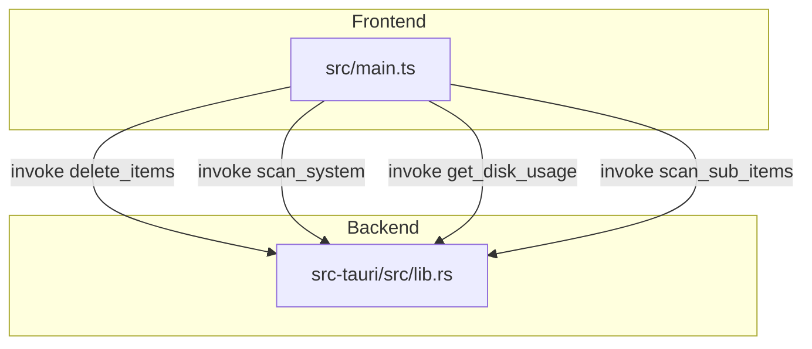
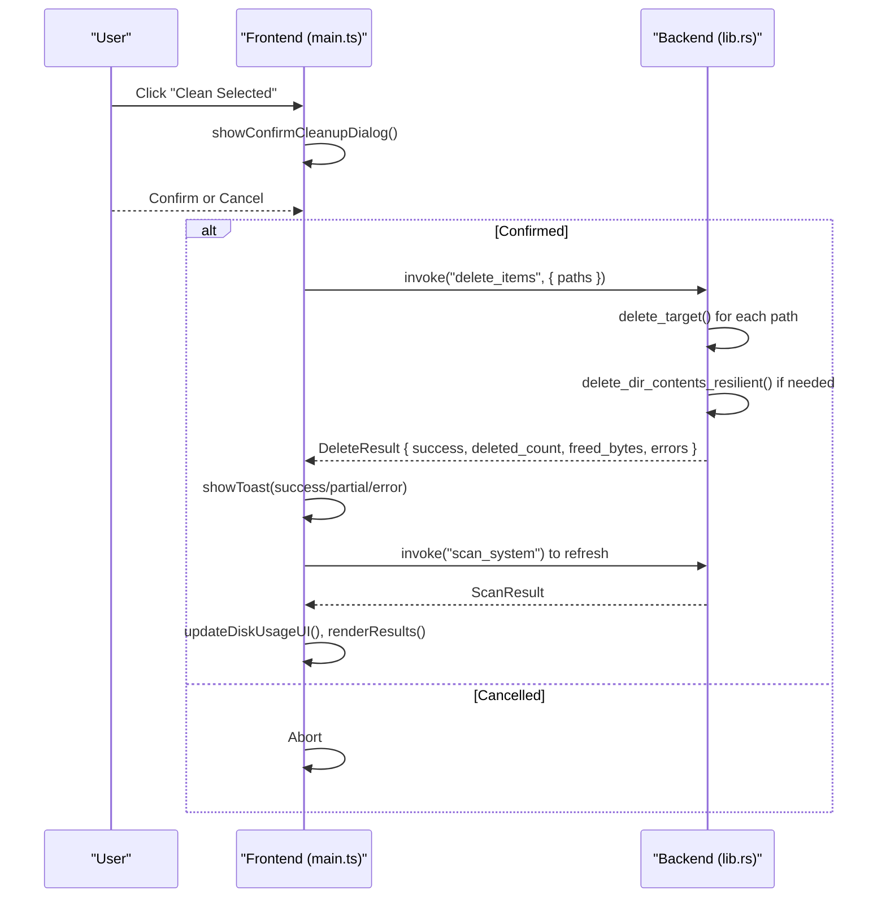
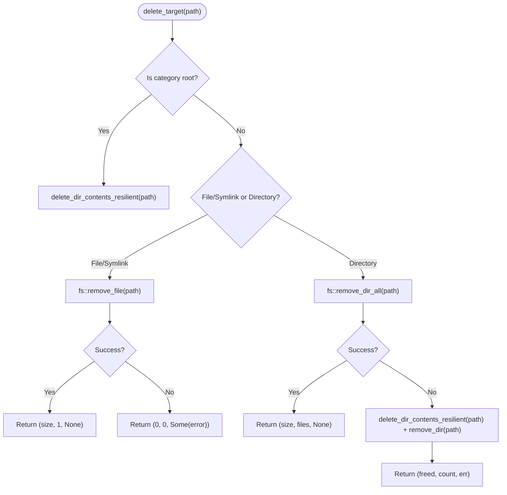
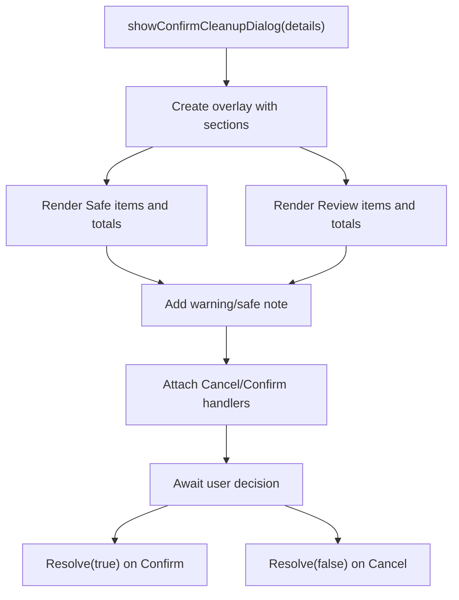
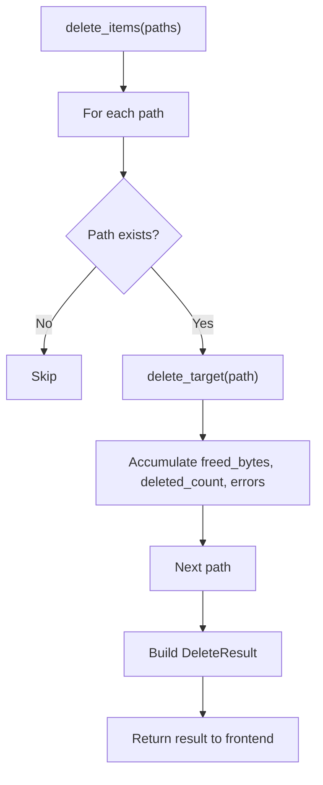
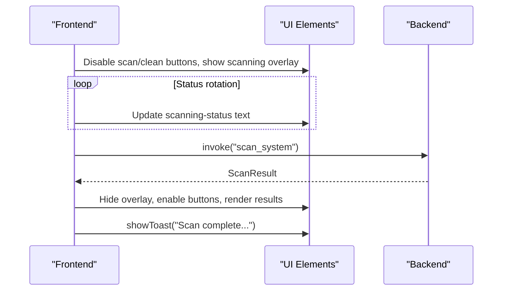
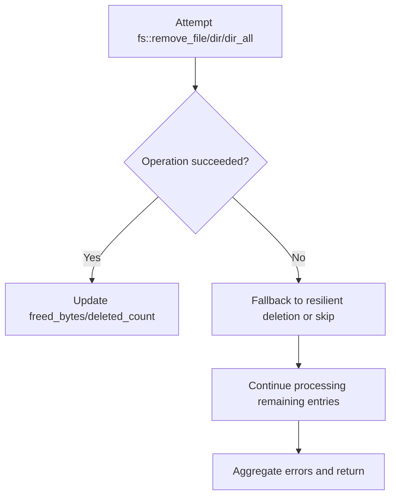
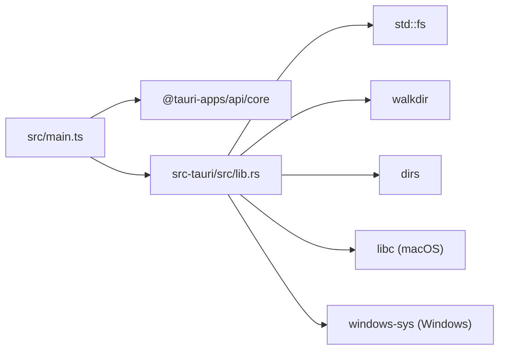

# Cleanup Operations

<cite>
**Referenced Files in This Document**
- [README.md](file://README.md)
- [main.ts](file://src/main.ts)
- [lib.rs](file://src-tauri/src/lib.rs)
</cite>

## Table of Contents
1. [Introduction](#introduction)
2. [Project Structure](#project-structure)
3. [Core Components](#core-components)
4. [Architecture Overview](#architecture-overview)
5. [Detailed Component Analysis](#detailed-component-analysis)
6. [Dependency Analysis](#dependency-analysis)
7. [Performance Considerations](#performance-considerations)
8. [Troubleshooting Guide](#troubleshooting-guide)
9. [Conclusion](#conclusion)

## Introduction
This document explains the cleanup operations system that safely removes user caches, logs, developer artifacts, and other reclaimable data across macOS and Windows. It focuses on resilient deletion with fallback mechanisms, the confirmation dialog that provides detailed breakdowns before deletion, error handling strategies including graceful degradation, progress tracking and feedback systems, and security considerations for system-level file operations.

The application is a Tauri 2 app built with Rust (backend) and TypeScript/HTML/CSS (frontend). The backend performs scanning and deletion using safe, platform-aware logic; the frontend presents results, selection states, confirmation dialogs, and user feedback via toasts.

**Section sources**
- [README.md:1-74](file://README.md#L1-L74)

## Project Structure
At a high level:
- Frontend (TypeScript): UI state management, tree selection model, confirmation dialog, toast notifications, and invoking backend commands.
- Backend (Rust): Disk usage queries, scan definitions per platform, directory traversal, and resilient deletion routines exposed as Tauri commands.

**Diagram sources**
- [main.ts:837-940](file://src/main.ts#L837-L940)
- [lib.rs:328-408](file://src-tauri/src/lib.rs#L328-L408)
- [lib.rs:1056-1099](file://src-tauri/src/lib.rs#L1056-L1099)

**Section sources**
- [main.ts:1-120](file://src/main.ts#L1-L120)
- [lib.rs:1-67](file://src-tauri/src/lib.rs#L1-L67)

## Core Components
- Resilient deletion engine:
  - delete_target(): Determines whether to remove files, symlinks, directories, or category roots, and applies appropriate deletion strategy.
  - delete_dir_contents_resilient(): Iterates directory contents, deletes files and recursively handles nested directories, collecting freed bytes and errors.
- Confirmation dialog system:
  - showConfirmCleanupDialog(): Presents a detailed breakdown of selected items grouped by safety level, total reclaimable space, and item counts.
- Error handling and feedback:
  - Toast notifications for success, partial success, and errors.
  - Aggregated DeleteResult with success flag, deleted_count, freed_bytes, and errors list.
- Progress tracking and UI updates:
  - Scanning overlay with rotating status messages.
  - Action bar showing selected count and size, disabled during deletion.

**Section sources**
- [lib.rs:261-324](file://src-tauri/src/lib.rs#L261-L324)
- [lib.rs:1056-1082](file://src-tauri/src/lib.rs#L1056-L1082)
- [main.ts:146-243](file://src/main.ts#L146-L243)
- [main.ts:837-940](file://src/main.ts#L837-L940)

## Architecture Overview
The cleanup flow integrates frontend user interactions with backend file system operations through Tauri commands.

**Diagram sources**
- [main.ts:900-940](file://src/main.ts#L900-L940)
- [lib.rs:1056-1082](file://src-tauri/src/lib.rs#L1056-L1082)
- [lib.rs:301-324](file://src-tauri/src/lib.rs#L301-L324)
- [lib.rs:261-299](file://src-tauri/src/lib.rs#L261-L299)

## Detailed Component Analysis

### Resilient Deletion Engine
- delete_target(path):
  - If path matches a known category root, delegates to delete_dir_contents_resilient().
  - For files or symlinks, attempts direct removal and returns size/count or an error message.
  - For directories, tries fs::remove_dir_all(); if it fails, falls back to delete_dir_contents_resilient() and then attempts to remove the empty directory.
- delete_dir_contents_resilient(path):
  - Reads directory entries, skipping unreadable ones.
  - For directories: computes size/file count, attempts recursive removal; if unsuccessful, recurses into children, accumulates freed bytes and errors, then attempts to remove the parent directory.
  - For files: reads metadata size, attempts removal, and accumulates freed bytes and counts.
  - Returns aggregated freed_bytes, deleted_count, and last_err.

**Diagram sources**
- [lib.rs:301-324](file://src-tauri/src/lib.rs#L301-L324)
- [lib.rs:261-299](file://src-tauri/src/lib.rs#L261-L299)

**Section sources**
- [lib.rs:261-324](file://src-tauri/src/lib.rs#L261-L324)

### Confirmation Dialog System
- showConfirmCleanupDialog(details):
  - Builds a modal overlay with sections for “Safe to Clean” and “Needs Review”.
  - Displays total reclaimable space, item counts, and per-item sizes.
  - Provides contextual warnings when review items are included.
  - Returns a Promise<boolean] resolved on user action (Cancel/Confirm).

**Diagram sources**
- [main.ts:146-243](file://src/main.ts#L146-L243)

**Section sources**
- [main.ts:146-243](file://src/main.ts#L146-L243)

### Error Handling Strategies
- Graceful degradation:
  - When fs::remove_dir_all fails, delete_target falls back to delete_dir_contents_resilient to salvage deletions where possible.
  - Individual file/directory failures are recorded in errors without aborting the entire batch.
- Retry mechanisms:
  - No explicit retry loops are implemented; resilience comes from targeted fallbacks and per-item error aggregation.
- Feedback:
  - Frontend shows success toast when any bytes are freed or all items succeed.
  - Shows error toast when errors exist, displaying the first error message.

**Diagram sources**
- [lib.rs:1056-1082](file://src-tauri/src/lib.rs#L1056-L1082)

**Section sources**
- [lib.rs:1056-1082](file://src-tauri/src/lib.rs#L1056-L1082)
- [main.ts:921-940](file://src/main.ts#L921-L940)

### Progress Tracking and Feedback Systems
- Scanning progress:
  - A rotating status message cycles through platform-specific hints while scanning.
  - Scanning overlay hides results until completion.
- Selection UI:
  - Action bar displays selected count and size; disables clean button during deletion.
- Toast notifications:
  - Success toast after successful cleanup.
  - Error toast when issues occur.
  - Info toast after scan completion.

**Diagram sources**
- [main.ts:837-896](file://src/main.ts#L837-L896)

**Section sources**
- [main.ts:837-896](file://src/main.ts#L837-L896)
- [main.ts:123-142](file://src/main.ts#L123-L142)

### Security Considerations and Permission Requirements
- Category root protection:
  - Category roots are explicitly recognized to ensure only intended directories are cleaned via resilient deletion.
- Platform-specific paths:
  - Paths are normalized and validated against known safe/review categories to avoid accidental deletion of unrelated files.
- Permission requirements:
  - Deleting system temp folders or recycle bin may require elevated privileges on Windows.
  - Some directories may be locked by running applications; deletion will fail gracefully and report errors.
- Safety levels:
  - Items are categorized as “Safe” or “Needs Review”, guiding users to understand risks before deletion.

**Section sources**
- [lib.rs:203-259](file://src-tauri/src/lib.rs#L203-L259)
- [lib.rs:420-732](file://src-tauri/src/lib.rs#L420-L732)
- [lib.rs:800-1042](file://src-tauri/src/lib.rs#L800-L1042)

### Examples of Handling Permission Errors and Recovery Strategies
- Permission denied on a file:
  - delete_dir_contents_resilient skips the entry and continues processing others.
  - The error is not surfaced immediately; aggregated errors are returned to the frontend.
- Locked directory:
  - fs::remove_dir_all fails; delete_target falls back to delete_dir_contents_resilient to remove what it can, then attempts to remove the now-empty directory.
- Frontend response:
  - If any errors occurred, a toast informs the user about issues; otherwise, a success toast reports freed space and item count.

**Diagram sources**
- [lib.rs:261-299](file://src-tauri/src/lib.rs#L261-L299)
- [lib.rs:301-324](file://src-tauri/src/lib.rs#L301-L324)
- [main.ts:921-940](file://src/main.ts#L921-L940)

**Section sources**
- [lib.rs:261-324](file://src-tauri/src/lib.rs#L261-L324)
- [main.ts:921-940](file://src/main.ts#L921-L940)

## Dependency Analysis
Key dependencies between components:
- Frontend main.ts depends on Tauri core API to invoke backend commands.
- Backend lib.rs uses std::fs, walkdir, dirs, and platform-specific crates (libc, windows-sys) for disk operations.
- Tauri command registration wires frontend invocations to backend functions.

**Diagram sources**
- [main.ts:1-2](file://src/main.ts#L1-L2)
- [lib.rs:1-4](file://src-tauri/src/lib.rs#L1-L4)
- [lib.rs:328-408](file://src-tauri/src/lib.rs#L328-L408)
- [lib.rs:1086-1099](file://src-tauri/src/lib.rs#L1086-L1099)

**Section sources**
- [main.ts:1-2](file://src/main.ts#L1-L2)
- [lib.rs:1-4](file://src-tauri/src/lib.rs#L1-L4)
- [lib.rs:328-408](file://src-tauri/src/lib.rs#L328-L408)
- [lib.rs:1086-1099](file://src-tauri/src/lib.rs#L1086-L1099)

## Performance Considerations
- Directory size calculation:
  - Uses WalkDir with max_depth(10) to limit traversal depth and avoid excessive recursion.
- Efficient iteration:
  - Filtering and mapping directory entries to compute sizes and file counts efficiently.
- Avoiding redundant scans:
  - Sub-items are loaded lazily when expanding nodes in the UI.
- Batch deletion:
  - Aggregating freed bytes and counts reduces overhead compared to per-item UI updates.

[No sources needed since this section provides general guidance]

## Troubleshooting Guide
Common issues and resolutions:
- Permission errors:
  - Symptoms: Toast indicates finished with issues; some items remain undeleted.
  - Resolution: Run the app with elevated privileges (especially on Windows for system temp/recycle bin), close applications holding locks, then retry.
- Locked files:
  - Symptoms: Specific files cannot be removed; resilient deletion proceeds with others.
  - Resolution: Close the locking application or reboot, then re-run cleanup.
- Empty or missing directories:
  - Symptoms: No reclaimable space found for a category.
  - Resolution: Verify the category path exists; some caches may be absent depending on usage.

**Section sources**
- [main.ts:921-940](file://src/main.ts#L921-L940)
- [lib.rs:261-324](file://src-tauri/src/lib.rs#L261-L324)

## Conclusion
The cleanup operations system combines a robust backend with a user-friendly frontend to deliver safe, resilient deletion across platforms. Key strengths include:
- Targeted deletion strategies via delete_target and delete_dir_contents_resilient.
- Transparent confirmation dialog providing detailed breakdowns and safety context.
- Graceful error handling with aggregated reporting and partial success support.
- Clear progress indicators and feedback to keep users informed throughout the process.
- Security-conscious design with category root checks and safety level categorization.

[No sources needed since this section summarizes without analyzing specific files]