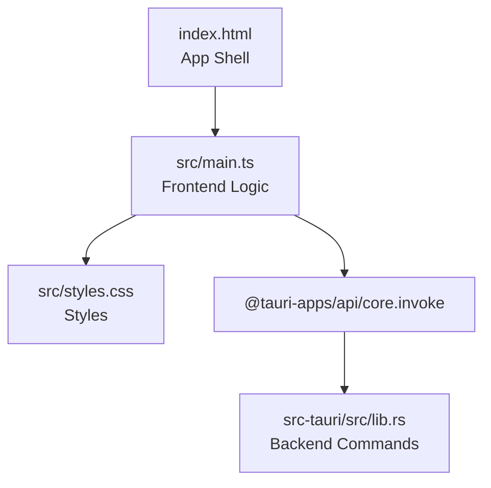
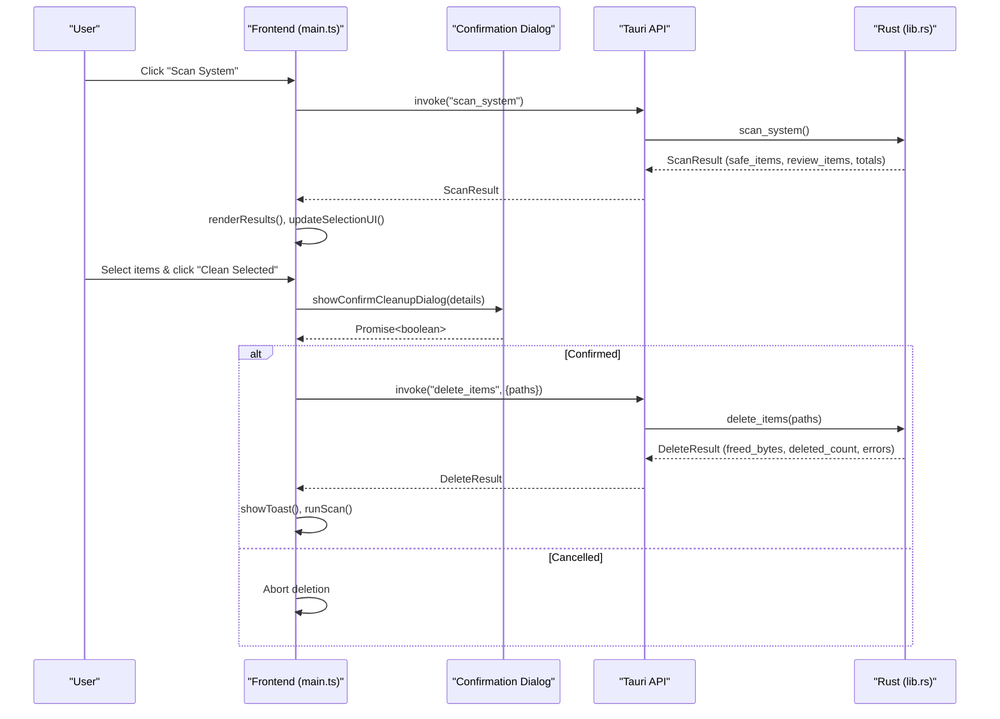
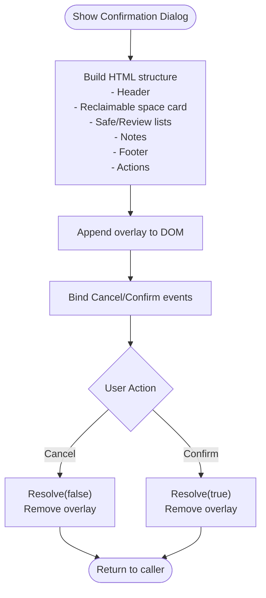
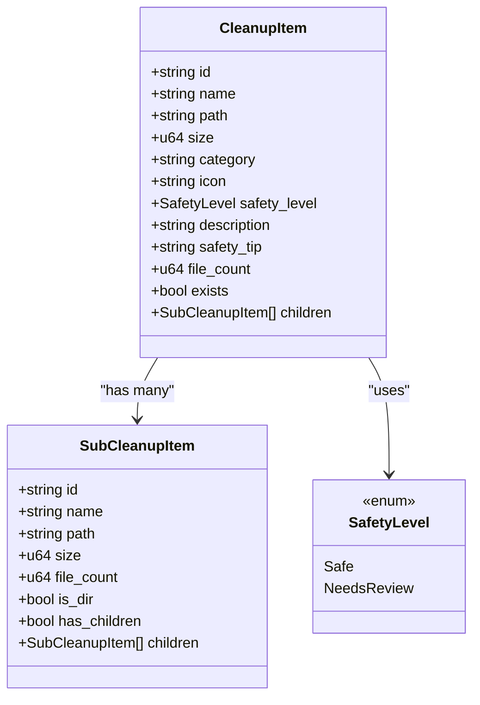
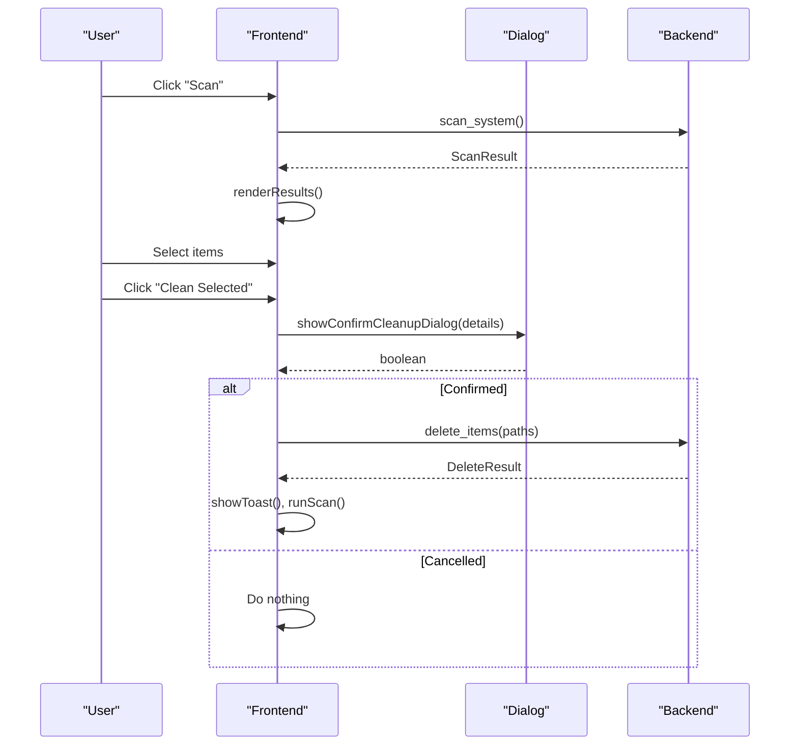
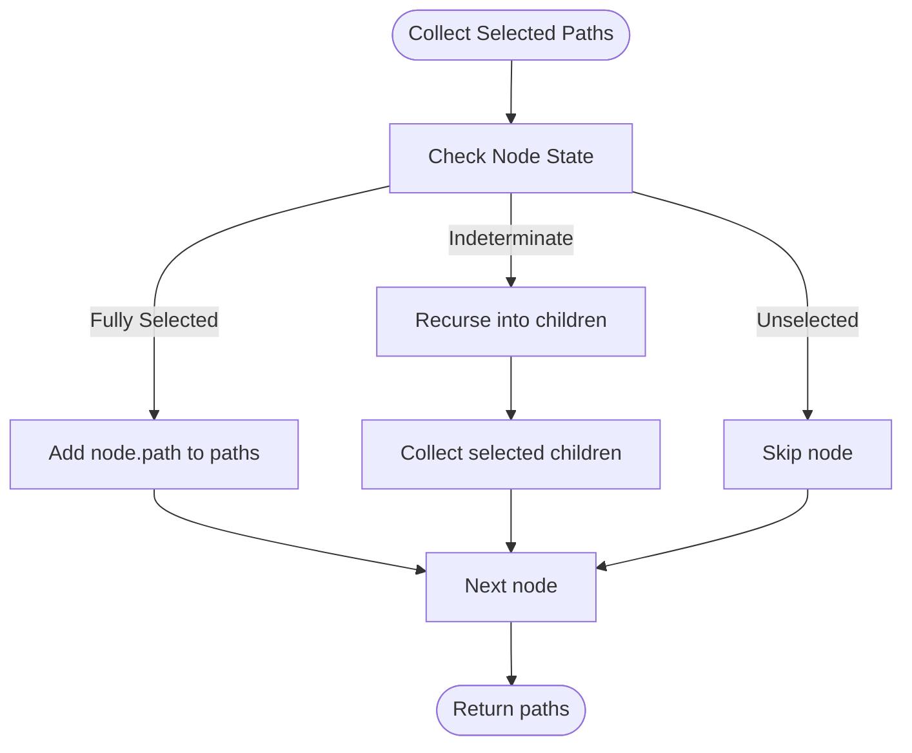
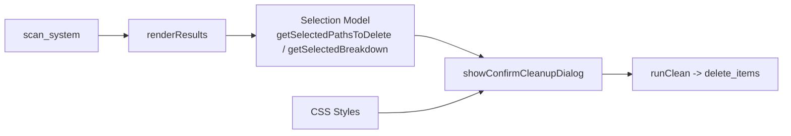

# Confirmation Dialogs

<cite>
**Referenced Files in This Document**   
- [index.html](file://index.html)
- [main.ts](file://src/main.ts)
- [styles.css](file://src/styles.css)
- [lib.rs](file://src-tauri/src/lib.rs)
- [README.md](file://README.md)
</cite>

## Table of Contents
1. [Introduction](#introduction)
2. [Project Structure](#project-structure)
3. [Core Components](#core-components)
4. [Architecture Overview](#architecture-overview)
5. [Detailed Component Analysis](#detailed-component-analysis)
6. [Dependency Analysis](#dependency-analysis)
7. [Performance Considerations](#performance-considerations)
8. [Troubleshooting Guide](#troubleshooting-guide)
9. [Conclusion](#conclusion)

## Introduction
This document explains the confirmation dialog system that presents users with a detailed breakdown before deletion. It covers how categorized cleanup targets are displayed with size information and safety classifications, the user interaction flow from scan results to final confirmation, real-time updates during deletion, customization options for dialogs, handling of cancellations or partial confirmations, accessibility considerations, and internationalization support.

The application is a macOS/Windows storage cleanup tool built with Tauri 2 (Rust backend + TypeScript frontend). The confirmation dialog is implemented as an in-app overlay that summarizes selected items by safety category and prompts explicit confirmation before deletion.

**Section sources**
- [README.md:1-74](file://README.md#L1-L74)

## Project Structure
At a high level:
- HTML defines the app shell, including sections for disk usage, scanning, results, action bar, and toast notifications.
- TypeScript implements state management, tree selection logic, UI rendering, and the confirmation dialog.
- CSS provides styling for all UI elements, including the confirmation dialog.
- Rust exposes commands for platform info, disk usage, scanning, sub-item loading, and deletion.

**Diagram sources**
- [index.html:1-141](file://index.html#L1-L141)
- [main.ts:1-1009](file://src/main.ts#L1-L1009)
- [styles.css:1-1298](file://src/styles.css#L1-L1298)
- [lib.rs:1-1100](file://src-tauri/src/lib.rs#L1-L1100)

**Section sources**
- [index.html:1-141](file://index.html#L1-L141)
- [main.ts:1-1009](file://src/main.ts#L1-L1009)
- [styles.css:1-1298](file://src/styles.css#L1-L1298)
- [lib.rs:1-1100](file://src-tauri/src/lib.rs#L1-L1100)

## Core Components
- Confirmation dialog overlay: dynamically created modal showing categorized cleanup targets, total reclaimable space, and safety notes.
- Selection model: hierarchical tree nodes representing categories and sub-items with tri-state checkboxes (selected, indeterminate, unselected).
- Scan pipeline: invokes backend to compute disk usage and categorize cleanup targets into “Safe” and “Needs Review.”
- Deletion pipeline: after confirmation, calls backend to delete selected paths and reports freed bytes and errors.

Key responsibilities:
- Frontend constructs the confirmation dialog with safe/review item lists and sizes.
- Backend classifies items by safety level and computes sizes and file counts.
- Styling differentiates safe vs review categories visually.

**Section sources**
- [main.ts:80-85](file://src/main.ts#L80-L85)
- [main.ts:144-243](file://src/main.ts#L144-L243)
- [main.ts:270-414](file://src/main.ts#L270-L414)
- [lib.rs:8-66](file://src-tauri/src/lib.rs#L8-L66)
- [lib.rs:410-744](file://src-tauri/src/lib.rs#L410-L744)
- [lib.rs:1056-1082](file://src-tauri/src/lib.rs#L1056-L1082)

## Architecture Overview
The confirmation dialog integrates with the scan and delete flows:

**Diagram sources**
- [main.ts:837-896](file://src/main.ts#L837-L896)
- [main.ts:900-941](file://src/main.ts#L900-L941)
- [main.ts:144-243](file://src/main.ts#L144-L243)
- [lib.rs:410-744](file://src-tauri/src/lib.rs#L410-L744)
- [lib.rs:1056-1082](file://src-tauri/src/lib.rs#L1056-L1082)

## Detailed Component Analysis

### Confirmation Dialog Implementation
The confirmation dialog is rendered on demand when the user initiates cleanup. It shows:
- A highlighted card with total reclaimable space.
- Two categorized lists:
  - Safe to Clean: green badge, summary text indicating automatic regeneration.
  - Needs Review: amber badge, summary text warning about potential rebuild/download requirements.
- A contextual note:
  - If any review items are present, a warning note appears.
  - Otherwise, a safe note reassures the user.
- Footer text summarizing the number of items/folders to be removed.
- Actions: Cancel and Confirm buttons.

Customization points:
- Group titles and badges can be styled via CSS classes (.dialog-group-title.safe|.review).
- Warning/safe notes are conditionally injected based on presence of review items.
- Button labels include dynamic reclaimable space formatting.

Cancellation and partial confirmation:
- Cancel resolves the promise with false; no deletion occurs.
- Confirm resolves true; deletion proceeds.
- Partial selections (indeterminate states) are handled by collecting only fully checked roots or recursing into children to gather selected sub-items.

Accessibility considerations:
- Buttons are native interactive elements with clear labels.
- Overlay uses backdrop blur and contrast colors for visibility.
- No explicit aria attributes are present in the implementation; adding roles and labels would improve screen reader support.

Internationalization:
- Some UI strings are hardcoded in English within the dialog (e.g., “Confirm Space Cleanup”, “Cancel”, “Clean X GB”).
- Other parts of the app use localized strings (Vietnamese) in HTML and comments; the dialog currently does not switch language at runtime.

**Diagram sources**
- [main.ts:144-243](file://src/main.ts#L144-L243)
- [styles.css:987-1174](file://src/styles.css#L987-L1174)

**Section sources**
- [main.ts:144-243](file://src/main.ts#L144-L243)
- [styles.css:987-1174](file://src/styles.css#L987-L1174)

### Categorized Cleanup Targets and Safety Classifications
The backend classifies cleanup targets into two safety levels:
- Safe: automatically regenerated caches/logs/trash/browser caches, etc.
- Needs Review: build artifacts, simulators, downloads, AI models, developer caches, Docker data, etc.

Each category includes:
- Name, path, icon, description, safety tip, file count, existence flag, and children list.
- Size computed recursively up to a depth limit.

Frontend renders these as top-level nodes with expandable children. Children are loaded lazily via a backend command.

**Diagram sources**
- [lib.rs:8-66](file://src-tauri/src/lib.rs#L8-L66)
- [lib.rs:163-201](file://src-tauri/src/lib.rs#L163-L201)

**Section sources**
- [lib.rs:8-66](file://src-tauri/src/lib.rs#L8-L66)
- [lib.rs:163-201](file://src-tauri/src/lib.rs#L163-L201)
- [lib.rs:410-744](file://src-tauri/src/lib.rs#L410-L744)

### User Interaction Flow: From Scan Results to Final Confirmation
1. User clicks “Scan System.”
2. Frontend invokes backend scan_system and displays progress overlay.
3. Backend returns ScanResult with categorized items and totals.
4. Frontend renders results, builds tree nodes, and updates selection UI.
5. User selects items (tri-state checkboxes propagate selection across hierarchy).
6. User clicks “Clean Selected.”
7. Frontend builds details (total size, paths, safe/review breakdown) and shows confirmation dialog.
8. If confirmed, frontend invokes delete_items with selected paths.
9. Backend deletes targets resiliently, aggregates freed bytes and errors.
10. Frontend shows toast feedback and re-scans to reflect changes.

**Diagram sources**
- [main.ts:837-896](file://src/main.ts#L837-L896)
- [main.ts:900-941](file://src/main.ts#L900-L941)
- [lib.rs:410-744](file://src-tauri/src/lib.rs#L410-L744)
- [lib.rs:1056-1082](file://src-tauri/src/lib.rs#L1056-L1082)

**Section sources**
- [main.ts:837-896](file://src/main.ts#L837-L896)
- [main.ts:900-941](file://src/main.ts#L900-L941)

### Real-Time Updates During Deletion
- After successful deletion, the frontend shows a success toast with freed bytes and item count.
- It then triggers a fresh scan to refresh disk usage and results.
- Errors are surfaced via error toasts if any occurred during deletion.

Note: There is no per-file progress indicator; updates occur post-operation.

**Section sources**
- [main.ts:921-941](file://src/main.ts#L921-L941)
- [lib.rs:1056-1082](file://src-tauri/src/lib.rs#L1056-L1082)

### Customization Options for the Confirmation Dialog
- Visual grouping:
  - Safe group title and badge color via .dialog-group-title.safe.
  - Review group title and badge color via .dialog-group-title.review.
- Highlight card:
  - Background, border, and typography controlled by .dialog-highlight-card and related classes.
- Lists:
  - Scrollable container with custom scrollbar styles under .dialog-list-container.
- Notes:
  - Warning note style .dialog-warning-note for review items.
  - Safe note style .dialog-safe-note for purely safe selections.
- Actions:
  - Cancel button style .dialog-btn.cancel.
  - Confirm button style .dialog-btn.confirm.

These styles allow consistent theming and easy adjustments without modifying JavaScript.

**Section sources**
- [styles.css:987-1174](file://src/styles.css#L987-L1174)

### Handling User Cancellations and Partial Confirmations
- Cancellation:
  - The dialog’s cancel button resolves the promise with false; the caller aborts deletion.
- Partial confirmations:
  - Tri-state checkboxes represent full selection, partial selection (indeterminate), or none.
  - When a parent node is partially selected, the frontend recurses into children to collect only fully checked leaves or directories.
  - getSelectedPathsToDelete and getSelectedBreakdown implement this logic.

**Diagram sources**
- [main.ts:338-361](file://src/main.ts#L338-L361)
- [main.ts:385-414](file://src/main.ts#L385-L414)

**Section sources**
- [main.ts:338-361](file://src/main.ts#L338-L361)
- [main.ts:385-414](file://src/main.ts#L385-L414)

### Accessibility Features
- Interactive elements:
  - Native buttons for actions (Scan, Clean, Cancel, Confirm).
  - Custom checkboxes styled but functionally driven by click handlers.
- Contrast and focus:
  - Dark theme with sufficient contrast for text and badges.
  - Hover and active states provide visual feedback.
- Limitations:
  - No explicit ARIA roles or labels on the dialog overlay or custom checkboxes.
  - Screen readers may not announce dialog content or checkbox states without additional markup.

Recommendations:
- Add role="dialog" and aria-modal="true" to the overlay.
- Associate aria-labels with buttons and checkboxes.
- Ensure keyboard navigation focuses the dialog and supports Escape to cancel.

**Section sources**
- [styles.css:987-1174](file://src/styles.css#L987-L1174)
- [main.ts:144-243](file://src/main.ts#L144-L243)

### Internationalization Support
- Current state:
  - The confirmation dialog contains hardcoded English strings (e.g., “Confirm Space Cleanup”, “Cancel”, “Clean X GB”).
  - Other UI elements use Vietnamese strings in HTML and comments.
- Implications:
  - Users switching languages will see mixed-language dialogs.
- Recommendations:
  - Extract all user-facing strings into a localization map keyed by language.
  - Update the dialog builder to select messages based on current locale.
  - Provide a language toggle and persist preference.

**Section sources**
- [main.ts:144-243](file://src/main.ts#L144-L243)
- [index.html:25-132](file://index.html#L25-L132)

## Dependency Analysis
The confirmation dialog depends on:
- Frontend state and selection model to compute details passed to the dialog.
- Backend classification and size computation to ensure accurate totals and categories.
- CSS for consistent visual presentation.

**Diagram sources**
- [main.ts:338-414](file://src/main.ts#L338-L414)
- [main.ts:144-243](file://src/main.ts#L144-L243)
- [main.ts:900-941](file://src/main.ts#L900-L941)
- [lib.rs:410-744](file://src-tauri/src/lib.rs#L410-L744)
- [styles.css:987-1174](file://src/styles.css#L987-L1174)

**Section sources**
- [main.ts:338-414](file://src/main.ts#L338-L414)
- [main.ts:144-243](file://src/main.ts#L144-L243)
- [main.ts:900-941](file://src/main.ts#L900-L941)
- [lib.rs:410-744](file://src-tauri/src/lib.rs#L410-L744)
- [styles.css:987-1174](file://src/styles.css#L987-L1174)

## Performance Considerations
- Lazy loading of sub-items reduces initial render cost.
- Recursive size calculation is bounded by depth limits to avoid excessive traversal.
- Deletion is resilient: it attempts direct removal first and falls back to recursive deletion, aggregating freed bytes and errors.
- Post-deletion re-scan ensures UI consistency but may incur I/O overhead; consider debouncing or caching where appropriate.

[No sources needed since this section provides general guidance]

## Troubleshooting Guide
Common issues and resolutions:
- Dialog does not appear:
  - Verify that selected paths exist and selection UI is updated.
  - Check console for errors in runClean and showConfirmCleanupDialog.
- Incorrect sizes or categories:
  - Validate backend scan logic and safety classifications.
  - Ensure children are loaded correctly via scan_sub_items.
- Deletion fails partially:
  - Inspect DeleteResult.errors and permissions.
  - Some paths may require elevated privileges (e.g., Windows Admin).
- UI not reflecting changes:
  - Ensure runScan is called after deletion to refresh disk usage and results.

**Section sources**
- [main.ts:921-941](file://src/main.ts#L921-L941)
- [lib.rs:1056-1082](file://src-tauri/src/lib.rs#L1056-L1082)

## Conclusion
The confirmation dialog system provides a clear, categorized breakdown of cleanup targets with size information and safety classifications. It integrates tightly with the scan and delete pipelines, ensuring users understand the impact of their choices before permanent deletion. While the current implementation offers robust functionality, improvements in accessibility and internationalization would enhance usability for diverse audiences.

[No sources needed since this section summarizes without analyzing specific files]