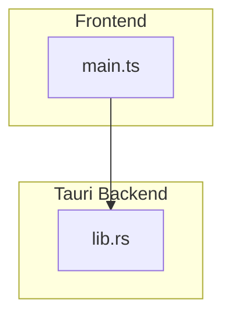
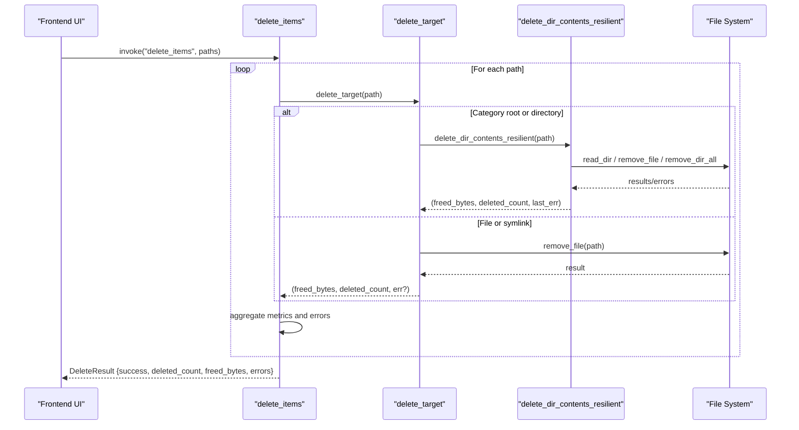
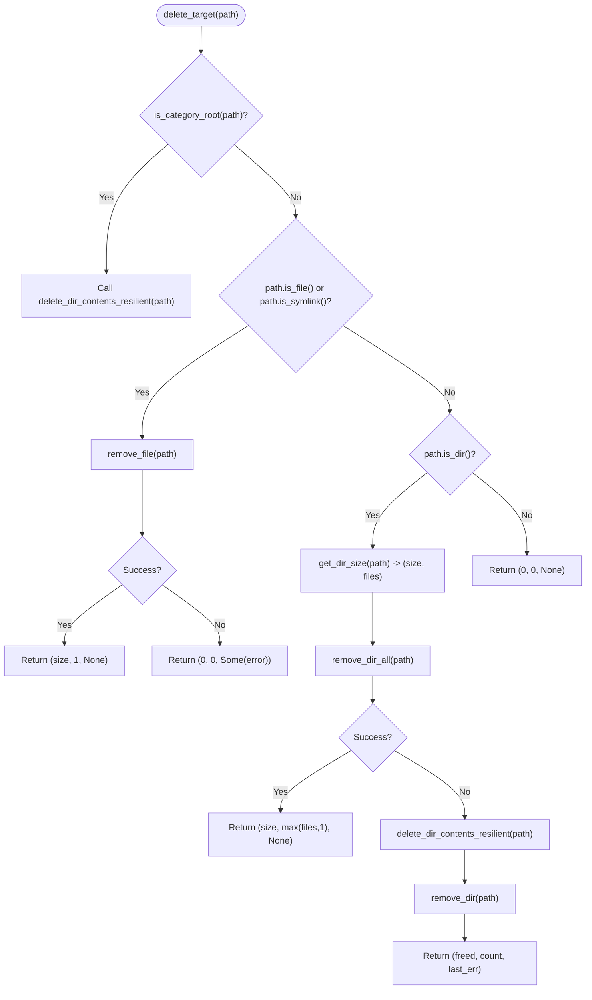
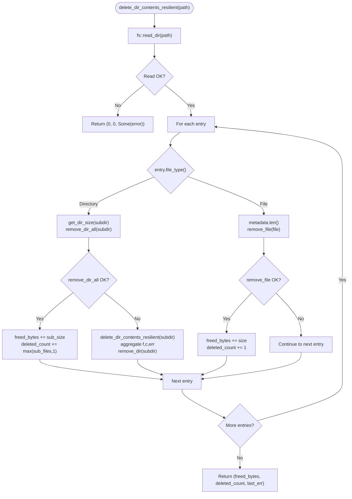
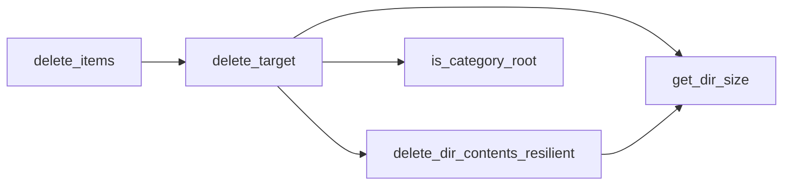

# Deletion Algorithms

<cite>
**Referenced Files in This Document**
- [lib.rs](file://src-tauri/src/lib.rs)
</cite>

## Table of Contents
1. [Introduction](#introduction)
2. [Project Structure](#project-structure)
3. [Core Components](#core-components)
4. [Architecture Overview](#architecture-overview)
5. [Detailed Component Analysis](#detailed-component-analysis)
6. [Dependency Analysis](#dependency-analysis)
7. [Performance Considerations](#performance-considerations)
8. [Troubleshooting Guide](#troubleshooting-guide)
9. [Conclusion](#conclusion)

## Introduction
This document explains the core deletion algorithms used by the application to safely and reliably remove files, directories, and symlinks while maximizing cleanup success. It focuses on two key functions:
- delete_target(): The entry point that decides how to delete a given path based on its type and category.
- delete_dir_contents_resilient(): A resilient recursive deletion helper for directory contents with fallback strategies.

The documentation covers decision logic for different file types, fallback mechanisms when primary deletion methods fail, recursive deletion strategy for complex directory structures, and how the system tracks freed bytes and deleted file counts. It also includes examples of error scenarios and best practices for maintaining system stability during cleanup.

## Project Structure
The deletion logic is implemented in the Tauri backend module. The relevant code resides in a single Rust source file that defines data models, helper utilities, and the deletion algorithms.

**Diagram sources**
- [lib.rs:1056-1082](file://src-tauri/src/lib.rs#L1056-L1082)
- [main.ts:900-935](file://src/main.ts#L900-L935)

**Section sources**
- [lib.rs:1-1100](file://src-tauri/src/lib.rs#L1-L1100)

## Core Components
- DeleteResult: Aggregates deletion outcomes including success flag, total deleted count, total freed bytes, and any errors encountered.
- get_dir_size(path): Computes total size and file count within a directory up to a safe depth limit.
- is_category_root(path_str): Determines if a path belongs to known safe-to-clean categories (e.g., caches, logs).
- delete_dir_contents_resilient(path): Iteratively deletes directory contents with robust fallbacks.
- delete_target(path): Dispatches deletion strategy based on path type and category.
- delete_items(paths): Tauri command that orchestrates deletion across multiple paths and aggregates results.

Key responsibilities:
- Type-based routing: files vs. directories vs. symlinks.
- Category-aware behavior: special handling for known cache/log roots.
- Resilience: fallback from bulk removal to item-by-item deletion.
- Metrics: accurate tracking of freed bytes and deleted file counts.

**Section sources**
- [lib.rs:60-66](file://src-tauri/src/lib.rs#L60-L66)
- [lib.rs:70-97](file://src-tauri/src/lib.rs#L70-L97)
- [lib.rs:203-259](file://src-tauri/src/lib.rs#L203-L259)
- [lib.rs:261-324](file://src-tauri/src/lib.rs#L261-L324)
- [lib.rs:1056-1082](file://src-tauri/src/lib.rs#L1056-L1082)

## Architecture Overview
The deletion workflow starts from the frontend invoking a Tauri command, which calls delete_items. For each selected path, delete_items delegates to delete_target. Depending on the path’s characteristics and whether it matches a known category root, delete_target either removes the target directly or falls back to delete_dir_contents_resilient for safer, iterative cleanup.

**Diagram sources**
- [lib.rs:1056-1082](file://src-tauri/src/lib.rs#L1056-L1082)
- [lib.rs:301-324](file://src-tauri/src/lib.rs#L301-L324)
- [lib.rs:261-299](file://src-tauri/src/lib.rs#L261-L299)

## Detailed Component Analysis

### delete_target(path)
Purpose:
- Decide the optimal deletion strategy based on path type and category.
- Return aggregated metrics: freed bytes, deleted file count, and optional error message.

Decision logic:
- If the path matches a known category root (e.g., caches/logs), delegate to delete_dir_contents_resilient to ensure safe, iterative cleanup.
- If the path is a file or symlink:
  - Attempt direct removal via remove_file.
  - On success, return the file’s size and a count of one; on failure, return an error message.
- If the path is a directory:
  - Compute total size and file count using get_dir_size.
  - Attempt bulk removal via remove_dir_all.
  - If bulk removal fails, fall back to delete_dir_contents_resilient to clean items individually and then attempt to remove the empty directory.

Metrics tracking:
- Freed bytes are accumulated from successful deletions.
- Deleted count increments per successfully removed file or directory (directories count at least once even if empty).

Error handling:
- Errors from failed operations are propagated as Option<String>.
- In fallback scenarios, partial successes still contribute to metrics.

**Diagram sources**
- [lib.rs:301-324](file://src-tauri/src/lib.rs#L301-L324)
- [lib.rs:70-97](file://src-tauri/src/lib.rs#L70-L97)
- [lib.rs:203-259](file://src-tauri/src/lib.rs#L203-L259)

**Section sources**
- [lib.rs:301-324](file://src-tauri/src/lib.rs#L301-L324)

### delete_dir_contents_resilient(path)
Purpose:
- Safely iterate through directory contents and delete them with resilience against failures.
- Accumulate freed bytes and deleted file counts across all successful operations.
- Propagate the last encountered error to inform callers about partial failures.

Algorithm overview:
- Read directory entries; if reading fails, return early with an error.
- For each entry:
  - If it is a directory:
    - Compute subdirectory size and file count via get_dir_size.
    - Attempt bulk removal with remove_dir_all.
    - If bulk removal succeeds, add sub_size to freed_bytes and increment deleted_count by max(sub_files, 1).
    - If bulk removal fails:
      - Recursively call delete_dir_contents_resilient on the subdirectory.
      - Aggregate returned freed_bytes and deleted_count.
      - Track last_err if present.
      - Attempt to remove the now-empty directory with remove_dir.
  - If it is a file:
    - Retrieve file size via metadata.
    - Attempt remove_file; on success, add size to freed_bytes and increment deleted_count by 1.

Complexity considerations:
- Time complexity: O(N + D) where N is the number of files and D is the number of directories traversed. Each file/dir is visited once; recursion handles nested structures.
- Space complexity: O(H) where H is the maximum recursion depth due to nested directories.

Error handling:
- Individual file/dir deletions are attempted independently; failures do not abort the entire operation.
- The function returns the last encountered error to signal partial failures without halting progress.

**Diagram sources**
- [lib.rs:261-299](file://src-tauri/src/lib.rs#L261-L299)
- [lib.rs:70-97](file://src-tauri/src/lib.rs#L70-L97)

**Section sources**
- [lib.rs:261-299](file://src-tauri/src/lib.rs#L261-L299)

### Supporting Helpers
- get_dir_size(path):
  - Uses WalkDir with a maximum depth to compute total size and file count.
  - Handles non-existent paths and single-file inputs efficiently.
- is_category_root(path_str):
  - Normalizes path separators and case for cross-platform compatibility.
  - Matches against a curated list of known cache/log directories.

These helpers enable accurate metrics and safe categorization for deletion decisions.

**Section sources**
- [lib.rs:70-97](file://src-tauri/src/lib.rs#L70-L97)
- [lib.rs:203-259](file://src-tauri/src/lib.rs#L203-L259)

## Dependency Analysis
The deletion pipeline has clear separation of concerns:
- delete_items orchestrates multiple targets and aggregates results.
- delete_target routes to appropriate deletion strategies.
- delete_dir_contents_resilient provides robust recursive cleanup.
- get_dir_size and is_category_root support metrics and policy decisions.

**Diagram sources**
- [lib.rs:261-324](file://src-tauri/src/lib.rs#L261-L324)
- [lib.rs:70-97](file://src-tauri/src/lib.rs#L70-L97)
- [lib.rs:203-259](file://src-tauri/src/lib.rs#L203-L259)
- [lib.rs:1056-1082](file://src-tauri/src/lib.rs#L1056-L1082)

**Section sources**
- [lib.rs:261-324](file://src-tauri/src/lib.rs#L261-L324)
- [lib.rs:1056-1082](file://src-tauri/src/lib.rs#L1056-L1082)

## Performance Considerations
- Depth-limited scanning: get_dir_size uses a maximum depth to avoid excessive traversal on deeply nested structures.
- Bulk vs. itemized deletion: Prefer bulk removal (remove_dir_all) for performance; fall back to itemized deletion only when necessary.
- Metadata caching: Avoid repeated metadata reads by computing sizes once per directory/file before attempting deletion.
- Error aggregation: Collecting errors rather than failing fast ensures maximum cleanup success and better user feedback.

[No sources needed since this section provides general guidance]

## Troubleshooting Guide
Common error scenarios and their handling:
- Permission denied:
  - Symptom: remove_file or remove_dir_all fails.
  - Behavior: delete_dir_contents_resilient continues processing other entries and records the last error.
  - Resolution: Run with elevated privileges or adjust file permissions.
- Path does not exist:
  - Symptom: fs::read_dir fails.
  - Behavior: Early return with an error; no metrics updated.
  - Resolution: Validate paths before deletion or handle missing paths gracefully in the caller.
- Partial deletion:
  - Symptom: Some files/directories succeed while others fail.
  - Behavior: Freed bytes and deleted counts reflect successful operations; last_err indicates issues.
  - Resolution: Review error messages and retry problematic items after addressing underlying causes.

Operational tips:
- Always check path existence before deletion to avoid unnecessary work.
- Use the DeleteResult.errors field to report actionable feedback to users.
- For large directories, expect longer runtimes due to recursive traversal and individual file operations.

**Section sources**
- [lib.rs:261-299](file://src-tauri/src/lib.rs#L261-L299)
- [lib.rs:301-324](file://src-tauri/src/lib.rs#L301-L324)
- [lib.rs:1056-1082](file://src-tauri/src/lib.rs#L1056-L1082)

## Conclusion
The deletion algorithms prioritize safety, resilience, and accuracy:
- delete_target makes informed decisions based on path type and category.
- delete_dir_contents_resilient ensures maximum cleanup success through iterative fallbacks and robust error handling.
- Metrics (freed bytes and deleted counts) are accurately tracked throughout the process.
- The design balances performance with reliability, making it suitable for complex directory structures while maintaining system stability.

[No sources needed since this section summarizes without analyzing specific files]