# Core Features Documentation

<cite>
**Referenced Files in This Document**
- [README.md](file://README.md)
- [index.html](file://index.html)
- [src/main.ts](file://src/main.ts)
- [src-tauri/src/lib.rs](file://src-tauri/src/lib.rs)
- [src-tauri/src/main.rs](file://src-tauri/src/main.rs)
- [package.json](file://package.json)
</cite>

## Update Summary
**Changes Made**
- Updated project description to reflect cross-platform support (macOS & Windows)
- Added comprehensive documentation for the new multi-tab interface
- Documented the Size Tree tab functionality for hierarchical directory exploration
- Documented the Large Files tab for finding oversized files across the system
- Enhanced architecture diagrams to show the new tab-based navigation
- Updated feature descriptions to include all three main tabs and their capabilities

## Table of Contents
1. [Introduction](#introduction)
2. [Project Structure](#project-structure)
3. [Core Components](#core-components)
4. [Architecture Overview](#architecture-overview)
5. [Detailed Component Analysis](#detailed-component-analysis)
6. [Dependency Analysis](#dependency-analysis)
7. [Performance Considerations](#performance-considerations)
8. [Troubleshooting Guide](#troubleshooting-guide)
9. [Conclusion](#conclusion)

## Introduction
FreeSpace is a modern, high-performance disk storage optimizer for macOS and Windows built with Tauri 2 (Rust + TypeScript/HTML5/CSS). It provides a comprehensive multi-tab interface for intelligent cache scanning, interactive cleanup operations, hierarchical directory exploration, and large file discovery. The app automatically detects platform-specific cache directories across 20+ applications and developer tools.

Key capabilities:
- **Multi-Tab Interface**: Three specialized tabs - Cleanup, Size Tree, and Large Files
- **Cross-Platform Support**: Native optimization for both macOS and Windows systems
- **Intelligent Cache Scanning**: Automatic detection of cache directories across 20+ applications
- **Safety Classification System**: Categorizes cleanup targets into 'Safe' (100% safe) and 'Needs Review' categories
- **Interactive Selection System**: Hierarchical tree navigation with parent-child relationship management
- **Resilient Deletion Operations**: Fallback mechanisms and confirmation dialogs for safe cleanup
- **Real-Time Disk Usage Monitoring**: Platform-specific implementations with visual gauges
- **Hierarchical Directory Exploration**: Size-sorted tree view with lazy loading
- **Large File Discovery**: Find and manage oversized files across the entire home directory

**Section sources**
- [README.md:1-74](file://README.md#L1-L74)

## Project Structure
The project follows a standard Tauri 2 layout with enhanced multi-tab UI architecture:
- Frontend: TypeScript entry point with tab-based navigation and HTML/CSS UI
- Backend: Rust library exposing Tauri commands for scanning, deletion, disk usage, and file operations
- Configuration: package scripts and Tauri configuration supporting cross-platform builds

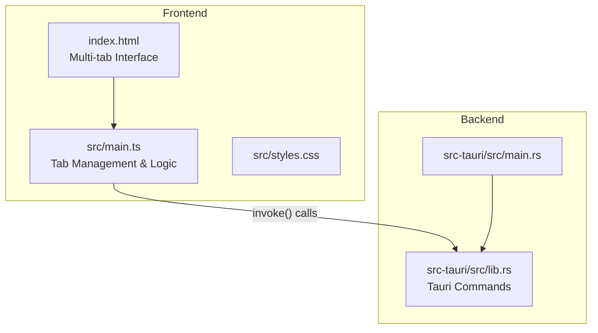

**Diagram sources**
- [index.html:1-189](file://index.html#L1-L189)
- [src/main.ts:1-1268](file://src/main.ts#L1-L1268)
- [src-tauri/src/lib.rs:1-1211](file://src-tauri/src/lib.rs#L1-L1211)
- [src-tauri/src/main.rs:1-7](file://src-tauri/src/main.rs#L1-L7)

**Section sources**
- [package.json:1-22](file://package.json#L1-L22)
- [index.html:1-189](file://index.html#L1-L189)
- [src/main.ts:1-1268](file://src/main.ts#L1-L1268)
- [src-tauri/src/lib.rs:1-1211](file://src-tauri/src/lib.rs#L1-L1211)
- [src-tauri/src/main.rs:1-7](file://src-tauri/src/main.rs#L1-L7)

## Core Components
This section summarizes the core features implemented across the frontend and backend with the new multi-tab architecture.

### Multi-Tab Interface System
- **Cleanup Tab**: Primary interface for cache scanning and cleanup operations
- **Size Tree Tab**: Hierarchical directory exploration with size visualization
- **Large Files Tab**: Discovery and management of oversized files across the system
- Tab switching with lazy initialization for performance optimization

### Intelligent Cache Scanning System
- Scans user caches, logs, crash reports, trash, browser caches, and developer tool caches
- Categorizes results into Safe and Needs Review with detailed explanations
- Provides per-item size and file counts, plus top-level children summaries
- Cross-platform path resolution and normalization

### Safety Classification System
- **Safe**: 100% safe to clean; data is temporary and auto-recreated when needed
- **Needs Review**: may require re-downloading or rebuilding artifacts; requires explicit user review
- Detailed safety tips and explanations for each category

### Interactive Selection System
- Hierarchical tree with expandable nodes and parent-child relationships
- Parent-child selection propagation with indeterminate states
- Select All/Deselect All controls per category
- Real-time selection state updates

### Cleanup Operations
- Confirmation dialog with breakdown of Safe vs Needs Review items
- Resilient deletion with fallback strategies
- Post-cleanup refresh of disk usage and scan results
- Toast notification system for feedback

### Real-Time Disk Usage Monitoring
- Platform-specific disk usage retrieval (macOS: libc::statfs, Windows: GetDiskFreeSpaceExW)
- Visual ring gauge and statistics panel
- Dynamic label updates based on detected platform

### Size Tree Navigation
- Hierarchical directory tree starting from home folder
- Size-sorted visualization with progress bars
- Lazy loading of subdirectories for performance
- Expand/collapse functionality with loading indicators

### Large File Discovery
- System-wide search for files exceeding configurable size thresholds
- Sort by size with ranking display
- Native file manager integration (Finder/Explorer reveal)
- Configurable minimum size filters

**Section sources**
- [src-tauri/src/lib.rs:420-852](file://src-tauri/src/lib.rs#L420-L852)
- [src-tauri/src/lib.rs:898-1162](file://src-tauri/src/lib.rs#L898-L1162)
- [src/main.ts:144-243](file://src/main.ts#L144-L243)
- [src/main.ts:270-414](file://src/main.ts#L270-L414)
- [src/main.ts:470-846](file://src/main.ts#L470-L846)
- [src/main.ts:956-1182](file://src/main.ts#L956-L1182)
- [src/main.ts:1184-1268](file://src/main.ts#L1184-L1268)
- [src-tauri/src/lib.rs:328-399](file://src-tauri/src/lib.rs#L328-L399)

## Architecture Overview
The application uses a client-server architecture via Tauri with enhanced multi-tab navigation:
- Frontend (TypeScript + HTML/CSS) renders the tabbed UI and handles user interactions
- Backend (Rust) exposes commands for scanning, deletion, disk usage, and file operations
- Data flows through invoke() calls from frontend to backend with lazy loading optimization

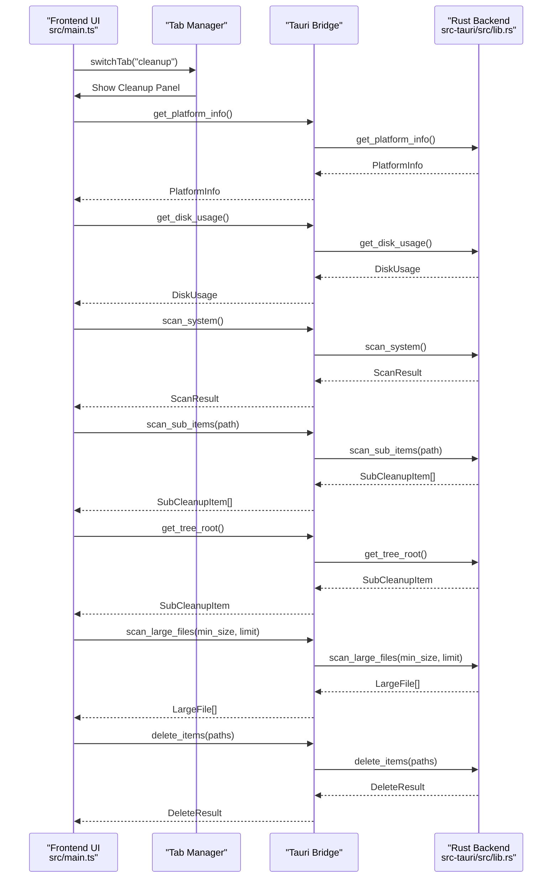

**Diagram sources**
- [src/main.ts:956-979](file://src/main.ts#L956-L979)
- [src/main.ts:1184-1268](file://src/main.ts#L1184-L1268)
- [src-tauri/src/lib.rs:891-894](file://src-tauri/src/lib.rs#L891-L894)
- [src-tauri/src/lib.rs:335-406](file://src-tauri/src/lib.rs#L335-L406)
- [src-tauri/src/lib.rs:408-415](file://src-tauri/src/lib.rs#L408-L415)
- [src-tauri/src/lib.rs:417-481](file://src-tauri/src/lib.rs#L417-L481)
- [src-tauri/src/lib.rs:1164-1190](file://src-tauri/src/lib.rs#L1164-L1190)

## Detailed Component Analysis

### Multi-Tab Interface System
The application features a sophisticated tab-based interface with three primary tabs:

#### Cleanup Tab
Primary interface for cache scanning and cleanup operations with disk usage visualization and item selection.

#### Size Tree Tab
Hierarchical directory exploration showing the complete file system structure sorted by size with lazy loading.

#### Large Files Tab
System-wide file discovery tool for finding and managing oversized files with native file manager integration.

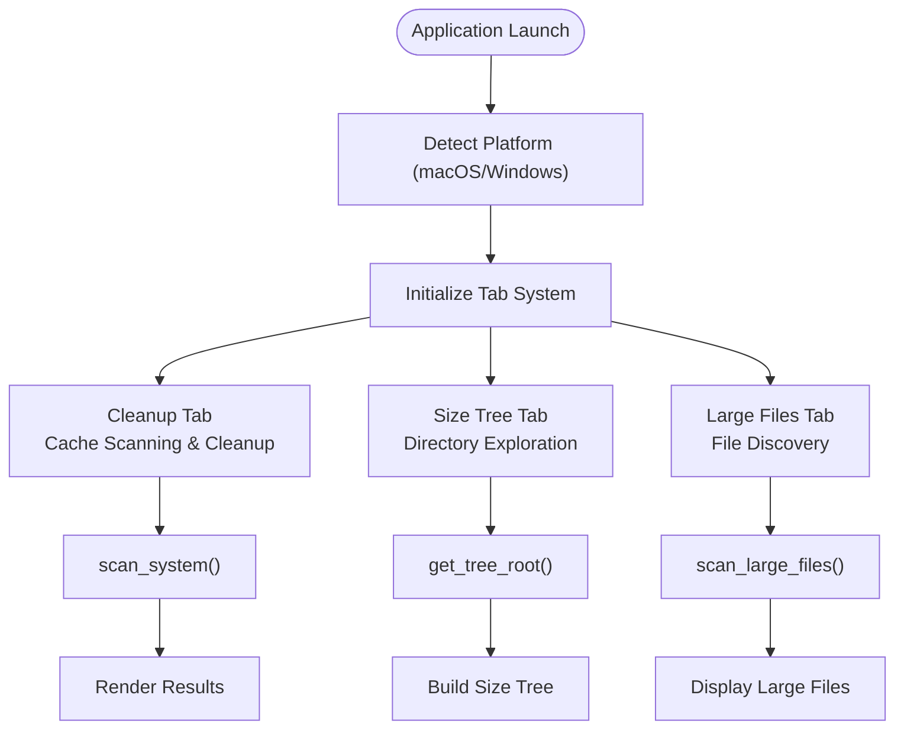

**Diagram sources**
- [src/main.ts:956-979](file://src/main.ts#L956-L979)
- [src/main.ts:981-1108](file://src/main.ts#L981-L1108)
- [src/main.ts:1110-1182](file://src/main.ts#L1110-L1182)

**Section sources**
- [index.html:25-30](file://index.html#L25-L30)
- [src/main.ts:956-979](file://src/main.ts#L956-L979)

### Intelligent Cache Scanning System
The scanner enumerates known cache directories for both macOS and Windows platforms, computes sizes and file counts, and returns categorized results with detailed safety information.

Key behaviors:
- Expands home paths and normalizes separators for cross-platform compatibility
- Computes directory sizes up to a depth limit to avoid excessive traversal
- Lists direct children with size and has_children flags for lazy loading
- Filters out non-existent or empty locations for optimal performance

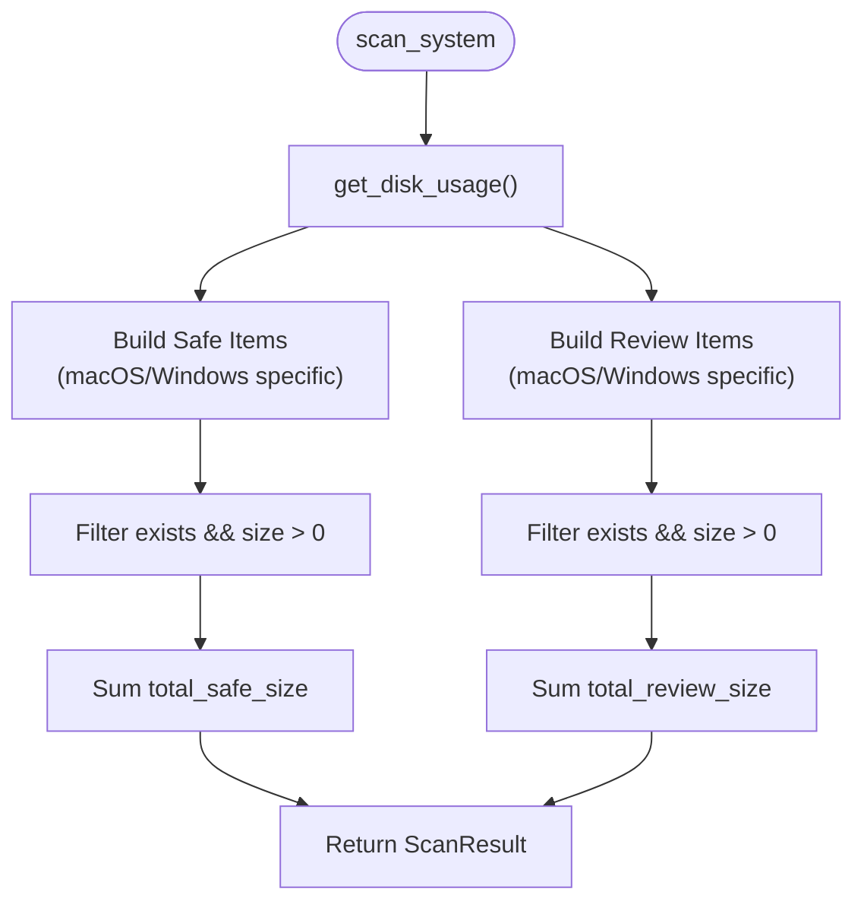

**Diagram sources**
- [src-tauri/src/lib.rs:518-852](file://src-tauri/src/lib.rs#L518-L852)
- [src-tauri/src/lib.rs:898-1162](file://src-tauri/src/lib.rs#L898-L1162)

Implementation highlights:
- Directory size calculation with walkdir and metadata aggregation
- Direct child enumeration with sorting by size for optimal UX
- Home path expansion and normalization for cross-platform support
- Platform-specific cache directory definitions

**Section sources**
- [src-tauri/src/lib.rs:70-97](file://src-tauri/src/lib.rs#L70-L97)
- [src-tauri/src/lib.rs:99-106](file://src-tauri/src/lib.rs#L99-L106)
- [src-tauri/src/lib.rs:108-161](file://src-tauri/src/lib.rs#L108-L161)
- [src-tauri/src/lib.rs:163-201](file://src-tauri/src/lib.rs#L163-L201)
- [src-tauri/src/lib.rs:518-852](file://src-tauri/src/lib.rs#L518-L852)
- [src-tauri/src/lib.rs:898-1162](file://src-tauri/src/lib.rs#L898-L1162)

### Safety Classification System
Targets are classified into two categories with detailed explanations:
- **Safe**: Temporary caches, logs, crash reports, trash, and browser caches that are safely recreated
- **Needs Review**: Developer artifacts, simulators, downloads, AI models, and other large caches that may need re-download or rebuild

Criteria:
- Safe items are transient and auto-regenerated by apps or OS
- Needs Review items may require network I/O or build steps to recreate

Examples:
- **Safe**: User Caches, Application Logs, Crash Reports, Trash, Browser Caches, npm/pip caches
- **Needs Review**: Xcode DerivedData, iOS Simulator Devices, HuggingFace Models, Downloads Folder, Docker data

**Section sources**
- [src-tauri/src/lib.rs:528-683](file://src-tauri/src/lib.rs#L528-L683)
- [src-tauri/src/lib.rs:685-840](file://src-tauri/src/lib.rs#L685-L840)
- [src-tauri/src/lib.rs:908-1033](file://src-tauri/src/lib.rs#L908-L1033)
- [src-tauri/src/lib.rs:1035-1150](file://src-tauri/src/lib.rs#L1035-L1150)

### Interactive Selection System
The frontend builds a hierarchical tree model with parent-child relationships and supports:
- Expand/collapse nodes with lazy loading
- Checkbox state propagation (selected/indeterminate)
- Top-level and sub-item rendering
- Select All/Deselect All per category
- Real-time selection state updates

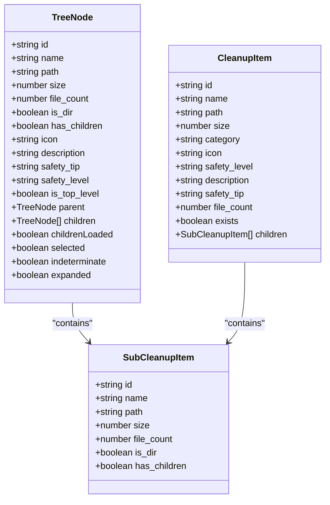

**Diagram sources**
- [src/main.ts:5-85](file://src/main.ts#L5-L85)
- [src-tauri/src/lib.rs:14-41](file://src-tauri/src/lib.rs#L14-L41)

Selection logic:
- setNodeSelection propagates selection down to descendants and updates ancestors with full/partial/none states
- updateCheckboxDOM reflects selected/indeterminate states in UI
- getSelectedPathsToDelete collects leaf selections based on indeterminate states

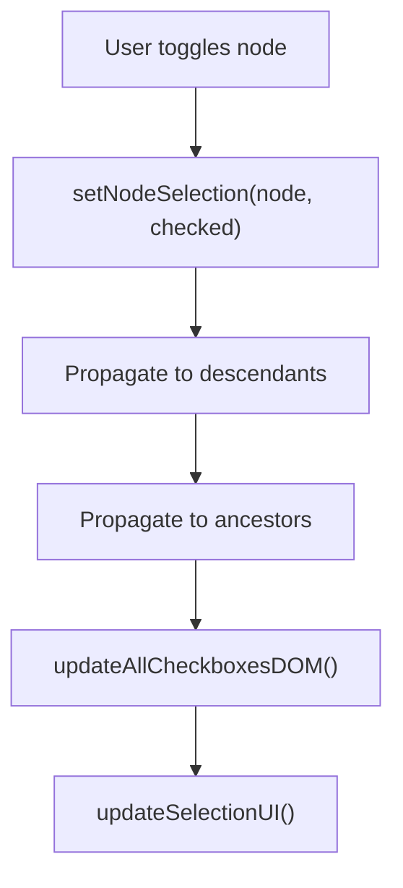

**Diagram sources**
- [src/main.ts:289-323](file://src/main.ts#L289-L323)
- [src/main.ts:325-349](file://src/main.ts#L325-L349)
- [src/main.ts:351-427](file://src/main.ts#L351-L427)
- [src/main.ts:431-481](file://src/main.ts#L431-L481)

**Section sources**
- [src/main.ts:283-427](file://src/main.ts#L283-L427)
- [src/main.ts:470-846](file://src/main.ts#L470-L846)

### Cleanup Operations
The cleanup flow includes:
- Collecting selected paths and sizes with breakdown by safety category
- Showing a confirmation dialog with Safe vs Needs Review breakdown
- Invoking backend deletion with resilient fallbacks
- Refreshing disk usage and results post-cleanup

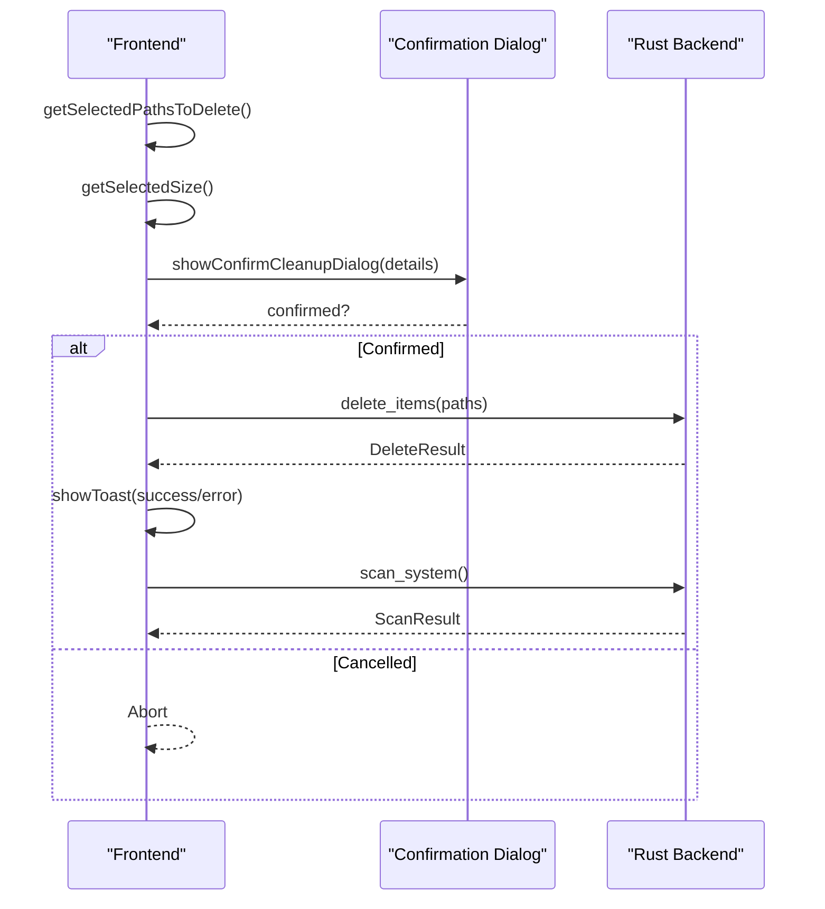

**Diagram sources**
- [src/main.ts:913-954](file://src/main.ts#L913-L954)
- [src-tauri/src/lib.rs:1164-1190](file://src-tauri/src/lib.rs#L1164-L1190)

Resilient deletion:
- For category roots, deletes contents recursively with fallback to item-by-item removal
- For files/symlinks, removes directly
- For directories, attempts remove_dir_all then falls back to content deletion

**Diagram sources**
- [src-tauri/src/lib.rs:268-331](file://src-tauri/src/lib.rs#L268-L331)

**Section sources**
- [src/main.ts:157-256](file://src/main.ts#L157-L256)
- [src/main.ts:913-954](file://src/main.ts#L913-L954)
- [src-tauri/src/lib.rs:268-331](file://src-tauri/src/lib.rs#L268-L331)
- [src-tauri/src/lib.rs:1164-1190](file://src-tauri/src/lib.rs#L1164-L1190)

### Real-Time Disk Usage Monitoring
The app retrieves disk usage using platform-specific APIs and updates the UI with a ring gauge and stats.

Platform implementations:
- **macOS**: Uses libc::statfs to compute total, used, free, and percentage
- **Windows**: Uses GetDiskFreeSpaceExW to compute totals and percentages

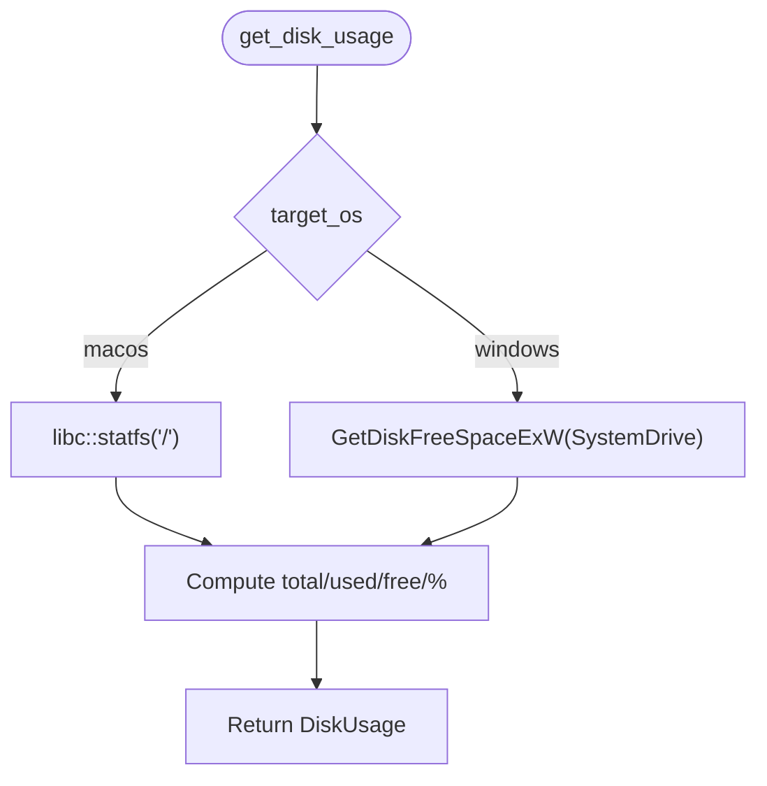

**Diagram sources**
- [src-tauri/src/lib.rs:335-406](file://src-tauri/src/lib.rs#L335-L406)

UI updates:
- Updates label, percentage, used/free/total stats
- Adjusts SVG ring progress based on percentage
- Dynamic platform-specific labeling

**Section sources**
- [src-tauri/src/lib.rs:335-406](file://src-tauri/src/lib.rs#L335-L406)
- [src/main.ts:258-281](file://src/main.ts#L258-L281)

### Size Tree Navigation
The Size Tree tab provides hierarchical directory exploration with size visualization:

Key features:
- Root node representing the user's home directory
- Size-sorted visualization with progress bars relative to largest sibling
- Lazy loading of subdirectories for optimal performance
- Expand/collapse functionality with loading indicators
- Native file manager integration for revealing files

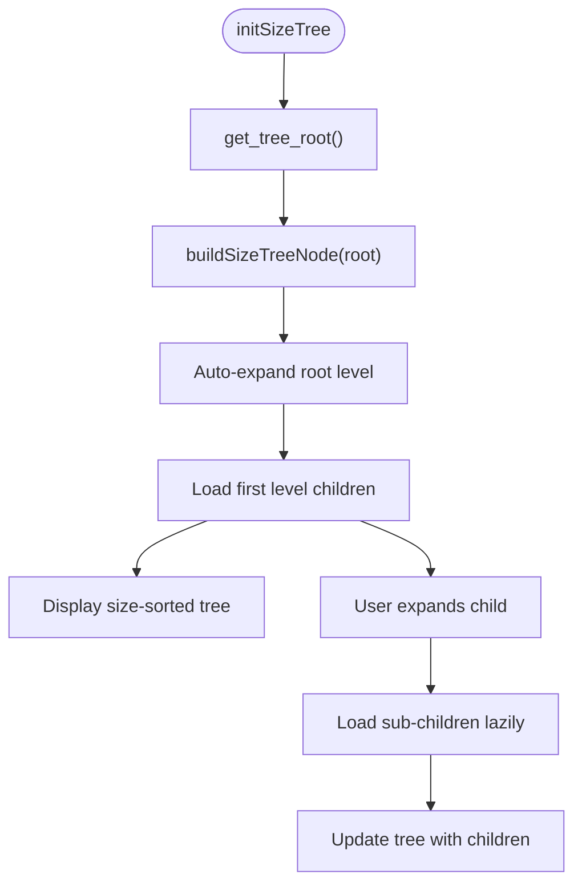

**Diagram sources**
- [src/main.ts:981-1108](file://src/main.ts#L981-L1108)

**Section sources**
- [src/main.ts:981-1108](file://src/main.ts#L981-L1108)
- [src-tauri/src/lib.rs:417-436](file://src-tauri/src/lib.rs#L417-L436)

### Large File Discovery
The Large Files tab enables system-wide file discovery with configurable thresholds:

Key features:
- Configurable minimum size filters (50MB to 1GB+)
- System-wide search with optimized walking algorithms
- Sort by size with ranking display
- Native file manager integration (Finder/Explorer reveal)
- Performance-optimized with depth limits and filtering

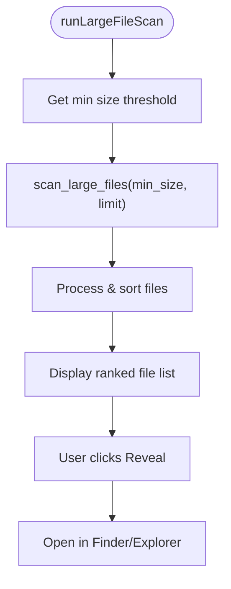

**Diagram sources**
- [src/main.ts:1110-1182](file://src/main.ts#L1110-L1182)

**Section sources**
- [src-main.ts:1110-1182](file://src/main.ts#L1110-L1182)
- [src-tauri/src/lib.rs:438-481](file://src-tauri/src/lib.rs#L438-L481)

## Dependency Analysis
The frontend depends on Tauri's invoke API to call backend commands. The backend exposes commands via Tauri's command handler with enhanced functionality for the multi-tab interface.

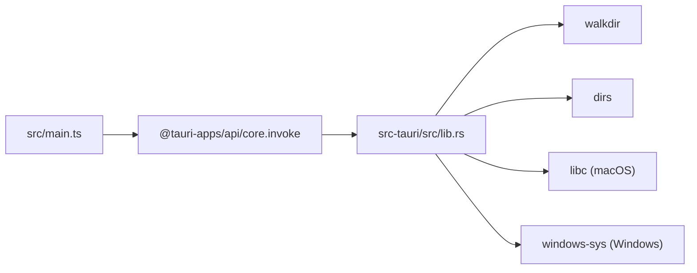

**Diagram sources**
- [src/main.ts:1-2](file://src/main.ts#L1-L2)
- [src-tauri/src/lib.rs:1-4](file://src-tauri/src/lib.rs#L1-L4)
- [src-tauri/src/lib.rs:335-406](file://src-tauri/src/lib.rs#L335-L406)

Coupling and cohesion:
- Frontend is decoupled from platform specifics via Tauri commands
- Backend encapsulates platform-specific logic within conditional compilation blocks
- High cohesion in scanning, deletion, and file operation modules
- Enhanced modularity supporting the multi-tab architecture

Potential circular dependencies:
- None detected between frontend and backend due to clear invoke boundaries

External dependencies:
- Tauri runtime and plugins
- Rust crates: walkdir, dirs, libc, windows-sys

**Section sources**
- [src/main.ts:1-2](file://src/main.ts#L1-L2)
- [src-tauri/src/lib.rs:1-4](file://src-tauri/src/lib.rs#L1-L4)
- [src-tauri/src/lib.rs:335-406](file://src-tauri/src/lib.rs#L335-L406)

## Performance Considerations
Enhanced performance optimizations for the multi-tab architecture:
- **Lazy Loading**: Heavy tabs (Size Tree, Large Files) initialize only when first accessed
- **Directory Size Computation**: Limits recursion depth to avoid excessive traversal
- **Child Enumeration**: Sorts by size to prioritize larger items for better UX
- **Resilient Deletion**: Avoids blocking operations by falling back to item-by-item removal
- **UI Updates**: Batched where possible (e.g., updating all checkboxes at once)
- **Memory Management**: Proper cleanup of DOM elements and event listeners

Optimization strategies:
- Use of fast filesystem APIs (libc statfs, Windows GetDiskFreeSpaceExW)
- Filtering out non-existent or zero-size items early
- Indeterminate state handling to minimize redundant DOM updates
- Depth-limited directory walking for large file scans
- Progress bar visualization for better user feedback during long operations

## Troubleshooting Guide
Common issues and resolutions:
- **Scan fails**: Check permissions and ensure target directories exist
- **Deletion errors**: Some files may be locked; the resilient fallback attempts to remove contents individually
- **Disk usage not updating**: Re-run scan after cleanup; verify platform-specific API availability
- **Tab loading issues**: Check console logs for invoke errors and verify backend command availability
- **Large file scan timeout**: Increase minimum size threshold or check disk permissions

Debugging tips:
- Inspect toast notifications for success/error messages
- Verify console logs for invoke errors and platform detection
- Confirm platform info and disk label initialization
- Check tab state management and lazy loading behavior

**Section sources**
- [src/main.ts:122-142](file://src/main.ts#L122-L142)
- [src/main.ts:876-896](file://src/main.ts#L876-L896)
- [src/main.ts:913-954](file://src/main.ts#L913-L954)
- [src-tauri/src/lib.rs:1164-1190](file://src-tauri/src/lib.rs#L1164-L1190)

## Conclusion
FreeSpace delivers a comprehensive, cross-platform disk storage optimization experience with an intuitive multi-tab interface. The application combines intelligent scanning, safety classification, interactive selection, resilient deletion, real-time disk usage monitoring, hierarchical directory exploration, and large file discovery. Its architecture cleanly separates frontend and backend concerns while leveraging platform-specific optimizations for performance and reliability across both macOS and Windows systems.

The transformation from a single-purpose macOS tool to a full-featured cross-platform optimizer demonstrates the power of Tauri's architecture in creating native-feeling applications that work seamlessly across different operating systems while maintaining high performance and user experience standards.