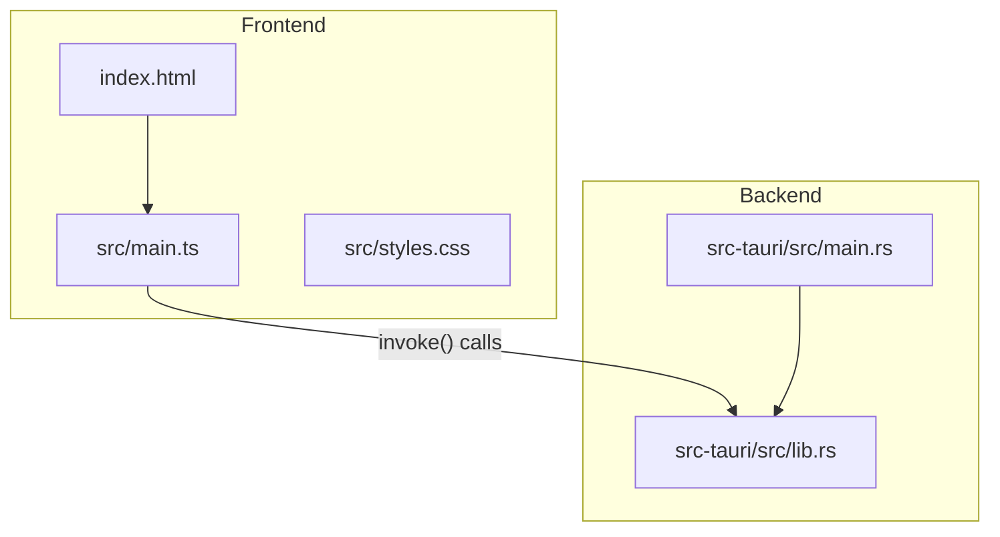
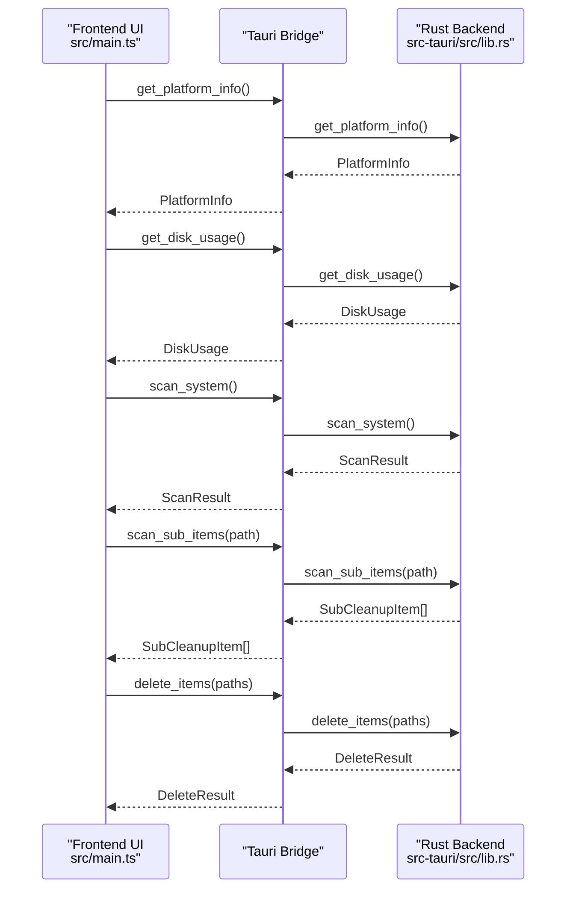
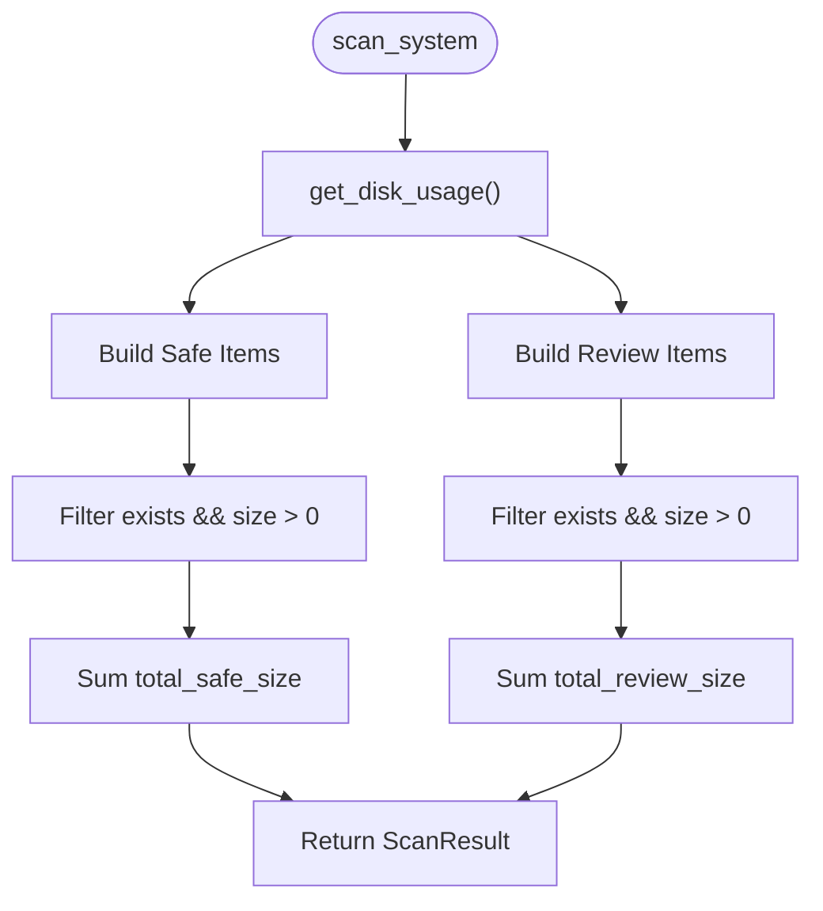
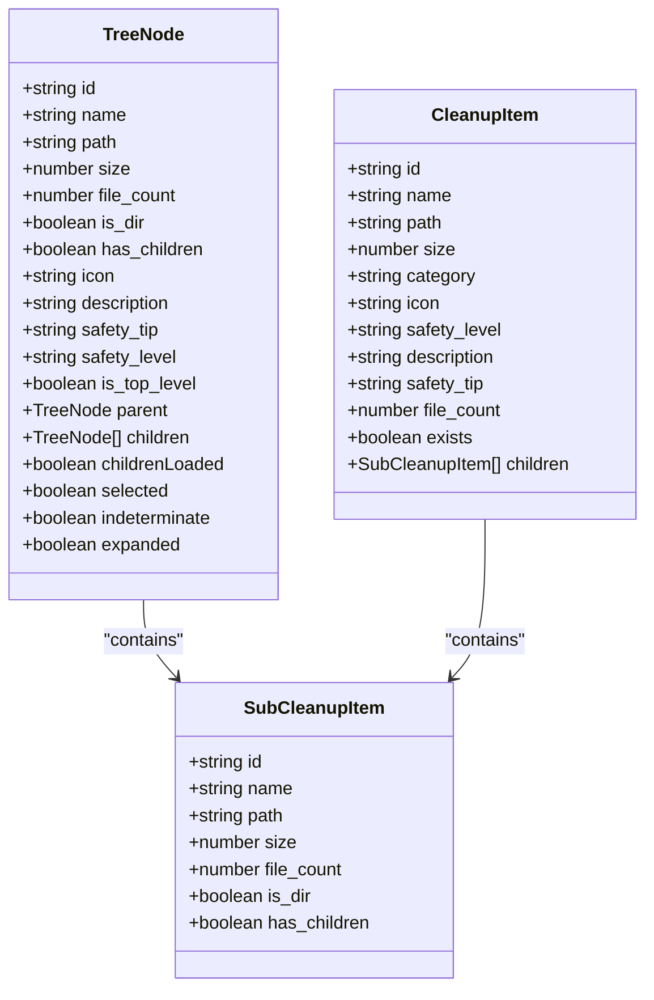
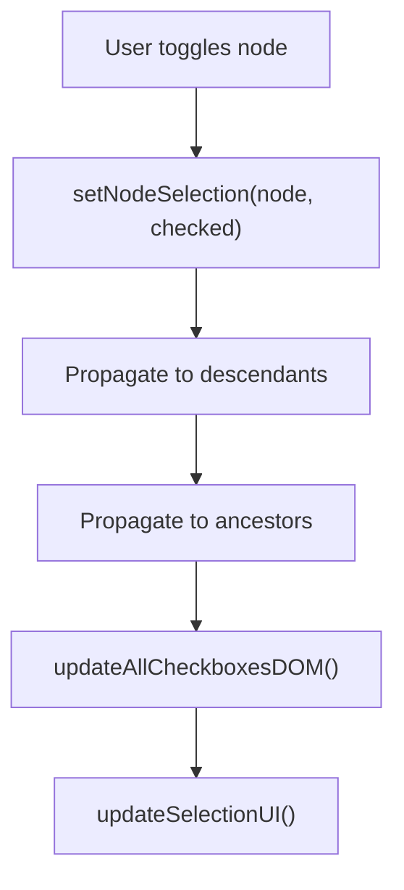
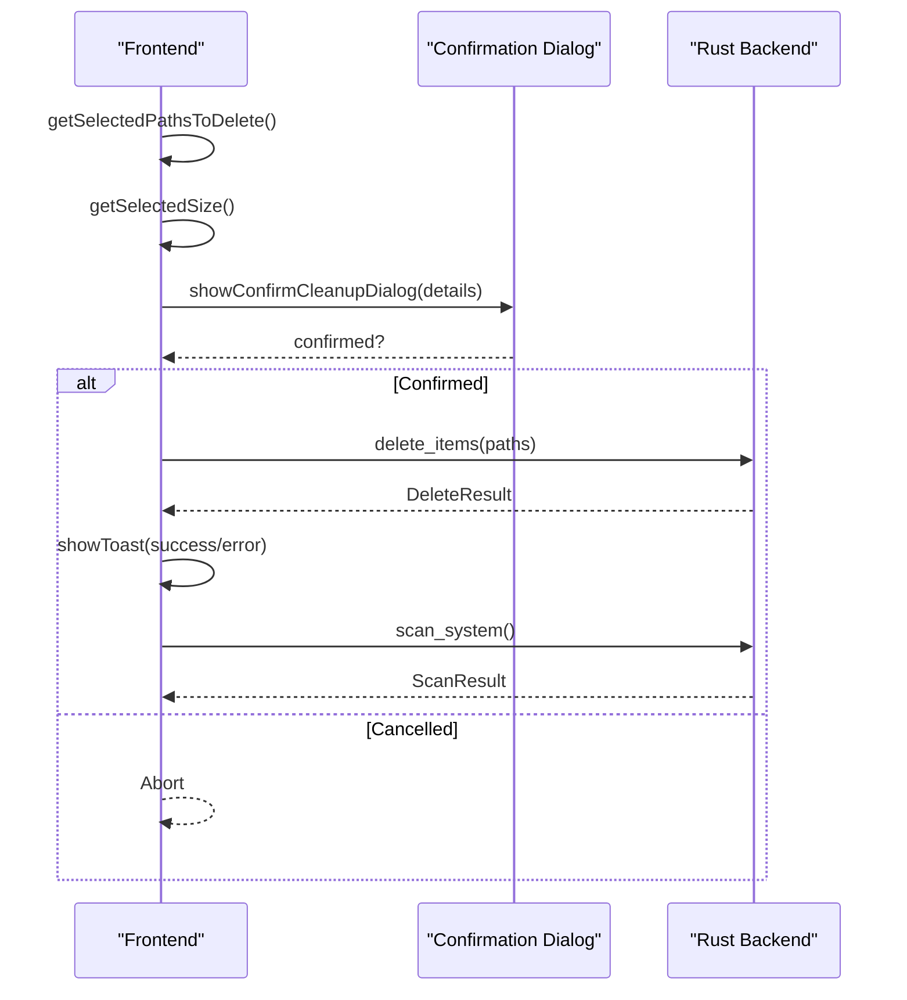
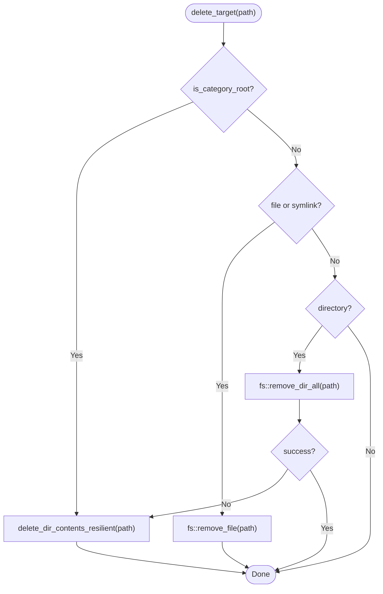
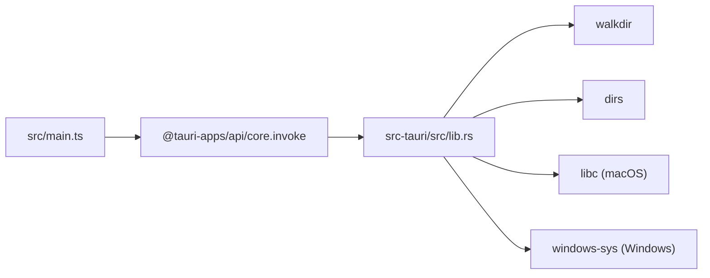

# Core Features Documentation

<cite>
**Referenced Files in This Document**
- [README.md](file://README.md)
- [index.html](file://index.html)
- [src/main.ts](file://src/main.ts)
- [src-tauri/src/lib.rs](file://src-tauri/src/lib.rs)
- [src-tauri/src/main.rs](file://src-tauri/src/main.rs)
- [package.json](file://package.json)
</cite>

## Table of Contents
1. [Introduction](#introduction)
2. [Project Structure](#project-structure)
3. [Core Components](#core-components)
4. [Architecture Overview](#architecture-overview)
5. [Detailed Component Analysis](#detailed-component-analysis)
6. [Dependency Analysis](#dependency-analysis)
7. [Performance Considerations](#performance-considerations)
8. [Troubleshooting Guide](#troubleshooting-guide)
9. [Conclusion](#conclusion)

## Introduction
FreeSpace is a modern, high-performance storage cleanup and disk analyzer for macOS (and Windows). It scans system and application caches, classifies targets by safety, and provides an interactive tree-based selection with resilient deletion and real-time disk usage monitoring. The app uses Tauri 2 to combine a Rust backend with a TypeScript/HTML/CSS frontend.

Key capabilities:
- Intelligent cache scanning across many applications and developer tools
- Safety classification into “Safe” and “Needs Review” categories
- Interactive hierarchical selection with parent-child relationship management
- Resilient deletion with fallback mechanisms and confirmation dialogs
- Real-time disk usage visualization with platform-specific implementations

**Section sources**
- [README.md:1-74](file://README.md#L1-L74)

## Project Structure
The project follows a standard Tauri 2 layout:
- Frontend: TypeScript entry point and HTML/CSS UI
- Backend: Rust library exposing Tauri commands for scanning, deletion, and disk usage
- Configuration: package scripts and Tauri configuration

**Diagram sources**
- [index.html:1-141](file://index.html#L1-L141)
- [src/main.ts:1-1009](file://src/main.ts#L1-L1009)
- [src-tauri/src/lib.rs:1-1100](file://src-tauri/src/lib.rs#L1-L1100)
- [src-tauri/src/main.rs:1-7](file://src-tauri/src/main.rs#L1-L7)

**Section sources**
- [package.json:1-22](file://package.json#L1-L22)
- [index.html:1-141](file://index.html#L1-L141)
- [src/main.ts:1-1009](file://src/main.ts#L1-L1009)
- [src-tauri/src/lib.rs:1-1100](file://src-tauri/src/lib.rs#L1-L1100)
- [src-tauri/src/main.rs:1-7](file://src-tauri/src/main.rs#L1-L7)

## Core Components
This section summarizes the core features implemented across the frontend and backend.

- Intelligent Cache Scanning System
  - Scans user caches, logs, crash reports, trash, browser caches, and developer tool caches
  - Categorizes results into Safe and Needs Review
  - Provides per-item size and file counts, plus top-level children summaries

- Safety Classification System
  - Safe: 100% safe to clean; data is temporary and auto-recreated when needed
  - Needs Review: may require re-downloading or rebuilding artifacts; requires explicit user review

- Interactive Selection System
  - Hierarchical tree with expandable nodes
  - Parent-child selection propagation and indeterminate states
  - Select All/Deselect All controls per category

- Cleanup Operations
  - Confirmation dialog with breakdown of Safe vs Needs Review items
  - Resilient deletion with fallback strategies
  - Post-cleanup refresh of disk usage and scan results

- Real-Time Disk Usage Monitoring
  - Platform-specific disk usage retrieval
  - Visual ring gauge and statistics panel

**Section sources**
- [src-tauri/src/lib.rs:420-744](file://src-tauri/src/lib.rs#L420-L744)
- [src-tauri/src/lib.rs:800-1054](file://src-tauri/src/lib.rs#L800-L1054)
- [src/main.ts:144-243](file://src/main.ts#L144-L243)
- [src/main.ts:270-414](file://src/main.ts#L270-L414)
- [src/main.ts:470-696](file://src/main.ts#L470-L696)
- [src/main.ts:700-800](file://src/main.ts#L700-L800)
- [src/main.ts:898-941](file://src/main.ts#L898-L941)
- [src-tauri/src/lib.rs:328-399](file://src-tauri/src/lib.rs#L328-L399)

## Architecture Overview
The application uses a client-server architecture via Tauri:
- Frontend (TypeScript + HTML/CSS) renders the UI and handles user interactions
- Backend (Rust) exposes commands for scanning, deletion, and disk usage
- Data flows through invoke() calls from frontend to backend

**Diagram sources**
- [src/main.ts:945-972](file://src/main.ts#L945-L972)
- [src/main.ts:876-896](file://src/main.ts#L876-L896)
- [src/main.ts:900-941](file://src/main.ts#L900-L941)
- [src-tauri/src/lib.rs:328-399](file://src-tauri/src/lib.rs#L328-L399)
- [src-tauri/src/lib.rs:401-408](file://src-tauri/src/lib.rs#L401-L408)
- [src-tauri/src/lib.rs:410-744](file://src-tauri/src/lib.rs#L410-L744)
- [src-tauri/src/lib.rs:1056-1082](file://src-tauri/src/lib.rs#L1056-L1082)

## Detailed Component Analysis

### Intelligent Cache Scanning System
The scanner enumerates known cache directories for macOS and Windows, computes sizes and file counts, and returns categorized results.

Key behaviors:
- Expands home paths and normalizes separators
- Computes directory sizes up to a depth limit
- Lists direct children with size and has_children flags
- Filters out non-existent or empty locations

**Diagram sources**
- [src-tauri/src/lib.rs:410-744](file://src-tauri/src/lib.rs#L410-L744)
- [src-tauri/src/lib.rs:788-1054](file://src-tauri/src/lib.rs#L788-L1054)

Implementation highlights:
- Directory size calculation with walkdir and metadata aggregation
- Direct child enumeration with sorting by size
- Home path expansion and normalization

**Section sources**
- [src-tauri/src/lib.rs:70-97](file://src-tauri/src/lib.rs#L70-L97)
- [src-tauri/src/lib.rs:99-106](file://src-tauri/src/lib.rs#L99-L106)
- [src-tauri/src/lib.rs:108-161](file://src-tauri/src/lib.rs#L108-L161)
- [src-tauri/src/lib.rs:163-201](file://src-tauri/src/lib.rs#L163-L201)
- [src-tauri/src/lib.rs:410-744](file://src-tauri/src/lib.rs#L410-L744)
- [src-tauri/src/lib.rs:788-1054](file://src-tauri/src/lib.rs#L788-L1054)

### Safety Classification System
Targets are classified into two categories:
- Safe: Temporary caches, logs, crash reports, trash, and browser caches that are safely recreated
- Needs Review: Developer artifacts, simulators, downloads, AI models, and other large caches that may need re-download or rebuild

Criteria:
- Safe items are transient and auto-regenerated by apps or OS
- Needs Review items may require network I/O or build steps to recreate

Examples:
- Safe: User Caches, Application Logs, Crash Reports, Trash, Browser Caches
- Needs Review: Xcode DerivedData, iOS Simulator Devices, HuggingFace Models, Downloads Folder

**Section sources**
- [src-tauri/src/lib.rs:420-744](file://src-tauri/src/lib.rs#L420-L744)
- [src-tauri/src/lib.rs:800-1054](file://src-tauri/src/lib.rs#L800-L1054)

### Interactive Selection System
The frontend builds a hierarchical tree model with parent-child relationships and supports:
- Expand/collapse nodes
- Checkbox state propagation (selected/indeterminate)
- Top-level and sub-item rendering
- Select All/Deselect All per category

**Diagram sources**
- [src/main.ts:5-85](file://src/main.ts#L5-L85)
- [src-tauri/src/lib.rs:14-41](file://src-tauri/src/lib.rs#L14-L41)

Selection logic:
- setNodeSelection propagates selection down to descendants and updates ancestors with full/partial/none states
- updateCheckboxDOM reflects selected/indeterminate states in UI
- getSelectedPathsToDelete collects leaf selections based on indeterminate states

**Diagram sources**
- [src/main.ts:276-310](file://src/main.ts#L276-L310)
- [src/main.ts:312-336](file://src/main.ts#L312-L336)
- [src/main.ts:338-414](file://src/main.ts#L338-L414)
- [src/main.ts:418-468](file://src/main.ts#L418-L468)

**Section sources**
- [src/main.ts:270-414](file://src/main.ts#L270-L414)
- [src/main.ts:470-696](file://src/main.ts#L470-L696)
- [src/main.ts:700-800](file://src/main.ts#L700-L800)

### Cleanup Operations
The cleanup flow includes:
- Collecting selected paths and sizes
- Showing a confirmation dialog with Safe vs Needs Review breakdown
- Invoking backend deletion with resilient fallbacks
- Refreshing disk usage and results post-cleanup

**Diagram sources**
- [src/main.ts:900-941](file://src/main.ts#L900-L941)
- [src-tauri/src/lib.rs:1056-1082](file://src-tauri/src/lib.rs#L1056-L1082)

Resilient deletion:
- For category roots, deletes contents recursively with fallback to item-by-item removal
- For files/symlinks, removes directly
- For directories, attempts remove_dir_all then falls back to content deletion

**Diagram sources**
- [src-tauri/src/lib.rs:261-324](file://src-tauri/src/lib.rs#L261-L324)

**Section sources**
- [src/main.ts:144-243](file://src/main.ts#L144-L243)
- [src/main.ts:900-941](file://src/main.ts#L900-L941)
- [src-tauri/src/lib.rs:261-324](file://src-tauri/src/lib.rs#L261-L324)
- [src-tauri/src/lib.rs:1056-1082](file://src-tauri/src/lib.rs#L1056-L1082)

### Real-Time Disk Usage Monitoring
The app retrieves disk usage using platform-specific APIs and updates the UI with a ring gauge and stats.

Platform implementations:
- macOS: Uses libc::statfs to compute total, used, free, and percentage
- Windows: Uses GetDiskFreeSpaceExW to compute totals and percentages

**Diagram sources**
- [src-tauri/src/lib.rs:328-399](file://src-tauri/src/lib.rs#L328-L399)

UI updates:
- Updates label, percentage, used/free/total stats
- Adjusts SVG ring progress based on percentage

**Section sources**
- [src-tauri/src/lib.rs:328-399](file://src-tauri/src/lib.rs#L328-L399)
- [src/main.ts:247-268](file://src/main.ts#L247-L268)

## Dependency Analysis
The frontend depends on Tauri’s invoke API to call backend commands. The backend exposes commands via Tauri’s command handler.

**Diagram sources**
- [src/main.ts:1-2](file://src/main.ts#L1-L2)
- [src-tauri/src/lib.rs:1-4](file://src-tauri/src/lib.rs#L1-L4)
- [src-tauri/src/lib.rs:328-399](file://src-tauri/src/lib.rs#L328-L399)

Coupling and cohesion:
- Frontend is decoupled from platform specifics via Tauri commands
- Backend encapsulates platform-specific logic within conditional compilation blocks
- High cohesion in scanning and deletion modules

Potential circular dependencies:
- None detected between frontend and backend due to clear invoke boundaries

External dependencies:
- Tauri runtime and plugins
- Rust crates: walkdir, dirs, libc, windows-sys

**Section sources**
- [src/main.ts:1-2](file://src/main.ts#L1-L2)
- [src-tauri/src/lib.rs:1-4](file://src-tauri/src/lib.rs#L1-L4)
- [src-tauri/src/lib.rs:328-399](file://src-tauri/src/lib.rs#L328-L399)

## Performance Considerations
- Directory size computation limits recursion depth to avoid excessive traversal
- Child enumeration sorts by size to prioritize larger items
- Lazy loading of sub-items reduces initial scan time
- Resilient deletion avoids blocking operations by falling back to item-by-item removal
- UI updates are batched where possible (e.g., updating all checkboxes at once)

Optimization strategies:
- Use of fast filesystem APIs (libc statfs, Windows GetDiskFreeSpaceExW)
- Filtering out non-existent or zero-size items early
- Indeterminate state handling to minimize redundant DOM updates

[No sources needed since this section provides general guidance]

## Troubleshooting Guide
Common issues and resolutions:
- Scan fails: Check permissions and ensure target directories exist
- Deletion errors: Some files may be locked; the resilient fallback attempts to remove contents individually
- Disk usage not updating: Re-run scan after cleanup; verify platform-specific API availability

Debugging tips:
- Inspect toast notifications for success/error messages
- Verify console logs for invoke errors
- Confirm platform info and disk label initialization

**Section sources**
- [src/main.ts:122-142](file://src/main.ts#L122-L142)
- [src/main.ts:876-896](file://src/main.ts#L876-L896)
- [src/main.ts:900-941](file://src/main.ts#L900-L941)
- [src-tauri/src/lib.rs:1056-1082](file://src-tauri/src/lib.rs#L1056-L1082)

## Conclusion
FreeSpace delivers a robust, cross-platform storage cleanup experience with intelligent scanning, safety classification, interactive selection, resilient deletion, and real-time disk usage monitoring. Its architecture cleanly separates frontend and backend concerns while leveraging platform-specific optimizations for performance and reliability.

[No sources needed since this section summarizes without analyzing specific files]