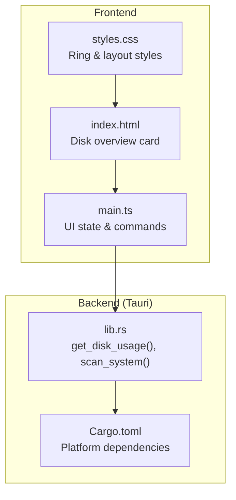
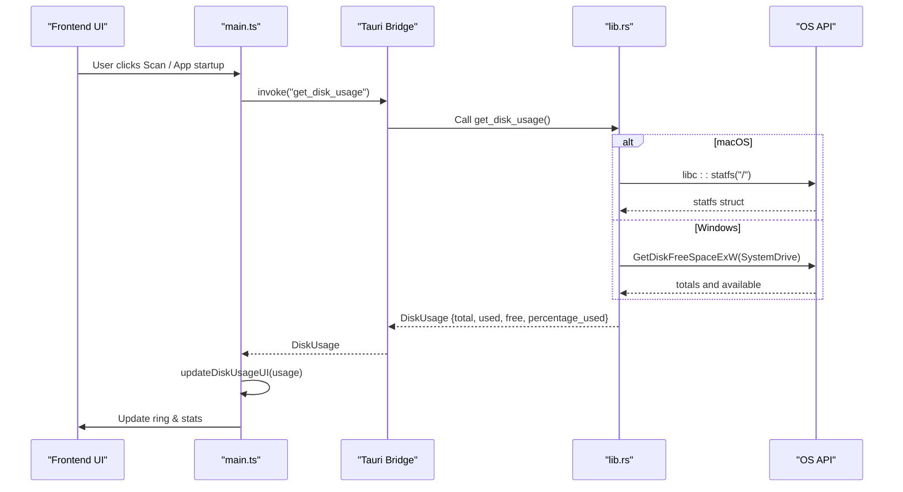
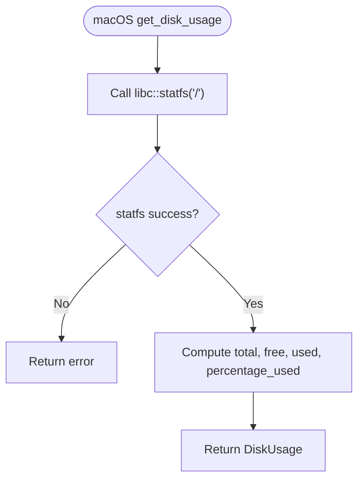
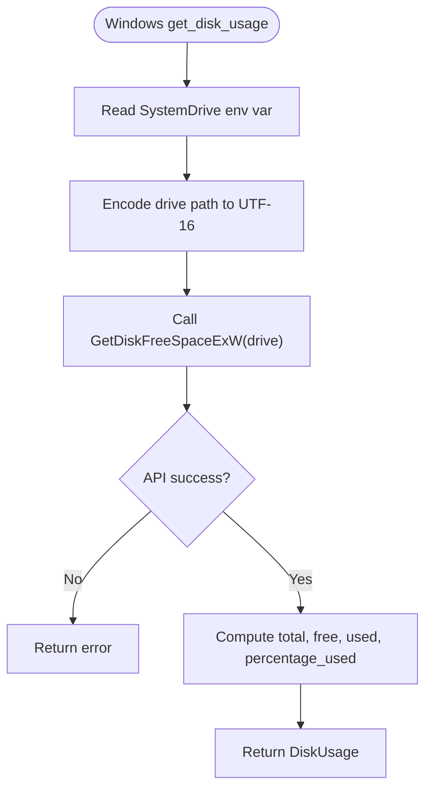
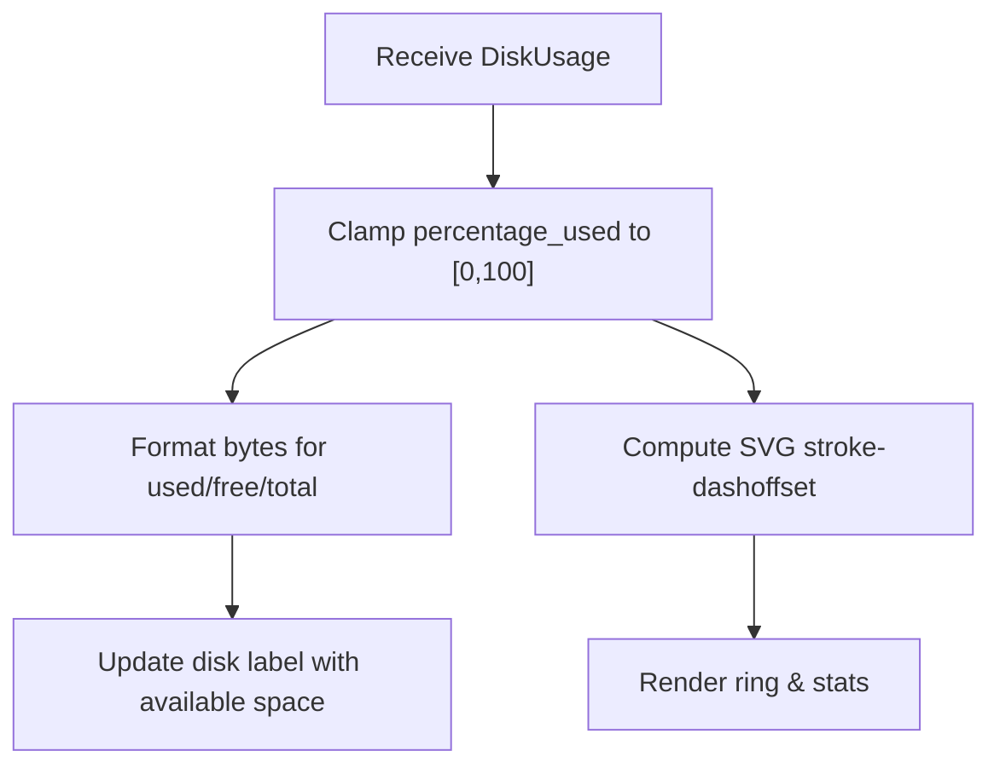
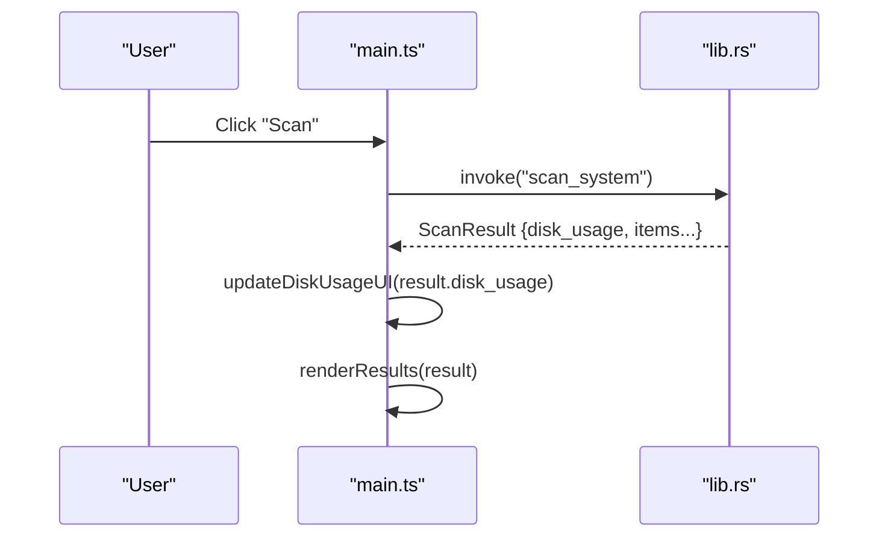
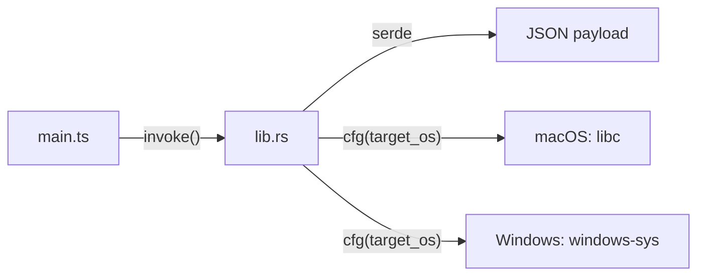

# Disk Usage Monitoring

<cite>
**Referenced Files in This Document**
- [lib.rs](file://src-tauri/src/lib.rs)
- [main.ts](file://src/main.ts)
- [index.html](file://index.html)
- [styles.css](file://src/styles.css)
- [Cargo.toml](file://src-tauri/Cargo.toml)
</cite>

## Table of Contents
1. [Introduction](#introduction)
2. [Project Structure](#project-structure)
3. [Core Components](#core-components)
4. [Architecture Overview](#architecture-overview)
5. [Detailed Component Analysis](#detailed-component-analysis)
6. [Dependency Analysis](#dependency-analysis)
7. [Performance Considerations](#performance-considerations)
8. [Troubleshooting Guide](#troubleshooting-guide)
9. [Conclusion](#conclusion)

## Introduction
This document explains the disk usage monitoring feature that provides real-time disk space information across macOS and Windows. The backend uses platform-specific system calls to retrieve total, used, free, and percentage-used values. The frontend renders a live ring visualization and statistics, updating whenever the user scans or cleans up files. It also documents how the application detects platform differences for disk labels and system drive identification.

## Project Structure
The disk usage feature spans both the Tauri backend (Rust) and the frontend (TypeScript + HTML + CSS):

- Backend:
  - Rust library exposes Tauri commands for disk usage retrieval and scanning.
  - Platform-specific logic is compiled conditionally for macOS and Windows.
- Frontend:
  - HTML defines the disk overview card with an SVG ring and stats.
  - TypeScript invokes backend commands and updates the UI.
  - CSS styles the ring, progress animation, and layout.



**Diagram sources**
- [index.html:25-57](file://index.html#L25-L57)
- [main.ts:245-268](file://src/main.ts#L245-L268)
- [lib.rs:43-49](file://src-tauri/src/lib.rs#L43-L49)
- [Cargo.toml:24-28](file://src-tauri/Cargo.toml#L24-L28)

**Section sources**
- [index.html:25-57](file://index.html#L25-L57)
- [main.ts:245-268](file://src/main.ts#L245-L268)
- [lib.rs:43-49](file://src-tauri/src/lib.rs#L43-L49)
- [Cargo.toml:24-28](file://src-tauri/Cargo.toml#L24-L28)

## Core Components
- DiskUsage data structure:
  - Fields: total, used, free, percentage_used.
  - Used by both backend and frontend to represent disk capacity and utilization.
- get_disk_usage() command:
  - macOS: Uses libc statfs on root path to compute total, free, used, and percentage.
  - Windows: Uses GetDiskFreeSpaceExW on the system drive to compute the same metrics.
- UI components:
  - Disk overview card with an SVG ring and numeric stats.
  - Percentage calculation and ring offset update in the frontend.

Key responsibilities:
- Backend retrieves accurate, low-level disk metrics per platform.
- Frontend formats bytes, clamps percentages, and animates the ring.

**Section sources**
- [lib.rs:43-49](file://src-tauri/src/lib.rs#L43-L49)
- [lib.rs:328-399](file://src-tauri/src/lib.rs#L328-L399)
- [main.ts:31-36](file://src/main.ts#L31-L36)
- [main.ts:245-268](file://src/main.ts#L245-L268)

## Architecture Overview
The disk usage flow starts when the app loads or the user triggers a scan. The frontend calls the backend via Tauri’s invoke mechanism. The backend returns a DiskUsage object, which the frontend uses to update the ring and stats.



**Diagram sources**
- [main.ts:945-970](file://src/main.ts#L945-L970)
- [lib.rs:328-399](file://src-tauri/src/lib.rs#L328-L399)

## Detailed Component Analysis

### DiskUsage Data Model
- Purpose: Encapsulates disk capacity and utilization.
- Fields:
  - total: Total disk size in bytes.
  - used: Used disk space in bytes.
  - free: Free disk space in bytes.
  - percentage_used: Percentage of disk used, computed as (used / total) * 100.
- Serialization:
  - Serialized to JSON for cross-process communication between frontend and backend.

Complexity:
- O(1) memory footprint; no algorithmic complexity beyond basic arithmetic.

Error handling:
- If total is zero, percentage_used is set to 0.0 to avoid division-by-zero.

**Section sources**
- [lib.rs:43-49](file://src-tauri/src/lib.rs#L43-L49)
- [lib.rs:343-347](file://src-tauri/src/lib.rs#L343-L347)
- [lib.rs:383-387](file://src-tauri/src/lib.rs#L383-L387)

### get_disk_usage() Implementation

#### macOS Path (libc statfs)
- Uses libc::statfs on the root directory "/".
- Computes:
  - block_size from f_bsize.
  - total = f_blocks * block_size.
  - free = f_bavail * block_size.
  - used = total - free.
  - percentage_used = (used / total) * 100 if total > 0 else 0.0.



**Diagram sources**
- [lib.rs:330-356](file://src-tauri/src/lib.rs#L330-L356)

**Section sources**
- [lib.rs:330-356](file://src-tauri/src/lib.rs#L330-L356)

#### Windows Path (GetDiskFreeSpaceExW)
- Determines the system drive using the SystemDrive environment variable (defaults to "C:" if missing).
- Calls GetDiskFreeSpaceExW with the drive root.
- Computes:
  - total = total_bytes.
  - free = available_bytes.
  - used = total - free.
  - percentage_used = (used / total) * 100 if total > 0 else 0.0.



**Diagram sources**
- [lib.rs:358-396](file://src-tauri/src/lib.rs#L358-L396)

**Section sources**
- [lib.rs:358-396](file://src-tauri/src/lib.rs#L358-L396)

### Frontend Disk Usage Visualization
- HTML elements:
  - Ring background and progress circles.
  - Percent text and stats for used/free/total.
- TypeScript logic:
  - updateDiskUsageUI formats bytes and clamps percentage to [0, 100].
  - Calculates SVG stroke-dashoffset based on circumference and percentage.
  - Updates label with disk label and available space.

Percentage calculation:
- Clamped to [0, 100] before rendering.
- Ring offset computed as circumference - (pct / 100) * circumference.



**Diagram sources**
- [main.ts:245-268](file://src/main.ts#L245-L268)
- [index.html:25-57](file://index.html#L25-L57)

**Section sources**
- [main.ts:245-268](file://src/main.ts#L245-L268)
- [index.html:25-57](file://index.html#L25-L57)

### Platform Differences: Disk Label and System Drive
- Disk label:
  - macOS: Hardcoded to a default label representing the main volume.
  - Windows: Constructed from the SystemDrive environment variable (e.g., "Local Disk (C:)").
- System drive identification:
  - Windows: Uses SystemDrive to determine the root drive for GetDiskFreeSpaceExW.
  - macOS: Always queries the root filesystem "/".

```mermaid
classDiagram
class PlatformInfo {
+string os
+string os_name
+string disk_label
}
class macOSPlatform {
+disk_label = "Macintosh HD"
}
class WindowsPlatform {
+disk_label = "Local Disk ({SystemDrive})"
}
PlatformInfo <|-- macOSPlatform
PlatformInfo <|-- WindowsPlatform
```

**Diagram sources**
- [lib.rs:748-781](file://src-tauri/src/lib.rs#L748-L781)

**Section sources**
- [lib.rs:748-781](file://src-tauri/src/lib.rs#L748-L781)

### Live Updates to the UI
- Initial load:
  - On DOMContentLoaded, the frontend calls get_platform_info and get_disk_usage to initialize labels and disk stats.
- Scan action:
  - When the user clicks Scan, the frontend calls scan_system, then updates the disk usage UI with the returned DiskUsage.
- Clean action:
  - After cleanup, the frontend re-scans to refresh disk usage and results.



**Diagram sources**
- [main.ts:837-896](file://src/main.ts#L837-L896)
- [lib.rs:410-744](file://src-tauri/src/lib.rs#L410-L744)

**Section sources**
- [main.ts:837-896](file://src/main.ts#L837-L896)
- [lib.rs:410-744](file://src-tauri/src/lib.rs#L410-L744)

## Dependency Analysis
- Backend dependencies:
  - macOS: libc for statfs.
  - Windows: windows-sys for GetDiskFreeSpaceExW.
- Frontend dependencies:
  - Tauri core invoke API to call backend commands.
- Cross-cutting:
  - serde for serialization of DiskUsage and other structures.



**Diagram sources**
- [Cargo.toml:15-28](file://src-tauri/Cargo.toml#L15-L28)
- [main.ts:1](file://src/main.ts#L1)

**Section sources**
- [Cargo.toml:15-28](file://src-tauri/Cargo.toml#L15-L28)
- [main.ts:1](file://src/main.ts#L1)

## Performance Considerations
- Disk polling frequency:
  - Avoid frequent polling of disk usage. The current design updates on initial load and after scans/cleanups, which is efficient.
- Large directories:
  - Scanning large directories can be expensive; the UI shows a scanning overlay and rotates status messages to indicate progress.
- Rendering performance:
  - The ring animation uses CSS transitions and SVG stroke-dashoffset, which are GPU-friendly and smooth.
- Error resilience:
  - The backend returns errors gracefully; the frontend catches and displays toast notifications without crashing.

[No sources needed since this section provides general guidance]

## Troubleshooting Guide
Common issues and resolutions:
- Permission denied on disk access:
  - Ensure the app has necessary permissions to read filesystem metadata. On some systems, elevated privileges may be required for certain paths.
- Incorrect disk label on Windows:
  - Verify the SystemDrive environment variable is set correctly. If missing, it defaults to "C:".
- statfs failure on macOS:
  - Check that the root filesystem is accessible. If statfs fails, the backend returns an error; the frontend will show a toast notification.
- GetDiskFreeSpaceExW failure on Windows:
  - Confirm the drive path encoding is correct and the drive exists. Errors are propagated to the frontend.

Operational tips:
- Use the Scan button to refresh disk usage after cleanup operations.
- Monitor the scanning overlay for progress indicators during deep scans.

**Section sources**
- [lib.rs:328-399](file://src-tauri/src/lib.rs#L328-L399)
- [main.ts:837-896](file://src/main.ts#L837-L896)

## Conclusion
The disk usage monitoring feature combines robust backend calls with a responsive frontend visualization. It accurately reports disk metrics using platform-specific APIs, presents clear visual feedback through an animated ring, and handles platform differences for disk labeling and system drive detection. By limiting polling to key events and providing informative UI states, the implementation balances accuracy, performance, and usability.