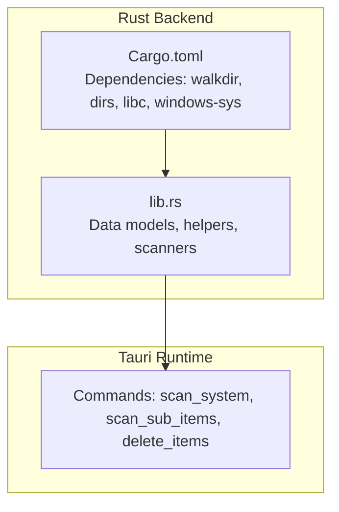
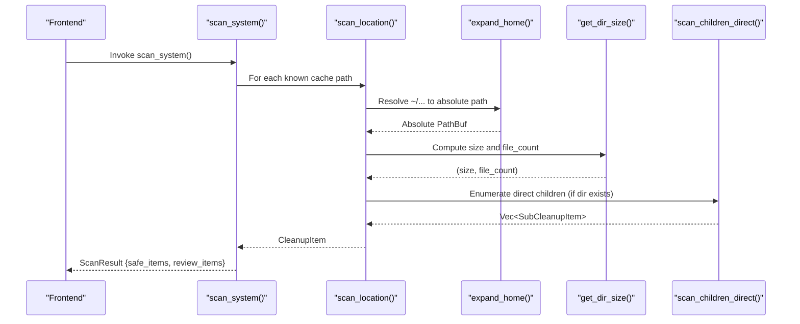
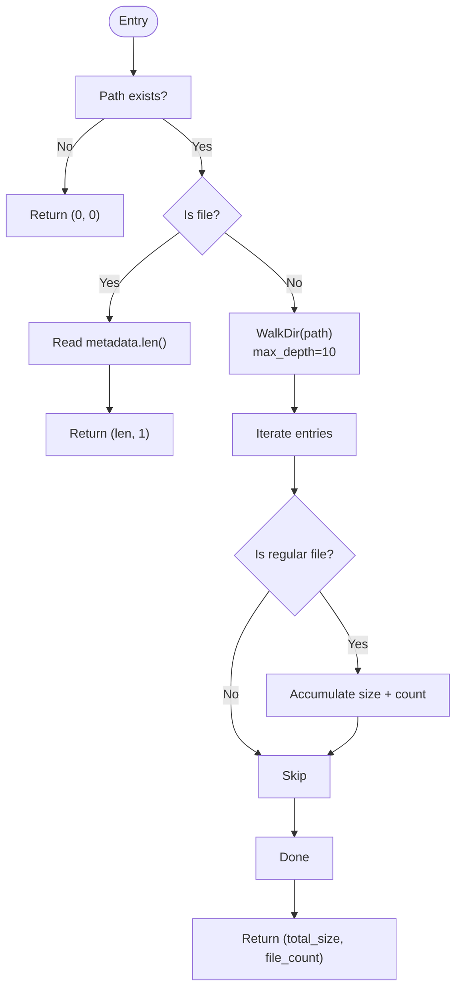
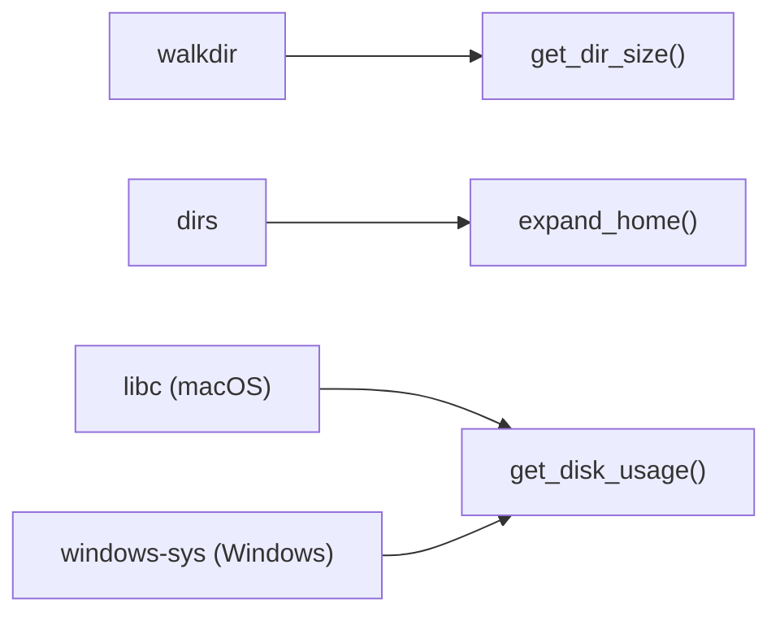

# Cache Detection Algorithms

<cite>
**Referenced Files in This Document**
- [lib.rs](file://src-tauri/src/lib.rs)
- [Cargo.toml](file://src-tauri/Cargo.toml)
</cite>

## Table of Contents
1. [Introduction](#introduction)
2. [Project Structure](#project-structure)
3. [Core Components](#core-components)
4. [Architecture Overview](#architecture-overview)
5. [Detailed Component Analysis](#detailed-component-analysis)
6. [Dependency Analysis](#dependency-analysis)
7. [Performance Considerations](#performance-considerations)
8. [Troubleshooting Guide](#troubleshooting-guide)
9. [Conclusion](#conclusion)

## Introduction
This document explains the cache detection algorithms used by the application, focusing on:
- The scan_location() function and its role in scanning and reporting cache locations
- Path resolution via expand_home() for tilde expansion
- Efficient directory size calculation with get_dir_size()
- Recursive traversal using WalkDir with depth limitations
- Optimization techniques to avoid scanning unnecessary files
- Complete mapping of supported cache locations for macOS and Windows
- Performance considerations and caching strategies during scanning operations

The implementation is written in Rust and exposed through Tauri commands.

## Project Structure
At a high level, the cache detection logic resides in the Rust backend library. Key responsibilities include:
- Data models for cleanup items and scan results
- Helper functions for path expansion, directory scanning, and size computation
- Platform-specific scanner implementations (macOS and Windows)
- Tauri command handlers that expose functionality to the frontend

**Diagram sources**
- [lib.rs:1-67](file://src-tauri/src/lib.rs#L1-L67)
- [Cargo.toml:15-29](file://src-tauri/Cargo.toml#L15-L29)

**Section sources**
- [lib.rs:1-67](file://src-tauri/src/lib.rs#L1-L67)
- [Cargo.toml:15-29](file://src-tauri/Cargo.toml#L15-L29)

## Core Components
- Data models: CleanupItem, SubCleanupItem, ScanResult, DiskUsage, SafetyLevel
- Helpers:
  - expand_home(): Resolves paths starting with ~/ to the user’s home directory
  - get_dir_size(): Computes total size and file count efficiently
  - scan_children_direct(): Lists immediate children with sizes and metadata
  - scan_location(): Builds a CleanupItem for a given location, computing existence, size, and top-level children
- Scanners:
  - macOS scan_system(): Returns safe and review-needed cache categories
  - Windows scan_system(): Returns platform-specific safe and review-needed cache categories
- Deletion utilities:
  - delete_target(), delete_dir_contents_resilient()

**Section sources**
- [lib.rs:8-67](file://src-tauri/src/lib.rs#L8-L67)
- [lib.rs:70-106](file://src-tauri/src/lib.rs#L70-L106)
- [lib.rs:108-201](file://src-tauri/src/lib.rs#L108-L201)
- [lib.rs:261-324](file://src-tauri/src/lib.rs#L261-L324)
- [lib.rs:410-744](file://src-tauri/src/lib.rs#L410-L744)
- [lib.rs:790-1054](file://src-tauri/src/lib.rs#L790-L1054)

## Architecture Overview
The scanning pipeline resolves paths, computes sizes, enumerates top-level children, and aggregates results into categorized lists.

**Diagram sources**
- [lib.rs:163-201](file://src-tauri/src/lib.rs#L163-L201)
- [lib.rs:99-106](file://src-tauri/src/lib.rs#L99-L106)
- [lib.rs:70-97](file://src-tauri/src/lib.rs#L70-L97)
- [lib.rs:108-161](file://src-tauri/src/lib.rs#L108-L161)
- [lib.rs:410-744](file://src-tauri/src/lib.rs#L410-L744)
- [lib.rs:790-1054](file://src-tauri/src/lib.rs#L790-L1054)

## Detailed Component Analysis

### Path Resolution: expand_home()
Purpose:
- Normalize paths beginning with ~/ to an absolute path under the current user’s home directory.
- If no tilde prefix is present, return the original path unchanged.

Behavior:
- Detects leading “~/” and joins the remainder with the resolved home directory.
- Falls back to the provided string if home directory cannot be determined.

Complexity:
- O(1) time and space; minimal string manipulation and path joining.

Edge cases:
- Missing home directory returns the original path.
- Paths without tilde are passed through unchanged.

**Section sources**
- [lib.rs:99-106](file://src-tauri/src/lib.rs#L99-L106)

### Directory Size Calculation: get_dir_size()
Purpose:
- Compute total size and file count for a given path.
- Optimize for single-file inputs and shallow directories.

Algorithm:
- If path does not exist, return (0, 0).
- If path is a file, read metadata once and return its length and count 1.
- Otherwise, traverse recursively with WalkDir up to a maximum depth.
- Sum file sizes and increment file counts only for regular files.

Optimizations:
- Early exit for non-existent or file-only paths.
- Depth limit prevents excessive recursion on deeply nested structures.
- Skips symlinks and non-files implicitly by checking file_type().

Complexity:
- Time: O(N) where N is the number of entries visited up to max_depth.
- Space: O(D) where D is the recursion depth bounded by max_depth.

**Diagram sources**
- [lib.rs:70-97](file://src-tauri/src/lib.rs#L70-L97)

**Section sources**
- [lib.rs:70-97](file://src-tauri/src/lib.rs#L70-L97)

### Child Enumeration: scan_children_direct()
Purpose:
- List immediate children of a directory with their sizes, file counts, and whether they contain further children.
- Filter out system noise like .DS_Store and .localized.

Behavior:
- Reads directory entries and computes size/file_count per child.
- For directories, calls get_dir_size() to compute totals.
- Checks presence of any subentries to set has_children flag.
- Sorts results by size descending for UI convenience.

Complexity:
- Time: O(K + S), where K is the number of direct children and S is the cost of size computation for directories.
- Space: O(K) to store the result vector.

**Section sources**
- [lib.rs:108-161](file://src-tauri/src/lib.rs#L108-L161)

### Location Scanner: scan_location()
Purpose:
- Build a CleanupItem for a specific cache location, including existence, size, category, safety level, description, and top-level children.

Flow:
- Expand path with expand_home().
- Check existence.
- Compute size and file_count via get_dir_size() if it exists.
- Populate children via scan_children_direct() if it is a directory.
- Assemble and return CleanupItem.

Complexity:
- Dominated by get_dir_size() and scan_children_direct().

**Section sources**
- [lib.rs:163-201](file://src-tauri/src/lib.rs#L163-L201)

### Category Root Matching: is_category_root()
Purpose:
- Determine whether a path belongs to a recognized category root across platforms.
- Normalizes separators and case to ensure consistent matching on macOS and Windows.

Use:
- Guides deletion strategy: contents-only deletion for category roots vs. full removal for other targets.

**Section sources**
- [lib.rs:203-259](file://src-tauri/src/lib.rs#L203-L259)

### Deletion Utilities
- delete_dir_contents_resilient(): Iterates entries, deletes files/directories resiliently, accumulates freed bytes and deleted counts, and reports errors.
- delete_target(): Dispatches deletion based on whether the target is a file, symlink, directory, or category root.

**Section sources**
- [lib.rs:261-324](file://src-tauri/src/lib.rs#L261-L324)

### macOS Scanner: scan_system()
Responsibilities:
- Gather disk usage.
- Build lists of safe and review-needed cache locations.
- Filter out non-existent or zero-size items.
- Aggregate totals for UI display.

Supported macOS Locations:
- Safe to delete:
  - User Caches: ~/Library/Caches
  - Xcode Interface Builder Cache: ~/Library/Developer/Xcode/UserData/IB Support
  - Python uv Package Cache: ~/.cache/uv
  - Google Chrome Cache: ~/Library/Caches/Google
  - Safari Cache: ~/Library/Caches/com.apple.Safari
  - Application Logs: ~/Library/Logs
  - Crash Reports: ~/Library/Application Support/CrashReporter
  - Trash Bin: ~/.Trash
  - Xcode Documentation Cache: ~/Library/Developer/Xcode/DocumentationCache
  - npm Package Cache: ~/.npm
  - Cargo Registry Cache: ~/.cargo/registry/cache
  - pip Download Cache: ~/Library/Caches/pip
  - Desktop App Update Cache: ~/Library/Caches/dev.kiro.desktop.ShipIt
  - DotSlash & CLI Cache: ~/Library/Caches/dotslash
  - Solana CLI Cache: ~/.cache/solana
- Needs review:
  - iOS DeviceSupport Symbols: ~/Library/Developer/Xcode/iOS DeviceSupport
  - Xcode DerivedData: ~/Library/Developer/Xcode/DerivedData
  - Xcode Archives: ~/Library/Developer/Xcode/Archives
  - iOS Simulators Data: ~/Library/Developer/CoreSimulator/Devices
  - HuggingFace AI Models: ~/.cache/huggingface
  - ProfileForge Cache: ~/.cache/profileforge
  - Yarn Cache: ~/Library/Caches/Yarn
  - CocoaPods Cache: ~/Library/Caches/CocoaPods
  - Gradle Caches: ~/.gradle/caches
  - Meteor Framework Packages: ~/.meteor/packages
  - Docker Data: ~/Library/Containers/com.docker.docker
  - VS Code Cache: ~/Library/Application Support/Code/Cache
  - Spotify Offline Cache: ~/Library/Application Support/Spotify/PersistentCache
  - Homebrew Cache: ~/Library/Caches/Homebrew
  - Downloads Folder: ~/Downloads

**Section sources**
- [lib.rs:410-744](file://src-tauri/src/lib.rs#L410-L744)

### Windows Scanner: scan_system()
Responsibilities:
- Gather disk usage.
- Build lists of safe and review-needed cache locations.
- Filter out non-existent or zero-size items.
- Aggregate totals for UI display.

Supported Windows Locations:
- Safe to delete:
  - User Temp Files: ~/AppData/Local/Temp
  - Windows System Temp: C:/Windows/Temp
  - Google Chrome Cache: ~/AppData/Local/Google/Chrome/User Data/Default/Cache
  - Microsoft Edge Cache: ~/AppData/Local/Microsoft/Edge/User Data/Default/Cache
  - Windows INetCache: ~/AppData/Local/Microsoft/Windows/INetCache
  - DirectX Shader Cache: ~/AppData/Local/D3DSCache
  - Windows Error Reports: ~/AppData/Local/Microsoft/Windows/WER
  - User Crash Dumps: ~/AppData/Local/CrashDumps
  - npm Package Cache: ~/AppData/Local/npm-cache
  - pip Download Cache: ~/AppData/Local/pip/cache
  - Python uv Package Cache: ~/AppData/Local/uv/cache
  - Cargo Registry Cache: ~/.cargo/registry/cache
- Needs review:
  - Downloads Folder: ~/Downloads
  - Recycle Bin: C:/$Recycle.Bin
  - Windows Update Download Cache: C:/Windows/SoftwareDistribution/Download
  - Windows.old: C:/Windows.old
  - HuggingFace AI Models: ~/.cache/huggingface
  - Gradle Caches: ~/.gradle/caches
  - NuGet Package Cache: ~/.nuget/packages
  - Docker Desktop Data: ~/AppData/Local/Docker
  - VS Code Cache: ~/AppData/Roaming/Code/Cache
  - Spotify Offline Cache: ~/AppData/Roaming/Spotify/Storage
  - Yarn Cache: ~/AppData/Local/Yarn/Cache

**Section sources**
- [lib.rs:790-1054](file://src-tauri/src/lib.rs#L790-L1054)

## Dependency Analysis
Key external dependencies enabling the cache detection algorithms:
- walkdir: Provides efficient recursive directory traversal with configurable depth limits.
- dirs: Supplies the user’s home directory for tilde expansion.
- libc (macOS): Used for low-level filesystem statistics to compute disk usage.
- windows-sys (Windows): Used for low-level filesystem APIs to compute disk usage.

**Diagram sources**
- [lib.rs:70-97](file://src-tauri/src/lib.rs#L70-L97)
- [lib.rs:99-106](file://src-tauri/src/lib.rs#L99-L106)
- [lib.rs:328-399](file://src-tauri/src/lib.rs#L328-L399)
- [Cargo.toml:15-29](file://src-tauri/Cargo.toml#L15-L29)

**Section sources**
- [Cargo.toml:15-29](file://src-tauri/Cargo.toml#L15-L29)
- [lib.rs:70-97](file://src-tauri/src/lib.rs#L70-L97)
- [lib.rs:99-106](file://src-tauri/src/lib.rs#L99-L106)
- [lib.rs:328-399](file://src-tauri/src/lib.rs#L328-L399)

## Performance Considerations
- Depth-limited traversal: WalkDir::max_depth(10) prevents deep recursion and reduces I/O overhead on extremely nested caches.
- Early exits: Non-existent paths and single-file inputs bypass expensive traversal.
- Shallow enumeration: scan_children_direct() avoids deep scans when listing top-level children; it only computes sizes for immediate children.
- Filtering noise: Excluding .DS_Store and .localized reduces unnecessary processing.
- Sorting by size: Improves UX by presenting larger items first, aiding quick decisions.
- Category-root optimization: Deletion uses content-only removal for recognized category roots, minimizing risk and improving resilience.

Caching strategies during scanning:
- No in-memory caching of directory listings; results are computed on demand.
- Results are filtered post-computation to exclude non-existent or zero-size items, reducing UI clutter.

Recommendations:
- Consider parallelizing size computations for independent directories if performance becomes a bottleneck.
- Introduce incremental scanning with timestamps to skip unchanged directories.
- Add progress reporting for long-running scans to improve responsiveness.

[No sources needed since this section provides general guidance]

## Troubleshooting Guide
Common issues and resolutions:
- Empty scan results:
  - Ensure the target paths exist; non-existent locations are filtered out.
  - Verify permissions to read directories and files.
- Slow scans:
  - Deeply nested directories may increase traversal time; consider excluding known large but irrelevant subtrees.
- Permission errors during deletion:
  - Some locations require elevated privileges (e.g., Windows system temp, recycle bin). Run with appropriate rights.
- Unexpected missing children:
  - Children with zero size and file count are excluded from results to keep the UI focused.

Operational notes:
- Category-root deletions remove contents rather than the root folder itself, preserving expected directory structure.
- Errors during deletion are aggregated and reported back to the caller.

**Section sources**
- [lib.rs:203-259](file://src-tauri/src/lib.rs#L203-L259)
- [lib.rs:261-324](file://src-tauri/src/lib.rs#L261-L324)
- [lib.rs:1056-1082](file://src-tauri/src/lib.rs#L1056-L1082)

## Conclusion
The cache detection system combines robust path resolution, efficient directory traversal, and platform-aware categorization to provide accurate and actionable insights into reclaimable storage. By leveraging depth-limited recursion, early exits, and targeted child enumeration, the implementation balances accuracy with performance. The comprehensive mappings for macOS and Windows ensure broad coverage while maintaining safety through clear categorization and resilient deletion strategies.

[No sources needed since this section summarizes without analyzing specific files]