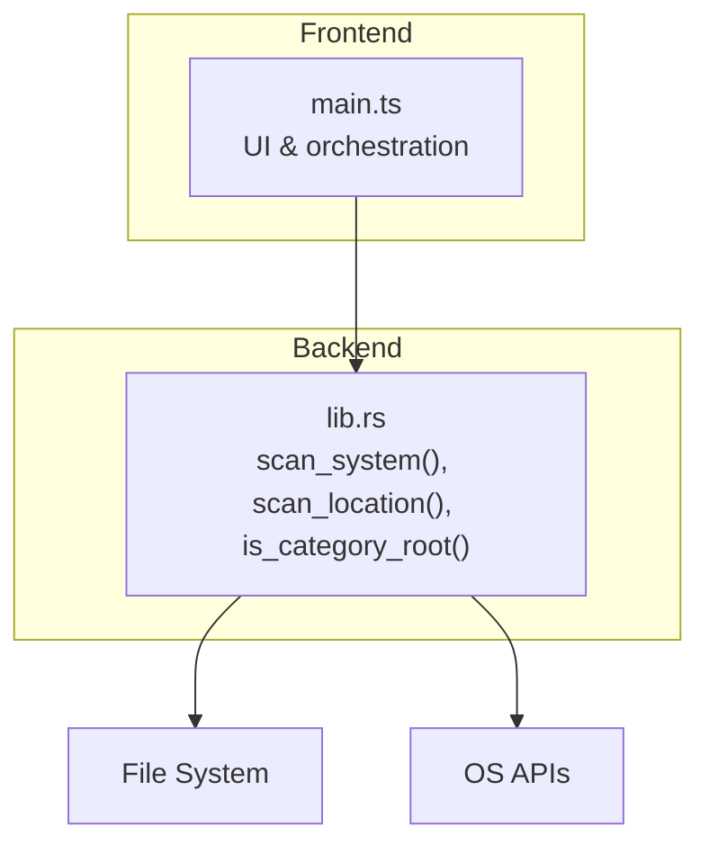
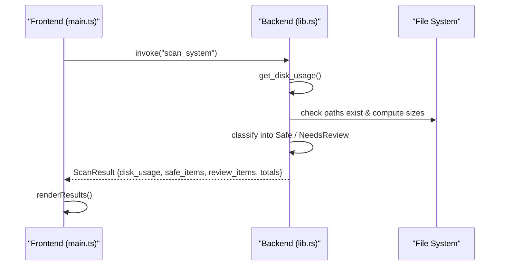
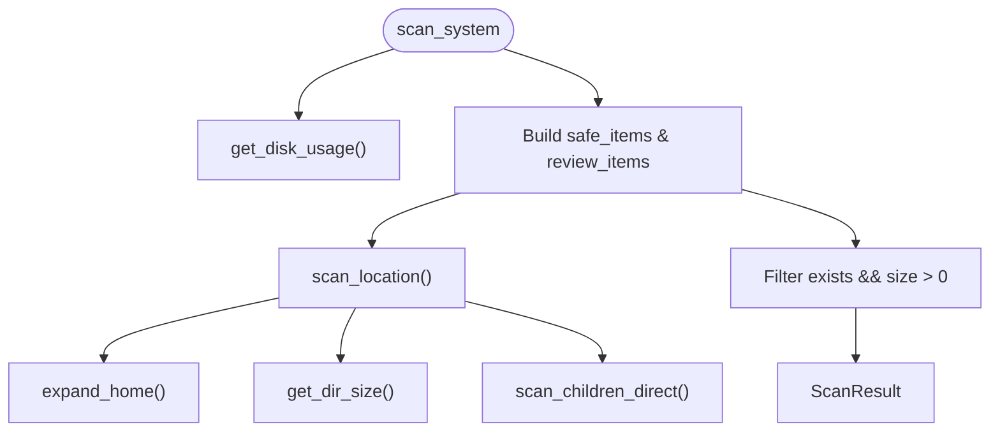

# Intelligent Cache Scanning

<cite>
**Referenced Files in This Document**
- [lib.rs](file://src-tauri/src/lib.rs)
- [main.ts](file://src/main.ts)
</cite>

## Table of Contents
1. [Introduction](#introduction)
2. [Project Structure](#project-structure)
3. [Core Components](#core-components)
4. [Architecture Overview](#architecture-overview)
5. [Detailed Component Analysis](#detailed-component-analysis)
6. [Dependency Analysis](#dependency-analysis)
7. [Performance Considerations](#performance-considerations)
8. [Troubleshooting Guide](#troubleshooting-guide)
9. [Conclusion](#conclusion)
10. [Appendices](#appendices)

## Introduction
This document explains the intelligent cache scanning system that automatically detects and classifies cache directories across macOS and Windows, covering browsers, development tools, and system caches. It focuses on:
- The scan_system() function for automatic detection
- The safety classification system (Safe vs Needs Review)
- The scan_location() function and directory processing logic
- Supported cache locations and their safety classifications
- Filtering mechanism for empty or non-existent directories
- How to add new categories and customize safety rules via is_category_root()

## Project Structure
The scanning system is implemented as a Tauri application with:
- Backend Rust logic handling platform-specific scans, size calculations, and deletion
- Frontend TypeScript UI invoking backend commands and rendering results

**Diagram sources**
- [main.ts:837-896](file://src/main.ts#L837-L896)
- [lib.rs:410-744](file://src-tauri/src/lib.rs#L410-L744)
- [lib.rs:790-1054](file://src-tauri/src/lib.rs#L790-L1054)

**Section sources**
- [main.ts:837-896](file://src/main.ts#L837-L896)
- [lib.rs:410-744](file://src-tauri/src/lib.rs#L410-L744)
- [lib.rs:790-1054](file://src-tauri/src/lib.rs#L790-L1054)

## Core Components
- SafetyLevel enum: Safe, NeedsReview
- CleanupItem: represents a scanned location with metadata and children
- SubCleanupItem: child entries within a directory
- ScanResult: aggregates disk usage and categorized items
- Functions:
  - get_dir_size(): calculates total size and file count up to a depth limit
  - expand_home(): expands ~ to home directory
  - scan_children_direct(): lists immediate children, skipping system artifacts and empty entries
  - scan_location(): builds a CleanupItem for a path
  - is_category_root(): determines if a path matches known root patterns for safe deletion
  - delete_target() / delete_dir_contents_resilient(): resilient deletion helpers
  - scan_system(): platform-specific scanner returning ScanResult

**Section sources**
- [lib.rs:8-66](file://src-tauri/src/lib.rs#L8-L66)
- [lib.rs:70-97](file://src-tauri/src/lib.rs#L70-L97)
- [lib.rs:99-106](file://src-tauri/src/lib.rs#L99-L106)
- [lib.rs:108-161](file://src-tauri/src/lib.rs#L108-L161)
- [lib.rs:163-201](file://src-tauri/src/lib.rs#L163-L201)
- [lib.rs:203-259](file://src-tauri/src/lib.rs#L203-L259)
- [lib.rs:261-324](file://src-tauri/src/lib.rs#L261-L324)

## Architecture Overview
The frontend triggers a scan by invoking the backend command. The backend computes disk usage, enumerates predefined cache locations per platform, classifies them by safety level, and returns structured results.

**Diagram sources**
- [main.ts:837-896](file://src/main.ts#L837-L896)
- [lib.rs:410-744](file://src-tauri/src/lib.rs#L410-L744)
- [lib.rs:790-1054](file://src-tauri/src/lib.rs#L790-L1054)

## Detailed Component Analysis

### scan_system() Function
Purpose:
- Automatically detect cache directories across applications and system locations
- Classify each target into Safe or NeedsReview
- Return aggregated results including disk usage and totals

Behavior:
- macOS implementation constructs two vectors:
  - safe_items: 100% safe caches/logs/temp
  - review_items: developer artifacts, simulators, downloads, AI models, etc.
- Windows implementation mirrors this structure with Windows-specific paths
- Each item is created via scan_location() and filtered to exclude non-existent or zero-size entries
- Returns ScanResult with disk_usage, categorized items, and total sizes

Key responsibilities:
- Platform-specific path enumeration
- Safety classification
- Aggregation and filtering

**Section sources**
- [lib.rs:410-744](file://src-tauri/src/lib.rs#L410-L744)
- [lib.rs:790-1054](file://src-tauri/src/lib.rs#L790-L1054)

### scan_location() Function
Purpose:
- Build a CleanupItem for a given path with metadata and children

Processing steps:
- Expand ~ to home directory
- Check existence
- Compute size and file count using get_dir_size()
- If directory exists, list immediate children via scan_children_direct()
- Populate CleanupItem fields: id, name, path, size, category, icon, safety_level, description, safety_tip, file_count, exists, children

Output:
- A fully populated CleanupItem ready for UI rendering and deletion

**Section sources**
- [lib.rs:163-201](file://src-tauri/src/lib.rs#L163-L201)

### Safety Classification System
Categories:
- Safe: 100% safe to clean; data is transient and auto-regenerated by apps/system
- NeedsReview: may require re-downloading/building; includes developer artifacts, simulators, downloads, AI models

Criteria:
- Safe typically includes browser caches, temp folders, logs, crash reports, package manager download caches
- NeedsReview includes build outputs, simulator data, downloaded installers, large model caches, Docker images/containers

Implementation:
- Each scan_location() call assigns SafetyLevel::Safe or SafetyLevel::NeedsReview
- Items are grouped into safe_items and review_items arrays

**Section sources**
- [lib.rs:8-12](file://src-tauri/src/lib.rs#L8-L12)
- [lib.rs:420-575](file://src-tauri/src/lib.rs#L420-L575)
- [lib.rs:577-732](file://src-tauri/src/lib.rs#L577-L732)
- [lib.rs:800-925](file://src-tauri/src/lib.rs#L800-L925)
- [lib.rs:927-1042](file://src-tauri/src/lib.rs#L927-L1042)

### Directory Processing Logic
- get_dir_size(): walks directory tree up to a maximum depth, summing file sizes and counting files
- scan_children_direct(): reads immediate directory entries, skips .DS_Store and .localized, excludes empty entries, sorts by size descending
- expand_home(): resolves ~ to user’s home directory

Complexity considerations:
- Depth-limited traversal prevents excessive recursion
- Sorting by size helps prioritize larger targets in UI

**Section sources**
- [lib.rs:70-97](file://src-tauri/src/lib.rs#L70-L97)
- [lib.rs:108-161](file://src-tauri/src/lib.rs#L108-L161)
- [lib.rs:99-106](file://src-tauri/src/lib.rs#L99-L106)

### Filtering Mechanism
- After building CleanupItem instances, both safe_items and review_items are filtered to include only items where exists is true and size > 0
- This ensures non-existent or empty directories are excluded from results

**Section sources**
- [lib.rs:572-575](file://src-tauri/src/lib.rs#L572-L575)
- [lib.rs:729-732](file://src-tauri/src/lib.rs#L729-L732)
- [lib.rs:923-925](file://src-tauri/src/lib.rs#L923-L925)
- [lib.rs:1040-1042](file://src-tauri/src/lib.rs#L1040-L1042)

### Deletion Safety Rules via is_category_root()
Purpose:
- Determine whether a path is a recognized “category root” eligible for resilient content-only deletion

Rules:
- Normalizes path separators and case for cross-platform matching
- Matches against a comprehensive list of known roots for macOS and Windows
- Used by delete_target() to decide between deleting contents vs entire directory/file

Extensibility:
- Add new roots to the array to support additional safe-to-clean locations

**Section sources**
- [lib.rs:203-259](file://src-tauri/src/lib.rs#L203-L259)
- [lib.rs:301-324](file://src-tauri/src/lib.rs#L301-L324)

## Dependency Analysis

**Diagram sources**
- [lib.rs:410-744](file://src-tauri/src/lib.rs#L410-L744)
- [lib.rs:790-1054](file://src-tauri/src/lib.rs#L790-L1054)
- [lib.rs:70-97](file://src-tauri/src/lib.rs#L70-L97)
- [lib.rs:99-106](file://src-tauri/src/lib.rs#L99-L106)
- [lib.rs:108-161](file://src-tauri/src/lib.rs#L108-L161)

**Section sources**
- [lib.rs:410-744](file://src-tauri/src/lib.rs#L410-L744)
- [lib.rs:790-1054](file://src-tauri/src/lib.rs#L790-L1054)

## Performance Considerations
- Depth-limited directory walking reduces I/O overhead
- Sorting children by size improves UX by highlighting larger targets first
- Filtering out non-existent/empty items avoids unnecessary UI work
- Resilient deletion attempts to remove contents when full removal fails, minimizing errors

[No sources needed since this section provides general guidance]

## Troubleshooting Guide
Common issues and resolutions:
- Permission errors during deletion: Some system directories require elevated privileges; ensure appropriate permissions or run with admin rights where necessary
- Locked files: Temp files may be locked by running processes; retry after closing relevant apps
- Path expansion failures: Ensure home directory resolution works correctly on the current OS
- Empty results: Verify that cache directories exist and contain data; some environments may not have certain caches populated

Operational notes:
- The frontend shows status messages while scanning and displays toast notifications for success/failure
- Errors from deletion are collected and reported back to the UI

**Section sources**
- [main.ts:837-896](file://src/main.ts#L837-L896)
- [lib.rs:261-324](file://src-tauri/src/lib.rs#L261-L324)

## Conclusion
The intelligent cache scanning system provides a robust, cross-platform solution for identifying and safely cleaning cache directories. By classifying targets into Safe and NeedsReview categories and leveraging resilient deletion logic, it balances space recovery with user safety. The design supports easy extension through is_category_root() and clear separation of concerns between scanning, classification, and deletion.

[No sources needed since this section summarizes without analyzing specific files]

## Appendices

### Complete List of Supported Cache Locations and Safety Classifications

macOS Safe (100% safe):
- User Caches: ~/Library/Caches
- Xcode Interface Builder Cache: ~/Library/Developer/Xcode/UserData/IB Support
- Python uv Package Cache: ~/.cache/uv
- Google Chrome Cache: ~/Library/Caches/Google
- Safari Cache: ~/Library/Caches/com.apple.Safari
- Application Logs: ~/Library/Logs
- Crash Reports: ~/Library/Application Support/CrashReporter
- Trash Bin: ~/.Trash
- Xcode Documentation Cache: ~/Library/Developer/Xcode/DocumentationCache
- npm Package Cache: ~/.npm
- Cargo Registry Cache: ~/.cargo/registry/cache
- pip Download Cache: ~/Library/Caches/pip
- Desktop App Update Cache: ~/Library/Caches/dev.kiro.desktop.ShipIt
- DotSlash & CLI Cache: ~/Library/Caches/dotslash
- Solana CLI Cache: ~/.cache/solana

macOS Needs Review:
- iOS DeviceSupport Symbols: ~/Library/Developer/Xcode/iOS DeviceSupport
- Xcode DerivedData: ~/Library/Developer/Xcode/DerivedData
- Xcode Archives: ~/Library/Developer/Xcode/Archives
- iOS Simulators Data: ~/Library/Developer/CoreSimulator/Devices
- HuggingFace AI Models: ~/.cache/huggingface
- ProfileForge Cache: ~/.cache/profileforge
- Yarn Cache: ~/Library/Caches/Yarn
- CocoaPods Cache: ~/Library/Caches/CocoaPods
- Gradle Caches: ~/.gradle/caches
- Meteor Framework Packages: ~/.meteor/packages
- Docker Data: ~/Library/Containers/com.docker.docker
- VS Code Cache: ~/Library/Application Support/Code/Cache
- Spotify Offline Cache: ~/Library/Application Support/Spotify/PersistentCache
- Homebrew Cache: ~/Library/Caches/Homebrew
- Downloads Folder: ~/Downloads

Windows Safe (100% safe):
- User Temp Files: ~/AppData/Local/Temp
- Windows System Temp: C:/Windows/Temp
- Google Chrome Cache: ~/AppData/Local/Google/Chrome/User Data/Default/Cache
- Microsoft Edge Cache: ~/AppData/Local/Microsoft/Edge/User Data/Default/Cache
- Windows INetCache: ~/AppData/Local/Microsoft/Windows/INetCache
- DirectX Shader Cache: ~/AppData/Local/D3DSCache
- Windows Error Reports: ~/AppData/Local/Microsoft/Windows/WER
- User Crash Dumps: ~/AppData/Local/CrashDumps
- npm Package Cache: ~/AppData/Local/npm-cache
- pip Download Cache: ~/AppData/Local/pip/cache
- Python uv Package Cache: ~/AppData/Local/uv/cache
- Cargo Registry Cache: ~/.cargo/registry/cache

Windows Needs Review:
- Downloads Folder: ~/Downloads
- Recycle Bin: C:/$Recycle.Bin
- Windows Update Download Cache: C:/Windows/SoftwareDistribution/Download
- Windows.old: C:/Windows.old
- HuggingFace AI Models: ~/.cache/huggingface
- Gradle Caches: ~/.gradle/caches
- NuGet Package Cache: ~/.nuget/packages
- Docker Desktop Data: ~/AppData/Local/Docker
- VS Code Cache: ~/AppData/Roaming/Code/Cache
- Spotify Offline Cache: ~/AppData/Roaming/Spotify/Storage
- Yarn Cache: ~/AppData/Local/Yarn/Cache

Notes:
- All items are filtered to exclude non-existent or zero-size directories before inclusion in results
- Safety classification reflects whether data is transient/auto-regenerated (Safe) or requires rebuild/re-download (NeedsReview)

**Section sources**
- [lib.rs:420-575](file://src-tauri/src/lib.rs#L420-L575)
- [lib.rs:577-732](file://src-tauri/src/lib.rs#L577-L732)
- [lib.rs:800-925](file://src-tauri/src/lib.rs#L800-L925)
- [lib.rs:927-1042](file://src-tauri/src/lib.rs#L927-L1042)

### Adding New Cache Categories and Customizing Safety Rules
To add a new cache category:
- Define a new entry in the appropriate platform-specific vector (safe_items or review_items) using scan_location()
- Assign a meaningful id, name, path, category, icon, safety_level, description, and safety_tip
- If the new path should be treated as a safe-to-clean root for deletion, add its normalized suffix to is_category_root() roots array

Example pattern:
- Use scan_location() to create the item
- Choose SafetyLevel based on whether the data is transient or requires regeneration
- Extend is_category_root() if the path is a recognized root for resilient deletion

**Section sources**
- [lib.rs:163-201](file://src-tauri/src/lib.rs#L163-L201)
- [lib.rs:203-259](file://src-tauri/src/lib.rs#L203-L259)
- [lib.rs:420-575](file://src-tauri/src/lib.rs#L420-L575)
- [lib.rs:577-732](file://src-tauri/src/lib.rs#L577-L732)
- [lib.rs:800-925](file://src-tauri/src/lib.rs#L800-L925)
- [lib.rs:927-1042](file://src-tauri/src/lib.rs#L927-L1042)