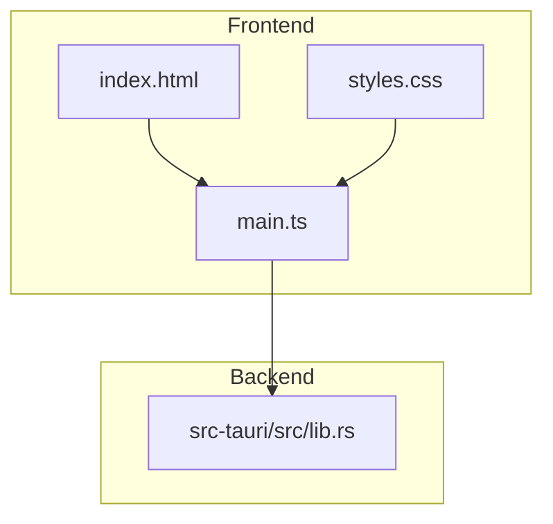
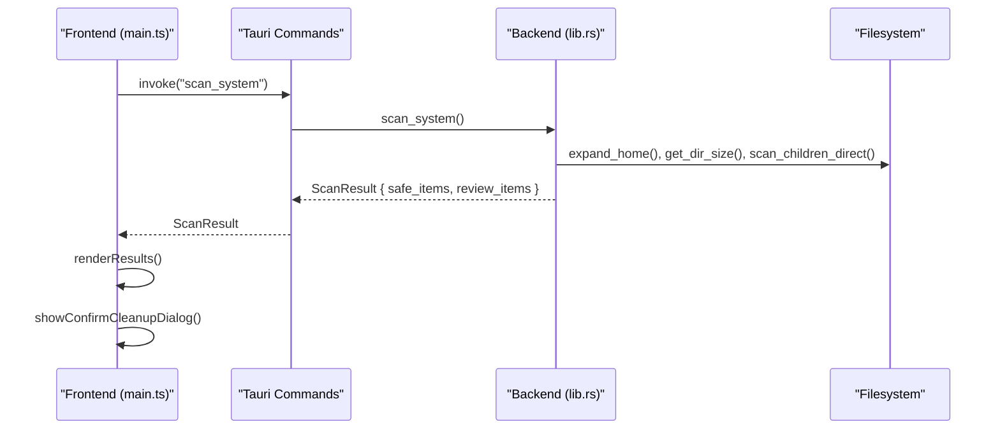
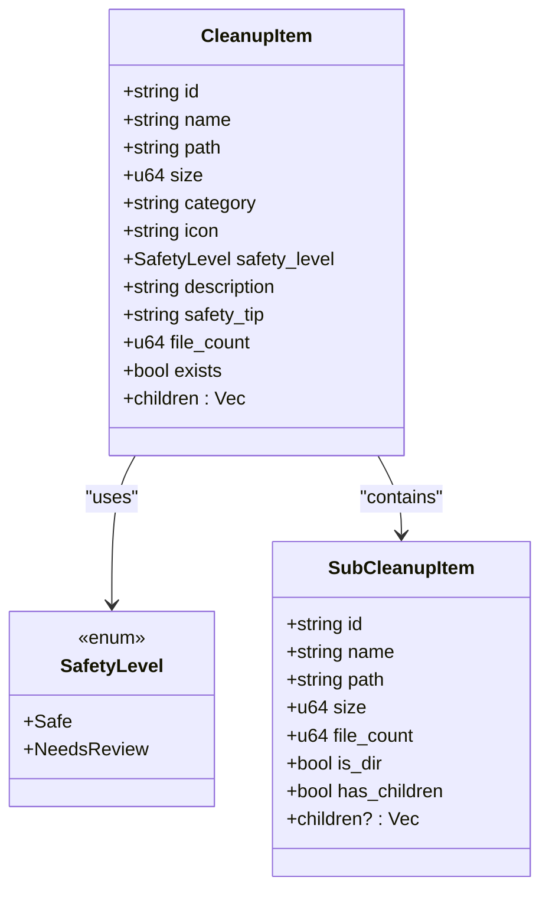
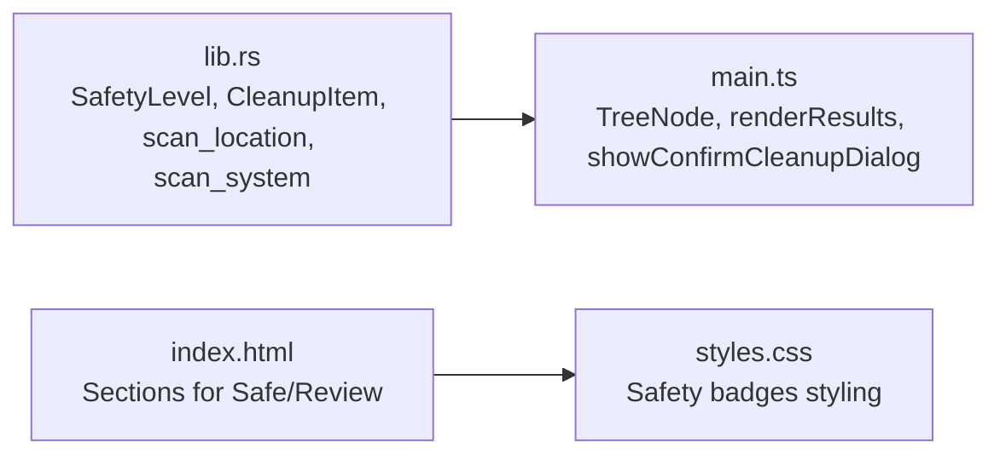

# Safety Classification System

<cite>
**Referenced Files in This Document**
- [lib.rs](file://src-tauri/src/lib.rs)
- [main.ts](file://src/main.ts)
- [index.html](file://index.html)
- [styles.css](file://src/styles.css)
- [README.md](file://README.md)
</cite>

## Table of Contents
1. [Introduction](#introduction)
2. [Project Structure](#project-structure)
3. [Core Components](#core-components)
4. [Architecture Overview](#architecture-overview)
5. [Detailed Component Analysis](#detailed-component-analysis)
6. [Dependency Analysis](#dependency-analysis)
7. [Performance Considerations](#performance-considerations)
8. [Troubleshooting Guide](#troubleshooting-guide)
9. [Conclusion](#conclusion)
10. [Appendices](#appendices)

## Introduction
This document explains the safety classification system used by FreeSpace to categorize cleanup targets on macOS and Windows. It focuses on:
- The SafetyLevel enum with Safe and NeedsReview variants
- Criteria for classifying each target as safe or requiring review
- The extensive lists of safe-to-delete and needs-review items (User Caches, Logs, Trash, Browser Caches, Xcode artifacts, Simulators, Downloads, etc.)
- Rationale behind classifications with concrete examples from the codebase
- Guidelines for evaluating new cache locations and assigning appropriate safety levels
- User communication strategies for explaining safety classifications in the UI

The goal is to make the safety model transparent, consistent, and actionable for both developers extending the scanner and end users operating the app.

## Project Structure
FreeSpace uses a Tauri architecture:
- Backend (Rust): Implements scanning, safety classification, deletion logic, and platform-specific paths.
- Frontend (TypeScript/HTML/CSS): Renders results, manages selection state, and displays safety badges and confirmation dialogs.

**Diagram sources**
- [index.html:1-141](file://index.html#L1-L141)
- [main.ts:1-120](file://src/main.ts#L1-L120)
- [styles.css:1190-1297](file://src/styles.css#L1190-L1297)
- [lib.rs:1-66](file://src-tauri/src/lib.rs#L1-L66)

**Section sources**
- [index.html:1-141](file://index.html#L1-L141)
- [main.ts:1-120](file://src/main.ts#L1-L120)
- [styles.css:1190-1297](file://src/styles.css#L1190-L1297)
- [lib.rs:1-66](file://src-tauri/src/lib.rs#L1-L66)

## Core Components
At the core of the safety classification system are:
- SafetyLevel enum defining Safe and NeedsReview
- CleanupItem struct carrying metadata including safety_level, description, and safety_tip
- scan_location helper that builds CleanupItem entries with explicit safety classification
- Platform-specific scan_system functions populating safe_items and review_items lists
- Frontend rendering of safety badges and confirmation dialog grouping items by safety level

Key responsibilities:
- Backend defines the taxonomy and rationale via descriptions and tips
- Frontend visualizes safety levels and guides user decisions

**Section sources**
- [lib.rs:8-41](file://src-tauri/src/lib.rs#L8-L41)
- [lib.rs:163-201](file://src-tauri/src/lib.rs#L163-L201)
- [lib.rs:410-744](file://src-tauri/src/lib.rs#L410-L744)
- [lib.rs:790-1054](file://src-tauri/src/lib.rs#L790-L1054)
- [main.ts:16-29](file://src/main.ts#L16-L29)
- [main.ts:626-696](file://src/main.ts#L626-L696)

## Architecture Overview
The safety classification flows from backend definitions to frontend presentation:

**Diagram sources**
- [main.ts:700-800](file://src/main.ts#L700-L800)
- [lib.rs:410-744](file://src-tauri/src/lib.rs#L410-L744)
- [lib.rs:790-1054](file://src-tauri/src/lib.rs#L790-L1054)

## Detailed Component Analysis

### SafetyLevel Enum and Data Model
SafetyLevel is an enum with two variants:
- Safe: Targets considered safe to delete; typically caches/logs/trash that apps/systems regenerate automatically without losing personal data.
- NeedsReview: Targets that may require re-downloading/rebuilding or could contain user data; deletion should be reviewed explicitly.

CleanupItem carries:
- Identification and path
- Size and file count
- Category and icon
- safety_level (Safe or NeedsReview)
- description and safety_tip (rationale and guidance)
- children (sub-items for hierarchical browsing)

**Diagram sources**
- [lib.rs:8-41](file://src-tauri/src/lib.rs#L8-L41)

**Section sources**
- [lib.rs:8-41](file://src-tauri/src/lib.rs#L8-L41)

### Safe-to-Delete Items (Safe)
These items are classified as Safe because they are transient caches, logs, or trash that applications and the OS can regenerate safely without impacting user data or account state. Examples include:
- User Caches (~/Library/Caches)
- Application Logs (~/Library/Logs)
- Crash Reports (~/Library/Application Support/CrashReporter)
- Trash Bin (~/.Trash)
- Safari Cache (~/Library/Caches/com.apple.Safari)
- Google Chrome Cache (~/Library/Caches/Google)
- Xcode Interface Builder Cache (IB Support)
- Xcode Documentation Cache (DocumentationCache)
- npm Package Cache (~/.npm)
- Cargo Registry Cache (~/.cargo/registry/cache)
- pip Download Cache (~/Library/Caches/pip)
- Desktop App Update Cache (e.g., Kiro Desktop ShipIt)
- DotSlash & CLI Cache
- Solana CLI Cache
- Python uv Package Cache (~/.cache/uv)

Rationale patterns:
- Regenerable caches: Apps recreate these when needed; no loss of bookmarks, passwords, or sessions.
- Logs and crash reports: Useful for diagnostics but not required for normal operation.
- Trash: Already deleted by user; clearing empties the bin.

Examples from code:
- Safe items list construction and safety tips are defined in the macOS scan function.
- Each entry includes a description and a safety_tip clarifying why it is safe.

**Section sources**
- [lib.rs:420-575](file://src-tauri/src/lib.rs#L420-L575)
- [README.md:11-16](file://README.md#L11-L16)

### Needs-Review Items (NeedsReview)
These items are classified as NeedsReview because deleting them may trigger re-downloads, rebuilds, or affect user data. Examples include:
- iOS DeviceSupport Symbols (Xcode symbols for connected devices)
- Xcode DerivedData (build intermediates and indexes)
- Xcode Archives (.xcarchive bundles)
- iOS Simulator Devices (simulator device data)
- HuggingFace AI Models (~/.cache/huggingface)
- ProfileForge Cache
- Yarn Cache (~/Library/Caches/Yarn)
- CocoaPods Cache (~/Library/Caches/CocoaPods)
- Gradle Caches (~/.gradle/caches)
- Meteor Packages (~/.meteor/packages)
- Docker Data (containers/images/volumes)
- VS Code Cache
- Spotify Offline Cache
- Homebrew Cache
- Downloads Folder (~/Downloads)

Rationale patterns:
- Build artifacts and package caches: Rebuild/install will re-download dependencies.
- Simulators and device support: Deleting resets simulator state or removes symbols used during debugging.
- User data folders (Downloads): May contain important files; requires careful selection.
- AI models and large datasets: Re-downloading over network may be time-consuming.

Examples from code:
- NeedsReview items list construction and safety tips are defined in the macOS scan function.
- Each entry includes a description and a safety_tip explaining potential consequences.

**Section sources**
- [lib.rs:577-732](file://src-tauri/src/lib.rs#L577-L732)
- [README.md:17-23](file://README.md#L17-L23)

### Windows-Specific Classifications
Windows also has Safe and NeedsReview categories:
- Safe: User Temp, Windows System Temp, browser caches (Chrome, Edge), INetCache, DirectX Shader Cache, WER reports, crash dumps, npm/pip/uv/cargo caches.
- NeedsReview: Downloads folder, Recycle Bin, Windows Update download cache, Windows.old, HuggingFace cache, Gradle cache, NuGet packages, Docker Desktop data, VS Code cache, Spotify offline cache, Yarn cache.

These follow the same rationale patterns as macOS: regenerable caches vs. build/user data.

**Section sources**
- [lib.rs:800-925](file://src-tauri/src/lib.rs#L800-L925)
- [lib.rs:927-1042](file://src-tauri/src/lib.rs#L927-L1042)

### Criteria for Classification
Criteria used to determine Safe vs. NeedsReview:
- Regenerability: If the item is a cache/log/trash that apps/systems regenerate without affecting user data, classify as Safe.
- Impact of deletion: If deletion causes re-downloads/rebuilds or affects user data, classify as NeedsReview.
- User intent: Trash and downloads require caution; trash is generally safe after user deletion, while downloads need explicit review.
- Tooling behavior: Package managers (npm, yarn, cargo, gradle, cocoapods, nuget) can re-fetch dependencies; mark as NeedsReview if deletion impacts immediate workflow.
- Debugging artifacts: Xcode symbols and archives are useful for debugging; mark as NeedsReview to avoid accidental loss.

Implementation evidence:
- Descriptions and safety_tips explain the impact and regeneration behavior for each item.
- The scan_system functions separate items into safe_items and review_items based on these criteria.

**Section sources**
- [lib.rs:420-732](file://src-tauri/src/lib.rs#L420-L732)
- [lib.rs:800-1042](file://src-tauri/src/lib.rs#L800-L1042)

### User Communication Strategies in the UI
The frontend communicates safety clearly:
- Safety badges: Green badge for Safe (“100% An toàn”), yellow badge for NeedsReview (“Cần xem xét”).
- Section headers: “Safe to Clean” and “Needs Review” sections with explanatory subtitles.
- Confirmation dialog: Groups selected items by safety level, shows totals, and warns about NeedsReview items.
- Safety tips: Per-item tips displayed under descriptions to guide users.

Guidelines:
- Always display safety_level alongside item names.
- Provide concise safety_tip text explaining regeneration or re-download implications.
- Use color-coded badges consistently across UI elements.
- In confirmation dialogs, highlight any NeedsReview selections and advise expanding categories to deselect sensitive files.

**Section sources**
- [main.ts:626-696](file://src/main.ts#L626-L696)
- [main.ts:146-243](file://src/main.ts#L146-L243)
- [index.html:81-119](file://index.html#L81-L119)
- [styles.css:1231-1270](file://src/styles.css#L1231-L1270)

## Dependency Analysis
The safety classification depends on:
- Backend definitions of Safe/NeedsReview items and their rationales
- Path expansion and directory scanning utilities
- Frontend rendering of safety badges and confirmation dialogs

**Diagram sources**
- [lib.rs:8-41](file://src-tauri/src/lib.rs#L8-L41)
- [lib.rs:163-201](file://src-tauri/src/lib.rs#L163-L201)
- [lib.rs:410-744](file://src-tauri/src/lib.rs#L410-L744)
- [lib.rs:790-1054](file://src-tauri/src/lib.rs#L790-L1054)
- [main.ts:700-800](file://src/main.ts#L700-L800)
- [index.html:81-119](file://index.html#L81-L119)
- [styles.css:1231-1270](file://src/styles.css#L1231-L1270)

**Section sources**
- [lib.rs:8-41](file://src-tauri/src/lib.rs#L8-L41)
- [main.ts:700-800](file://src/main.ts#L700-L800)
- [index.html:81-119](file://index.html#L81-L119)
- [styles.css:1231-1270](file://src/styles.css#L1231-L1270)

## Performance Considerations
- Directory scanning depth: The backend limits recursion depth to avoid excessive traversal.
- Filtering empty directories: Children scanning skips zero-size entries to reduce noise.
- Resilient deletion: Deletion routines handle partial failures and continue processing remaining items.

Recommendations:
- Keep max_depth conservative to balance completeness and performance.
- Avoid scanning deeply nested structures unless necessary.
- Batch deletions and report aggregated results to minimize UI churn.

**Section sources**
- [lib.rs:70-97](file://src-tauri/src/lib.rs#L70-L97)
- [lib.rs:108-161](file://src-tauri/src/lib.rs#L108-L161)
- [lib.rs:261-324](file://src-tauri/src/lib.rs#L261-L324)

## Troubleshooting Guide
Common issues and resolutions:
- Permission errors during deletion: Some system temp or recycle bin operations may require admin privileges; ensure proper permissions or prompt users accordingly.
- Locked files: Applications may lock certain cache files; resilient deletion attempts to remove contents recursively and reports errors.
- Missing paths: If a path does not exist, scanning returns zero size and no children; verify platform-specific paths.

Operational tips:
- Check error messages returned by delete operations.
- Expand categories to inspect sub-items before confirming deletion.
- For NeedsReview items, selectively deselect sensitive files within the hierarchy.

**Section sources**
- [lib.rs:261-324](file://src-tauri/src/lib.rs#L261-L324)
- [lib.rs:1056-1082](file://src-tauri/src/lib.rs#L1056-L1082)

## Conclusion
The safety classification system provides a clear, consistent framework for categorizing cleanup targets:
- Safe items are transient caches/logs/trash that apps/systems regenerate without impacting user data.
- NeedsReview items involve build artifacts, simulators, downloads, and other data where deletion may cause re-downloads/rebuilds or affect user content.
- The backend defines detailed rationales via descriptions and safety_tips, while the frontend communicates safety through badges, section headers, and confirmation dialogs.
- Extending the system involves adding new scan_location entries with appropriate SafetyLevel values and clear explanations.

By following the criteria and guidelines outlined here, developers can maintain a trustworthy and user-friendly cleanup experience.

## Appendices

### Guidelines for Evaluating New Cache Locations
When adding a new cache location:
- Determine regenerability: Can the application or system recreate this cache without losing user data? If yes, classify as Safe.
- Assess impact: Will deletion cause re-downloads, rebuilds, or reset states? If yes, classify as NeedsReview.
- Consider user data: If the location contains user files (e.g., Downloads), classify as NeedsReview and encourage selective deletion.
- Provide clear documentation: Add description and safety_tip explaining what the cache is and the consequences of deletion.
- Validate paths: Ensure platform-specific paths are correct and normalized.

Example evaluation steps:
- Identify the tool/app owning the cache (e.g., npm, yarn, cargo).
- Confirm whether deleting the cache affects installed packages or only speeds up future installs.
- Decide classification based on impact and provide guidance in safety_tip.

**Section sources**
- [lib.rs:163-201](file://src-tauri/src/lib.rs#L163-L201)
- [lib.rs:420-732](file://src-tauri/src/lib.rs#L420-L732)
- [lib.rs:800-1042](file://src-tauri/src/lib.rs#L800-L1042)