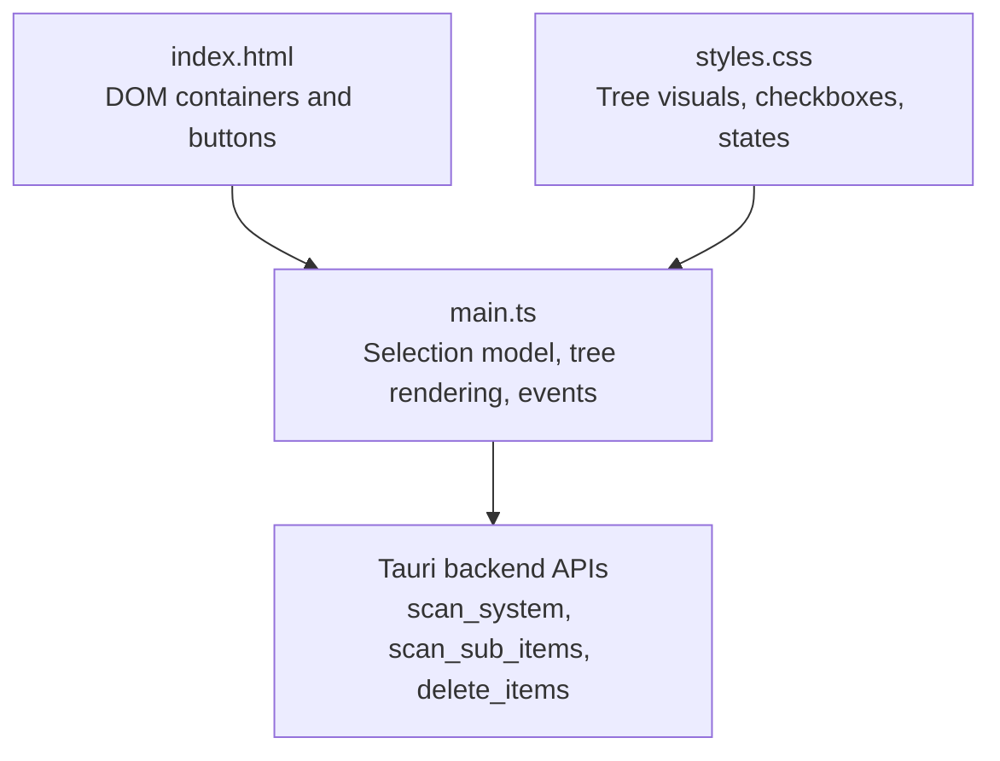
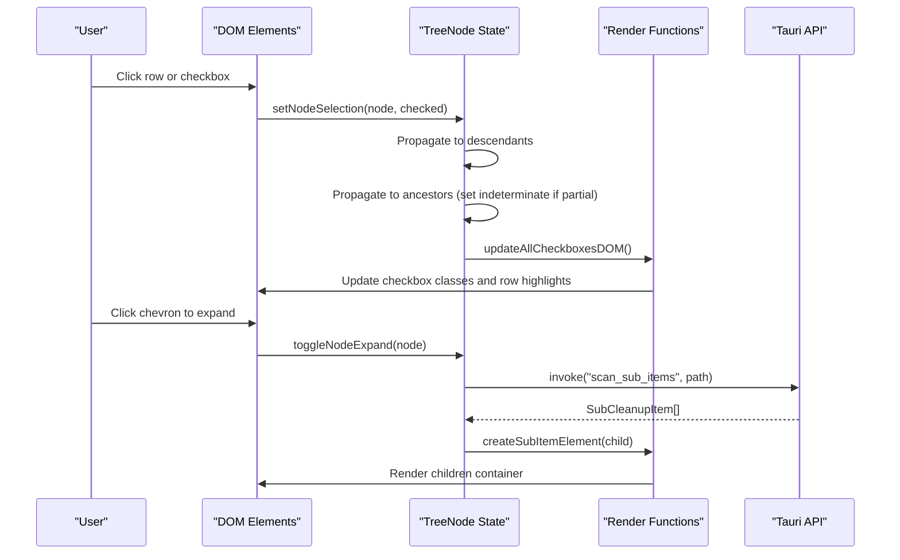
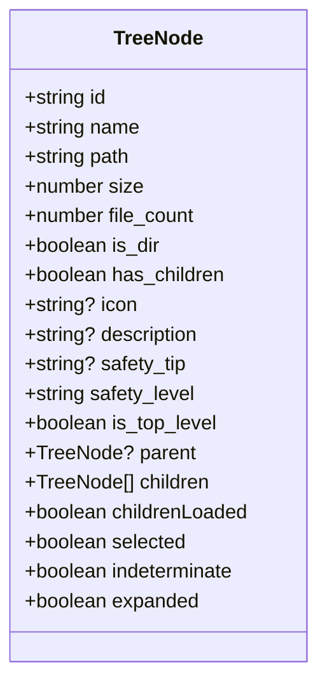
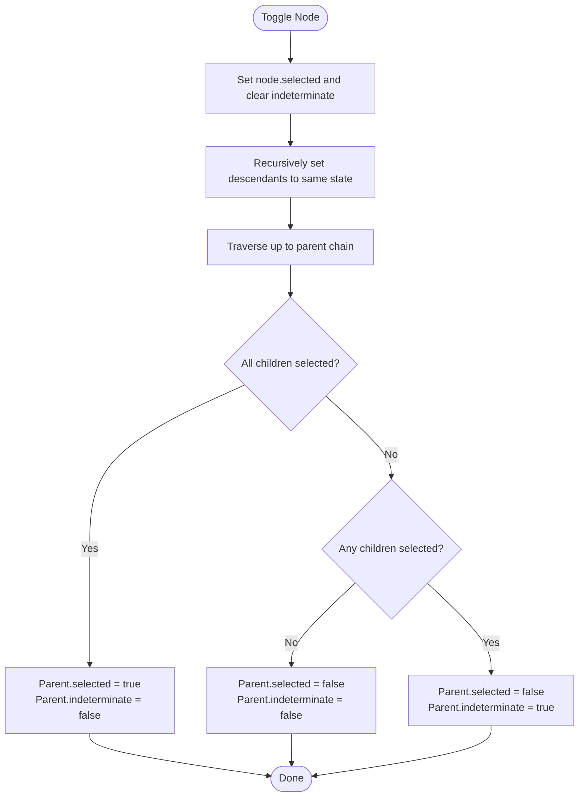
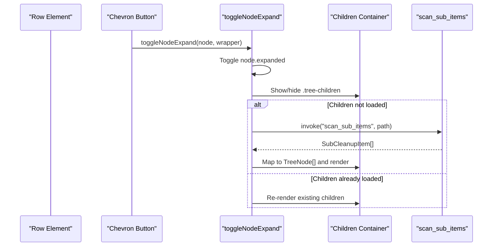
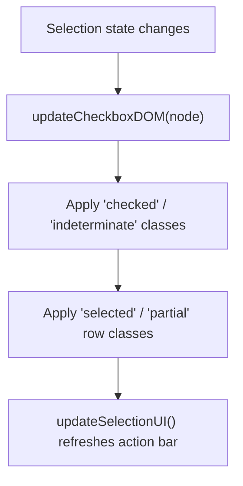
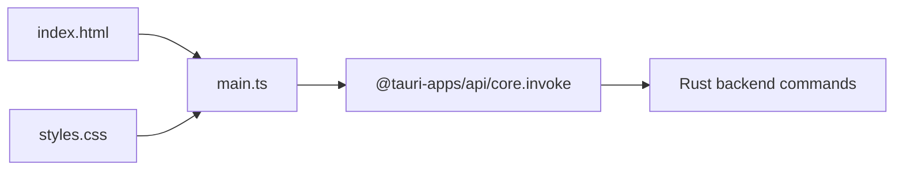

# Interactive Selection System

<cite>
**Referenced Files in This Document**
- [main.ts](file://src/main.ts)
- [styles.css](file://src/styles.css)
- [index.html](file://index.html)
</cite>

## Table of Contents
1. [Introduction](#introduction)
2. [Project Structure](#project-structure)
3. [Core Components](#core-components)
4. [Architecture Overview](#architecture-overview)
5. [Detailed Component Analysis](#detailed-component-analysis)
6. [Dependency Analysis](#dependency-analysis)
7. [Performance Considerations](#performance-considerations)
8. [Troubleshooting Guide](#troubleshooting-guide)
9. [Conclusion](#conclusion)

## Introduction
This document explains the interactive selection system with hierarchical tree navigation used by the application. It focuses on how parent-child relationships are managed, how selection state propagates between parents and children (including indeterminate states), the TreeNode data structure, UI rendering for expandable nodes, dynamic expansion behavior, and accessibility considerations for keyboard navigation.

The system is implemented in TypeScript within a Tauri-based desktop app. The frontend renders an interactive tree where users can select categories and nested items to clean disk space. Selections propagate up and down the hierarchy, and partial selections are visually indicated via an indeterminate state.

## Project Structure
The interactive selection system spans three primary files:
- index.html defines the DOM skeleton and container elements for the tree sections and action bar.
- main.ts implements the selection model, tree node management, rendering logic, and event handling.
- styles.css provides visual styling for tree nodes, checkboxes, expand/collapse chevrons, and selection states.

**Diagram sources**
- [index.html:1-141](file://index.html#L1-L141)
- [main.ts:1-1009](file://src/main.ts#L1-L1009)
- [styles.css:1-800](file://src/styles.css#L1-L800)

**Section sources**
- [index.html:1-141](file://index.html#L1-L141)
- [main.ts:1-1009](file://src/main.ts#L1-L1009)
- [styles.css:1-800](file://src/styles.css#L1-L800)

## Core Components
Key components of the selection system:
- TreeNode data structure: Represents each item in the tree with selection state, hierarchy links, and lazy-loading flags.
- Selection propagation functions: Update selected/indeterminate states across ancestors and descendants.
- Tree rendering functions: Create top-level category nodes and sub-item nodes, handle expand/collapse, and render child containers lazily.
- UI update functions: Reflect selection changes in the DOM and action bar.

Important responsibilities:
- Managing parent-child relationships via explicit parent references and recursive traversal.
- Maintaining tri-state checkboxes through selected and indeterminate flags.
- Rendering expandable folders and lazy-loading their contents from the backend.

**Section sources**
- [main.ts:59-78](file://src/main.ts#L59-L78)
- [main.ts:272-383](file://src/main.ts#L272-L383)
- [main.ts:472-696](file://src/main.ts#L472-L696)
- [main.ts:700-833](file://src/main.ts#L700-L833)

## Architecture Overview
The selection system follows a unidirectional flow: user interactions trigger selection updates, which propagate through the tree and then update the UI. Dynamic expansion fetches child nodes on demand.

**Diagram sources**
- [main.ts:276-310](file://src/main.ts#L276-L310)
- [main.ts:312-336](file://src/main.ts#L312-L336)
- [main.ts:472-558](file://src/main.ts#L472-L558)
- [main.ts:560-624](file://src/main.ts#L560-L624)

## Detailed Component Analysis

### TreeNode Data Structure and State Management
The TreeNode type encapsulates both metadata and selection state:
- Identification and hierarchy: id, name, path, parent, children, has_children, is_dir, is_top_level.
- Metadata: size, file_count, icon, description, safety_tip, safety_level.
- UI state: selected, indeterminate, expanded, childrenLoaded.

State management patterns:
- Parent reference enables upward propagation when a node’s selection changes.
- Children array holds direct descendants; childrenLoaded indicates whether lazy-loaded content has been fetched.
- selected and indeterminate together implement tri-state checkboxes:
  - selected = true, indeterminate = false means fully selected.
  - selected = false, indeterminate = true means partially selected.
  - selected = false, indeterminate = false means not selected.

Complexity considerations:
- Recursive traversal for propagation and collection operations is O(N) relative to the number of nodes visited.
- Lazy loading reduces initial render cost by fetching children only when expanded.

**Section sources**
- [main.ts:59-78](file://src/main.ts#L59-L78)
- [main.ts:716-800](file://src/main.ts#L716-L800)

#### Class Diagram

**Diagram sources**
- [main.ts:59-78](file://src/main.ts#L59-L78)

### Selection Propagation Logic
When a node is toggled:
- Descendants are recursively updated to match the new selection state.
- Ancestors are recalculated based on their immediate children:
  - If all children are fully selected, the parent becomes fully selected.
  - If no children are selected, the parent becomes deselected.
  - Otherwise, the parent becomes indeterminate.

**Diagram sources**
- [main.ts:276-310](file://src/main.ts#L276-L310)

**Section sources**
- [main.ts:276-310](file://src/main.ts#L276-L310)

### UI Rendering and Expandable Tree Nodes
Rendering is split into two functions:
- createTopLevelItemElement: Renders top-level categories with icons, badges, and metadata.
- createSubItemElement: Renders nested items under a category, including folder-like expandability.

Both functions:
- Attach click handlers to rows and chevrons.
- Apply CSS classes for selection and partial states.
- Handle lazy expansion by creating a children container and populating it either from cached children or by invoking the backend.

Dynamic expansion behavior:
- On chevron click, toggleNodeExpand toggles expanded state and manages visibility of the children container.
- If children have not been loaded yet, it shows a loading indicator, calls scan_sub_items, maps results to TreeNode instances, and renders them.
- If children were already loaded, it re-renders existing children.

**Diagram sources**
- [main.ts:472-558](file://src/main.ts#L472-L558)
- [main.ts:560-624](file://src/main.ts#L560-L624)

**Section sources**
- [main.ts:472-696](file://src/main.ts#L472-L696)

### Checkbox Visual Indicators and Styles
Visual indicators for selection status are implemented via CSS classes:
- Checked state: A filled checkbox with a checkmark.
- Indeterminate state: A filled checkbox with a horizontal bar indicating partial selection.
- Selected/partial row highlighting: Background colors differentiate fully selected vs partially selected rows.

These classes are applied dynamically by updateCheckboxDOM and updateAllCheckboxesDOM whenever selection state changes.

**Diagram sources**
- [main.ts:312-336](file://src/main.ts#L312-L336)
- [main.ts:418-468](file://src/main.ts#L418-L468)
- [styles.css:504-562](file://src/styles.css#L504-L562)
- [styles.css:450-464](file://src/styles.css#L450-L464)

**Section sources**
- [main.ts:312-336](file://src/main.ts#L312-L336)
- [styles.css:504-562](file://src/styles.css#L504-L562)
- [styles.css:450-464](file://src/styles.css#L450-L464)

### Collection Utilities for Deletion and Summaries
Utilities compute what will be deleted and summarize selection:
- getSelectedPathsToDelete: Collects paths for deletion, skipping indeterminate nodes and recursing into their children.
- getSelectedSize: Sums sizes of fully selected nodes and recurses into indeterminate nodes.
- getSelectedBreakdown: Separates selected items into safe and review categories for confirmation dialogs.

These functions ensure that only explicitly selected leaf or directory roots are included in deletion operations.

**Section sources**
- [main.ts:338-414](file://src/main.ts#L338-L414)

## Dependency Analysis
The selection system depends on:
- DOM elements defined in index.html for rendering and interaction.
- CSS classes in styles.css for visual feedback.
- Tauri backend APIs invoked via invoke for scanning and deleting items.

**Diagram sources**
- [index.html:1-141](file://index.html#L1-L141)
- [main.ts:1-1009](file://src/main.ts#L1-L1009)

**Section sources**
- [index.html:1-141](file://index.html#L1-L141)
- [main.ts:1-1009](file://src/main.ts#L1-L1009)

## Performance Considerations
- Lazy loading: Children are fetched only when expanded, reducing initial load time and memory usage.
- Minimal DOM updates: updateAllCheckboxesDOM traverses the tree once to sync classes, avoiding excessive reflows.
- Efficient selection propagation: Recursion stops at leaves and uses parent references to avoid redundant checks.
- Avoid unnecessary re-renders: Existing children containers are reused when expanding previously loaded nodes.

Recommendations:
- Debounce rapid expansions to prevent repeated backend calls.
- Consider virtualization for very large trees to limit DOM nodes rendered at once.
- Cache computed totals (e.g., total selected size) incrementally when selection changes.

[No sources needed since this section provides general guidance]

## Troubleshooting Guide
Common issues and resolutions:
- Indeterminate state not updating: Ensure updateAllCheckboxesDOM is called after setNodeSelection and that ancestor recalculation runs correctly.
- Children not appearing on expand: Verify that childrenLoaded is false before attempting to load, and that scan_sub_items returns valid data.
- Selection not reflected in action bar: Confirm updateSelectionUI is invoked after selection changes and that getSelectedPathsToDelete/getSelectedSize traverse correctly.
- Keyboard navigation not working: Add focus management and aria attributes to make the tree accessible.

Operational tips:
- Inspect DOM attributes data-node-id to verify correct node targeting.
- Use browser dev tools to observe class toggling (.checked, .indeterminate, .selected, .partial).
- Validate backend responses for scan_sub_items to ensure mapping to TreeNode fields is correct.

**Section sources**
- [main.ts:312-336](file://src/main.ts#L312-L336)
- [main.ts:472-558](file://src/main.ts#L472-L558)
- [main.ts:418-468](file://src/main.ts#L418-L468)

## Conclusion
The interactive selection system provides a robust hierarchical tree interface with tri-state selection semantics. It maintains consistent state across parent and child nodes, supports dynamic expansion with lazy loading, and offers clear visual feedback for selection status. By following the documented patterns and recommendations, developers can extend the tree safely while preserving performance and usability. Accessibility enhancements such as keyboard navigation and ARIA attributes should be added to improve inclusivity.

[No sources needed since this section summarizes without analyzing specific files]