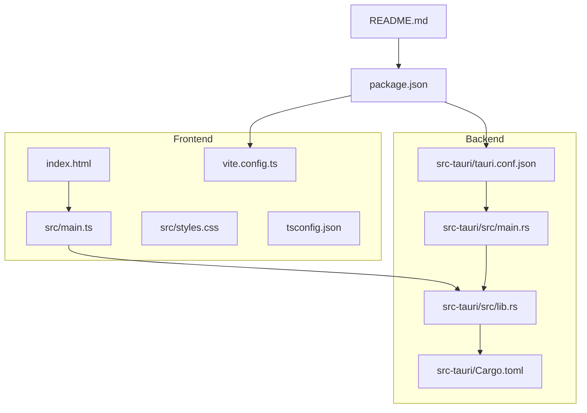
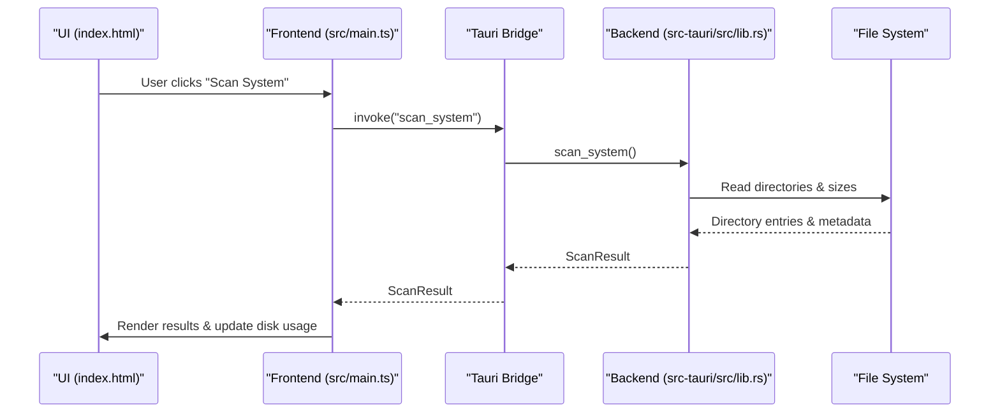
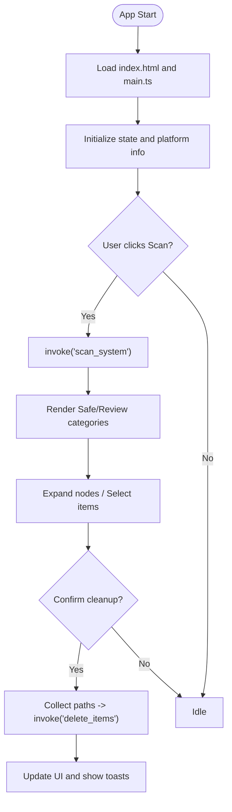
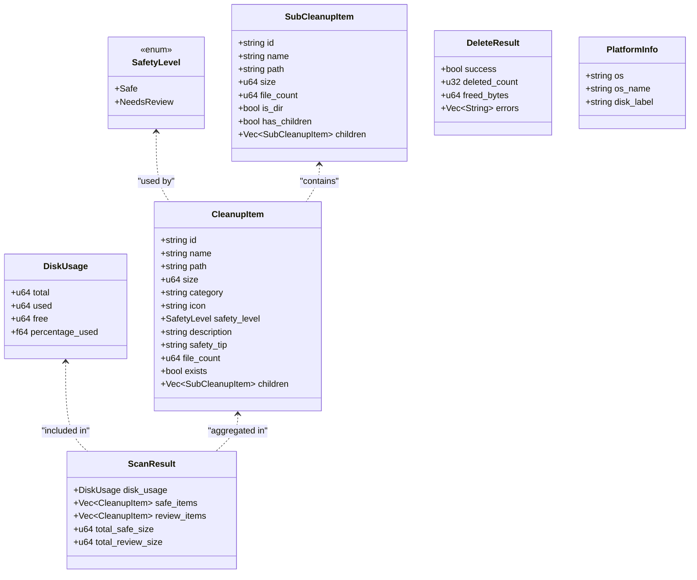
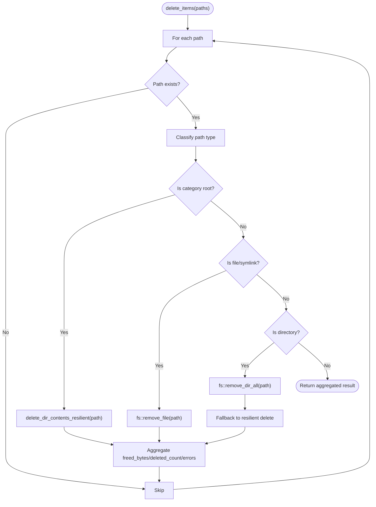
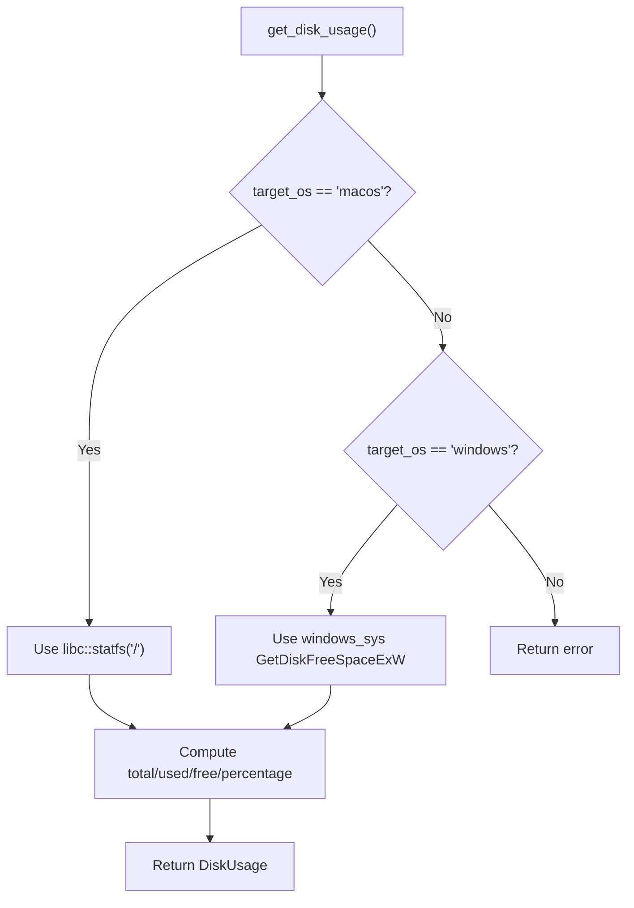
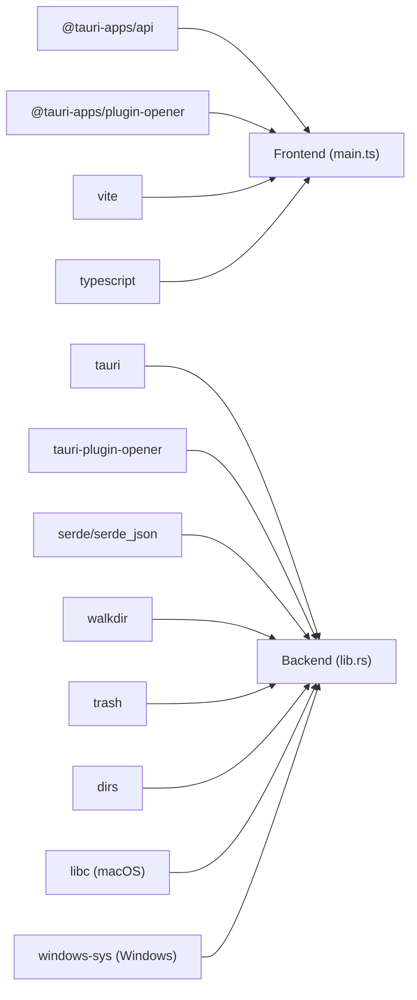

# Development Guide

<cite>
**Referenced Files in This Document**   
- [README.md](file://README.md)
- [package.json](file://package.json)
- [vite.config.ts](file://vite.config.ts)
- [tsconfig.json](file://tsconfig.json)
- [index.html](file://index.html)
- [src/main.ts](file://src/main.ts)
- [src-tauri/Cargo.toml](file://src-tauri/Cargo.toml)
- [src-tauri/tauri.conf.json](file://src-tauri/tauri.conf.json)
- [src-tauri/src/main.rs](file://src-tauri/src/main.rs)
- [src-tauri/src/lib.rs](file://src-tauri/src/lib.rs)
</cite>

## Table of Contents
1. [Introduction](#introduction)
2. [Project Structure](#project-structure)
3. [Core Components](#core-components)
4. [Architecture Overview](#architecture-overview)
5. [Detailed Component Analysis](#detailed-component-analysis)
6. [Dependency Analysis](#dependency-analysis)
7. [Performance Considerations](#performance-considerations)
8. [Troubleshooting Guide](#troubleshooting-guide)
9. [Conclusion](#conclusion)
10. [Appendices](#appendices)

## Introduction
This guide explains how to develop, test, build, and contribute to FreeSpaceMacos. It covers the development workflow, environment setup, Tauri-based frontend/backend interaction, platform-specific logic, testing strategies, coding standards, and contribution practices. The app is a macOS storage cleanup tool built with Tauri 2, Rust backend, and TypeScript frontend.

## Project Structure
FreeSpaceMacos uses a standard Tauri 2 layout:
- Frontend (TypeScript + HTML + CSS) under src and index.html
- Backend (Rust) under src-tauri
- Build configuration for Vite and Tauri
- Package scripts for dev/build workflows

**Diagram sources**
- [package.json:1-22](file://package.json#L1-L22)
- [vite.config.ts:1-31](file://vite.config.ts#L1-L31)
- [tsconfig.json:1-24](file://tsconfig.json#L1-L24)
- [index.html:1-141](file://index.html#L1-L141)
- [src/main.ts:1-120](file://src/main.ts#L1-L120)
- [src-tauri/Cargo.toml:1-29](file://src-tauri/Cargo.toml#L1-L29)
- [src-tauri/tauri.conf.json:1-46](file://src-tauri/tauri.conf.json#L1-L46)
- [src-tauri/src/main.rs:1-7](file://src-tauri/src/main.rs#L1-L7)
- [src-tauri/src/lib.rs:1-60](file://src-tauri/src/lib.rs#L1-L60)

**Section sources**
- [README.md:35-69](file://README.md#L35-L69)
- [package.json:1-22](file://package.json#L1-L22)
- [src-tauri/Cargo.toml:1-29](file://src-tauri/Cargo.toml#L1-L29)
- [src-tauri/tauri.conf.json:1-46](file://src-tauri/tauri.conf.json#L1-L46)

## Core Components
- Frontend entrypoint: index.html loads the UI and main TypeScript module.
- Frontend logic: src/main.ts implements UI state, tree selection, confirmation dialogs, toast notifications, and invokes Tauri commands.
- Backend entrypoint: src-tauri/src/main.rs starts the Tauri runtime and delegates to freespace_lib::run().
- Backend core: src-tauri/src/lib.rs defines data models, file system scanning, deletion logic, platform detection, and Tauri command handlers.
- Configuration:
  - package.json defines npm scripts and dependencies.
  - vite.config.ts configures dev server port and HMR for Tauri.
  - tsconfig.json enforces strict TypeScript settings.
  - tauri.conf.json configures app window, bundling, and frontend dist path.
  - Cargo.toml declares Rust dependencies and target-specific crates.

Key responsibilities:
- File system operations are centralized in lib.rs using walkdir, dirs, and libc on macOS.
- Platform-specific behavior is implemented via cfg attributes and separate scan_system implementations per OS.
- Frontend communicates with backend through Tauri invoke API.

**Section sources**
- [index.html:1-141](file://index.html#L1-L141)
- [src/main.ts:1-120](file://src/main.ts#L1-L120)
- [src-tauri/src/main.rs:1-7](file://src-tauri/src/main.rs#L1-L7)
- [src-tauri/src/lib.rs:1-120](file://src-tauri/src/lib.rs#L1-L120)
- [package.json:1-22](file://package.json#L1-L22)
- [vite.config.ts:1-31](file://vite.config.ts#L1-L31)
- [tsconfig.json:1-24](file://tsconfig.json#L1-L24)
- [src-tauri/tauri.conf.json:1-46](file://src-tauri/tauri.conf.json#L1-L46)
- [src-tauri/Cargo.toml:1-29](file://src-tauri/Cargo.toml#L1-L29)

## Architecture Overview
The application follows a layered architecture:
- UI Layer (HTML/CSS/TS): Renders disk usage, scan results, selection trees, and user actions.
- Tauri Bridge: Uses @tauri-apps/api/core invoke() to call backend commands.
- Backend Layer (Rust): Implements commands for disk usage, scanning, sub-item enumeration, and deletion.
- Platform Abstraction: Uses cfg(target_os = ...) to provide macOS and Windows implementations where needed.

**Diagram sources**
- [index.html:59-65](file://index.html#L59-L65)
- [src/main.ts:700-800](file://src/main.ts#L700-L800)
- [src-tauri/src/lib.rs:410-744](file://src-tauri/src/lib.rs#L410-L744)

## Detailed Component Analysis

### Frontend Application Flow
- Initialization: index.html loads styles and main.ts.
- State management: safeNodes and reviewNodes hold hierarchical TreeNode structures.
- Disk usage: Updates ring progress and stats based on backend response.
- Tree interactions: Expand/collapse nodes, lazy-load children via scan_sub_items, propagate selection up/down.
- Confirmation dialog: Presents selected items grouped by safety level and asks for final confirmation before deletion.
- Deletion flow: Collects selected paths, shows confirmation, calls delete_items, then updates UI with toasts.

**Diagram sources**
- [index.html:1-141](file://index.html#L1-L141)
- [src/main.ts:121-243](file://src/main.ts#L121-L243)
- [src/main.ts:270-414](file://src/main.ts#L270-L414)
- [src/main.ts:470-696](file://src/main.ts#L470-L696)
- [src/main.ts:700-800](file://src/main.ts#L700-L800)

**Section sources**
- [index.html:1-141](file://index.html#L1-L141)
- [src/main.ts:1-120](file://src/main.ts#L1-L120)
- [src/main.ts:121-243](file://src/main.ts#L121-L243)
- [src/main.ts:270-414](file://src/main.ts#L270-L414)
- [src/main.ts:470-696](file://src/main.ts#L470-L696)
- [src/main.ts:700-800](file://src/main.ts#L700-L800)

### Backend Data Models and Commands
Data models:
- SafetyLevel: Safe or NeedsReview
- SubCleanupItem: child directory/file details
- CleanupItem: top-level category with metadata and children
- DiskUsage: total, used, free, percentage_used
- ScanResult: aggregated scan output
- DeleteResult: success flag, counts, and errors
- PlatformInfo: os, os_name, disk_label

Commands:
- get_platform_info: returns platform metadata
- get_disk_usage: retrieves disk statistics (macOS via libc; Windows via windows-sys)
- scan_system: builds safe and review item lists (platform-specific implementations)
- scan_sub_items: enumerates immediate children of a directory
- delete_items: deletes selected paths resiliently

**Diagram sources**
- [src-tauri/src/lib.rs:8-66](file://src-tauri/src/lib.rs#L8-L66)
- [src-tauri/src/lib.rs:44-66](file://src-tauri/src/lib.rs#L44-L66)
- [src-tauri/src/lib.rs:748-786](file://src-tauri/src/lib.rs#L748-L786)

**Section sources**
- [src-tauri/src/lib.rs:8-66](file://src-tauri/src/lib.rs#L8-L66)
- [src-tauri/src/lib.rs:328-410](file://src-tauri/src/lib.rs#L328-L410)
- [src-tauri/src/lib.rs:410-744](file://src-tauri/src/lib.rs#L410-L744)
- [src-tauri/src/lib.rs:748-786](file://src-tauri/src/lib.rs#L748-L786)
- [src-tauri/src/lib.rs:1056-1100](file://src-tauri/src/lib.rs#L1056-L1100)

### File System Scanning and Deletion Logic
Scanning:
- get_dir_size walks directories up to depth 10 and sums file sizes while counting files.
- expand_home resolves ~/ paths to absolute paths.
- scan_children_direct enumerates immediate children, filters .DS_Store/.localized, computes size/file_count, and determines if directories have children.
- scan_location constructs CleanupItem with metadata and children.

Deletion:
- delete_dir_contents_resilient iterates entries, removes files/directories, and aggregates freed bytes and error messages.
- delete_target decides whether to remove contents directly or recursively based on path type and category root rules.
- delete_items orchestrates deletion across multiple paths and returns aggregated results.

**Diagram sources**
- [src-tauri/src/lib.rs:261-324](file://src-tauri/src/lib.rs#L261-L324)
- [src-tauri/src/lib.rs:1056-1082](file://src-tauri/src/lib.rs#L1056-L1082)

**Section sources**
- [src-tauri/src/lib.rs:70-201](file://src-tauri/src/lib.rs#L70-L201)
- [src-tauri/src/lib.rs:203-259](file://src-tauri/src/lib.rs#L203-L259)
- [src-tauri/src/lib.rs:261-324](file://src-tauri/src/lib.rs#L261-L324)
- [src-tauri/src/lib.rs:1056-1082](file://src-tauri/src/lib.rs#L1056-L1082)

### Platform-Specific Behavior
- macOS:
  - get_disk_usage uses libc::statfs to compute disk totals/free/used.
  - scan_system enumerates macOS-specific cache and developer directories.
- Windows:
  - get_disk_usage uses windows_sys::GetDiskFreeSpaceExW.
  - scan_system enumerates Windows-specific temp, browser caches, and user data.
- PlatformInfo provides consistent labels and OS names across platforms.

**Diagram sources**
- [src-tauri/src/lib.rs:328-399](file://src-tauri/src/lib.rs#L328-L399)

**Section sources**
- [src-tauri/src/lib.rs:328-399](file://src-tauri/src/lib.rs#L328-L399)
- [src-tauri/src/lib.rs:410-744](file://src-tauri/src/lib.rs#L410-L744)
- [src-tauri/src/lib.rs:748-786](file://src-tauri/src/lib.rs#L748-L786)
- [src-tauri/src/lib.rs:790-1054](file://src-tauri/src/lib.rs#L790-L1054)

## Dependency Analysis
Frontend dependencies:
- @tauri-apps/api: core invoke interface
- @tauri-apps/plugin-opener: open external links/files
- vite: dev server and bundler
- typescript: language and compiler options

Backend dependencies:
- tauri: runtime and command registration
- tauri-plugin-opener: opener plugin initialization
- serde/serde_json: serialization/deserialization
- walkdir: recursive directory traversal
- trash: optional trash integration (declared)
- dirs: home directory resolution
- libc (macOS): statfs for disk usage
- windows-sys (Windows): GetDiskFreeSpaceExW

**Diagram sources**
- [package.json:12-20](file://package.json#L12-L20)
- [src-tauri/Cargo.toml:15-28](file://src-tauri/Cargo.toml#L15-L28)

**Section sources**
- [package.json:12-20](file://package.json#L12-L20)
- [src-tauri/Cargo.toml:15-28](file://src-tauri/Cargo.toml#L15-L28)

## Performance Considerations
- Directory scanning limits depth to avoid excessive recursion (max_depth(10)).
- Lazy loading of sub-items reduces initial payload and improves UI responsiveness.
- Resilient deletion attempts direct removal first and falls back to content-by-content deletion to handle locked files.
- Avoid unnecessary re-scans by caching node expansion state and childrenLoaded flags in the frontend.
- Use platform-native APIs for disk usage to minimize overhead.

[No sources needed since this section provides general guidance]

## Troubleshooting Guide
Common issues and resolutions:
- Dev server port conflicts:
  - Vite is configured to use port 1420 strictly; ensure no other process binds that port.
  - HMR host/port can be customized via TAURI_DEV_HOST.
- Rust compilation errors:
  - Ensure Rust toolchain is installed and compatible with Tauri 2.
  - Check target-specific features (macOS vs Windows).
- Permission errors during deletion:
  - Some directories may require elevated privileges; consider running with appropriate permissions or guiding users to confirm prompts.
- Missing icons or assets:
  - Verify tauri.conf.json bundle.icon paths and ensure assets exist.
- Frontend not loading:
  - Confirm tauri.conf.json.build.frontendDist points to the correct dist folder produced by Vite.

Debugging techniques:
- Use browser devtools to inspect UI state and network-like invoke calls.
- Add console logs in frontend functions for selection and confirmation flows.
- In Rust, log intermediate values in scanning and deletion functions to diagnose failures.
- Validate paths and existence checks before performing deletions.

**Section sources**
- [vite.config.ts:14-28](file://vite.config.ts#L14-L28)
- [src-tauri/tauri.conf.json:6-11](file://src-tauri/tauri.conf.json#L6-L11)
- [src-tauri/tauri.conf.json:34-44](file://src-tauri/tauri.conf.json#L34-L44)
- [src-tauri/src/lib.rs:261-324](file://src-tauri/src/lib.rs#L261-L324)

## Conclusion
FreeSpaceMacos combines a modern TypeScript frontend with a robust Rust backend to deliver safe and efficient disk cleanup. By following the development workflow, adhering to coding standards, and leveraging the provided architecture patterns, contributors can extend functionality, maintain code quality, and ship reliable distribution packages.

[No sources needed since this section summarizes without analyzing specific files]

## Appendices

### Development Workflow
- Prerequisites:
  - macOS (Apple Silicon or Intel)
  - Node.js v18+ and npm
  - Rust and Cargo
- Setup:
  - Install dependencies: npm install
  - Run dev server with hot reload: npm run tauri dev
- Build production bundles:
  - npm run tauri build
  - Outputs:
    - src-tauri/target/release/bundle/macos/FreeSpace.app
    - src-tauri/target/release/bundle/dmg/FreeSpace_0.1.0_aarch64.dmg

**Section sources**
- [README.md:44-69](file://README.md#L44-L69)
- [package.json:6-11](file://package.json#L6-L11)

### Coding Standards and Naming Conventions
- TypeScript:
  - Strict mode enabled; no unused locals/parameters; no fallthrough switch cases.
  - Module resolution set to bundler; ESNext modules; DOM libs included.
- Rust:
  - Use serde derive for data models.
  - Organize commands and helpers clearly; keep platform-specific code behind cfg attributes.
- General:
  - Prefer descriptive identifiers and clear separation of concerns.
  - Keep UI state minimal and synchronized with backend responses.

**Section sources**
- [tsconfig.json:1-24](file://tsconfig.json#L1-L24)
- [src-tauri/src/lib.rs:1-66](file://src-tauri/src/lib.rs#L1-L66)

### Testing Strategies
- File system operations:
  - Test get_dir_size and scan_children_direct with various directory structures and empty folders.
  - Validate resilience of delete_dir_contents_resilient when encountering locked files.
- Platform-specific code:
  - Mock or stub platform APIs in tests where possible; verify cfg branches compile correctly.
- UI components:
  - Simulate user interactions (expand/collapse, select/deselect) and assert DOM updates.
  - Validate confirmation dialog behavior and toast notifications.

[No sources needed since this section provides general guidance]

### Contribution Workflow and Code Review Standards
- Fork the repository and create feature branches.
- Follow existing patterns for adding new scan categories and deletion targets.
- Ensure changes compile on both macOS and Windows (if applicable).
- Submit pull requests with clear descriptions and link related issues.
- Code reviews should focus on correctness, safety, performance, and adherence to standards.

[No sources needed since this section provides general guidance]