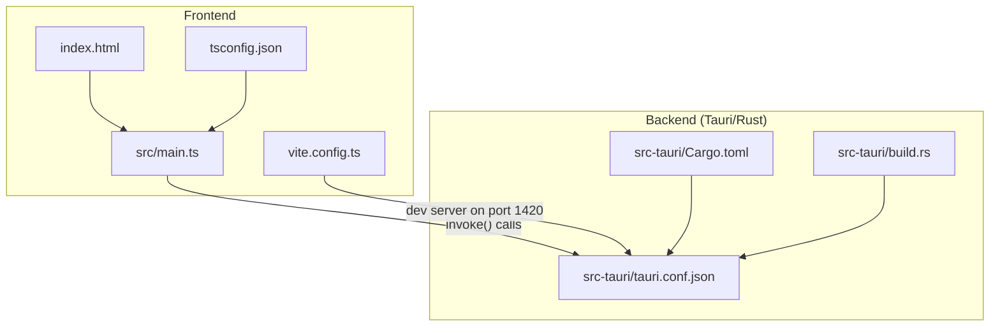
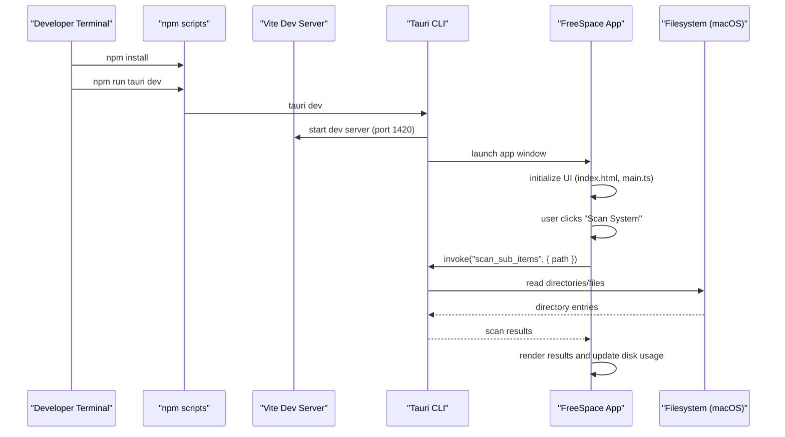
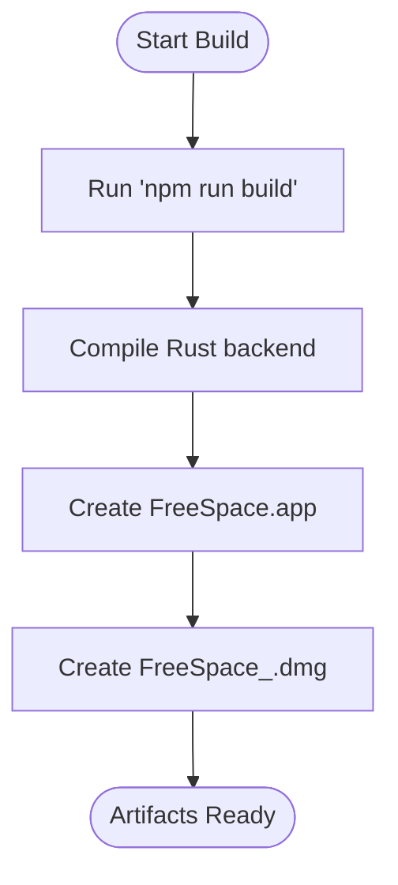
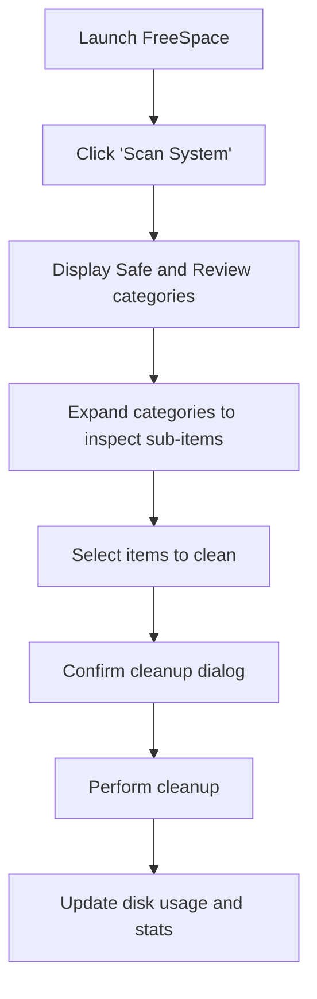
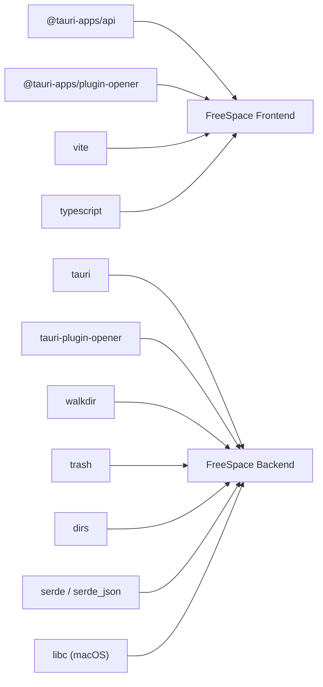

# Getting Started Guide

<cite>
**Referenced Files in This Document**
- [README.md](file://README.md)
- [package.json](file://package.json)
- [vite.config.ts](file://vite.config.ts)
- [tsconfig.json](file://tsconfig.json)
- [index.html](file://index.html)
- [src/main.ts](file://src/main.ts)
- [src-tauri/Cargo.toml](file://src-tauri/Cargo.toml)
- [src-tauri/tauri.conf.json](file://src-tauri/tauri.conf.json)
- [src-tauri/build.rs](file://src-tauri/build.rs)
</cite>

## Table of Contents
1. [Introduction](#introduction)
2. [Project Structure](#project-structure)
3. [Core Components](#core-components)
4. [Architecture Overview](#architecture-overview)
5. [Detailed Component Analysis](#detailed-component-analysis)
6. [Dependency Analysis](#dependency-analysis)
7. [Performance Considerations](#performance-considerations)
8. [Troubleshooting Guide](#troubleshooting-guide)
9. [Conclusion](#conclusion)

## Introduction
FreeSpace for macOS is a modern, high-performance storage cleanup and disk analyzer app built with Tauri 2 (Rust + TypeScript/HTML5/CSS). It scans your Mac to identify safe-to-clean caches and logs, as well as larger items that need review before deletion. The app provides an interactive UI with real-time space calculation, confirmation dialogs, and a toast notification system.

This guide helps you set up the development environment, run the app locally, build production bundles (.app and .dmg), and understand the first-run experience.

## Project Structure
At a high level:
- Frontend: TypeScript + HTML + CSS served by Vite during development and bundled for production.
- Backend: Rust via Tauri 2, providing file system scanning and cleanup operations.
- Configuration: Tauri configuration defines window settings, bundle targets, and frontend integration.

**Diagram sources**
- [index.html:1-141](file://index.html#L1-L141)
- [src/main.ts:1-800](file://src/main.ts#L1-L800)
- [vite.config.ts:1-31](file://vite.config.ts#L1-L31)
- [tsconfig.json:1-24](file://tsconfig.json#L1-L24)
- [src-tauri/Cargo.toml:1-29](file://src-tauri/Cargo.toml#L1-L29)
- [src-tauri/tauri.conf.json:1-46](file://src-tauri/tauri.conf.json#L1-L46)
- [src-tauri/build.rs:1-4](file://src-tauri/build.rs#L1-L4)

**Section sources**
- [README.md:35-41](file://README.md#L35-L41)
- [package.json:1-22](file://package.json#L1-L22)
- [src-tauri/tauri.conf.json:1-46](file://src-tauri/tauri.conf.json#L1-L46)

## Core Components
- Frontend entry point: index.html loads styles and the main TypeScript module.
- Application logic: src/main.ts implements scanning state, selection model, tree rendering, and invokes backend commands via Tauri’s invoke API.
- Build tooling: Vite config sets dev server port and HMR; TypeScript compiler options are defined in tsconfig.json.
- Tauri configuration: tauri.conf.json defines app metadata, window properties, CSP, and bundle targets.
- Rust dependencies: Cargo.toml declares Tauri, filesystem traversal, trash handling, and platform-specific crates.

Key responsibilities:
- Development server: Vite serves the frontend at a fixed port configured for Tauri dev mode.
- Production build: Tauri runs npm scripts to build the frontend and then compiles the Rust backend into a macOS app and DMG.

**Section sources**
- [index.html:1-141](file://index.html#L1-L141)
- [src/main.ts:1-800](file://src/main.ts#L1-L800)
- [vite.config.ts:1-31](file://vite.config.ts#L1-L31)
- [tsconfig.json:1-24](file://tsconfig.json#L1-L24)
- [src-tauri/Cargo.toml:1-29](file://src-tauri/Cargo.toml#L1-L29)
- [src-tauri/tauri.conf.json:1-46](file://src-tauri/tauri.conf.json#L1-L46)

## Architecture Overview
The app uses a Tauri architecture where the frontend communicates with the Rust backend through IPC calls. During development, Vite serves the UI while Tauri hosts the native shell. In production, the frontend is bundled and embedded within the macOS application bundle.

**Diagram sources**
- [vite.config.ts:14-24](file://vite.config.ts#L14-L24)
- [src-tauri/tauri.conf.json:6-11](file://src-tauri/tauri.conf.json#L6-L11)
- [src/main.ts:508-510](file://src/main.ts#L508-L510)

## Detailed Component Analysis

### Prerequisites
- macOS (Apple Silicon or Intel)
- Node.js v18+ and npm
- Rust and Cargo installed via rustup

Install Rust using:
- curl --proto '=https' --tlsv1.2 -sSf https://sh.rustup.rs | sh

Verify installations:
- node -v
- npm -v
- cargo --version

**Section sources**
- [README.md:46-49](file://README.md#L46-L49)

### Setup Instructions
1. Install project dependencies:
   - npm install
2. Start the development server:
   - npm run tauri dev

What happens:
- Tauri triggers the dev workflow, which runs the Vite dev server on port 1420.
- The FreeSpace app window opens and connects to the dev server.

Notes:
- The dev server is configured to use a fixed port and strict mode to avoid conflicts.
- TypeScript compilation is handled by Vite in dev mode; tsconfig.json enforces strict checks.

**Section sources**
- [README.md:51-58](file://README.md#L51-L58)
- [package.json:6-11](file://package.json#L6-L11)
- [vite.config.ts:14-24](file://vite.config.ts#L14-L24)
- [tsconfig.json:1-24](file://tsconfig.json#L1-L24)

### Running the Development Environment
- Open the terminal in the project root.
- Run npm install to fetch frontend dependencies.
- Run npm run tauri dev to start both the Vite dev server and the Tauri app.

Expected behavior:
- A browser-like window appears with the FreeSpace UI.
- You can click “Scan System” to analyze disk usage and list cleanup candidates.

**Section sources**
- [index.html:59-65](file://index.html#L59-L65)
- [src/main.ts:247-268](file://src/main.ts#L247-L268)

### Build Process for Production Bundles
To build production artifacts:
- npm run tauri build

Outputs:
- .app bundle: src-tauri/target/release/bundle/macos/FreeSpace.app
- .dmg installer: src-tauri/target/release/bundle/dmg/FreeSpace_0.1.0_aarch64.dmg

Build pipeline:
- Tauri executes the beforeBuildCommand (npm run build) to compile the frontend.
- The Rust backend is compiled and packaged into the macOS app bundle.
- Icons and bundle targets are defined in tauri.conf.json.

**Diagram sources**
- [src-tauri/tauri.conf.json:6-11](file://src-tauri/tauri.conf.json#L6-L11)
- [src-tauri/tauri.conf.json:34-44](file://src-tauri/tauri.conf.json#L34-L44)
- [src-tauri/build.rs:1-4](file://src-tauri/build.rs#L1-L4)

**Section sources**
- [README.md:60-68](file://README.md#L60-L68)
- [package.json:6-11](file://package.json#L6-L11)
- [src-tauri/tauri.conf.json:6-11](file://src-tauri/tauri.conf.json#L6-L11)
- [src-tauri/tauri.conf.json:34-44](file://src-tauri/tauri.conf.json#L34-L44)

### First-Run Instructions
After launching the app:
1. Click “Scan System” to analyze your disk.
2. Review the two categories:
   - Safe to Clean: caches, logs, crash reports, trash, Safari cache.
   - Needs Review: Xcode DerivedData & Archives, iOS Simulator devices, developer caches, Docker data, VS Code cache, Downloads.
3. Use the tree view to expand categories and inspect sub-items.
4. Select items to clean; the action bar shows selected count and total size.
5. Confirm cleanup via the dialog, which summarizes reclaimable space and lists items.
6. After cleanup, check the disk usage gauge and stats to see freed space.

Interface highlights:
- Disk Usage card shows used/free/total and a percentage ring.
- Results sections display totals and allow selecting all items per category.
- Toast notifications provide feedback on actions.

**Diagram sources**
- [index.html:25-57](file://index.html#L25-L57)
- [index.html:78-132](file://index.html#L78-L132)
- [src/main.ts:146-243](file://src/main.ts#L146-L243)
- [src/main.ts:247-268](file://src/main.ts#L247-L268)

**Section sources**
- [README.md:9-32](file://README.md#L9-L32)
- [index.html:25-57](file://index.html#L25-L57)
- [index.html:78-132](file://index.html#L78-L132)
- [src/main.ts:146-243](file://src/main.ts#L146-L243)
- [src/main.ts:247-268](file://src/main.ts#L247-L268)

## Dependency Analysis
Frontend dependencies:
- @tauri-apps/api: Provides invoke() to call backend commands.
- @tauri-apps/plugin-opener: Enables opening URLs or files from the app.
- vite: Development server and bundler.
- typescript: Type checking and compilation.

Backend dependencies:
- tauri: Core framework for building the app shell and IPC.
- tauri-plugin-opener: Native opener plugin.
- walkdir: Recursive directory traversal.
- trash: Move files/folders to Trash.
- dirs: Resolve user directories.
- serde/serde_json: Serialization utilities.
- libc (macOS): Platform-specific functionality.

**Diagram sources**
- [package.json:12-20](file://package.json#L12-L20)
- [src-tauri/Cargo.toml:15-25](file://src-tauri/Cargo.toml#L15-L25)

**Section sources**
- [package.json:12-20](file://package.json#L12-L20)
- [src-tauri/Cargo.toml:15-25](file://src-tauri/Cargo.toml#L15-L25)

## Performance Considerations
- Development server port is fixed to 1420 to ensure stable Tauri integration.
- Vite ignores changes in src-tauri during development to speed up hot reload.
- Tree expansion is lazy: sub-items are fetched only when a node is expanded, reducing initial load time.
- Selection model propagates state efficiently across parent-child nodes to minimize re-renders.

[No sources needed since this section provides general guidance]

## Troubleshooting Guide
Common issues and resolutions:
- Port conflict: If another process uses port 1420, the dev server will fail. Close conflicting apps or change the host/port configuration in vite.config.ts.
- Rust toolchain missing: Ensure rustup is installed and cargo is available. Reinstall if necessary.
- Node version mismatch: The project requires Node.js v18+. Use a version manager (e.g., nvm) to switch versions.
- Missing icons: Ensure icon assets exist at the paths specified in tauri.conf.json; otherwise, the build may fail or produce incomplete bundles.
- Permission errors during cleanup: macOS may prompt for permissions. Follow prompts and grant access when requested.

Verification steps:
- Check Node and npm versions: node -v, npm -v
- Check Rust and Cargo: cargo --version
- Validate dev server: npm run tauri dev should open the app without errors.
- Inspect console logs in the app window for runtime errors.

**Section sources**
- [vite.config.ts:14-24](file://vite.config.ts#L14-L24)
- [src-tauri/tauri.conf.json:34-44](file://src-tauri/tauri.conf.json#L34-L44)
- [README.md:46-49](file://README.md#L46-L49)

## Conclusion
You now have everything needed to set up, develop, and build FreeSpace for macOS. Use the development server for rapid iteration, and rely on the production build pipeline to generate distributable .app and .dmg artifacts. The app’s interface guides you through scanning, reviewing, and safely cleaning up disk space on your Mac.

[No sources needed since this section summarizes without analyzing specific files]