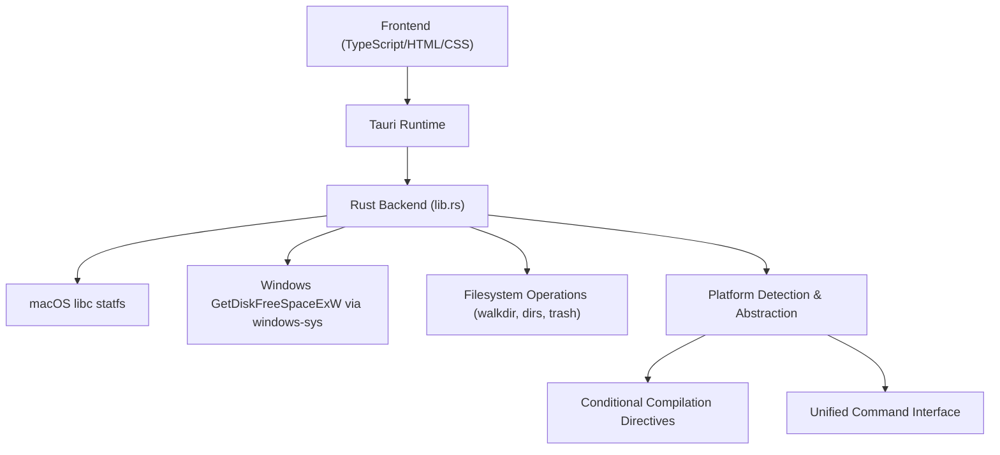
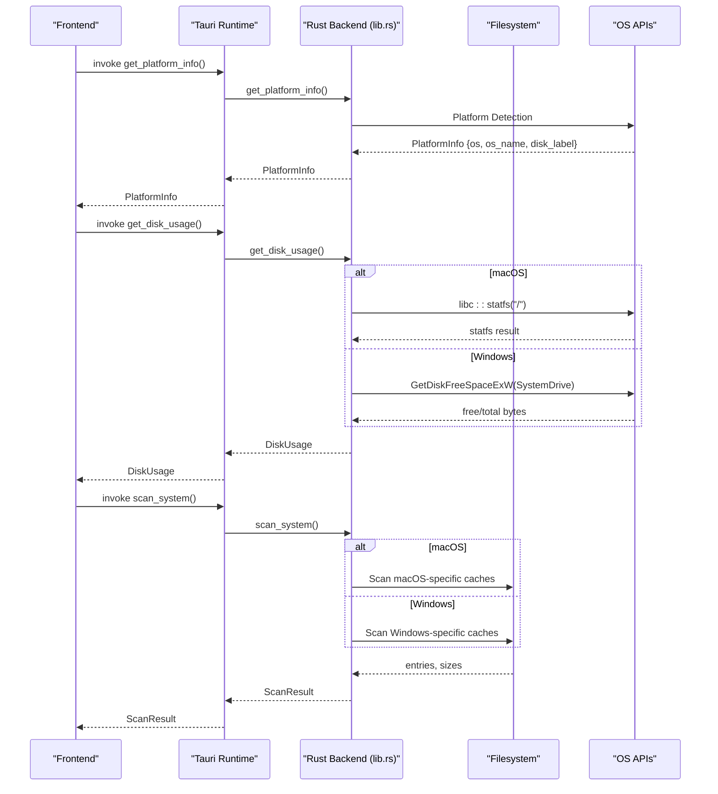
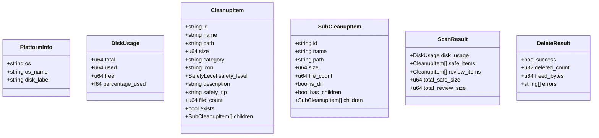
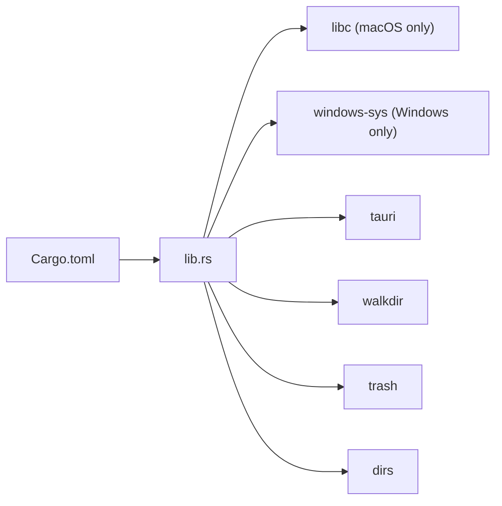

# Platform-Specific Features

<cite>
**Referenced Files in This Document**
- [README.md](file://README.md)
- [Cargo.toml](file://src-tauri/Cargo.toml)
- [lib.rs](file://src-tauri/src/lib.rs)
- [main.rs](file://src-tauri/src/main.rs)
- [build.rs](file://src-tauri/build.rs)
- [tauri.conf.json](file://src-tauri/tauri.conf.json)
- [package.json](file://package.json)
</cite>

## Update Summary
**Changes Made**
- Updated Windows compatibility features section with complete implementation details
- Added comprehensive conditional compilation strategies documentation
- Enhanced platform abstraction patterns explanation
- Updated architecture diagrams to reflect dual-platform support
- Expanded troubleshooting guide with Windows-specific issues
- Added new sections for platform detection and unified API design

## Table of Contents
1. [Introduction](#introduction)
2. [Project Structure](#project-structure)
3. [Core Components](#core-components)
4. [Architecture Overview](#architecture-overview)
5. [Detailed Component Analysis](#detailed-component-analysis)
6. [Dependency Analysis](#dependency-analysis)
7. [Performance Considerations](#performance-considerations)
8. [Troubleshooting Guide](#troubleshooting-guide)
9. [Conclusion](#conclusion)
10. [Appendices](#appendices)

## Introduction
This document explains the comprehensive cross-platform implementation in FreeSpaceMacos, which provides native storage cleanup capabilities for both macOS and Windows systems. The application demonstrates advanced platform abstraction techniques while maintaining optimal performance on each target platform.

Key platform-specific implementations include:
- **macOS-native capabilities**: Direct libc integration for disk statistics and native API calls for system cache locations
- **Windows compatibility features**: Complete mirror of macOS functionality with Windows-specific cache path handling and Win32 API adaptations using windows-sys crate
- **Advanced conditional compilation**: Sophisticated build-time platform detection and code path selection
- **Unified API surface**: Consistent interface across platforms through Tauri commands
- **Cross-platform filesystem operations**: Path normalization and platform-aware directory traversal

The application is a Tauri 2 app with a Rust backend and TypeScript frontend, exposing commands for disk usage analysis, cleanup target scanning, and deletion operations across both supported platforms.

## Project Structure
At a high level:
- Frontend assets live under src (TypeScript, HTML, CSS)
- Backend logic lives under src-tauri (Rust) with extensive platform-specific implementations
- Tauri configuration and build scripts are under src-tauri
- Root-level package.json configures Vite and Tauri CLI

**Diagram sources**
- [lib.rs:336-406](file://src-tauri/src/lib.rs#L336-L406)
- [Cargo.toml:15-28](file://src-tauri/Cargo.toml#L15-L28)

**Section sources**
- [README.md:35-40](file://README.md#L35-L40)
- [package.json:1-22](file://package.json#L1-L22)
- [tauri.conf.json:1-46](file://src-tauri/tauri.conf.json#L1-L46)

## Core Components
Key backend components demonstrate sophisticated cross-platform design:
- Data models for scan results, cleanup items, and disk usage with platform-agnostic serialization
- Disk usage retrieval with platform-specific implementations behind unified interfaces
- System scanning routines that enumerate safe and review-needed directories per platform
- Deletion utilities with resilient directory traversal and error aggregation
- Platform info provider returning OS name and default disk label with platform detection

Highlights of the cross-platform implementation:
- **macOS uses libc::statfs** for fast disk stats with direct kernel access
- **Windows uses GetDiskFreeSpaceExW** via windows-sys for disk stats and detects the system drive from SystemDrive environment variable
- **Path normalization** supports both macOS and Windows paths for category root checks
- **Conditional compilation gates** platform-specific code paths at compile time
- **Unified command interface** abstracts platform differences from the frontend

**Section sources**
- [lib.rs:8-66](file://src-tauri/src/lib.rs#L8-L66)
- [lib.rs:336-406](file://src-tauri/src/lib.rs#L336-L406)
- [lib.rs:854-894](file://src-tauri/src/lib.rs#L854-L894)

## Architecture Overview
The app exposes Tauri commands to the frontend with complete platform abstraction:
- get_platform_info: returns OS and disk label with platform detection
- get_disk_usage: returns total/used/free space and percentage used with platform-specific implementations
- scan_system: enumerates safe and review-needed cleanup categories per platform
- scan_sub_items: lists sub-items under a given path
- delete_items: deletes selected paths and aggregates errors

**Diagram sources**
- [lib.rs:336-406](file://src-tauri/src/lib.rs#L336-L406)
- [lib.rs:518-852](file://src-tauri/src/lib.rs#L518-L852)
- [lib.rs:898-1162](file://src-tauri/src/lib.rs#L898-L1162)
- [lib.rs:891-894](file://src-tauri/src/lib.rs#L891-L894)

## Detailed Component Analysis

### macOS Native Features
- **Direct libc integration for disk statistics**:
  - Uses libc::statfs on "/" to compute total, free, used, and percentage used
  - Avoids repeated authorization prompts by leveraging native filesystem semantics
  - Provides optimal performance through direct kernel access
- **Native API calls for system cache locations**:
  - Scans well-known macOS directories such as ~/Library/Caches, ~/Library/Logs, CrashReporter, Safari cache, Xcode caches, Homebrew, npm, pip, etc.
  - Categorizes items into Safe vs NeedsReview based on safety heuristics
  - Includes specialized developer tool caches (Xcode, CocoaPods, Docker, VS Code)

**Diagram sources**
- [lib.rs:336-363](file://src-tauri/src/lib.rs#L336-L363)

**Section sources**
- [lib.rs:336-363](file://src-tauri/src/lib.rs#L336-L363)
- [lib.rs:518-852](file://src-tauri/src/lib.rs#L518-L852)

### Windows Compatibility Features
- **System drive detection**:
  - Reads SystemDrive environment variable to determine the root drive (defaulting to "C:")
  - Handles edge cases where SystemDrive is not set
- **Windows-specific cache path handling**:
  - Comprehensive scanning of AppData/Local/Temp, C:/Windows/Temp, browser caches (Chrome, Edge), INetCache, WER reports, crash dumps, DirectX shader cache, npm/pip/uv/cargo caches, Docker data, VS Code cache, Spotify storage, Yarn cache, NuGet packages, Recycle Bin, Windows Update cache, and Windows.old
  - Platform-aware path resolution with proper Windows path separators
- **API adaptations using windows-sys crate**:
  - Calls GetDiskFreeSpaceExW to retrieve disk usage information
  - Proper Unicode string handling with OsStrExt for wide character conversion

**Diagram sources**
- [lib.rs:365-403](file://src-tauri/src/lib.rs#L365-L403)

**Section sources**
- [lib.rs:365-403](file://src-tauri/src/lib.rs#L365-L403)
- [lib.rs:898-1162](file://src-tauri/src/lib.rs#L898-L1162)

### Conditional Compilation Strategies and Platform Abstraction
- **Sophisticated conditional compilation**:
  - `#[cfg(target_os = "macos")]` gates macOS-only code blocks including libc integration and macOS-specific cache scanning
  - `#[cfg(target_os = "windows")]` gates Windows-only code blocks including windows-sys usage and Windows-specific cache scanning
  - `#[cfg(not(any(target_os = "macos", target_os = "windows")))]` provides fallback behavior for unsupported platforms
- **Platform abstraction patterns**:
  - Unified get_disk_usage command abstracts underlying OS calls behind a single interface
  - Unified scan_system command exposes platform-specific category sets behind the same interface
  - PlatformInfo struct normalizes OS name and disk label across platforms
  - Path normalization supports both macOS and Windows paths for category root checks
- **Build-time optimization**:
  - Platform-specific dependencies only included when building for that target
  - No runtime overhead for platform detection or branching

**Diagram sources**
- [lib.rs:8-66](file://src-tauri/src/lib.rs#L8-L66)
- [lib.rs:854-894](file://src-tauri/src/lib.rs#L854-L894)

**Section sources**
- [lib.rs:854-894](file://src-tauri/src/lib.rs#L854-L894)
- [Cargo.toml:24-28](file://src-tauri/Cargo.toml#L24-L28)

### Filesystem Traversal and Deletion Logic
- **Directory size calculation**:
  - WalkDir-based traversal up to a max depth to sum file sizes and count files
  - Optimized for both macOS and Windows path handling
- **Resilient deletion**:
  - Attempts remove_dir_all; if it fails, recursively deletes contents and then removes the empty directory
  - Aggregates freed bytes, deleted counts, and last encountered error
  - Platform-aware path handling throughout the deletion process

**Diagram sources**
- [lib.rs:308-331](file://src-tauri/src/lib.rs#L308-L331)

**Section sources**
- [lib.rs:77-104](file://src-tauri/src/lib.rs#L77-L104)
- [lib.rs:268-306](file://src-tauri/src/lib.rs#L268-L306)
- [lib.rs:308-331](file://src-tauri/src/lib.rs#L308-L331)
- [lib.rs:1164-1190](file://src-tauri/src/lib.rs#L1164-L1190)

## Dependency Analysis
Platform-specific dependencies are carefully managed through Cargo's conditional compilation:
- **macOS**: libc for statfs and direct kernel access
- **Windows**: windows-sys for Win32 Storage FileSystem APIs
- **Cross-platform**: tauri, serde, walkdir, trash, dirs

**Diagram sources**
- [Cargo.toml:15-28](file://src-tauri/Cargo.toml#L15-L28)

**Section sources**
- [Cargo.toml:15-28](file://src-tauri/Cargo.toml#L15-L28)

## Performance Considerations
- **macOS disk usage via libc::statfs** is efficient and avoids extra I/O overhead compared to walking the filesystem
- **Windows disk usage via GetDiskFreeSpaceExW** provides optimal performance through native Win32 APIs
- **Directory size computation** uses WalkDir with bounded depth to limit traversal cost on both platforms
- **Deletion logic** prefers remove_dir_all when possible, falling back to recursive content deletion only when necessary
- **Category root checks** normalize paths to support both macOS and Windows, reducing branching complexity during scans
- **Conditional compilation** ensures no runtime overhead for platform detection or feature checking

## Troubleshooting Guide
Common platform-specific issues and resolutions:

### macOS Issues
- **Permission denied on macOS**:
  - Some directories may require user consent or elevated permissions; ensure the app runs under the correct user context
  - If encountering repeated authorization prompts, verify that the app is not sandboxed in a way that restricts filesystem access
- **Incorrect disk usage values**:
  - On macOS, confirm that "/" is accessible and readable by the process
  - Verify that the process has appropriate permissions to read filesystem metadata

### Windows Issues
- **Permission denied on Windows**:
  - Deleting system temp files, Recycle Bin, Windows Update cache, or Windows.old may require administrator privileges
  - Run the application with elevated privileges when targeting protected paths like C:/Windows/System32 or C:/$Recycle.Bin
- **System drive detection failures**:
  - Ensure SystemDrive environment variable is set correctly; otherwise, defaults to "C:"
  - Check for unusual drive configurations or network drives that might affect path resolution
- **Unicode path handling issues**:
  - Windows paths with special characters should be properly encoded using OsStrExt
  - Verify that file paths don't exceed Windows MAX_PATH limitations

### Cross-Platform Issues
- **Cache paths not found**:
  - Many paths are user-scoped (~/.cache, ~/Library/Caches, ~/AppData); ensure the current user owns these directories
  - Some developer tools (Xcode, Docker, VS Code) must be installed for their caches to exist
  - Environment variables like HOME, USERPROFILE, or APPDATA may need to be properly set
- **Known limitations**:
  - Deep directory traversals can be slow on large trees; consider excluding very deep hierarchies
  - Some caches are regenerated automatically after deletion; expect transient slowdowns on next use
  - Network drives and mounted volumes may have different permission models than local filesystems

**Section sources**
- [lib.rs:336-406](file://src-tauri/src/lib.rs#L336-L406)
- [lib.rs:898-1162](file://src-tauri/src/lib.rs#L898-L1162)

## Conclusion
FreeSpaceMacos implements robust cross-platform features while maintaining clean abstractions and optimal performance:
- **macOS benefits** from direct libc integration for fast disk statistics and comprehensive cache scanning
- **Windows integrates** seamlessly with Win32 APIs via windows-sys for disk usage and handles Windows-specific cache locations
- **Conditional compilation** ensures each platform receives optimized behavior without runtime branching overhead
- **Unified command interface** simplifies frontend integration and future platform additions
- **Sophisticated platform detection** provides consistent user experience across different operating systems

The implementation serves as an excellent example of how to build truly cross-platform applications in Rust using Tauri, demonstrating best practices for platform abstraction, conditional compilation, and native API integration.

## Appendices

### Build and Deployment Notes
- **Development**:
  - Use npm run tauri dev to start the development server with hot reload
- **Production builds**:
  - Use npm run tauri build to generate platform-specific bundles
  - macOS: .app and .dmg bundles
  - Windows: .exe installer and portable executables
  - Ensure Rust toolchain and Node.js are installed as prerequisites
- **Tauri configuration**:
  - Window settings, CSP, and bundle targets are defined in tauri.conf.json
  - Icons include multiple resolutions and formats for macOS and Windows
  - Platform-specific build configurations handled automatically by Tauri

**Section sources**
- [README.md:44-69](file://README.md#L44-L69)
- [tauri.conf.json:1-46](file://src-tauri/tauri.conf.json#L1-L46)
- [package.json:1-22](file://package.json#L1-L22)
- [build.rs:1-4](file://src-tauri/build.rs#L1-L4)
- [main.rs:1-7](file://src-tauri/src/main.rs#L1-L7)