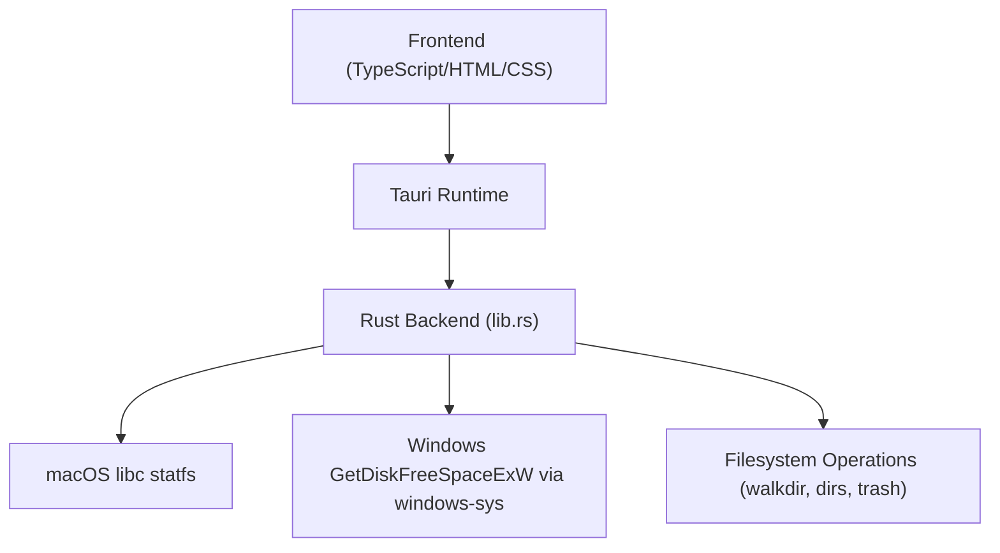
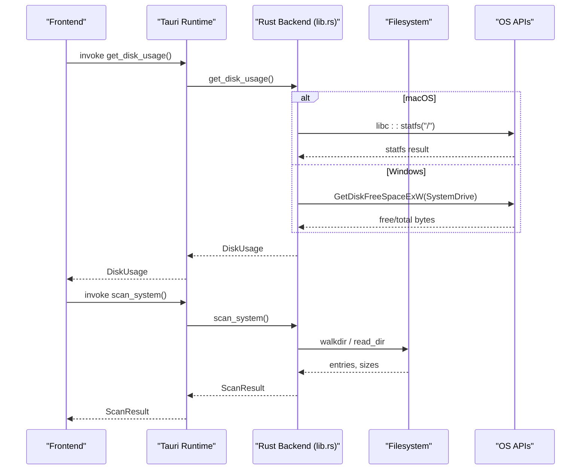
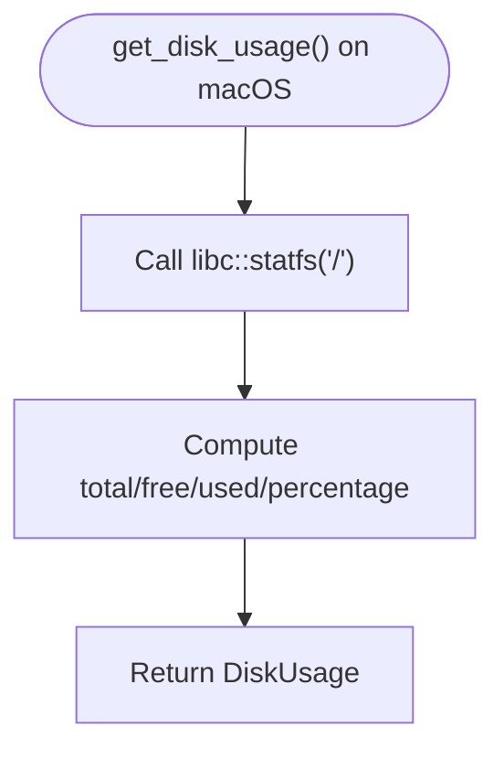
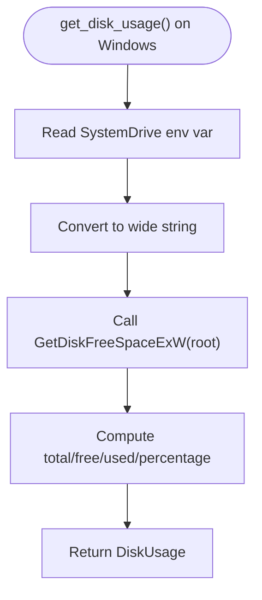
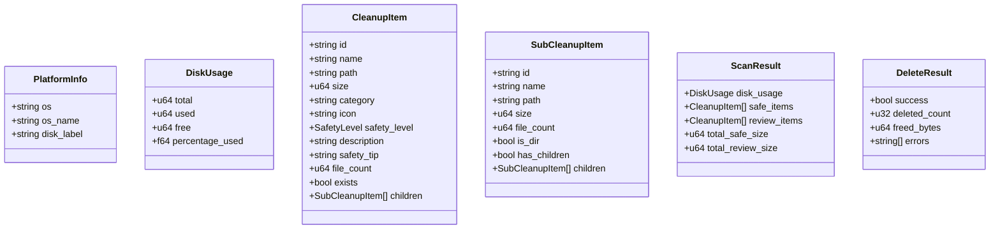
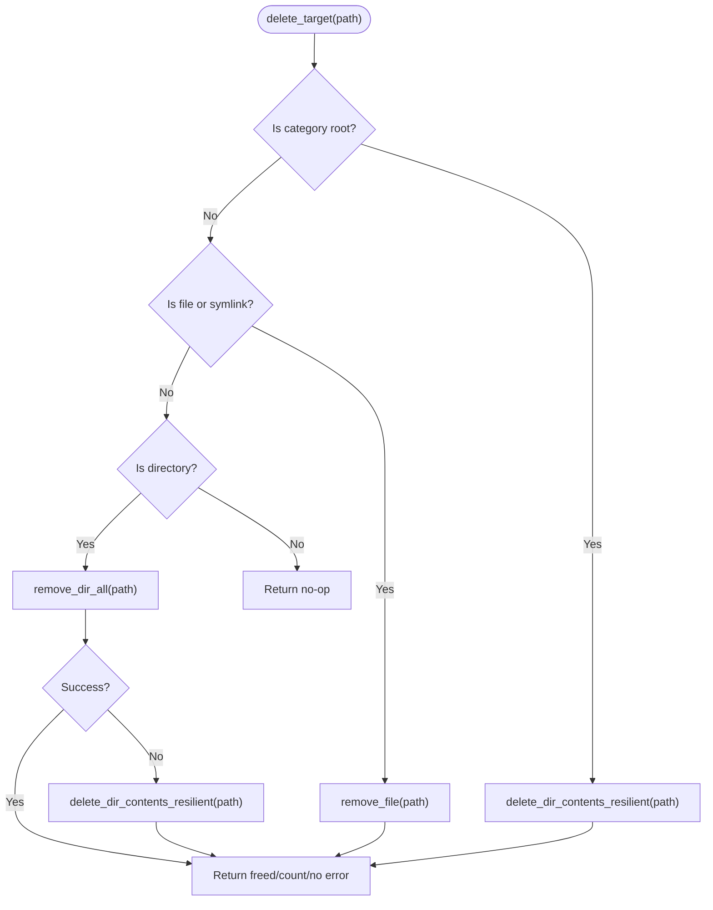
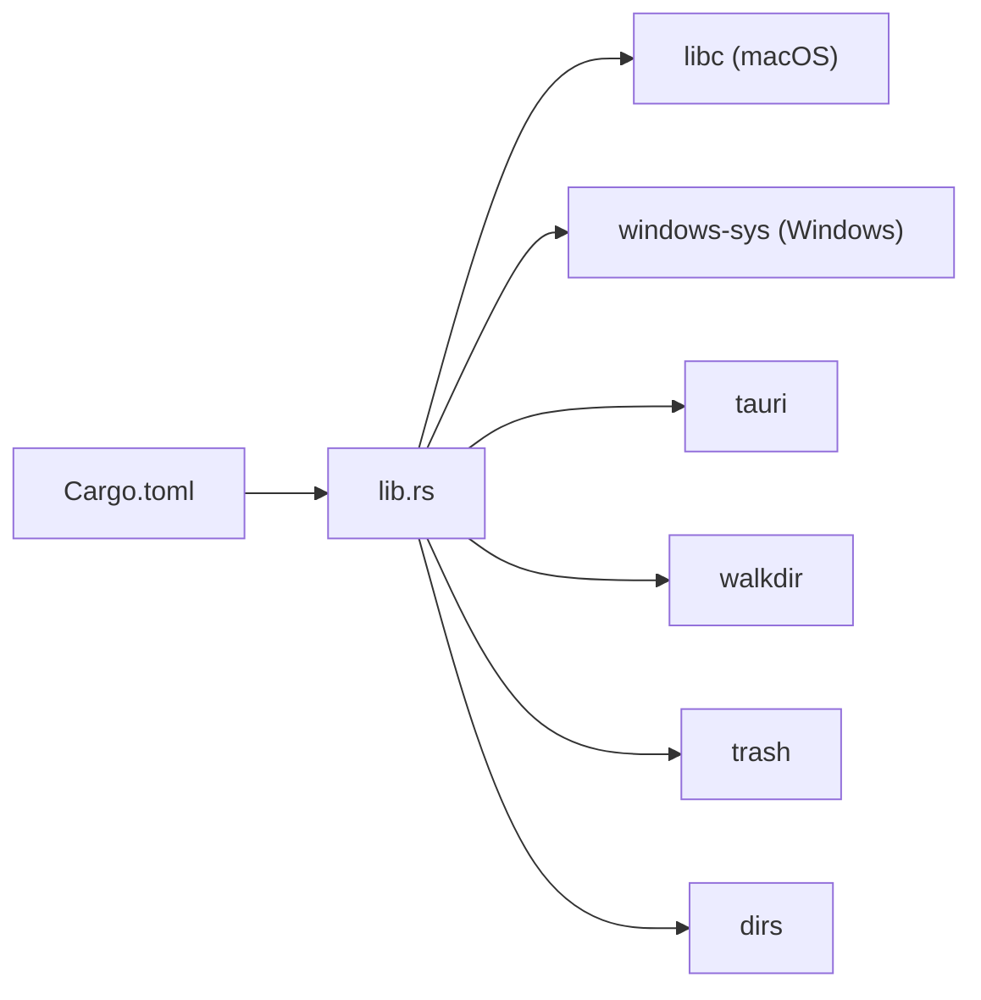

# Platform-Specific Features

<cite>
**Referenced Files in This Document**
- [README.md](file://README.md)
- [Cargo.toml](file://src-tauri/Cargo.toml)
- [lib.rs](file://src-tauri/src/lib.rs)
- [main.rs](file://src-tauri/src/main.rs)
- [build.rs](file://src-tauri/build.rs)
- [tauri.conf.json](file://src-tauri/tauri.conf.json)
- [package.json](file://package.json)
</cite>

## Table of Contents
1. [Introduction](#introduction)
2. [Project Structure](#project-structure)
3. [Core Components](#core-components)
4. [Architecture Overview](#architecture-overview)
5. [Detailed Component Analysis](#detailed-component-analysis)
6. [Dependency Analysis](#dependency-analysis)
7. [Performance Considerations](#performance-considerations)
8. [Troubleshooting Guide](#troubleshooting-guide)
9. [Conclusion](#conclusion)
10. [Appendices](#appendices)

## Introduction
This document explains the platform-specific features and cross-platform abstractions implemented in FreeSpaceMacos. It focuses on:
- macOS-native capabilities, including direct libc integration for disk statistics and native API calls for system cache locations
- Windows compatibility features, including system drive detection, Windows-specific cache path handling, and API adaptations using the windows-sys crate
- Conditional compilation strategies and platform abstraction patterns used to maintain cross-platform compatibility
- Troubleshooting guidance for platform-specific issues, permission requirements, and known limitations
- Deployment considerations and platform-specific build configurations

The application is a Tauri 2 app with a Rust backend and TypeScript frontend. The backend exposes commands for disk usage, scanning cleanup targets, and deletion operations.

## Project Structure
At a high level:
- Frontend assets live under src (TypeScript, HTML, CSS)
- Backend logic lives under src-tauri (Rust)
- Tauri configuration and build scripts are under src-tauri
- Root-level package.json configures Vite and Tauri CLI

**Diagram sources**
- [lib.rs:328-399](file://src-tauri/src/lib.rs#L328-L399)
- [Cargo.toml:15-28](file://src-tauri/Cargo.toml#L15-L28)

**Section sources**
- [README.md:35-40](file://README.md#L35-L40)
- [package.json:1-22](file://package.json#L1-L22)
- [tauri.conf.json:1-46](file://src-tauri/tauri.conf.json#L1-L46)

## Core Components
Key backend components:
- Data models for scan results, cleanup items, and disk usage
- Disk usage retrieval with platform-specific implementations
- System scanning routines that enumerate safe and review-needed directories per platform
- Deletion utilities with resilient directory traversal and error aggregation
- Platform info provider returning OS name and default disk label

Highlights:
- macOS uses libc::statfs for fast disk stats
- Windows uses GetDiskFreeSpaceExW via windows-sys for disk stats and detects the system drive from SystemDrive
- Path normalization supports both macOS and Windows paths for category root checks
- Conditional compilation gates platform-specific code paths

**Section sources**
- [lib.rs:8-66](file://src-tauri/src/lib.rs#L8-L66)
- [lib.rs:328-399](file://src-tauri/src/lib.rs#L328-L399)
- [lib.rs:746-786](file://src-tauri/src/lib.rs#L746-L786)

## Architecture Overview
The app exposes Tauri commands to the frontend:
- get_platform_info: returns OS and disk label
- get_disk_usage: returns total/used/free space and percentage used
- scan_system: enumerates safe and review-needed cleanup categories
- scan_sub_items: lists sub-items under a given path
- delete_items: deletes selected paths and aggregates errors

**Diagram sources**
- [lib.rs:328-399](file://src-tauri/src/lib.rs#L328-L399)
- [lib.rs:410-744](file://src-tauri/src/lib.rs#L410-L744)
- [lib.rs:790-1054](file://src-tauri/src/lib.rs#L790-L1054)

## Detailed Component Analysis

### macOS Native Features
- Direct libc integration for disk statistics:
  - Uses libc::statfs on "/" to compute total, free, used, and percentage used
  - Avoids repeated authorization prompts by leveraging native filesystem semantics
- Native API calls for system cache locations:
  - Scans well-known macOS directories such as ~/Library/Caches, ~/Library/Logs, CrashReporter, Safari cache, Xcode caches, Homebrew, npm, pip, etc.
  - Categorizes items into Safe vs NeedsReview based on safety heuristics

**Diagram sources**
- [lib.rs:328-356](file://src-tauri/src/lib.rs#L328-L356)

**Section sources**
- [lib.rs:328-356](file://src-tauri/src/lib.rs#L328-L356)
- [lib.rs:410-744](file://src-tauri/src/lib.rs#L410-L744)

### Windows Compatibility Features
- System drive detection:
  - Reads SystemDrive environment variable to determine the root drive (defaulting to "C:")
- Windows-specific cache path handling:
  - Scans AppData/Local/Temp, C:/Windows/Temp, browser caches (Chrome, Edge), INetCache, WER reports, crash dumps, DirectX shader cache, npm/pip/uv/cargo caches, Docker data, VS Code cache, Spotify storage, Yarn cache, NuGet packages, Recycle Bin, Windows Update cache, and Windows.old
- API adaptations using windows-sys crate:
  - Calls GetDiskFreeSpaceExW to retrieve disk usage information

**Diagram sources**
- [lib.rs:358-399](file://src-tauri/src/lib.rs#L358-L399)

**Section sources**
- [lib.rs:358-399](file://src-tauri/src/lib.rs#L358-L399)
- [lib.rs:790-1054](file://src-tauri/src/lib.rs#L790-L1054)

### Conditional Compilation Strategies and Platform Abstraction
- Conditional compilation:
  - #[cfg(target_os = "macos")] gates macOS-only code blocks
  - #[cfg(target_os = "windows")] gates Windows-only code blocks
  - #[cfg(not(any(target_os = "macos", target_os = "windows")))] provides fallback behavior
- Platform abstraction:
  - Unified get_disk_usage command abstracts underlying OS calls
  - Unified scan_system command exposes platform-specific category sets behind the same interface
  - PlatformInfo struct normalizes OS name and disk label across platforms

**Diagram sources**
- [lib.rs:8-66](file://src-tauri/src/lib.rs#L8-L66)
- [lib.rs:746-786](file://src-tauri/src/lib.rs#L746-L786)

**Section sources**
- [lib.rs:746-786](file://src-tauri/src/lib.rs#L746-L786)

### Filesystem Traversal and Deletion Logic
- Directory size calculation:
  - WalkDir-based traversal up to a max depth to sum file sizes and count files
- Resilient deletion:
  - Attempts remove_dir_all; if it fails, recursively deletes contents and then removes the empty directory
  - Aggregates freed bytes, deleted counts, and last encountered error

**Diagram sources**
- [lib.rs:261-324](file://src-tauri/src/lib.rs#L261-L324)

**Section sources**
- [lib.rs:70-97](file://src-tauri/src/lib.rs#L70-L97)
- [lib.rs:108-161](file://src-tauri/src/lib.rs#L108-L161)
- [lib.rs:261-324](file://src-tauri/src/lib.rs#L261-L324)
- [lib.rs:1056-1082](file://src-tauri/src/lib.rs#L1056-L1082)

## Dependency Analysis
Platform-specific dependencies:
- macOS: libc for statfs
- Windows: windows-sys for Win32 Storage FileSystem APIs
- Cross-platform: tauri, serde, walkdir, trash, dirs

**Diagram sources**
- [Cargo.toml:15-28](file://src-tauri/Cargo.toml#L15-L28)

**Section sources**
- [Cargo.toml:15-28](file://src-tauri/Cargo.toml#L15-L28)

## Performance Considerations
- macOS disk usage via libc::statfs is efficient and avoids extra I/O overhead compared to walking the filesystem
- Directory size computation uses WalkDir with a bounded depth to limit traversal cost
- Deletion logic prefers remove_dir_all when possible, falling back to recursive content deletion only when necessary
- Category root checks normalize paths to support both macOS and Windows, reducing branching complexity during scans

[No sources needed since this section provides general guidance]

## Troubleshooting Guide
Common platform-specific issues and resolutions:
- Permission denied on macOS:
  - Some directories may require user consent or elevated permissions; ensure the app runs under the correct user context
  - If encountering repeated authorization prompts, verify that the app is not sandboxed in a way that restricts filesystem access
- Permission denied on Windows:
  - Deleting system temp files, Recycle Bin, Windows Update cache, or Windows.old may require administrator privileges
  - Run the application with elevated privileges when targeting protected paths
- Incorrect disk usage values:
  - On macOS, confirm that "/" is accessible and readable by the process
  - On Windows, ensure SystemDrive is set correctly; otherwise, defaults to "C:"
- Cache paths not found:
  - Many paths are user-scoped (~/.cache, ~/Library/Caches, ~/AppData); ensure the current user owns these directories
  - Some developer tools (Xcode, Docker, VS Code) must be installed for their caches to exist
- Known limitations:
  - Deep directory traversals can be slow on large trees; consider excluding very deep hierarchies
  - Some caches are regenerated automatically after deletion; expect transient slowdowns on next use

**Section sources**
- [lib.rs:328-399](file://src-tauri/src/lib.rs#L328-L399)
- [lib.rs:790-1054](file://src-tauri/src/lib.rs#L790-L1054)

## Conclusion
FreeSpaceMacos implements robust platform-specific features while maintaining a clean cross-platform abstraction layer:
- macOS benefits from direct libc integration for fast disk statistics and comprehensive cache scanning
- Windows integrates with Win32 APIs via windows-sys for disk usage and handles Windows-specific cache locations
- Conditional compilation ensures each platform receives optimized behavior without runtime branching overhead
- The unified command interface simplifies frontend integration and future platform additions

[No sources needed since this section summarizes without analyzing specific files]

## Appendices

### Build and Deployment Notes
- Development:
  - Use npm run tauri dev to start the development server with hot reload
- Production builds:
  - Use npm run tauri build to generate .app and .dmg bundles for macOS
  - Ensure Rust toolchain and Node.js are installed as prerequisites
- Tauri configuration:
  - Window settings, CSP, and bundle targets are defined in tauri.conf.json
  - Icons include multiple resolutions and formats for macOS and Windows

**Section sources**
- [README.md:44-69](file://README.md#L44-L69)
- [tauri.conf.json:1-46](file://src-tauri/tauri.conf.json#L1-L46)
- [package.json:1-22](file://package.json#L1-L22)
- [build.rs:1-4](file://src-tauri/build.rs#L1-L4)
- [main.rs:1-7](file://src-tauri/src/main.rs#L1-L7)