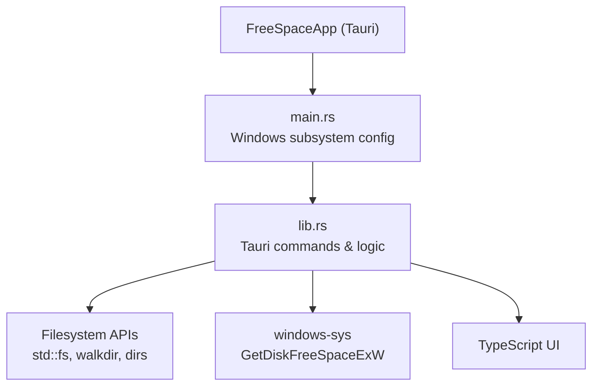
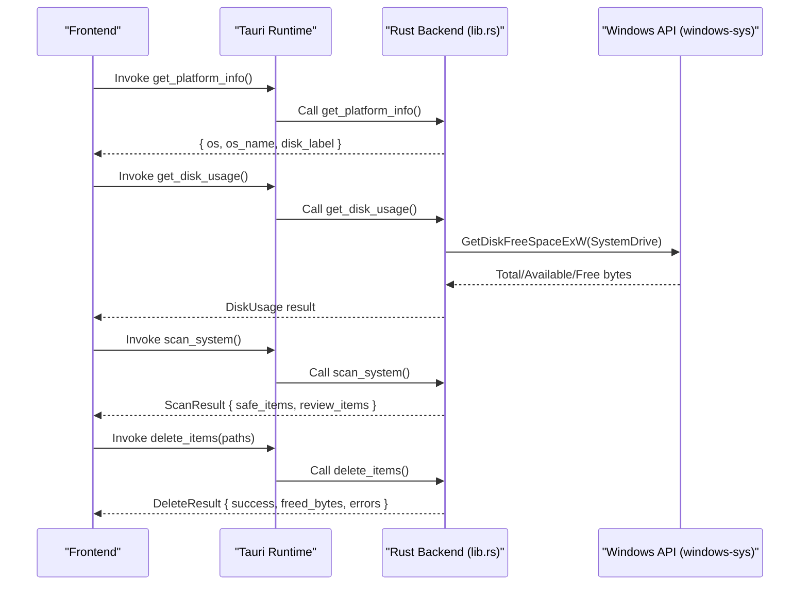
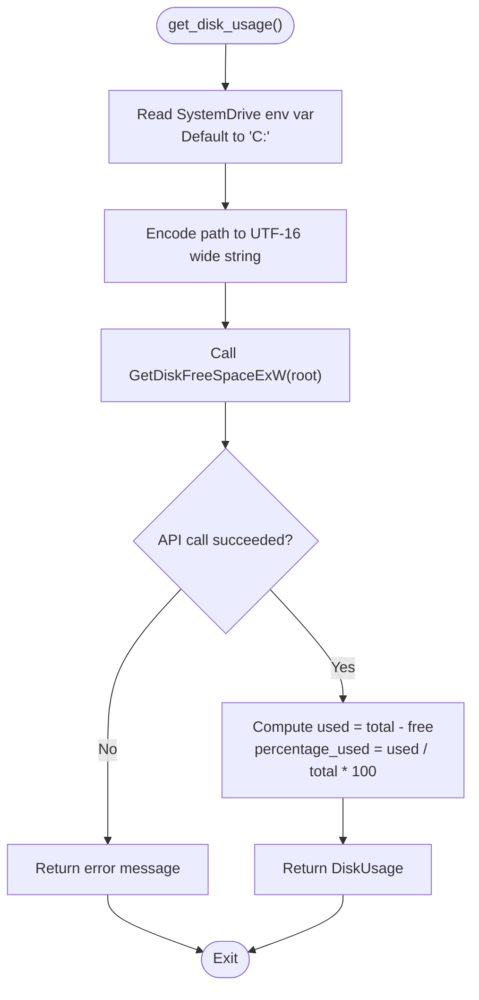
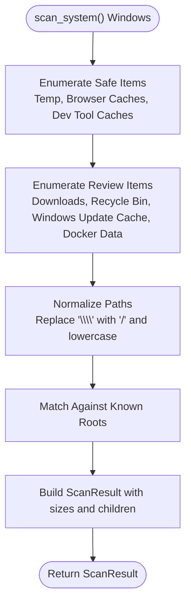
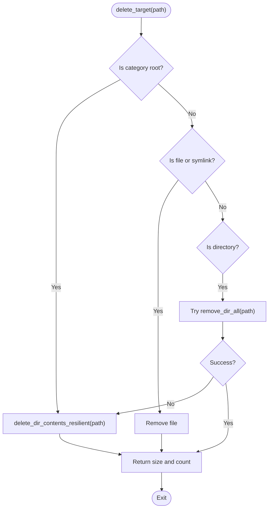
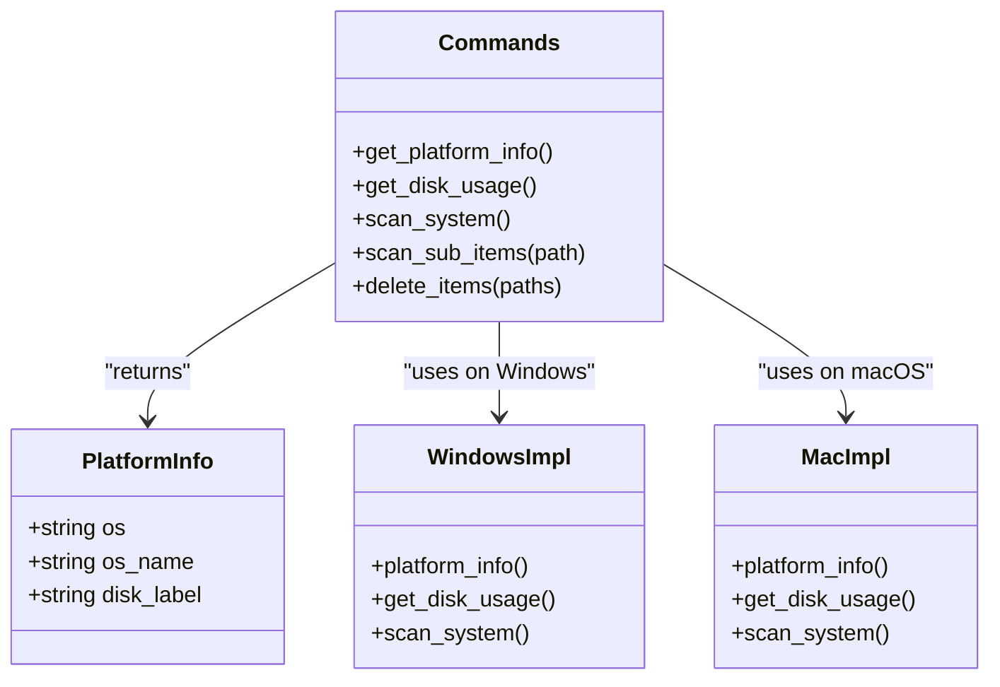
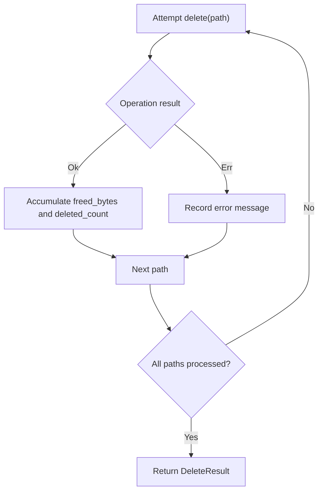
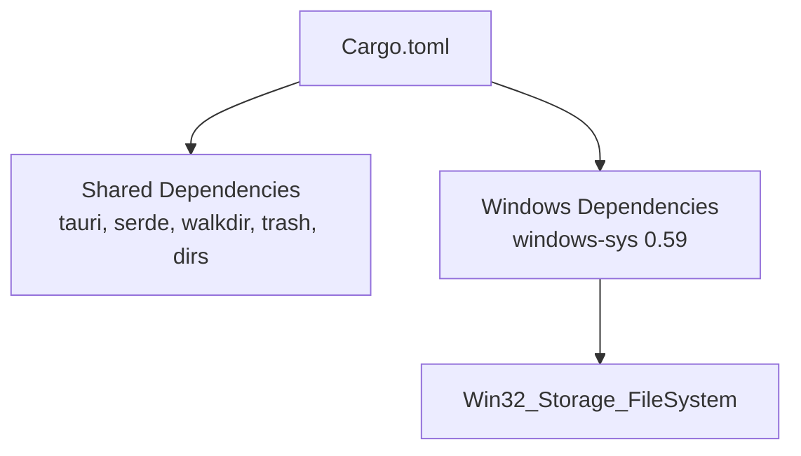

# Windows Compatibility

<cite>
**Referenced Files in This Document**
- [README.md](file://README.md)
- [Cargo.toml](file://src-tauri/Cargo.toml)
- [main.rs](file://src-tauri/src/main.rs)
- [lib.rs](file://src-tauri/src/lib.rs)
</cite>

## Update Summary
**Changes Made**
- Updated Windows-specific cache path handling with complete implementation including browser caches (Chrome/Edge), package manager support (npm/pip), Docker data, and system temporary directories
- Added detailed documentation for the `scan_system()` function implementation
- Enhanced Windows file system semantics documentation with specific examples
- Updated conditional compilation strategies with actual code references
- Expanded troubleshooting guidance for Windows-specific issues

## Table of Contents
1. [Introduction](#introduction)
2. [Project Structure](#project-structure)
3. [Core Components](#core-components)
4. [Architecture Overview](#architecture-overview)
5. [Detailed Component Analysis](#detailed-component-analysis)
6. [Dependency Analysis](#dependency-analysis)
7. [Performance Considerations](#performance-considerations)
8. [Troubleshooting Guide](#troubleshooting-guide)
9. [Conclusion](#conclusion)

## Introduction
This document explains how FreeSpaceMacos supports Windows compatibility, focusing on:
- System drive detection using the windows-sys crate to identify the system drive and query disk usage.
- Complete Windows-specific cache path handling for common applications such as Visual Studio, Node.js, Python, Docker, browsers (Chrome/Edge), and development tools.
- API adaptations required for Windows file system semantics, including path separators, permission models, and file locking behaviors.
- Conditional compilation strategies using `#[cfg(target_os = "windows")]` attributes to maintain cross-platform compatibility.
- Examples of Windows-specific error handling, permission escalation scenarios, and registry access patterns.
- Deployment considerations for Windows users, including administrator privileges requirements and antivirus software interactions.
- Troubleshooting guidance for common Windows-specific issues like access denied errors and path resolution problems.

The application is a Tauri 2 app with a Rust backend and TypeScript frontend. The Rust backend provides platform-aware commands for disk usage scanning, cleanup item enumeration, and deletion.

**Section sources**
- [README.md:1-74](file://README.md#L1-L74)

## Project Structure
At a high level, the relevant parts for Windows support are under `src-tauri`:
- `src-tauri/Cargo.toml` declares Windows-specific dependencies via conditional compilation.
- `src-tauri/src/main.rs` is the Tauri entry point and suppresses the console window on Windows in release builds.
- `src-tauri/src/lib.rs` contains the core logic, including:
  - Cross-platform data types and helpers.
  - Platform-specific implementations of disk usage queries.
  - A Windows-specific `scan_system()` command that enumerates safe and review-needed cleanup items.
  - Path normalization and category root matching that works across macOS and Windows.

**Diagram sources**
- [main.rs:1-7](file://src-tauri/src/main.rs#L1-L7)
- [lib.rs:328-399](file://src-tauri/src/lib.rs#L328-L399)
- [lib.rs:898-1162](file://src-tauri/src/lib.rs#L898-L1162)

**Section sources**
- [Cargo.toml:1-29](file://src-tauri/Cargo.toml#L1-L29)
- [main.rs:1-7](file://src-tauri/src/main.rs#L1-L7)
- [lib.rs:1-67](file://src-tauri/src/lib.rs#L1-L67)

## Core Components
Key components related to Windows compatibility:
- Conditional dependency configuration for Windows in Cargo manifest.
- Windows subsystem configuration in main entry point.
- Disk usage query implementation using `windows_sys::Win32::Storage::FileSystem::GetDiskFreeSpaceExW`.
- Windows-specific scan function enumerating caches and temporary directories.
- Path normalization and category root matching that handles both `/` and `\` separators.
- Deletion routines resilient to locked files and partial failures.

**Section sources**
- [Cargo.toml:24-29](file://src-tauri/Cargo.toml#L24-L29)
- [main.rs:1-7](file://src-tauri/src/main.rs#L1-L7)
- [lib.rs:328-399](file://src-tauri/src/lib.rs#L328-L399)
- [lib.rs:898-1162](file://src-tauri/src/lib.rs#L898-L1162)
- [lib.rs:203-259](file://src-tauri/src/lib.rs#L203-L259)
- [lib.rs:261-324](file://src-tauri/src/lib.rs#L261-L324)

## Architecture Overview
The Windows-compatible architecture integrates Tauri commands with platform-specific logic:
- The frontend invokes Tauri commands exposed by the Rust backend.
- On Windows, `get_disk_usage` uses `windows-sys` to query disk space from the system drive.
- `scan_system` on Windows enumerates known cache and temp locations for user and system-level cleanup.
- Path normalization ensures consistent matching regardless of separator differences between platforms.
- Deletion operations use resilient strategies to handle locked files and permission constraints.

**Diagram sources**
- [lib.rs:892-894](file://src-tauri/src/lib.rs#L892-L894)
- [lib.rs:328-399](file://src-tauri/src/lib.rs#L328-L399)
- [lib.rs:898-1162](file://src-tauri/src/lib.rs#L898-L1162)
- [lib.rs:1164-1190](file://src-tauri/src/lib.rs#L1164-L1190)

## Detailed Component Analysis

### System Drive Detection Using windows-sys
On Windows, disk usage is obtained by reading the `SystemDrive` environment variable (defaulting to `C:`), converting it to a wide string, and calling `GetDiskFreeSpaceExW` through `windows-sys`. This returns total, available, and free bytes, which are converted into a unified `DiskUsage` structure.

**Diagram sources**
- [lib.rs:365-406](file://src-tauri/src/lib.rs#L365-L406)

**Section sources**
- [lib.rs:365-406](file://src-tauri/src/lib.rs#L365-L406)

### Complete Windows Cache Path Handling
The Windows `scan_system()` function provides comprehensive enumeration of well-known cache and temporary directories:

**Safe Items (Auto-deletable):**
- **User & System Temp**: User temp files (`~/AppData/Local/Temp`) and Windows system temp (`C:/Windows/Temp`)
- **Browser Caches**: Google Chrome cache, Microsoft Edge cache, and Windows INetCache
- **System Components**: DirectX shader cache, Windows Error Reports, crash dumps
- **Development Tools**: npm cache, pip cache, uv cache, cargo registry cache

**Review Items (Require Confirmation):**
- **User Data**: Downloads folder and Recycle Bin
- **System Updates**: Windows Update download cache and Windows.old installation
- **Developer Tools**: HuggingFace cache, Gradle caches, NuGet packages
- **Application Data**: Docker Desktop data, VS Code cache, Spotify storage, Yarn cache

These paths are normalized and matched against a list of roots to determine whether a target is a category root eligible for resilient directory content deletion.

**Diagram sources**
- [lib.rs:898-1162](file://src-tauri/src/lib.rs#L898-L1162)
- [lib.rs:203-259](file://src-tauri/src/lib.rs#L203-L259)

**Section sources**
- [lib.rs:898-1162](file://src-tauri/src/lib.rs#L898-L1162)
- [lib.rs:203-259](file://src-tauri/src/lib.rs#L203-L259)

### API Adaptations for Windows File System Semantics
- **Path Separators**: The code normalizes backslashes to forward slashes when matching category roots, ensuring consistent behavior across Windows (`\`) and Unix-like systems (`/`).
- **Permission Models**: Some Windows paths require elevated permissions (e.g., system temp, Windows Update cache, Recycle Bin). The deletion routines gracefully report errors rather than failing the entire operation.
- **File Locking Behaviors**: Resilient deletion attempts to remove files and directories even if some entries are locked; it continues processing other entries and aggregates errors.

**Diagram sources**
- [lib.rs:268-331](file://src-tauri/src/lib.rs#L268-L331)

**Section sources**
- [lib.rs:203-259](file://src-tauri/src/lib.rs#L203-L259)
- [lib.rs:268-331](file://src-tauri/src/lib.rs#L268-L331)

### Conditional Compilation Strategies
The codebase uses `#[cfg(target_os = "windows")]` and `#[cfg(target_os = "macos")]` to provide platform-specific implementations:
- `get_disk_usage` has separate branches for macOS and Windows.
- `platform_info` returns OS-specific labels and names.
- `scan_system` is implemented separately for macOS and Windows.

**Diagram sources**
- [lib.rs:856-894](file://src-tauri/src/lib.rs#L856-L894)
- [lib.rs:328-399](file://src-tauri/src/lib.rs#L328-L399)
- [lib.rs:898-1162](file://src-tauri/src/lib.rs#L898-L1162)

**Section sources**
- [lib.rs:328-399](file://src-tauri/src/lib.rs#L328-L399)
- [lib.rs:856-894](file://src-tauri/src/lib.rs#L856-L894)
- [lib.rs:898-1162](file://src-tauri/src/lib.rs#L898-L1162)

### Windows-Specific Error Handling and Permission Escalation Scenarios
- **Error Aggregation**: Deletion operations collect errors per path and return them in `DeleteResult.errors`, allowing the UI to inform users about specific failures.
- **Permission Escalation**: Certain paths (e.g., system temp, Windows Update cache, Recycle Bin) may require administrator privileges. The current implementation does not automatically elevate privileges; instead, it reports errors so the user can retry with elevated rights or adjust permissions.
- **Antivirus Interactions**: Real-time scanning by antivirus software may lock files temporarily, causing deletion failures. Retrying after closing active applications or adding exclusions can mitigate these issues.

**Diagram sources**
- [lib.rs:1164-1190](file://src-tauri/src/lib.rs#L1164-L1190)

**Section sources**
- [lib.rs:1164-1190](file://src-tauri/src/lib.rs#L1164-L1190)

### Registry Access Patterns
The current codebase does not include direct registry access. If future features require reading Windows registry keys (for example, locating installation directories or user profile paths), the recommended approach would be:
- Use `windows-sys` to call registry functions such as `RegOpenKeyExW`, `RegQueryValueExW`, and `RegCloseKey`.
- Handle Unicode strings carefully using UTF-16 encoding.
- Wrap calls in safe Rust wrappers to avoid unsafe blocks where possible.
- Implement robust error handling for missing keys, insufficient permissions, and type mismatches.

[No sources needed since this section provides general guidance]

## Dependency Analysis
The project's Windows-related dependencies are declared conditionally:
- `windows-sys` version 0.59 with the `Win32_Storage_FileSystem` feature is included only for Windows targets.
- Other dependencies like `walkdir`, `trash`, `dirs`, `serde`, and `tauri` are shared across platforms.

**Diagram sources**
- [Cargo.toml:15-29](file://src-tauri/Cargo.toml#L15-L29)

**Section sources**
- [Cargo.toml:15-29](file://src-tauri/Cargo.toml#L15-L29)

## Performance Considerations
- **Directory Traversal**: The code limits traversal depth to 10 levels during size calculation to balance accuracy and performance.
- **Resilient Deletion**: Attempting to delete directory contents recursively avoids blocking the entire operation on locked files.
- **Disk Usage Query**: Using `GetDiskFreeSpaceExW` is efficient and avoids scanning directories.
- **Path Normalization**: Efficient string replacement and case conversion for cross-platform compatibility.

[No sources needed since this section provides general guidance]

## Troubleshooting Guide
Common Windows-specific issues and resolutions:
- **Access Denied Errors**:
  - Cause: Insufficient permissions for system directories or locked files.
  - Resolution: Run the application with administrator privileges or close applications holding locks on the target files.
- **Path Resolution Problems**:
  - Cause: Mixed path separators or incorrect environment variables.
  - Resolution: Ensure paths are normalized and verify `SystemDrive` environment variable points to the expected drive.
- **Antivirus Interference**:
  - Cause: Real-time scanning locks files temporarily.
  - Resolution: Add exclusions for the application or temporarily disable real-time scanning while cleaning.
- **Locked Developer Tools**:
  - Cause: Active IDEs or package managers hold locks on cache directories.
  - Resolution: Close IDEs (e.g., VS Code, Visual Studio) and stop running processes before cleanup.
- **Windows Update Issues**:
  - Cause: Windows Update service holds locks on update cache files.
  - Resolution: Stop Windows Update service temporarily or run with elevated privileges.
- **Docker Desktop Conflicts**:
  - Cause: Docker Desktop maintains active connections to container volumes.
  - Resolution: Stop all containers and shut down Docker Desktop before cleanup operations.

**Section sources**
- [lib.rs:268-331](file://src-tauri/src/lib.rs#L268-L331)
- [lib.rs:1164-1190](file://src-tauri/src/lib.rs#L1164-L1190)

## Conclusion
FreeSpaceMacos implements comprehensive Windows compatibility through careful use of conditional compilation, platform-specific APIs, and resilient file operations. The system drive detection leverages `windows-sys` to query disk usage, while the complete Windows-specific cache path enumeration covers browser caches (Chrome/Edge), package managers (npm/pip), Docker data, and various system temporary directories. Path normalization and error aggregation ensure robust behavior across different environments. For deployment, users should consider administrator privileges and antivirus interactions to achieve optimal results.

[No sources needed since this section summarizes without analyzing specific files]