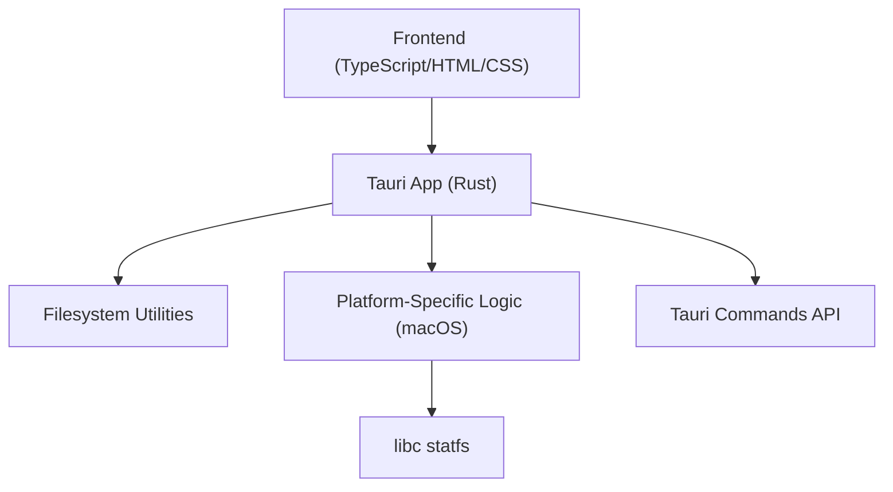
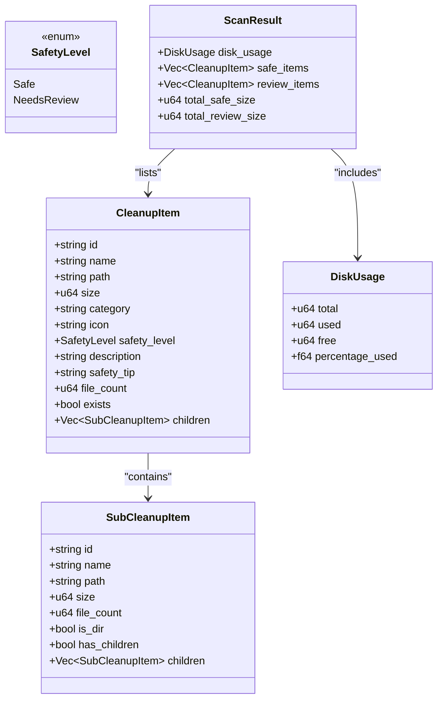
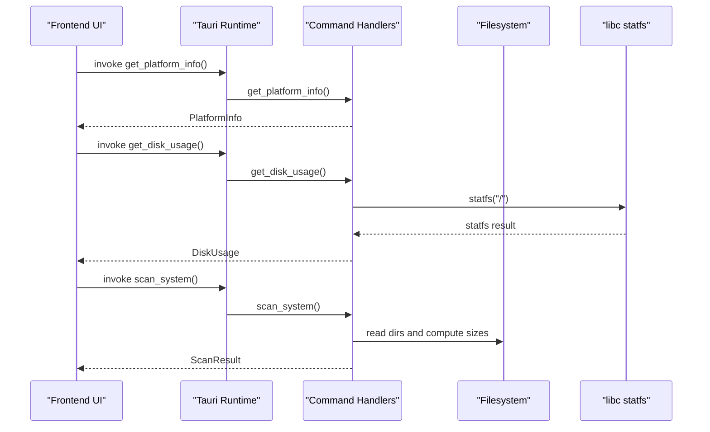
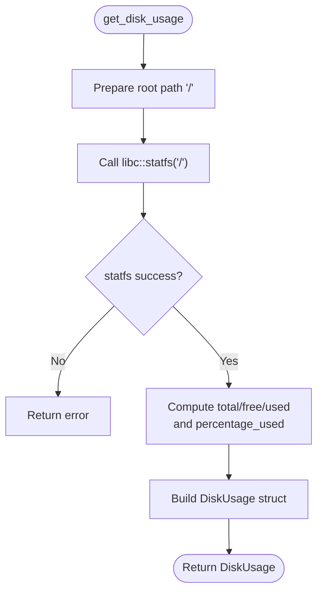
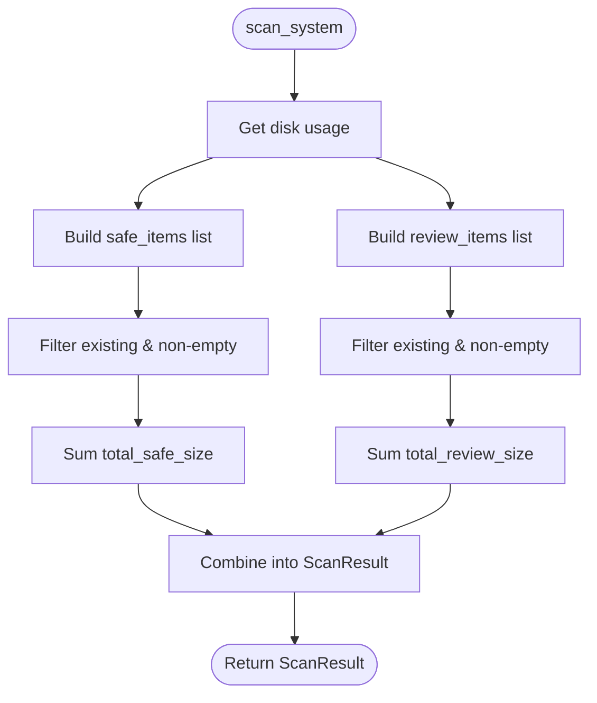
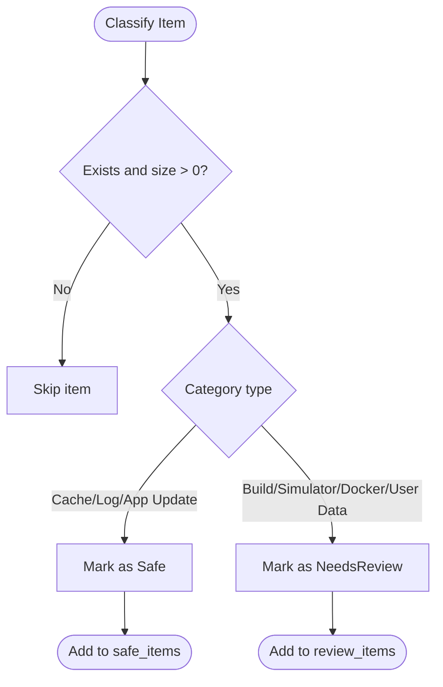
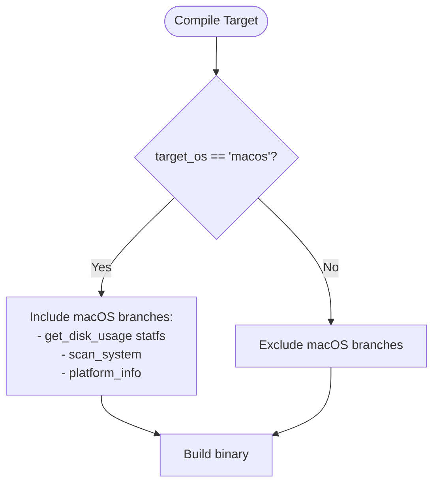
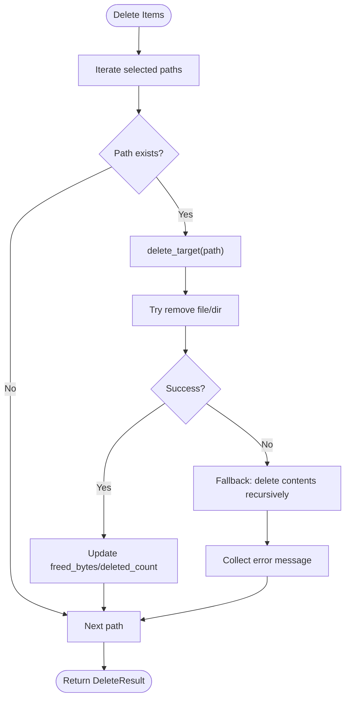
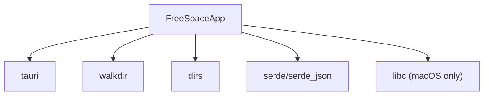

# macOS Implementation

<cite>
**Referenced Files in This Document**
- [README.md](file://README.md)
- [Cargo.toml](file://src-tauri/Cargo.toml)
- [lib.rs](file://src-tauri/src/lib.rs)
- [main.rs](file://src-tauri/src/main.rs)
</cite>

## Table of Contents
1. [Introduction](#introduction)
2. [Project Structure](#project-structure)
3. [Core Components](#core-components)
4. [Architecture Overview](#architecture-overview)
5. [Detailed Component Analysis](#detailed-component-analysis)
6. [Dependency Analysis](#dependency-analysis)
7. [Performance Considerations](#performance-considerations)
8. [Troubleshooting Guide](#troubleshooting-guide)
9. [Conclusion](#conclusion)

## Introduction
This document explains the macOS-specific implementation details for FreeSpaceMacos, a Tauri-based storage cleanup and disk analyzer app. It focuses on:
- Direct libc integration for disk statistics via statfs
- Platform-specific cache directory detection algorithms using macOS paths and system conventions
- Safety classification of directories into safe-to-delete versus needs-review categories
- Conditional compilation with #[cfg(target_os = "macos")] attributes
- Permission considerations when accessing system directories
- Known limitations and troubleshooting steps specific to macOS

The project is built with Tauri 2 (Rust backend + TypeScript/HTML/CSS frontend), targeting both Apple Silicon and Intel Macs.

**Section sources**
- [README.md:1-40](file://README.md#L1-L40)

## Project Structure
FreeSpaceMacos uses a standard Tauri layout:
- Frontend assets under src/
- Rust backend under src-tauri/, including Cargo configuration and source files
- Tauri entry point and command handlers implemented in Rust

**Diagram sources**
- [main.rs:4-6](file://src-tauri/src/main.rs#L4-L6)
- [lib.rs:1086-1099](file://src-tauri/src/lib.rs#L1086-L1099)

**Section sources**
- [main.rs:1-7](file://src-tauri/src/main.rs#L1-L7)
- [lib.rs:1086-1099](file://src-tauri/src/lib.rs#L1086-L1099)

## Core Components
Key components for macOS support include:
- Disk usage retrieval via direct libc calls
- macOS scan_system() that enumerates known cache and log locations
- Safety classification model (Safe vs NeedsReview)
- Path expansion utilities for user home directories
- Resilient deletion routines for directories and files

**Diagram sources**
- [lib.rs:8-66](file://src-tauri/src/lib.rs#L8-L66)

**Section sources**
- [lib.rs:8-66](file://src-tauri/src/lib.rs#L8-L66)

## Architecture Overview
At runtime, the Tauri app exposes commands to the frontend:
- get_platform_info: returns platform metadata
- get_disk_usage: retrieves disk totals and percentages
- scan_system: scans macOS-specific directories and categorizes them
- scan_sub_items: lists subdirectories/files within a given path
- delete_items: deletes selected items resiliently

**Diagram sources**
- [lib.rs:328-399](file://src-tauri/src/lib.rs#L328-L399)
- [lib.rs:410-744](file://src-tauri/src/lib.rs#L410-L744)
- [lib.rs:783-786](file://src-tauri/src/lib.rs#L783-L786)

**Section sources**
- [lib.rs:328-399](file://src-tauri/src/lib.rs#L328-L399)
- [lib.rs:410-744](file://src-tauri/src/lib.rs#L410-L744)
- [lib.rs:783-786](file://src-tauri/src/lib.rs#L783-L786)

## Detailed Component Analysis

### Direct libc Integration for Disk Statistics
On macOS, disk usage is obtained by calling statfs through the libc crate:
- The root path "/" is passed to statfs
- Block size and block counts are used to calculate total, free, and used space
- Percentage used is computed from total and free values

**Diagram sources**
- [lib.rs:328-399](file://src-tauri/src/lib.rs#L328-L399)

**Section sources**
- [lib.rs:328-399](file://src-tauri/src/lib.rs#L328-L399)

### macOS Cache Directory Detection Algorithm
The macOS scan_system() function enumerates well-known cache and log directories:
- User caches: ~/Library/Caches
- Application logs: ~/Library/Logs
- Crash reports: ~/Library/Application Support/CrashReporter
- Browser caches: Safari and Chrome
- Developer caches: Xcode DerivedData, Archives, iOS DeviceSupport, CoreSimulator Devices
- Package manager caches: npm, pip, cargo, yarn, CocoaPods, Gradle, Homebrew
- AI/data caches: HuggingFace, Solana CLI
- Desktop app update caches: Kiro ShipIt, DotSlash
- Other artifacts: VS Code cache, Spotify persistent cache, Docker data

Each location is processed by scan_location(), which:
- Expands "~" to the user’s home directory
- Checks existence and computes size/file count
- Scans immediate children and sorts by size
- Classifies each item as Safe or NeedsReview based on predefined rules

**Diagram sources**
- [lib.rs:410-744](file://src-tauri/src/lib.rs#L410-L744)

**Section sources**
- [lib.rs:410-744](file://src-tauri/src/lib.rs#L410-L744)

### Safety Classification System
Directories are classified into two categories:
- Safe: Automatically deletable without user confirmation; typically caches/logs that apps recreate
- NeedsReview: Requires explicit user confirmation; may need re-downloading or rebuilding

Examples:
- Safe: ~/Library/Caches, ~/Library/Logs, ~/.Trash, browser caches, package manager caches
- NeedsReview: Xcode DerivedData/Archives, iOS Simulator devices, Docker data, Downloads folder

**Diagram sources**
- [lib.rs:410-744](file://src-tauri/src/lib.rs#L410-L744)

**Section sources**
- [lib.rs:410-744](file://src-tauri/src/lib.rs#L410-L744)

### Conditional Compilation with #[cfg(target_os = "macos")]
The codebase uses conditional compilation to isolate platform-specific logic:
- get_disk_usage includes a macOS branch that calls statfs
- scan_system is defined only for macOS
- platform_info provides macOS-specific labels like "Macintosh HD"

**Diagram sources**
- [lib.rs:328-399](file://src-tauri/src/lib.rs#L328-L399)
- [lib.rs:410-744](file://src-tauri/src/lib.rs#L410-L744)
- [lib.rs:755-781](file://src-tauri/src/lib.rs#L755-L781)

**Section sources**
- [lib.rs:328-399](file://src-tauri/src/lib.rs#L328-L399)
- [lib.rs:410-744](file://src-tauri/src/lib.rs#L410-L744)
- [lib.rs:755-781](file://src-tauri/src/lib.rs#L755-L781)

### Permission Requirements for Accessing System Directories
- Most cache/log directories under ~/Library and ~/.cache are user-writable and do not require elevated permissions
- Some directories (e.g., Docker data, system-level caches) may require elevated privileges if locked by other processes
- The deletion routine handles permission errors gracefully by collecting errors and continuing where possible

**Diagram sources**
- [lib.rs:1056-1082](file://src-tauri/src/lib.rs#L1056-L1082)
- [lib.rs:261-324](file://src-tauri/src/lib.rs#L261-L324)

**Section sources**
- [lib.rs:1056-1082](file://src-tauri/src/lib.rs#L1056-L1082)
- [lib.rs:261-324](file://src-tauri/src/lib.rs#L261-L324)

## Dependency Analysis
The macOS implementation depends on:
- libc crate for low-level statfs calls
- walkdir for recursive directory traversal
- dirs for resolving user home directory
- serde/serde_json for serialization of results
- tauri and tauri-plugin-opener for app runtime and opening URLs

**Diagram sources**
- [Cargo.toml:15-25](file://src-tauri/Cargo.toml#L15-L25)
- [lib.rs:1-5](file://src-tauri/src/lib.rs#L1-L5)

**Section sources**
- [Cargo.toml:15-25](file://src-tauri/Cargo.toml#L15-L25)
- [lib.rs:1-5](file://src-tauri/src/lib.rs#L1-L5)

## Performance Considerations
- Filesystem scanning uses walkdir with a max depth limit to avoid excessive recursion
- Size computation aggregates file lengths directly from metadata
- Sorting of child items is performed by size to prioritize large targets
- Deletion operations are resilient: they attempt direct removal first, then fall back to recursive content deletion, collecting errors rather than failing entirely

Optimization opportunities:
- Parallelize directory size calculations for large trees
- Use buffered I/O for batch operations
- Cache intermediate results during repeated scans

[No sources needed since this section provides general guidance]

## Troubleshooting Guide
Common macOS-specific issues and resolutions:
- statfs failures: Ensure the root filesystem is accessible; check for unusual mount points or read-only volumes
- Permission denied errors: Run the app with appropriate permissions or use sudo for protected directories (e.g., Docker data)
- Stale cache entries: Some applications lock cache files while running; close the application before cleaning
- Large Xcode artifacts: DerivedData and Archives can be very large; selectively delete old builds and device symbols
- Browser caches: Clearing browser caches does not affect saved passwords or bookmarks but may require re-login for some sites

Steps:
- Verify target directories exist before scanning
- Use scan_sub_items to inspect large directories before deletion
- Review the errors returned by delete_items and address permission issues

**Section sources**
- [lib.rs:328-399](file://src-tauri/src/lib.rs#L328-L399)
- [lib.rs:1056-1082](file://src-tauri/src/lib.rs#L1056-L1082)

## Conclusion
FreeSpaceMacos implements robust macOS-specific functionality:
- Direct libc integration for accurate disk statistics
- Comprehensive cache and log directory detection tailored to macOS conventions
- A clear safety classification system guiding users on what can be safely deleted
- Conditional compilation ensuring clean separation between macOS and other platforms
- Resilient deletion handling with informative error reporting

These features provide a safe, efficient, and user-friendly experience for reclaiming disk space on macOS systems.

[No sources needed since this section summarizes without analyzing specific files]