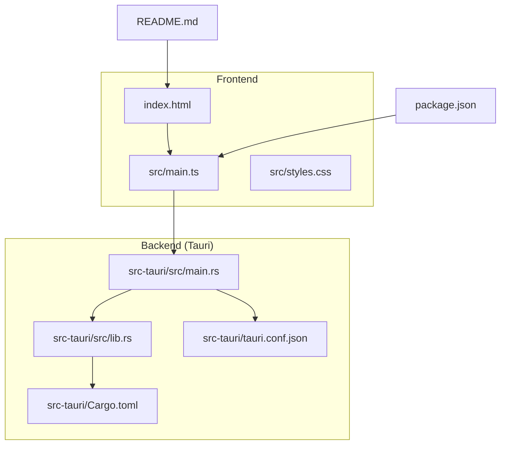
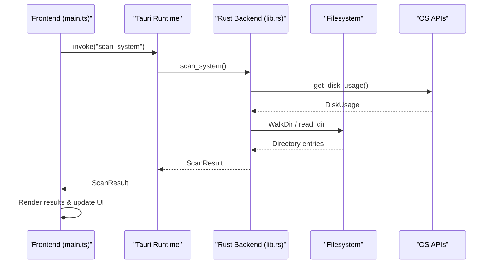
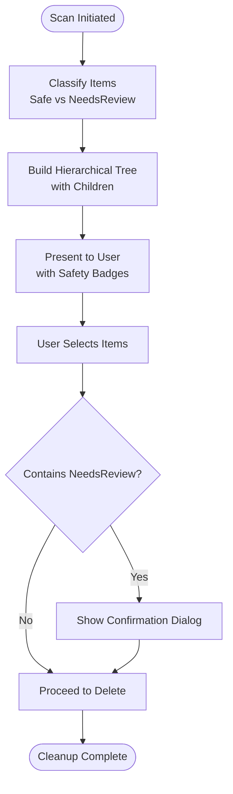
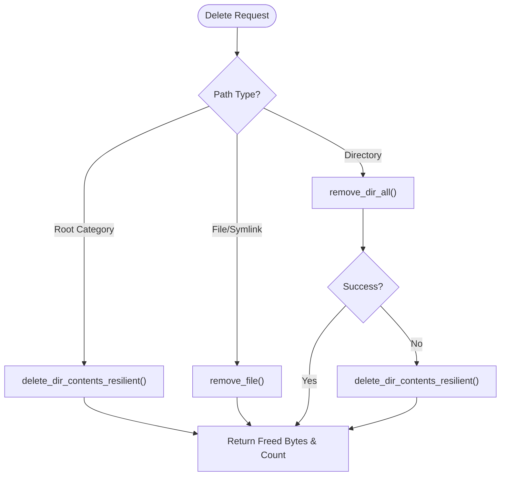
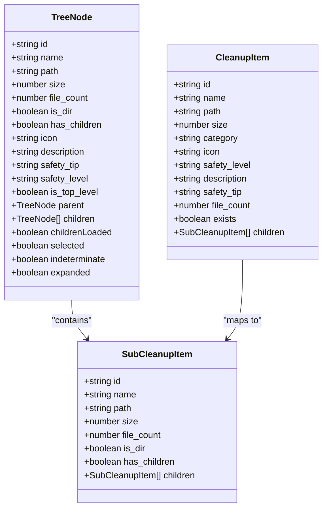
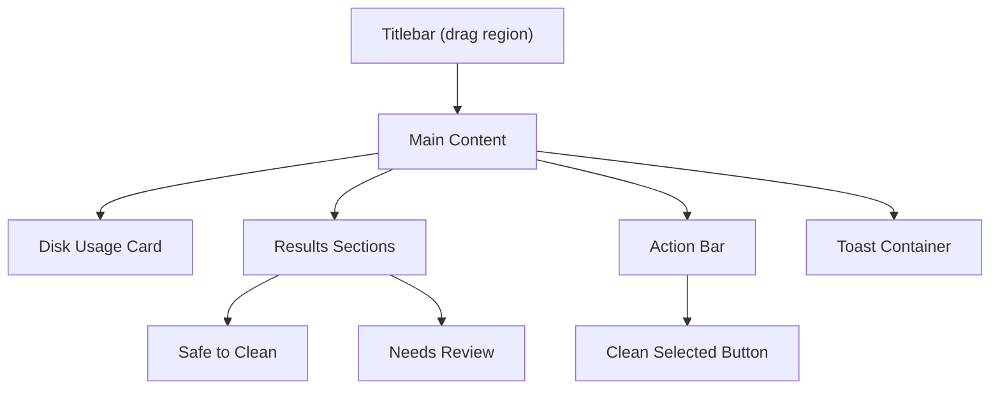
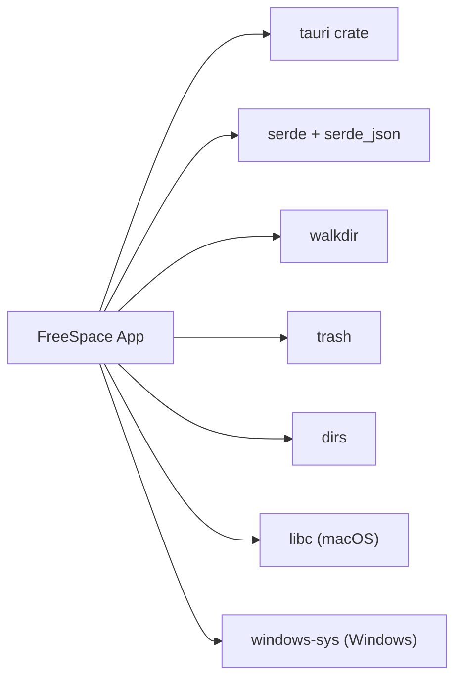

# Project Overview

<cite>
**Referenced Files in This Document**
- [README.md](file://README.md)
- [package.json](file://package.json)
- [src-tauri/Cargo.toml](file://src-tauri/Cargo.toml)
- [src-tauri/tauri.conf.json](file://src-tauri/tauri.conf.json)
- [src-tauri/src/main.rs](file://src-tauri/src/main.rs)
- [src-tauri/src/lib.rs](file://src-tauri/src/lib.rs)
- [index.html](file://index.html)
- [src/main.ts](file://src/main.ts)
- [src/styles.css](file://src/styles.css)
</cite>

## Table of Contents
1. [Introduction](#introduction)
2. [Project Structure](#project-structure)
3. [Core Components](#core-components)
4. [Architecture Overview](#architecture-overview)
5. [Detailed Component Analysis](#detailed-component-analysis)
6. [Dependency Analysis](#dependency-analysis)
7. [Performance Considerations](#performance-considerations)
8. [Troubleshooting Guide](#troubleshooting-guide)
9. [Conclusion](#conclusion)

## Introduction
FreeSpace for macOS is a modern, high-performance storage cleanup and disk analyzer application built with Tauri 2. It helps users safely reclaim disk space by scanning system directories, classifying cache and temporary files, and presenting clear safety guidance before deletion. The app combines a Rust backend with a TypeScript frontend to deliver fast, reliable operations and a polished macOS-native experience.

Key value propositions:
- Intelligent classification into “Safe to Clean” and “Needs Review” categories so users can confidently free up space without risking important data.
- Direct file system operations that avoid repetitive macOS authorization prompts during cleanup.
- Real-time disk usage visualization and interactive selection with hierarchical tree navigation.
- A modern glassmorphism UI designed for macOS, including dark mode and native window chrome.

Target audience:
- Developers who accumulate large caches (Xcode, npm/yarn, Docker, Gradle, Homebrew, etc.).
- System administrators managing macOS workstations and needing predictable, safe cleanup workflows.
- General macOS users who want an easy way to understand and reclaim disk space.

Differentiators:
- Safety-first approach with explicit classification and confirmation dialogs.
- Performance optimizations via direct filesystem traversal and resilient deletion logic.
- Glassmorphism design with smooth animations and native-feeling interactions.

[No sources needed since this section provides conceptual overview]

## Project Structure
The project follows a standard Tauri 2 layout:
- Frontend assets and entry points under the root directory.
- Backend Rust code under src-tauri.
- Configuration files for Tauri, packaging, and build scripts.

**Diagram sources**
- [index.html:1-10](file://index.html#L1-L10)
- [src/main.ts:1-10](file://src/main.ts#L1-L10)
- [src-tauri/src/main.rs:1-7](file://src-tauri/src/main.rs#L1-L7)
- [src-tauri/src/lib.rs:1-10](file://src-tauri/src/lib.rs#L1-L10)
- [src-tauri/Cargo.toml:1-10](file://src-tauri/Cargo.toml#L1-L10)
- [src-tauri/tauri.conf.json:1-12](file://src-tauri/tauri.conf.json#L1-L12)
- [package.json:1-10](file://package.json#L1-L10)
- [README.md:1-10](file://README.md#L1-L10)

**Section sources**
- [README.md:1-10](file://README.md#L1-L10)
- [package.json:1-10](file://package.json#L1-L10)
- [src-tauri/Cargo.toml:1-10](file://src-tauri/Cargo.toml#L1-L10)
- [src-tauri/tauri.conf.json:1-12](file://src-tauri/tauri.conf.json#L1-L12)

## Core Components
This section outlines the main building blocks of FreeSpace and their responsibilities.

- Rust backend (lib.rs):
  - Defines core data models for scan results, cleanup items, disk usage, and platform info.
  - Implements scanning logic for macOS and Windows, including safe and review categories.
  - Provides commands exposed to the frontend for disk usage, scanning, and deletion.
  - Uses walkdir for efficient directory traversal and libc/Windows APIs for disk stats.

- Tauri runtime (main.rs):
  - Entry point that launches the Tauri app and delegates to the library run function.

- Frontend (index.html, main.ts, styles.css):
  - Renders the UI with a glassmorphism theme and interactive controls.
  - Manages state for selected items, expansion, and selection propagation across hierarchies.
  - Invokes backend commands via Tauri’s invoke API and updates the UI accordingly.

- Configuration:
  - tauri.conf.json defines app metadata, window settings, and build integration.
  - Cargo.toml declares dependencies such as tauri, walkdir, trash, dirs, serde, and platform-specific crates.
  - package.json configures Vite, TypeScript, and Tauri CLI tooling.

**Section sources**
- [src-tauri/src/lib.rs:1-66](file://src-tauri/src/lib.rs#L1-L66)
- [src-tauri/src/lib.rs:326-399](file://src-tauri/src/lib.rs#L326-L399)
- [src-tauri/src/lib.rs:410-744](file://src-tauri/src/lib.rs#L410-L744)
- [src-tauri/src/main.rs:1-7](file://src-tauri/src/main.rs#L1-L7)
- [index.html:1-20](file://index.html#L1-L20)
- [src/main.ts:1-57](file://src/main.ts#L1-L57)
- [src/styles.css:1-45](file://src/styles.css#L1-L45)
- [src-tauri/Cargo.toml:15-25](file://src-tauri/Cargo.toml#L15-L25)
- [src-tauri/tauri.conf.json:1-33](file://src-tauri/tauri.conf.json#L1-L33)
- [package.json:1-20](file://package.json#L1-L20)

## Architecture Overview
FreeSpace uses a hybrid architecture:
- Frontend: TypeScript + HTML + CSS rendered inside a Tauri window.
- Backend: Rust library exposing commands to the frontend via Tauri IPC.
- Platform integrations: macOS uses libc.statfs; Windows uses Win32 APIs for disk stats.

**Diagram sources**
- [src/main.ts:1-10](file://src/main.ts#L1-L10)
- [src-tauri/src/lib.rs:410-744](file://src-tauri/src/lib.rs#L410-L744)
- [src-tauri/src/lib.rs:326-399](file://src-tauri/src/lib.rs#L326-L399)

**Section sources**
- [src/main.ts:1-10](file://src/main.ts#L1-L10)
- [src-tauri/src/lib.rs:326-399](file://src-tauri/src/lib.rs#L326-L399)
- [src-tauri/src/lib.rs:410-744](file://src-tauri/src/lib.rs#L410-L744)

## Detailed Component Analysis

### Safety Classification System
FreeSpace categorizes cleanup targets into two primary groups:
- Safe to Clean: Cache, logs, crash reports, trash, browser caches, and developer caches that are typically safe to remove because they are regenerated or not essential for normal operation.
- Needs Review: Larger or more sensitive artifacts like Xcode DerivedData, iOS Simulator devices, AI model caches, Docker data, and user Downloads. These require explicit user confirmation due to potential rebuild/download overhead.

Implementation highlights:
- Data models define SafetyLevel and CleanupItem structures.
- Scanning functions populate safe_items and review_items based on known paths and heuristics.
- The frontend renders badges and tips to guide users.

**Diagram sources**
- [src-tauri/src/lib.rs:8-41](file://src-tauri/src/lib.rs#L8-L41)
- [src-tauri/src/lib.rs:410-744](file://src-tauri/src/lib.rs#L410-L744)
- [src/main.ts:146-243](file://src/main.ts#L146-L243)

**Section sources**
- [src-tauri/src/lib.rs:8-41](file://src-tauri/src/lib.rs#L8-L41)
- [src-tauri/src/lib.rs:410-744](file://src-tauri/src/lib.rs#L410-L744)
- [src/main.ts:146-243](file://src/main.ts#L146-L243)

### Filesystem Scanning and Deletion Logic
Scanning:
- Uses walkdir to traverse directories efficiently with depth limits.
- Computes size and file counts per directory/file.
- Expands home paths and filters out non-relevant entries.

Deletion:
- Resilient deletion strategy attempts direct removal first, then falls back to recursive content deletion if necessary.
- Tracks freed bytes and deleted file counts, returning errors when applicable.

**Diagram sources**
- [src-tauri/src/lib.rs:261-324](file://src-tauri/src/lib.rs#L261-L324)

**Section sources**
- [src-tauri/src/lib.rs:70-97](file://src-tauri/src/lib.rs#L70-L97)
- [src-tauri/src/lib.rs:108-161](file://src-tauri/src/lib.rs#L108-L161)
- [src-tauri/src/lib.rs:261-324](file://src-tauri/src/lib.rs#L261-L324)

### Frontend State Management and Selection Model
The frontend maintains a hierarchical selection model:
- Nodes represent top-level categories and sub-items.
- Selection propagates downward to descendants and upward to ancestors, supporting indeterminate states.
- UI updates reflect selected count, total size, and action bar visibility.

**Diagram sources**
- [src/main.ts:59-78](file://src/main.ts#L59-L78)
- [src-tauri/src/lib.rs:14-41](file://src-tauri/src/lib.rs#L14-L41)

**Section sources**
- [src/main.ts:270-414](file://src/main.ts#L270-L414)
- [src/main.ts:470-696](file://src/main.ts#L470-L696)
- [src/main.ts:698-800](file://src/main.ts#L698-L800)

### UI Design and Glassmorphism Theme
The UI emphasizes clarity and performance:
- Dark mode with glassmorphism cards and subtle gradients.
- Custom titlebar region for native drag behavior.
- Animated disk usage ring and responsive layouts.
- Toast notifications for feedback and confirmation dialogs for destructive actions.

**Diagram sources**
- [index.html:11-20](file://index.html#L11-L20)
- [index.html:25-57](file://index.html#L25-L57)
- [index.html:78-132](file://index.html#L78-L132)
- [src/styles.css:134-143](file://src/styles.css#L134-L143)

**Section sources**
- [index.html:1-141](file://index.html#L1-L141)
- [src/styles.css:1-45](file://src/styles.css#L1-L45)
- [src/styles.css:134-143](file://src/styles.css#L134-L143)

## Dependency Analysis
The project integrates several key libraries:
- Tauri runtime and plugins for IPC and opener functionality.
- Serde for serialization/deserialization of data models.
- Walkdir for efficient directory traversal.
- Trash for moving items to the system trash where appropriate.
- Dirs for resolving user directories.
- Platform-specific crates: libc for macOS statfs and windows-sys for Windows disk APIs.

**Diagram sources**
- [src-tauri/Cargo.toml:15-25](file://src-tauri/Cargo.toml#L15-L25)

**Section sources**
- [src-tauri/Cargo.toml:15-25](file://src-tauri/Cargo.toml#L15-L25)

## Performance Considerations
- Efficient directory traversal using walkdir with depth limits reduces I/O overhead.
- Direct filesystem operations minimize permission prompts and improve responsiveness.
- Lazy loading of subdirectories avoids upfront scanning costs.
- Resilient deletion ensures partial failures do not block overall cleanup progress.

[No sources needed since this section provides general guidance]

## Troubleshooting Guide
Common issues and resolutions:
- Permission errors during deletion:
  - Ensure the app runs with appropriate permissions.
  - Use the confirmation dialog to verify selected paths.
- Slow scans on large directories:
  - Avoid selecting overly broad categories; expand selectively.
  - Consider excluding rarely used caches from future scans.
- UI not updating after deletion:
  - Re-run the scan to refresh the state.
  - Check toast notifications for error messages.

**Section sources**
- [src-tauri/src/lib.rs:261-324](file://src-tauri/src/lib.rs#L261-L324)
- [src/main.ts:121-142](file://src/main.ts#L121-L142)

## Conclusion
FreeSpace for macOS delivers a safe, intelligent, and performant approach to reclaiming disk space. Its classification system, robust backend, and polished UI make it suitable for developers, system administrators, and everyday macOS users. By combining Rust’s reliability with a modern TypeScript frontend, the app offers a seamless experience for understanding and optimizing storage usage.

[No sources needed since this section summarizes without analyzing specific files]