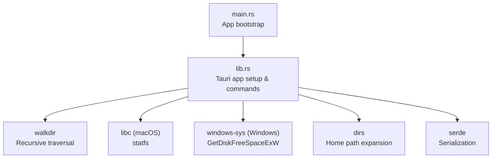
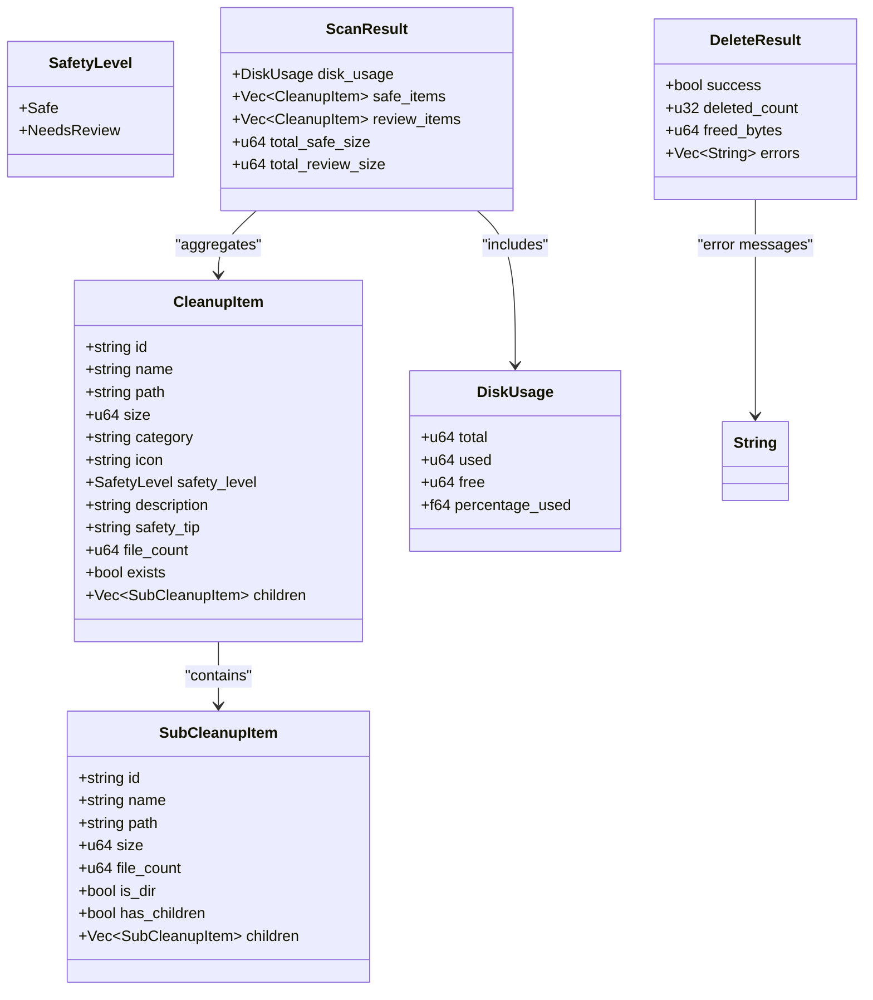
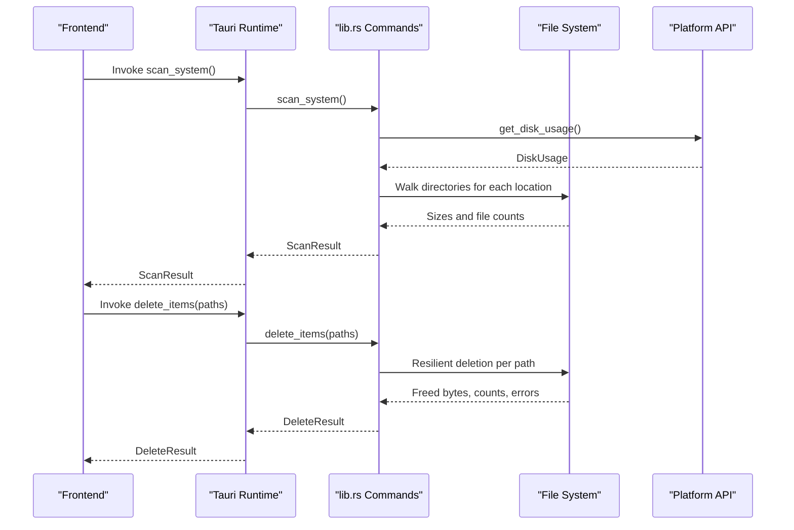
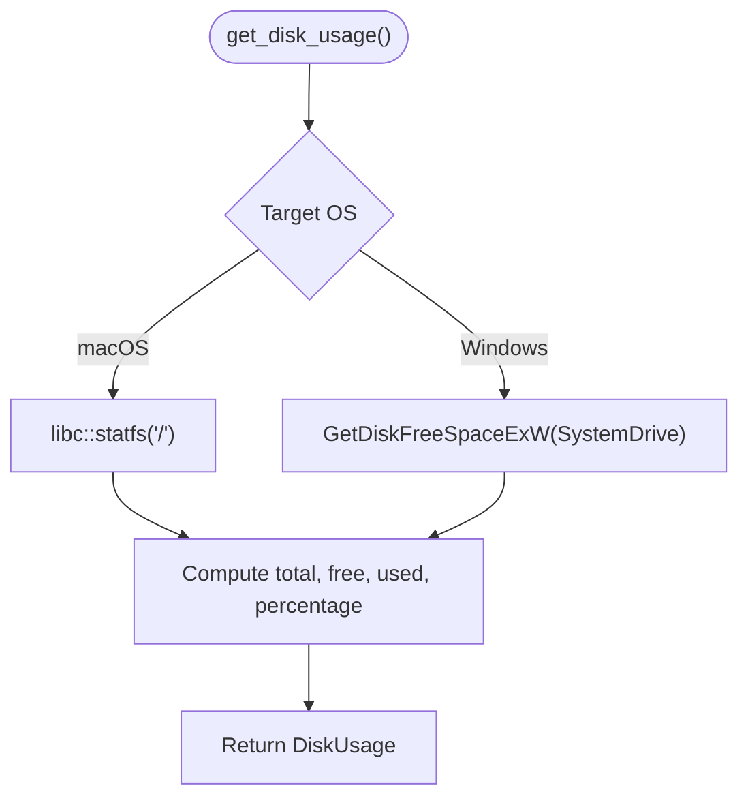
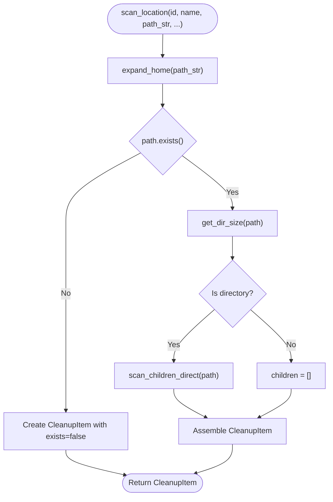
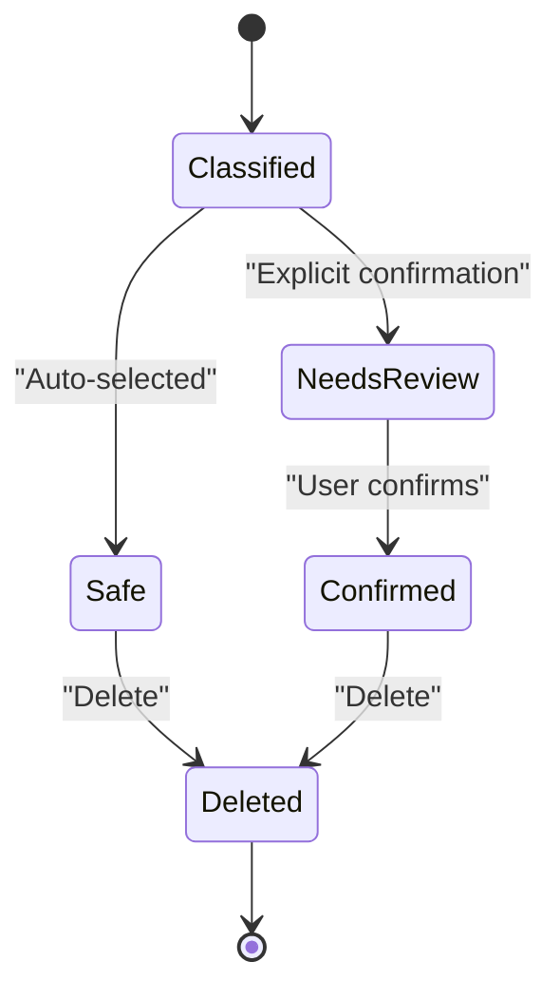
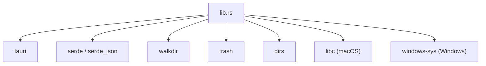

# Backend Architecture (Rust)

<cite>
**Referenced Files in This Document**
- [README.md](file://README.md)
- [Cargo.toml](file://src-tauri/Cargo.toml)
- [lib.rs](file://src-tauri/src/lib.rs)
- [main.rs](file://src-tauri/src/main.rs)
</cite>

## Table of Contents
1. [Introduction](#introduction)
2. [Project Structure](#project-structure)
3. [Core Components](#core-components)
4. [Architecture Overview](#architecture-overview)
5. [Detailed Component Analysis](#detailed-component-analysis)
6. [Dependency Analysis](#dependency-analysis)
7. [Performance Considerations](#performance-considerations)
8. [Troubleshooting Guide](#troubleshooting-guide)
9. [Conclusion](#conclusion)

## Introduction
This document describes the backend architecture of FreeSpaceMacos, a Tauri 2 application that scans and cleans storage on macOS and Windows. The Rust backend exposes commands for disk usage, scanning cleanup targets, expanding sub-items, and resilient deletion. It uses:
- walkdir for recursive directory traversal
- libc for macOS-specific disk statistics via statfs
- windows-sys for Windows-specific disk statistics via GetDiskFreeSpaceExW
- serde for serialization of data models
- dirs for home directory resolution

The system classifies cleanup targets into two safety levels: Safe and Needs Review. Safe items are generally safe to delete automatically; Needs Review items require explicit user confirmation because deleting them may trigger re-downloads or rebuilds.

**Section sources**
- [README.md:1-74](file://README.md#L1-L74)
- [Cargo.toml:1-29](file://src-tauri/Cargo.toml#L1-L29)

## Project Structure
The Rust backend is implemented as a Tauri library crate with a minimal main entry point. Key files:
- src-tauri/src/lib.rs: Core logic, data models, platform-specific implementations, and Tauri command handlers
- src-tauri/src/main.rs: Application bootstrap delegating to the library’s run function
- src-tauri/Cargo.toml: Dependencies including walkdir, libc (macOS), windows-sys (Windows), serde, tauri, trash, dirs

**Diagram sources**
- [main.rs:1-7](file://src-tauri/src/main.rs#L1-L7)
- [lib.rs:1086-1099](file://src-tauri/src/lib.rs#L1086-L1099)
- [Cargo.toml:15-29](file://src-tauri/Cargo.toml#L15-L29)

**Section sources**
- [main.rs:1-7](file://src-tauri/src/main.rs#L1-L7)
- [lib.rs:1086-1099](file://src-tauri/src/lib.rs#L1086-L1099)
- [Cargo.toml:1-29](file://src-tauri/Cargo.toml#L1-L29)

## Core Components
This section documents the core data models and their relationships.

### Data Models
- SafetyLevel: Enum indicating whether an item is Safe or NeedsReview
- SubCleanupItem: Represents a single child item under a scan target, including size, file count, directory flags, and optional children
- CleanupItem: Represents a top-level scan target with metadata such as category, icon, description, safety level, existence flag, and list of children
- DiskUsage: Aggregated disk metrics including total, used, free space, and percentage used
- ScanResult: Aggregates disk usage plus categorized lists of safe and review items along with totals
- DeleteResult: Reports deletion outcomes including success flag, deleted count, freed bytes, and error messages

**Diagram sources**
- [lib.rs:8-66](file://src-tauri/src/lib.rs#L8-L66)

**Section sources**
- [lib.rs:8-66](file://src-tauri/src/lib.rs#L8-L66)

## Architecture Overview
The backend exposes Tauri commands that the frontend can invoke:
- get_platform_info: Returns OS details and disk label
- get_disk_usage: Retrieves disk metrics using platform-specific APIs
- scan_system: Scans predefined locations and returns categorized cleanup items
- scan_sub_items: Expands a given path to list its immediate children with sizes
- delete_items: Performs resilient deletion across multiple paths

**Diagram sources**
- [lib.rs:328-399](file://src-tauri/src/lib.rs#L328-L399)
- [lib.rs:410-744](file://src-tauri/src/lib.rs#L410-L744)
- [lib.rs:1056-1082](file://src-tauri/src/lib.rs#L1056-L1082)
- [lib.rs:1086-1099](file://src-tauri/src/lib.rs#L1086-L1099)

**Section sources**
- [lib.rs:328-399](file://src-tauri/src/lib.rs#L328-L399)
- [lib.rs:410-744](file://src-tauri/src/lib.rs#L410-L744)
- [lib.rs:1056-1082](file://src-tauri/src/lib.rs#L1056-L1082)
- [lib.rs:1086-1099](file://src-tauri/src/lib.rs#L1086-L1099)

## Detailed Component Analysis

### Data Models and Serialization
- All models derive Debug, Clone, Serialize, Deserialize for inter-process communication between frontend and backend
- Optional fields use skip_serializing_if to avoid unnecessary payload when not present
- SafetyLevel enum drives UI behavior and deletion policy

**Diagram sources**
- [lib.rs:8-66](file://src-tauri/src/lib.rs#L8-L66)

**Section sources**
- [lib.rs:8-66](file://src-tauri/src/lib.rs#L8-L66)

### File System Operations and Traversal
- Directory size calculation uses walkdir with a max depth limit to avoid excessive recursion
- Directories are traversed recursively; files contribute their metadata length to total size
- Children scanning reads one level deep, filters out system artifacts like .DS_Store and .localized
- Home path expansion supports ~ prefix by resolving via dirs::home_dir

**Diagram sources**
- [lib.rs:70-97](file://src-tauri/src/lib.rs#L70-L97)

**Section sources**
- [lib.rs:70-97](file://src-tauri/src/lib.rs#L70-L97)
- [lib.rs:99-106](file://src-tauri/src/lib.rs#L99-L106)
- [lib.rs:108-161](file://src-tauri/src/lib.rs#L108-L161)

### Platform-Specific Disk Usage
- macOS: Uses libc::statfs on root path "/" to compute total, free, used, and percentage used
- Windows: Uses windows_sys::Win32::Storage::FileSystem::GetDiskFreeSpaceExW on the system drive to compute metrics
- Errors from platform calls are handled gracefully; fallback values are provided where appropriate

**Diagram sources**
- [lib.rs:328-399](file://src-tauri/src/lib.rs#L328-L399)
- [Cargo.toml:24-29](file://src-tauri/Cargo.toml#L24-L29)

**Section sources**
- [lib.rs:328-399](file://src-tauri/src/lib.rs#L328-L399)
- [Cargo.toml:24-29](file://src-tauri/Cargo.toml#L24-L29)

### Scanning Algorithm and Categorization
- scan_location constructs a CleanupItem by expanding paths, checking existence, computing size/file count, and listing direct children
- Categories include Caches, Browser, Developer, Logs, Trash, Apps, User Data, AI & Data
- Safety classification:
  - Safe: Typically caches, logs, crash reports, trash, browser caches, developer caches that regenerate
  - Needs Review: Build artifacts, simulators, downloads, Docker data, large model caches that may require re-download/rebuild

**Diagram sources**
- [lib.rs:163-201](file://src-tauri/src/lib.rs#L163-L201)
- [lib.rs:203-259](file://src-tauri/src/lib.rs#L203-L259)
- [lib.rs:410-744](file://src-tauri/src/lib.rs#L410-L744)

**Section sources**
- [lib.rs:163-201](file://src-tauri/src/lib.rs#L163-L201)
- [lib.rs:203-259](file://src-tauri/src/lib.rs#L203-L259)
- [lib.rs:410-744](file://src-tauri/src/lib.rs#L410-L744)

### Resilient Deletion Mechanism
- delete_target routes deletion based on path type:
  - Category roots: Delete contents resiliently without removing the root
  - Files/symlinks: Remove file directly
  - Directories: Attempt remove_dir_all; if it fails, fall back to recursive content deletion
- delete_dir_contents_resilient iterates entries, deletes files/directories, aggregates freed bytes and counts, and propagates last error

**Diagram sources**
- [lib.rs:261-324](file://src-tauri/src/lib.rs#L261-L324)
- [lib.rs:1056-1082](file://src-tauri/src/lib.rs#L1056-L1082)

**Section sources**
- [lib.rs:261-324](file://src-tauri/src/lib.rs#L261-L324)
- [lib.rs:1056-1082](file://src-tauri/src/lib.rs#L1056-L1082)

### Safety Classification System
- SafetyLevel enum drives UI prompts and deletion policies
- Safe items are pre-approved for automatic cleanup; Needs Review items require explicit user confirmation
- Descriptions and safety tips guide users about consequences (e.g., rebuilds, re-downloads)

**Diagram sources**
- [lib.rs:8-12](file://src-tauri/src/lib.rs#L8-L12)
- [lib.rs:410-744](file://src-tauri/src/lib.rs#L410-L744)

**Section sources**
- [lib.rs:8-12](file://src-tauri/src/lib.rs#L8-L12)
- [lib.rs:410-744](file://src-tauri/src/lib.rs#L410-L744)

## Dependency Analysis
The backend depends on:
- tauri: App framework and command invocation
- tauri-plugin-opener: Utility plugin (registered but not central to scanning/deletion)
- serde/serde_json: Serialization for data models
- walkdir: Recursive directory traversal
- trash: Available but not used in current implementation
- dirs: Home directory resolution
- libc (macOS): statfs for disk stats
- windows-sys (Windows): GetDiskFreeSpaceExW for disk stats

**Diagram sources**
- [Cargo.toml:15-29](file://src-tauri/Cargo.toml#L15-L29)
- [lib.rs:1086-1099](file://src-tauri/src/lib.rs#L1086-L1099)

**Section sources**
- [Cargo.toml:15-29](file://src-tauri/Cargo.toml#L15-L29)
- [lib.rs:1086-1099](file://src-tauri/src/lib.rs#L1086-L1099)

## Performance Considerations
- Directory size computation limits recursion depth to 10 to prevent excessive traversal overhead
- Filtering out non-file entries during traversal reduces metadata operations
- Sorting children by size improves UX by showing largest items first
- Resilient deletion avoids blocking entire operation on single failures by aggregating partial results
- Platform-specific disk stats use efficient native APIs rather than walking filesystems

[No sources needed since this section provides general guidance]

## Troubleshooting Guide
Common issues and strategies:
- Permission errors during deletion:
  - The resilient deletion mechanism collects errors and continues processing other items
  - Admin privileges may be required for certain system directories (e.g., Windows Temp, Recycle Bin)
- Path resolution problems:
  - Ensure ~ expansion works correctly; verify home directory via dirs::home_dir
- Non-existent or locked files:
  - delete_target handles missing paths gracefully and returns aggregated results
- Disk usage retrieval failures:
  - Platform-specific calls return errors; fallback values are used to keep UI responsive

**Section sources**
- [lib.rs:261-324](file://src-tauri/src/lib.rs#L261-L324)
- [lib.rs:328-399](file://src-tauri/src/lib.rs#L328-L399)
- [lib.rs:1056-1082](file://src-tauri/src/lib.rs#L1056-L1082)

## Conclusion
The FreeSpaceMacos backend provides a robust, cross-platform solution for storage analysis and cleanup. It leverages native APIs for accurate disk metrics, walkdir for efficient traversal, and a clear safety classification system to balance performance and user safety. The modular design separates concerns between data models, platform-specific logic, and Tauri command handlers, making it maintainable and extensible.

[No sources needed since this section summarizes without analyzing specific files]