# Backend Architecture (Rust)

<cite>
**Referenced Files in This Document**
- [README.md](file://README.md)
- [Cargo.toml](file://src-tauri/Cargo.toml)
- [lib.rs](file://src-tauri/src/lib.rs)
- [main.rs](file://src-tauri/src/main.rs)
</cite>

## Update Summary
**Changes Made**
- Added documentation for new LargeFile struct and related functionality
- Documented three new Tauri commands: get_tree_root, scan_large_files, reveal_path
- Updated directory scanning section to reflect enhanced path normalization
- Enhanced architecture diagrams to include new components
- Added new sections for large file scanning and tree navigation features

## Table of Contents
1. [Introduction](#introduction)
2. [Project Structure](#project-structure)
3. [Core Components](#core-components)
4. [Architecture Overview](#architecture-overview)
5. [Detailed Component Analysis](#detailed-component-analysis)
6. [Large File Scanning System](#large-file-scanning-system)
7. [Directory Tree Navigation](#directory-tree-navigation)
8. [Path Normalization and Cross-Platform Support](#path-normalization-and-cross-platform-support)
9. [Dependency Analysis](#dependency-analysis)
10. [Performance Considerations](#performance-considerations)
11. [Troubleshooting Guide](#troubleshooting-guide)
12. [Conclusion](#conclusion)

## Introduction
This document describes the backend architecture of FreeSpaceMacos, a Tauri 2 application that scans and cleans storage on macOS and Windows. The Rust backend exposes commands for disk usage, scanning cleanup targets, expanding sub-items, large file discovery, directory tree navigation, and resilient deletion. It uses:
- walkdir for recursive directory traversal
- libc for macOS-specific disk statistics via statfs
- windows-sys for Windows-specific disk statistics via GetDiskFreeSpaceExW
- serde for serialization of data models
- dirs for home directory resolution

The system classifies cleanup targets into two safety levels: Safe and Needs Review. Safe items are generally safe to delete automatically; Needs Review items require explicit user confirmation because deleting them may trigger re-downloads or rebuilds.

**Section sources**
- [README.md:1-74](file://README.md#L1-L74)
- [Cargo.toml:1-29](file://src-tauri/Cargo.toml#L1-L29)

## Project Structure
The Rust backend is implemented as a Tauri library crate with a minimal main entry point. Key files:
- src-tauri/src/lib.rs: Core logic, data models, platform-specific implementations, and Tauri command handlers
- src-tauri/src/main.rs: Application bootstrap delegating to the library's run function
- src-tauri/Cargo.toml: Dependencies including walkdir, libc (macOS), windows-sys (Windows), serde, tauri, trash, dirs

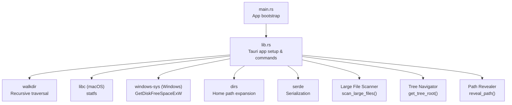

**Diagram sources**
- [main.rs:1-7](file://src-tauri/src/main.rs#L1-L7)
- [lib.rs:1194-1211](file://src-tauri/src/lib.rs#L1194-L1211)
- [Cargo.toml:15-29](file://src-tauri/Cargo.toml#L15-L29)

**Section sources**
- [main.rs:1-7](file://src-tauri/src/main.rs#L1-L7)
- [lib.rs:1194-1211](file://src-tauri/src/lib.rs#L1194-L1211)
- [Cargo.toml:1-29](file://src-tauri/Cargo.toml#L1-L29)

## Core Components
This section documents the core data models and their relationships.

### Data Models
- SafetyLevel: Enum indicating whether an item is Safe or NeedsReview
- SubCleanupItem: Represents a single child item under a scan target, including size, file count, directory flags, and optional children
- CleanupItem: Represents a top-level scan target with metadata such as category, icon, description, safety level, existence flag, and list of children
- DiskUsage: Aggregated disk metrics including total, used, free space, and percentage used
- ScanResult: Aggregates disk usage plus categorized lists of safe and review items along with totals
- DeleteResult: Reports deletion outcomes including success flag, deleted count, freed bytes, and error messages
- LargeFile: Represents individual large files found during scanning with name, path, and size information

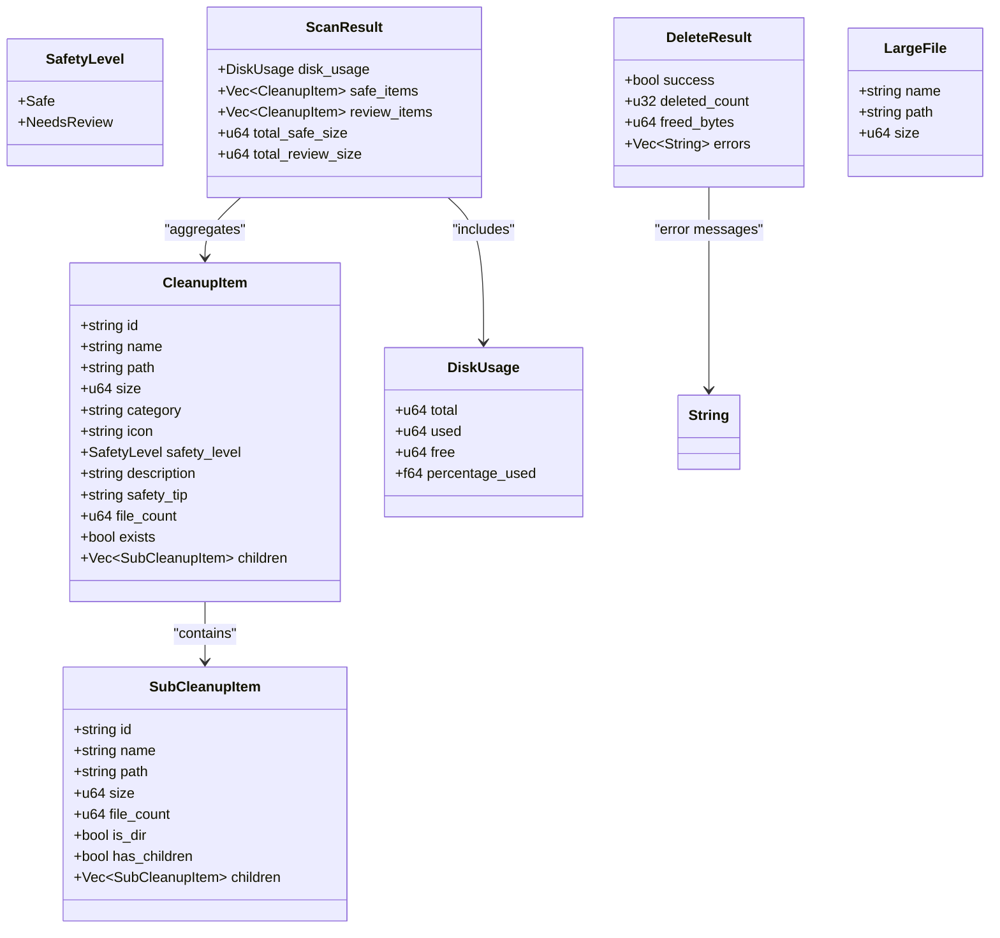

**Diagram sources**
- [lib.rs:8-73](file://src-tauri/src/lib.rs#L8-L73)

**Section sources**
- [lib.rs:8-73](file://src-tauri/src/lib.rs#L8-L73)

## Architecture Overview
The backend exposes Tauri commands that the frontend can invoke:
- get_platform_info: Returns OS details and disk label
- get_disk_usage: Retrieves disk metrics using platform-specific APIs
- scan_system: Scans predefined locations and returns categorized cleanup items
- scan_sub_items: Expands a given path to list its immediate children with sizes
- get_tree_root: Returns the root node of the size-sorted directory tree (user's home folder)
- scan_large_files: Scans the home directory for the largest individual files above a minimum size threshold
- reveal_path: Reveals a file/folder in the native file manager (Finder / Explorer)
- delete_items: Performs resilient deletion across multiple paths

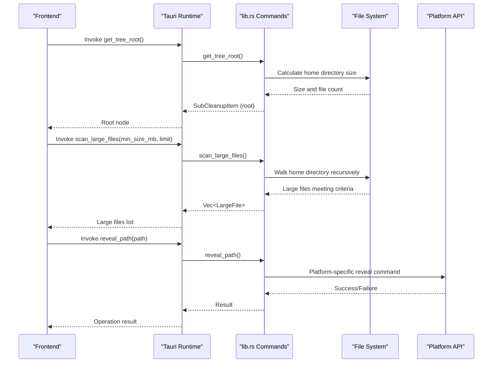

**Diagram sources**
- [lib.rs:417-516](file://src-tauri/src/lib.rs#L417-L516)
- [lib.rs:1194-1211](file://src-tauri/src/lib.rs#L1194-L1211)

**Section sources**
- [lib.rs:417-516](file://src-tauri/src/lib.rs#L417-L516)
- [lib.rs:1194-1211](file://src-tauri/src/lib.rs#L1194-L1211)

## Detailed Component Analysis

### Data Models and Serialization
- All models derive Debug, Clone, Serialize, Deserialize for inter-process communication between frontend and backend
- Optional fields use skip_serializing_if to avoid unnecessary payload when not present
- SafetyLevel enum drives UI behavior and deletion policy

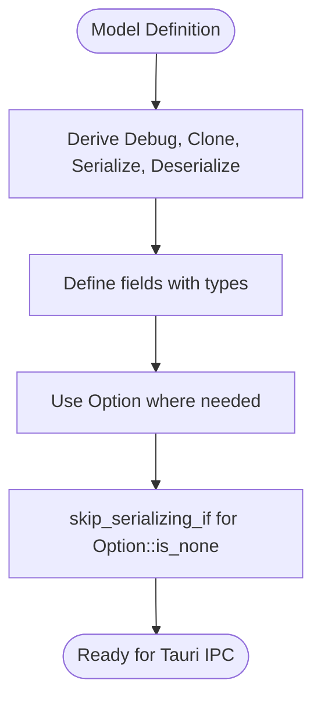

**Diagram sources**
- [lib.rs:8-73](file://src-tauri/src/lib.rs#L8-L73)

**Section sources**
- [lib.rs:8-73](file://src-tauri/src/lib.rs#L8-L73)

### File System Operations and Traversal
- Directory size calculation uses walkdir with a max depth limit to avoid excessive recursion
- Directories are traversed recursively; files contribute their metadata length to total size
- Children scanning reads one level deep, filters out system artifacts like .DS_Store and .localized
- Home path expansion supports ~ prefix by resolving via dirs::home_dir

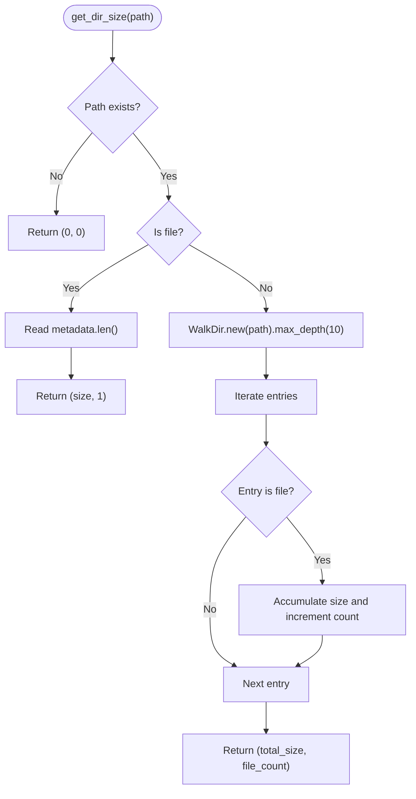

**Diagram sources**
- [lib.rs:77-104](file://src-tauri/src/lib.rs#L77-L104)

**Section sources**
- [lib.rs:77-104](file://src-tauri/src/lib.rs#L77-L104)
- [lib.rs:115-168](file://src-tauri/src/lib.rs#L115-L168)

### Platform-Specific Disk Usage
- macOS: Uses libc::statfs on root path "/" to compute total, free, used, and percentage used
- Windows: Uses windows_sys::Win32::Storage::FileSystem::GetDiskFreeSpaceExW on the system drive to compute metrics
- Errors from platform calls are handled gracefully; fallback values are provided where appropriate

**Diagram sources**
- [lib.rs:335-406](file://src-tauri/src/lib.rs#L335-L406)
- [Cargo.toml:24-29](file://src-tauri/Cargo.toml#L24-L29)

**Section sources**
- [lib.rs:335-406](file://src-tauri/src/lib.rs#L335-L406)
- [Cargo.toml:24-29](file://src-tauri/Cargo.toml#L24-L29)

### Scanning Algorithm and Categorization
- scan_location constructs a CleanupItem by expanding paths, checking existence, computing size/file count, and listing direct children
- Categories include Caches, Browser, Developer, Logs, Trash, Apps, User Data, AI & Data
- Safety classification:
  - Safe: Typically caches, logs, crash reports, trash, browser caches, developer caches that regenerate
  - Needs Review: Build artifacts, simulators, downloads, Docker data, large model caches that may require re-download/rebuild

**Diagram sources**
- [lib.rs:170-208](file://src-tauri/src/lib.rs#L170-L208)

**Section sources**
- [lib.rs:170-208](file://src-tauri/src/lib.rs#L170-L208)
- [lib.rs:518-852](file://src-tauri/src/lib.rs#L518-L852)
- [lib.rs:898-1162](file://src-tauri/src/lib.rs#L898-L1162)

### Resilient Deletion Mechanism
- delete_target routes deletion based on path type:
  - Category roots: Delete contents resiliently without removing the root
  - Files/symlinks: Remove file directly
  - Directories: Attempt remove_dir_all; if it fails, fall back to recursive content deletion
- delete_dir_contents_resilient iterates entries, deletes files/directories, aggregates freed bytes and counts, and propagates last error

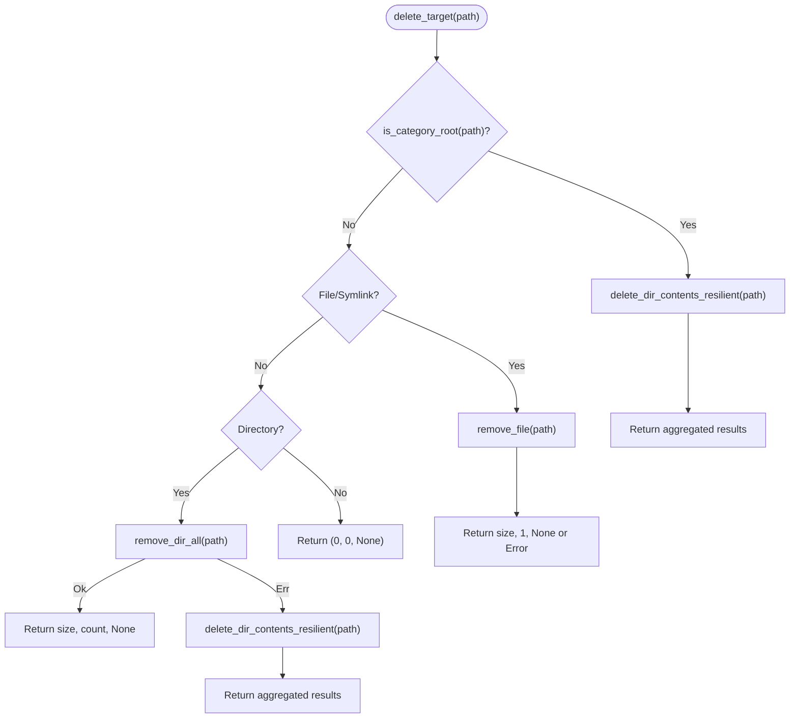

**Diagram sources**
- [lib.rs:268-331](file://src-tauri/src/lib.rs#L268-L331)

**Section sources**
- [lib.rs:268-331](file://src-tauri/src/lib.rs#L268-L331)
- [lib.rs:1164-1190](file://src-tauri/src/lib.rs#L1164-L1190)

### Safety Classification System
- SafetyLevel enum drives UI prompts and deletion policies
- Safe items are pre-approved for automatic cleanup; Needs Review items require explicit user confirmation
- Descriptions and safety tips guide users about consequences (e.g., rebuilds, re-downloads)

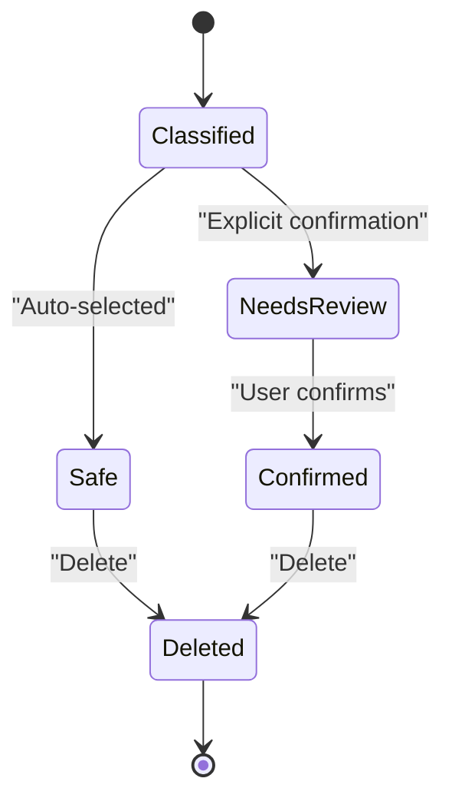

**Diagram sources**
- [lib.rs:8-12](file://src-tauri/src/lib.rs#L8-L12)

**Section sources**
- [lib.rs:8-12](file://src-tauri/src/lib.rs#L8-L12)

## Large File Scanning System

### LargeFile Structure and Scanning Algorithm
The LargeFile struct represents individual large files discovered during directory scanning, containing the file name, full path, and size in bytes. The scan_large_files command provides comprehensive file discovery capabilities:

- **Minimum Size Filtering**: Filters files below a configurable minimum size threshold (in MB)
- **Depth Control**: Uses a maximum depth of 24 levels to ensure thorough scanning while maintaining performance
- **Smart Filtering**: Excludes hidden dotfiles/directories and system directories like $RECYCLE.BIN and System Volume Information
- **Symlink Safety**: Follows links=false to prevent infinite loops and security issues
- **Sorting and Limiting**: Results are sorted by size (largest first) and truncated to a configurable limit (default 200)

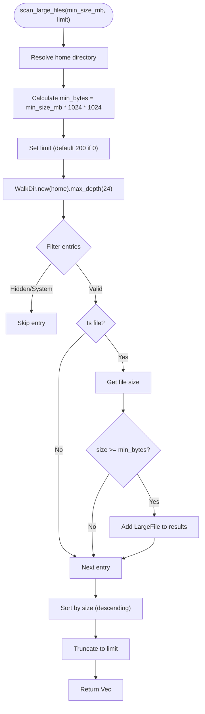

**Diagram sources**
- [lib.rs:438-481](file://src-tauri/src/lib.rs#L438-L481)

**Section sources**
- [lib.rs:68-73](file://src-tauri/src/lib.rs#L68-L73)
- [lib.rs:438-481](file://src-tauri/src/lib.rs#L438-L481)

## Directory Tree Navigation

### Tree Root Discovery
The get_tree_root command provides a hierarchical view of the user's home directory structure, enabling efficient navigation through large directory trees:

- **Home Directory Resolution**: Automatically resolves the user's home directory using the dirs crate
- **Size Calculation**: Computes total size and file count for the entire home directory
- **Metadata Extraction**: Extracts the home directory name for display purposes
- **Tree Node Creation**: Creates a SubCleanupItem representing the root node with all necessary metadata

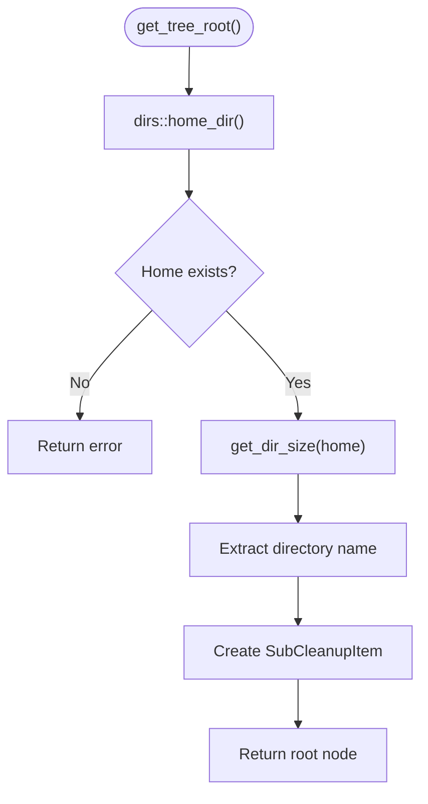

**Diagram sources**
- [lib.rs:417-436](file://src-tauri/src/lib.rs#L417-L436)

**Section sources**
- [lib.rs:417-436](file://src-tauri/src/lib.rs#L417-L436)

## Path Normalization and Cross-Platform Support

### Enhanced Path Handling
The is_category_root function implements sophisticated path normalization to ensure consistent behavior across different operating systems:

- **Separator Normalization**: Converts backslashes to forward slashes for cross-platform compatibility
- **Case Insensitivity**: Converts paths to lowercase for case-insensitive matching
- **Comprehensive Root Detection**: Supports both macOS and Windows specific paths with normalized comparison
- **System Directory Protection**: Includes protection for critical system directories like $Recycle.Bin and Windows Temp folders

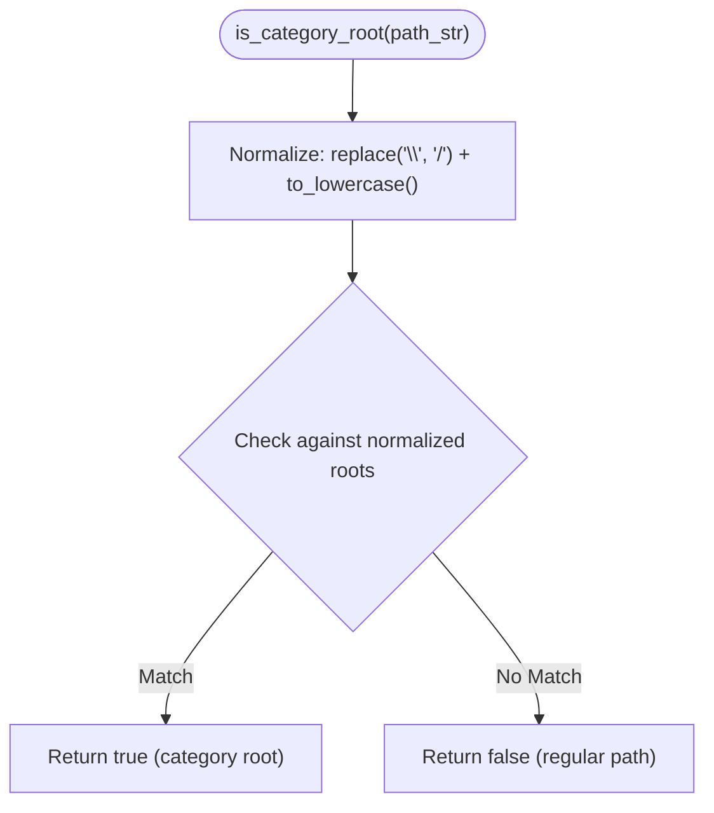

**Diagram sources**
- [lib.rs:210-266](file://src-tauri/src/lib.rs#L210-L266)

**Section sources**
- [lib.rs:210-266](file://src-tauri/src/lib.rs#L210-L266)

## Dependency Analysis
The backend depends on:
- tauri: App framework and command invocation
- tauri-plugin-opener: Utility plugin (registered but not central to scanning/deletion)
- serde/serde_json: Serialization for data models
- walkdir: Recursive directory traversal
- trash: Available but not used in current implementation
- dirs: Home directory resolution
- libc (macOS): statfs for disk stats
- windows-sys (Windows): GetDiskFreeSpaceExW for disk stats

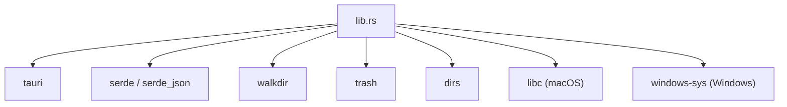

**Diagram sources**
- [Cargo.toml:15-29](file://src-tauri/Cargo.toml#L15-L29)
- [lib.rs:1194-1211](file://src-tauri/src/lib.rs#L1194-L1211)

**Section sources**
- [Cargo.toml:15-29](file://src-tauri/Cargo.toml#L15-L29)
- [lib.rs:1194-1211](file://src-tauri/src/lib.rs#L1194-L1211)

## Performance Considerations
- Directory size computation limits recursion depth to 10 to prevent excessive traversal overhead
- Large file scanning uses depth limit of 24 with smart filtering to balance thoroughness and performance
- Filtering out non-file entries during traversal reduces metadata operations
- Sorting children by size improves UX by showing largest items first
- Resilient deletion avoids blocking entire operation on single failures by aggregating partial results
- Platform-specific disk stats use efficient native APIs rather than walking filesystems
- Path normalization ensures consistent behavior across platforms without performance penalties

## Troubleshooting Guide
Common issues and strategies:
- Permission errors during deletion:
  - The resilient deletion mechanism collects errors and continues processing other items
  - Admin privileges may be required for certain system directories (e.g., Windows Temp, Recycle Bin)
- Path resolution problems:
  - Ensure ~ expansion works correctly; verify home directory via dirs::home_dir
  - Path normalization handles both forward and backward slashes for cross-platform compatibility
- Non-existent or locked files:
  - delete_target handles missing paths gracefully and returns aggregated results
- Disk usage retrieval failures:
  - Platform-specific calls return errors; fallback values are used to keep UI responsive
- Large file scanning performance:
  - Adjust min_size_mb parameter to reduce scanning time for large directories
  - Use limit parameter to control the number of results returned
- Tree navigation issues:
  - Verify home directory accessibility before attempting tree operations
  - Check for permission issues on nested directories

**Section sources**
- [lib.rs:268-331](file://src-tauri/src/lib.rs#L268-L331)
- [lib.rs:335-406](file://src-tauri/src/lib.rs#L335-L406)
- [lib.rs:438-481](file://src-tauri/src/lib.rs#L438-L481)
- [lib.rs:1164-1190](file://src-tauri/src/lib.rs#L1164-L1190)

## Conclusion
The FreeSpaceMacos backend provides a robust, cross-platform solution for storage analysis and cleanup. Recent enhancements include sophisticated large file scanning capabilities, intuitive directory tree navigation, and improved cross-platform path handling. The system leverages native APIs for accurate disk metrics, walkdir for efficient traversal, and a clear safety classification system to balance performance and user safety. The modular design separates concerns between data models, platform-specific logic, and Tauri command handlers, making it maintainable and extensible. The new LargeFile struct and associated commands enable users to identify and manage large files effectively, while the tree navigation system provides an intuitive interface for exploring directory structures. Enhanced path normalization ensures consistent behavior across macOS and Windows platforms.