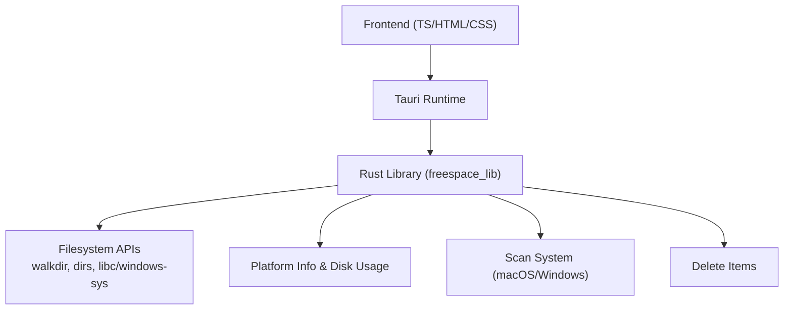
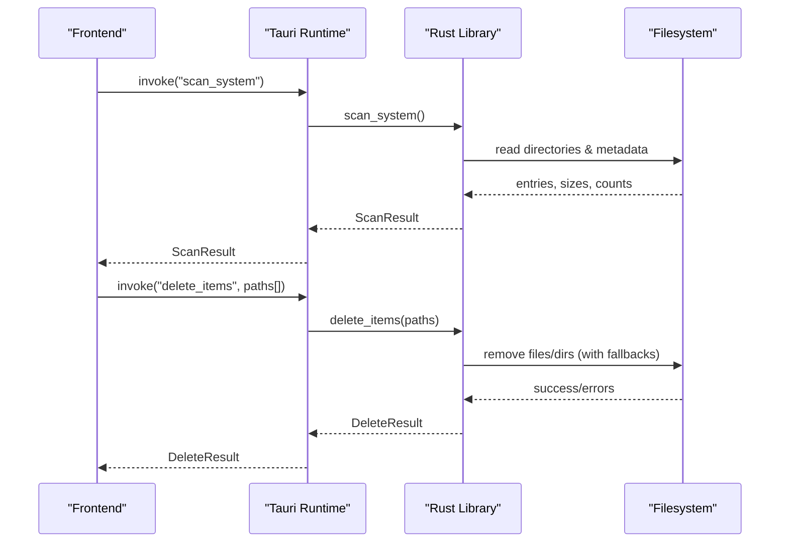
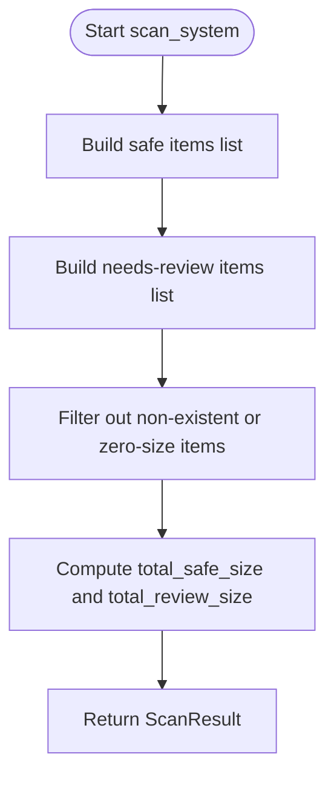
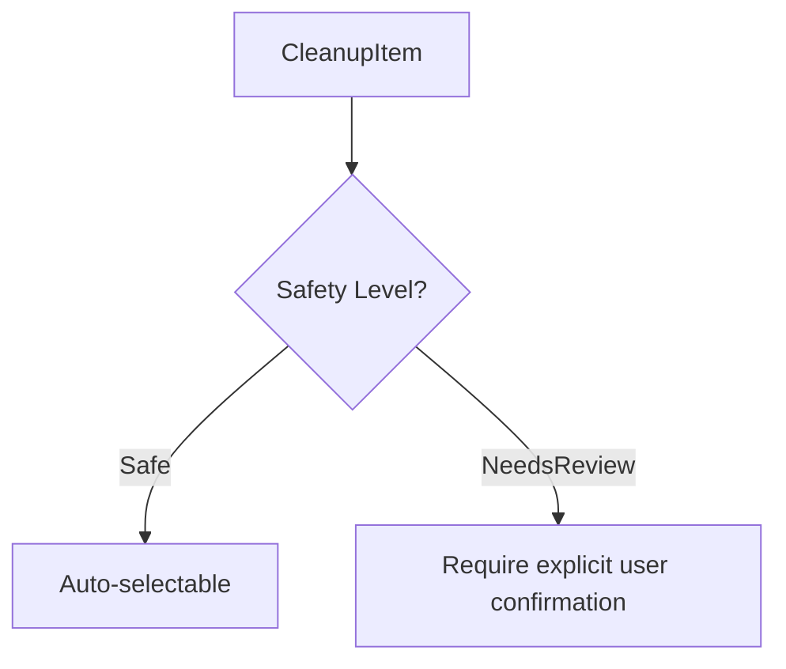
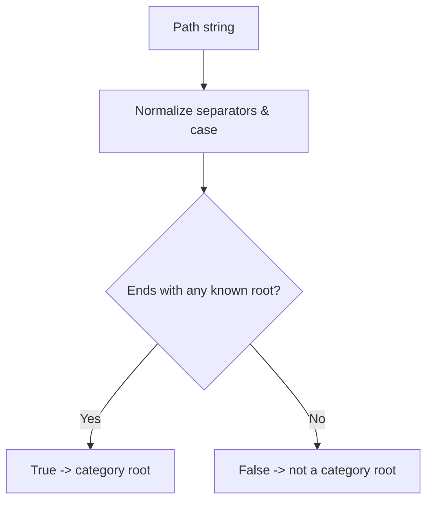
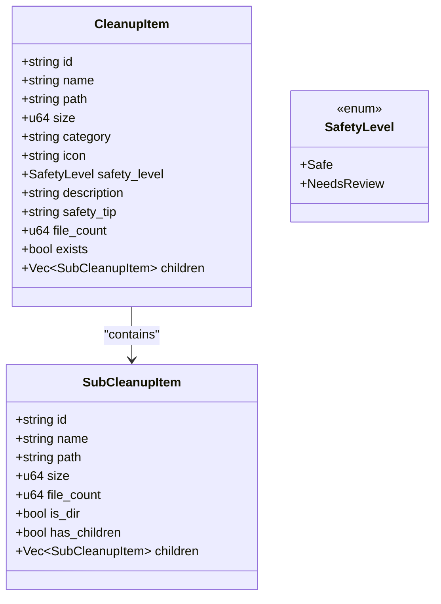
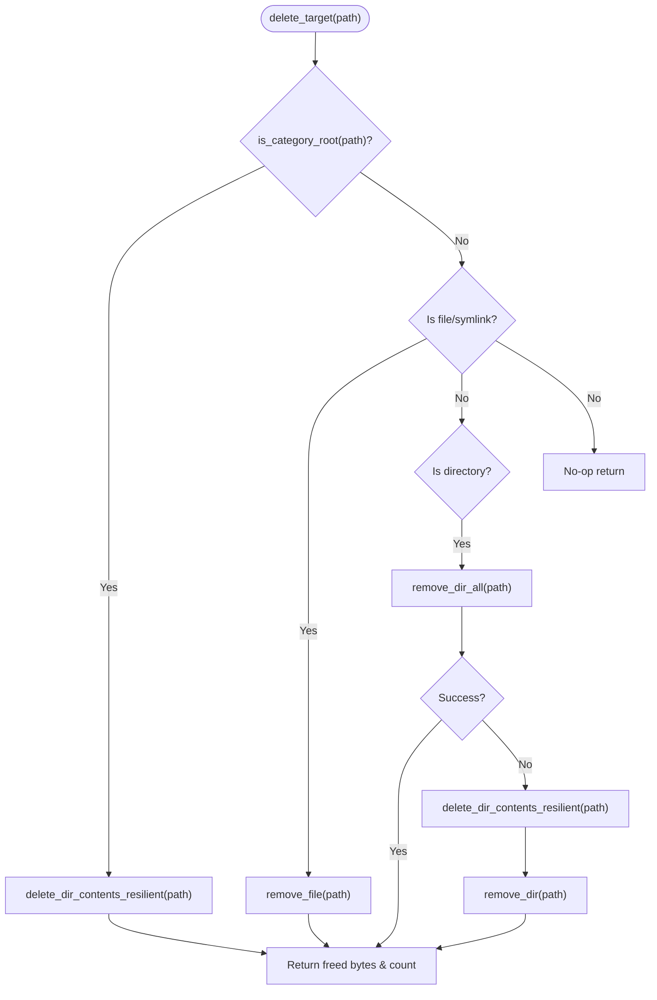
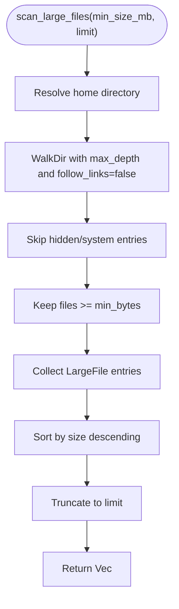
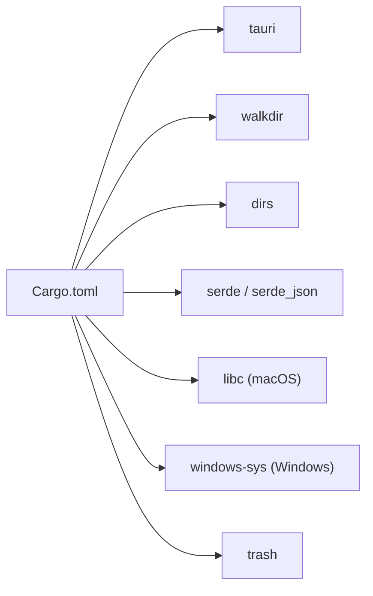

# Core Algorithms

<cite>
**Referenced Files in This Document**
- [lib.rs](file://src-tauri/src/lib.rs)
- [main.rs](file://src-tauri/src/main.rs)
- [Cargo.toml](file://src-tauri/Cargo.toml)
- [README.md](file://README.md)
</cite>

## Table of Contents
1. [Introduction](#introduction)
2. [Project Structure](#project-structure)
3. [Core Components](#core-components)
4. [Architecture Overview](#architecture-overview)
5. [Detailed Component Analysis](#detailed-component-analysis)
6. [Dependency Analysis](#dependency-analysis)
7. [Performance Considerations](#performance-considerations)
8. [Troubleshooting Guide](#troubleshooting-guide)
9. [Conclusion](#conclusion)

## Introduction
This document explains the core algorithms that power FreeSpaceMacos: intelligent cache detection, safety classification logic, category root identification via is_category_root, scanning algorithms for automatic cache directory discovery across 20+ applications, selection state management for hierarchical tree navigation and parent-child relationships, and deletion algorithms with fallback mechanisms and error recovery strategies. The goal is to make these internals accessible to both technical and non-technical readers while providing precise code-level references and diagrams.

## Project Structure
FreeSpaceMacos is a Tauri 2 application with a Rust backend exposing commands to a TypeScript/HTML frontend. The Rust library defines data models, scanning logic, platform-specific system scans, and deletion routines. The main entry point initializes the Tauri runtime and registers command handlers.

**Diagram sources**
- [main.rs:4-6](file://src-tauri/src/main.rs#L4-L6)
- [lib.rs:1194-1210](file://src-tauri/src/lib.rs#L1194-L1210)

**Section sources**
- [main.rs:1-7](file://src-tauri/src/main.rs#L1-L7)
- [lib.rs:1194-1210](file://src-tauri/src/lib.rs#L1194-L1210)
- [Cargo.toml:1-29](file://src-tauri/Cargo.toml#L1-L29)
- [README.md:1-74](file://README.md#L1-L74)

## Core Components
- Data models: SafetyLevel, SubCleanupItem, CleanupItem, DiskUsage, ScanResult, DeleteResult, LargeFile, PlatformInfo. These define the structure of scanned items, disk usage metrics, and results returned to the frontend.
- Helpers: get_dir_size, expand_home, scan_children_direct, scan_location, is_category_root, delete_dir_contents_resilient, delete_target.
- Commands: get_disk_usage, scan_sub_items, get_tree_root, scan_large_files, reveal_path, scan_system (platform-specific), delete_items, get_platform_info.

Key responsibilities:
- Intelligent cache detection: build lists of known cache directories per platform and compute sizes and file counts.
- Safety classification: categorize items as Safe or NeedsReview based on predefined rules.
- Category root identification: determine whether a path is a recognized category root to choose deletion strategy.
- Tree navigation: provide home-rooted tree nodes and lazy child scanning.
- Deletion: robust removal with fallbacks and error aggregation.

**Section sources**
- [lib.rs:8-73](file://src-tauri/src/lib.rs#L8-L73)
- [lib.rs:75-331](file://src-tauri/src/lib.rs#L75-L331)
- [lib.rs:335-516](file://src-tauri/src/lib.rs#L335-L516)
- [lib.rs:518-852](file://src-tauri/src/lib.rs#L518-L852)
- [lib.rs:854-894](file://src-tauri/src/lib.rs#L854-L894)
- [lib.rs:896-1162](file://src-tauri/src/lib.rs#L896-L1162)
- [lib.rs:1164-1210](file://src-tauri/src/lib.rs#L1164-L1210)

## Architecture Overview
The application exposes Tauri commands that the frontend invokes. Each command triggers backend logic for filesystem operations, returning structured results.

**Diagram sources**
- [lib.rs:518-852](file://src-tauri/src/lib.rs#L518-L852)
- [lib.rs:896-1162](file://src-tauri/src/lib.rs#L896-L1162)
- [lib.rs:1164-1190](file://src-tauri/src/lib.rs#L1164-L1190)

## Detailed Component Analysis

### Intelligent Cache Detection and Scanning
The scanner builds two categories of cleanup targets:
- Safe items: caches/logs/trash that are safe to delete without user intervention.
- Needs review items: developer caches, simulators, downloads, etc., requiring explicit confirmation.

For each target, the algorithm:
- Expands home-prefixed paths.
- Checks existence and computes size/file count using get_dir_size.
- Lazily scans direct children for UI tree display.

**Diagram sources**
- [lib.rs:518-852](file://src-tauri/src/lib.rs#L518-L852)
- [lib.rs:896-1162](file://src-tauri/src/lib.rs#L896-L1162)

**Section sources**
- [lib.rs:518-852](file://src-tauri/src/lib.rs#L518-L852)
- [lib.rs:896-1162](file://src-tauri/src/lib.rs#L896-L1162)

### Safety Classification Logic
Safety levels are defined by enum SafetyLevel with values Safe and NeedsReview. Each CleanupItem carries a safety_level, description, and safety_tip to guide users.

Decision logic:
- Predefined lists classify each location into Safe or NeedsReview.
- Filtering ensures only existing and non-empty locations appear in results.

**Diagram sources**
- [lib.rs:8-12](file://src-tauri/src/lib.rs#L8-L12)
- [lib.rs:27-41](file://src-tauri/src/lib.rs#L27-L41)
- [lib.rs:528-683](file://src-tauri/src/lib.rs#L528-L683)
- [lib.rs:685-840](file://src-tauri/src/lib.rs#L685-L840)
- [lib.rs:908-1033](file://src-tauri/src/lib.rs#L908-L1033)
- [lib.rs:1035-1150](file://src-tauri/src/lib.rs#L1035-L1150)

**Section sources**
- [lib.rs:8-12](file://src-tauri/src/lib.rs#L8-L12)
- [lib.rs:27-41](file://src-tauri/src/lib.rs#L27-L41)
- [lib.rs:528-840](file://src-tauri/src/lib.rs#L528-L840)
- [lib.rs:908-1150](file://src-tauri/src/lib.rs#L908-L1150)

### Category Root Identification: is_category_root
is_category_root normalizes paths and checks if they match a curated set of roots across macOS and Windows. It determines whether deletion should use resilient content clearing or direct removal.

**Diagram sources**
- [lib.rs:210-266](file://src-tauri/src/lib.rs#L210-L266)

**Section sources**
- [lib.rs:210-266](file://src-tauri/src/lib.rs#L210-L266)

### Selection State Management and Hierarchical Tree Navigation
Tree navigation uses SubCleanupItem to represent directories/files with fields like id, name, path, size, file_count, is_dir, has_children, and optional children. The algorithm provides:
- Home-root node via get_tree_root.
- Lazy child scanning via scan_sub_items and scan_children_direct.
- Sorting by size for efficient prioritization.

**Diagram sources**
- [lib.rs:8-12](file://src-tauri/src/lib.rs#L8-L12)
- [lib.rs:14-41](file://src-tauri/src/lib.rs#L14-L41)
- [lib.rs:115-168](file://src-tauri/src/lib.rs#L115-L168)
- [lib.rs:170-208](file://src-tauri/src/lib.rs#L170-L208)
- [lib.rs:408-436](file://src-tauri/src/lib.rs#L408-L436)

**Section sources**
- [lib.rs:115-168](file://src-tauri/src/lib.rs#L115-L168)
- [lib.rs:170-208](file://src-tauri/src/lib.rs#L170-L208)
- [lib.rs:408-436](file://src-tauri/src/lib.rs#L408-L436)

### Deletion Algorithms with Fallback Mechanisms and Error Recovery
Deletion strategy depends on whether the target is a category root, file/symlink, or directory:
- Category root: delete contents resiliently, preserving directory structure where possible.
- File/symlink: attempt direct removal; report errors.
- Directory: try remove_dir_all; if it fails, fall back to deleting contents recursively and then removing the empty directory.

**Diagram sources**
- [lib.rs:268-331](file://src-tauri/src/lib.rs#L268-L331)

Error handling:
- delete_dir_contents_resilient aggregates freed bytes, deleted counts, and last encountered error.
- delete_items aggregates per-path errors and returns a DeleteResult with success flag, totals, and error messages.

**Section sources**
- [lib.rs:268-331](file://src-tauri/src/lib.rs#L268-L331)
- [lib.rs:1164-1190](file://src-tauri/src/lib.rs#L1164-L1190)

### Large File Scanning Algorithm
The large file scanner walks the home directory up to a depth limit, filters hidden/system folders, collects files above a threshold size, sorts them descending, and truncates to a limit.

**Diagram sources**
- [lib.rs:438-481](file://src-tauri/src/lib.rs#L438-L481)

**Section sources**
- [lib.rs:438-481](file://src-tauri/src/lib.rs#L438-L481)

## Dependency Analysis
External dependencies used by the Rust backend:
- tauri: runtime and command invocation.
- walkdir: recursive directory traversal.
- dirs: home directory resolution.
- libc (macOS): statfs for disk usage.
- windows-sys (Windows): GetDiskFreeSpaceExW for disk usage.
- serde/serde_json: serialization/deserialization.
- trash: optional trash integration (declared but not used in analyzed code).

**Diagram sources**
- [Cargo.toml:1-29](file://src-tauri/Cargo.toml#L1-L29)

**Section sources**
- [Cargo.toml:1-29](file://src-tauri/Cargo.toml#L1-L29)

## Performance Considerations
- Depth-limited walking: get_dir_size uses max_depth(10) to avoid deep recursion during size calculation; scan_large_files uses max_depth(24) with filtering to reduce noise.
- Early exits: functions return quickly when paths do not exist or are not directories.
- Sorting and truncation: large file results are sorted and truncated to limit memory usage.
- Resilient deletion: fallback to content deletion avoids blocking on locked files and improves success rates.

Optimization techniques:
- Prefer direct removal for category roots when possible; otherwise, fall back to resilient content deletion.
- Skip hidden/system directories during large file scans to reduce I/O overhead.
- Use lazy child scanning for UI tree to avoid upfront cost.

[No sources needed since this section provides general guidance]

## Troubleshooting Guide
Common issues and strategies:
- Permission errors during deletion: delete_dir_contents_resilient captures errors and continues processing other entries; check DeleteResult.errors for details.
- Locked files preventing removal: fallback mechanism attempts to delete contents individually and then removes the directory; consider running with elevated privileges if necessary.
- Non-existent paths: scanning functions gracefully handle missing paths and return empty results.
- Platform-specific behavior: ensure correct OS-targeted commands are invoked; get_platform_info can help diagnose environment differences.

**Section sources**
- [lib.rs:268-331](file://src-tauri/src/lib.rs#L268-L331)
- [lib.rs:1164-1190](file://src-tauri/src/lib.rs#L1164-L1190)
- [lib.rs:891-894](file://src-tauri/src/lib.rs#L891-L894)

## Conclusion
FreeSpaceMacos implements a robust set of algorithms for detecting and safely cleaning caches across multiple platforms. Its safety classification system guides user interactions, while is_category_root enables targeted deletion strategies. The scanning algorithms efficiently traverse directories with depth limits and filters, and the deletion routines incorporate fallback mechanisms to maximize success and minimize errors. Together, these components deliver a performant and user-friendly storage cleanup experience.

[No sources needed since this section summarizes without analyzing specific files]