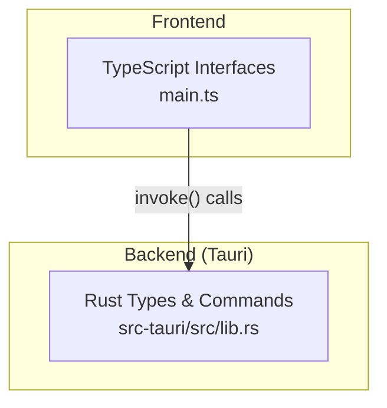
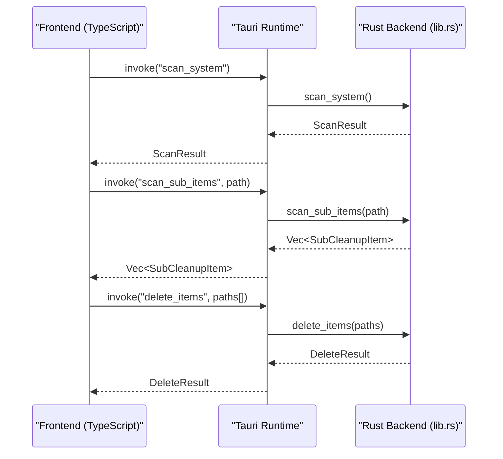
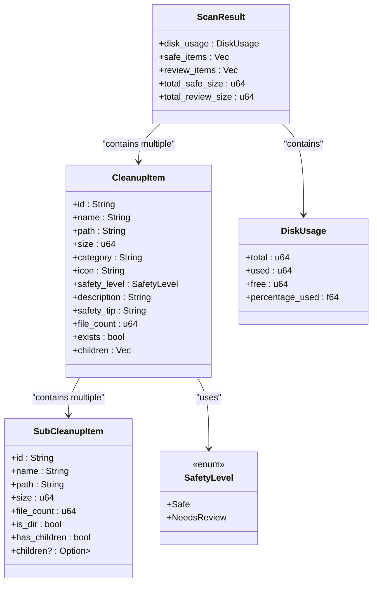
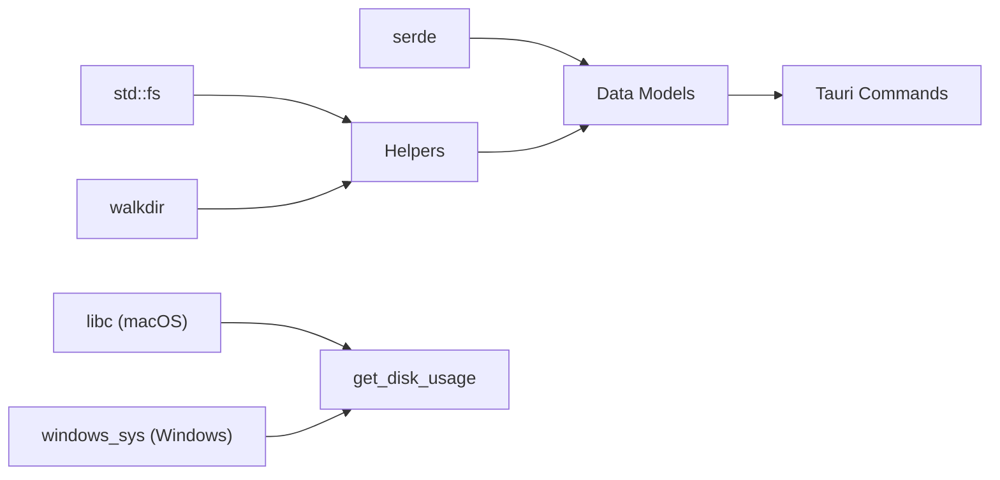

# Data Models and Structures

<cite>
**Referenced Files in This Document**
- [lib.rs](file://src-tauri/src/lib.rs)
- [main.ts](file://src/main.ts)
- [README.md](file://README.md)
</cite>

## Table of Contents
1. [Introduction](#introduction)
2. [Project Structure](#project-structure)
3. [Core Components](#core-components)
4. [Architecture Overview](#architecture-overview)
5. [Detailed Component Analysis](#detailed-component-analysis)
6. [Dependency Analysis](#dependency-analysis)
7. [Performance Considerations](#performance-considerations)
8. [Troubleshooting Guide](#troubleshooting-guide)
9. [Conclusion](#conclusion)

## Introduction
This document explains the Rust data models used by the FreeSpaceMacos backend to represent a hierarchical cleanup system. It focuses on CleanupItem, SubCleanupItem, ScanResult, DiskUsage, SafetyLevel, and DeleteResult. The documentation covers field purposes, serde serialization behavior, relationships between models, and how these structures support UI rendering and user workflows. It also includes examples of model instantiation patterns, JSON serialization/deserialization expectations, and usage flows across Tauri commands.

The project is a macOS storage cleanup app built with Tauri 2 (Rust + TypeScript/HTML5/CSS). The backend scans directories, computes disk usage, categorizes items by safety level, and supports deletion operations. The frontend mirrors the Rust types as TypeScript interfaces for type-safe communication.

**Section sources**
- [README.md:1-74](file://README.md#L1-L74)

## Project Structure
At a high level, the Rust backend defines data models and Tauri commands in lib.rs. The frontend main.ts declares matching TypeScript interfaces that mirror the Rust types for cross-process communication.

**Diagram sources**
- [lib.rs:1-66](file://src-tauri/src/lib.rs#L1-L66)
- [main.ts:3-57](file://src/main.ts#L3-L57)

**Section sources**
- [lib.rs:1-66](file://src-tauri/src/lib.rs#L1-L66)
- [main.ts:3-57](file://src/main.ts#L3-L57)

## Core Components
This section summarizes the core data models and their roles.

- SafetyLevel: Enumerates whether an item can be safely deleted or needs user review before deletion.
- SubCleanupItem: Represents a child entry within a directory during scanning; supports optional nested children for deeper exploration.
- CleanupItem: Represents a top-level scan target with metadata, safety classification, and immediate children.
- DiskUsage: Aggregates total, used, free space and percentage used.
- ScanResult: Wraps disk usage plus categorized lists of safe and review items, along with totals.
- DeleteResult: Reports deletion outcomes including success flag, counts, freed bytes, and errors.

These models are serialized via serde and exposed through Tauri commands to the frontend.

**Section sources**
- [lib.rs:8-66](file://src-tauri/src/lib.rs#L8-L66)

## Architecture Overview
The backend exposes several Tauri commands that operate on the data models:

- get_disk_usage: Returns DiskUsage.
- scan_system: Returns ScanResult populated with CleanupItem lists and totals.
- scan_sub_items: Returns Vec<SubCleanupItem> for a given path.
- delete_items: Accepts paths and returns DeleteResult.

**Diagram sources**
- [lib.rs:328-399](file://src-tauri/src/lib.rs#L328-L399)
- [lib.rs:401-408](file://src-tauri/src/lib.rs#L401-L408)
- [lib.rs:410-744](file://src-tauri/src/lib.rs#L410-L744)
- [lib.rs:1056-1082](file://src-tauri/src/lib.rs#L1056-L1082)

## Detailed Component Analysis

### SafetyLevel
Purpose:
- Classifies items into Safe or NeedsReview to guide UI behavior and deletion confirmation flows.

Serialization:
- Serialized as string variants ("Safe", "NeedsReview").

Relationships:
- Used by CleanupItem to indicate deletion policy.

Design notes:
- Simple enum keeps UI logic straightforward: auto-delete Safe items after confirmation; require explicit review for NeedsReview items.

**Section sources**
- [lib.rs:8-12](file://src-tauri/src/lib.rs#L8-L12)

### SubCleanupItem
Purpose:
- Represents a single directory entry discovered during scanning, including size, file count, directory flags, and optional nested children.

Key fields:
- id: Unique identifier for the entry (typically its path).
- name: Display name.
- path: Filesystem path.
- size: Total size of the entry (for directories, aggregated).
- file_count: Number of files counted.
- is_dir: Whether the entry is a directory.
- has_children: Hint that the directory contains more entries (used for lazy loading).
- children: Optional nested list for deeper traversal.

Serialization:
- children is omitted when None using skip_serializing_if to reduce payload size.

Relationships:
- Child of CleanupItem.children at the first level; can contain further SubCleanupItem entries for deeper levels.

Design notes:
- Lazy expansion: children starts as None and can be populated on demand via scan_sub_items.

**Section sources**
- [lib.rs:14-25](file://src-tauri/src/lib.rs#L14-L25)
- [lib.rs:108-161](file://src-tauri/src/lib.rs#L108-L161)

### CleanupItem
Purpose:
- Represents a top-level cleanup category with metadata and immediate children.

Key fields:
- id: Stable identifier for the category.
- name: Human-readable label.
- path: Root path being scanned.
- size: Aggregated size of the root path.
- category: Grouping label (e.g., Caches, Developer, Browser).
- icon: UI icon representation.
- safety_level: Safety classification.
- description: Explanation of what the category contains.
- safety_tip: Guidance for users about risks and recovery.
- file_count: Number of files under the root path.
- exists: Whether the path currently exists.
- children: Immediate SubCleanupItem entries.

Serialization:
- All fields are included; children always present as a vector (empty if none).

Relationships:
- Contains SubCleanupItem entries.
- Part of ScanResult.safe_items or ScanResult.review_items.

Design notes:
- Exists and size enable UI filtering to show only relevant categories.
- Safety tip and description inform user decisions.

**Section sources**
- [lib.rs:27-41](file://src-tauri/src/lib.rs#L27-L41)
- [lib.rs:163-201](file://src-tauri/src/lib.rs#L163-L201)

### DiskUsage
Purpose:
- Provides current disk statistics for display in the UI gauge.

Key fields:
- total: Total capacity.
- used: Space used.
- free: Available space.
- percentage_used: Percentage of used space.

Serialization:
- Numeric values serialized directly.

Usage:
- Returned by get_disk_usage and embedded in ScanResult.

**Section sources**
- [lib.rs:43-49](file://src-tauri/src/lib.rs#L43-L49)
- [lib.rs:328-399](file://src-tauri/src/lib.rs#L328-L399)

### ScanResult
Purpose:
- Aggregates scan outputs: disk usage, categorized cleanup items, and totals.

Key fields:
- disk_usage: Current disk stats.
- safe_items: Categories eligible for automatic deletion.
- review_items: Categories requiring user review.
- total_safe_size: Sum of sizes in safe_items.
- total_review_size: Sum of sizes in review_items.

Serialization:
- All fields included.

Usage:
- Returned by scan_system; drives UI sections for safe and review categories.

**Section sources**
- [lib.rs:51-58](file://src-tauri/src/lib.rs#L51-L58)
- [lib.rs:410-744](file://src-tauri/src/lib.rs#L410-L744)

### DeleteResult
Purpose:
- Reports the outcome of deletion operations.

Key fields:
- success: True if no errors occurred.
- deleted_count: Number of items/files removed.
- freed_bytes: Total bytes freed.
- errors: List of error messages encountered.

Serialization:
- All fields included.

Usage:
- Returned by delete_items; informs UI feedback and progress.

**Section sources**
- [lib.rs:60-66](file://src-tauri/src/lib.rs#L60-L66)
- [lib.rs:1056-1082](file://src-tauri/src/lib.rs#L1056-L1082)

### Hierarchical Cleanup System
The hierarchy is represented as:
- ScanResult contains two lists of CleanupItem (safe and review).
- Each CleanupItem has a children vector of SubCleanupItem.
- SubCleanupItem may have optional nested children for deeper exploration.

**Diagram sources**
- [lib.rs:8-66](file://src-tauri/src/lib.rs#L8-L66)

## Dependency Analysis
The data models depend on:
- serde for serialization/deserialization.
- std::fs and walkdir for directory traversal and size computation.
- Platform-specific crates (libc, windows_sys) for disk usage queries.

**Diagram sources**
- [lib.rs:1-4](file://src-tauri/src/lib.rs#L1-L4)
- [lib.rs:328-399](file://src-tauri/src/lib.rs#L328-L399)

**Section sources**
- [lib.rs:1-4](file://src-tauri/src/lib.rs#L1-L4)
- [lib.rs:328-399](file://src-tauri/src/lib.rs#L328-L399)

## Performance Considerations
- Directory size calculation uses a depth limit to avoid excessive recursion and improve performance.
- Children scanning sorts results by size to prioritize larger items in the UI.
- Skipping empty entries reduces noise and improves responsiveness.
- Using skip_serializing_if for optional children reduces JSON payload size when not expanded.

Recommendations:
- For very large directories, consider pagination or virtualization in the UI.
- Cache computed sizes where appropriate to avoid repeated scans.

[No sources needed since this section provides general guidance]

## Troubleshooting Guide
Common issues and resolutions:
- Path resolution: Ensure home directory expansion works correctly; invalid or non-existent paths result in zero-sized items and empty children.
- Permission errors: Deletion may fail due to permissions; check DeleteResult.errors for details.
- Platform differences: Disk usage APIs differ by OS; ensure correct platform detection and fallbacks.

Operational tips:
- Use scan_sub_items to lazily expand directories and inspect contents before deletion.
- Validate existence and size before presenting items to users.

**Section sources**
- [lib.rs:99-106](file://src-tauri/src/lib.rs#L99-L106)
- [lib.rs:1056-1082](file://src-tauri/src/lib.rs#L1056-L1082)

## Conclusion
The FreeSpaceMacos backend models provide a clear, serializable representation of the cleanup system. SafetyLevel guides user interactions, while CleanupItem and SubCleanupItem form a flexible hierarchy supporting both flat and nested views. ScanResult aggregates scan outputs for UI consumption, and DeleteResult offers robust feedback for deletion operations. These design choices align with UI requirements for clarity, safety, and performance, enabling efficient scanning and controlled deletion across platforms.

[No sources needed since this section summarizes without analyzing specific files]