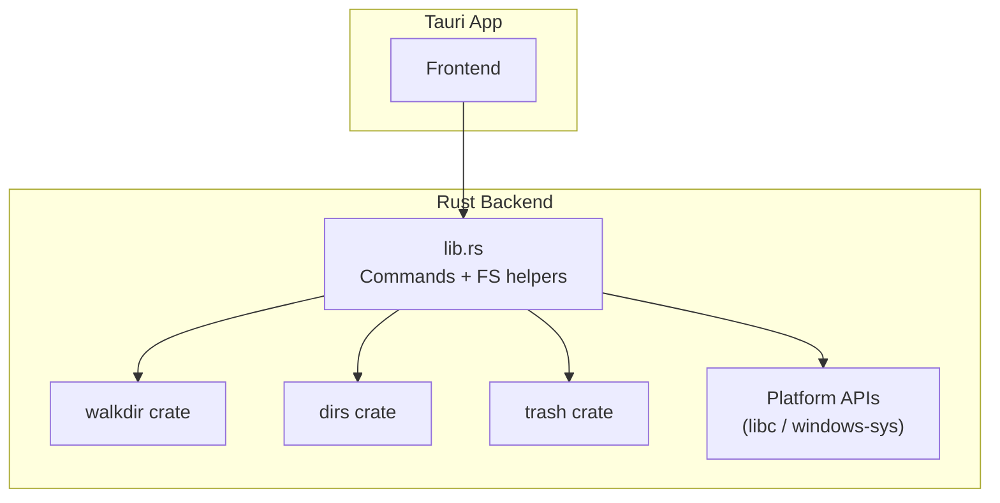
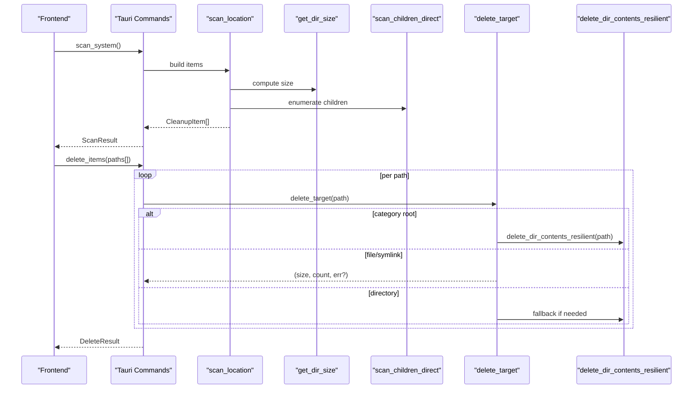
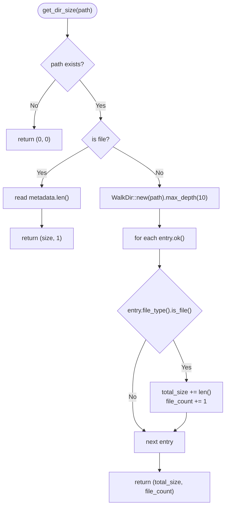
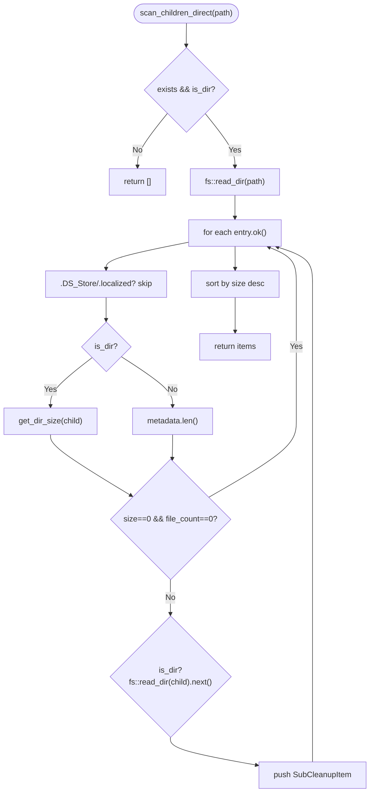
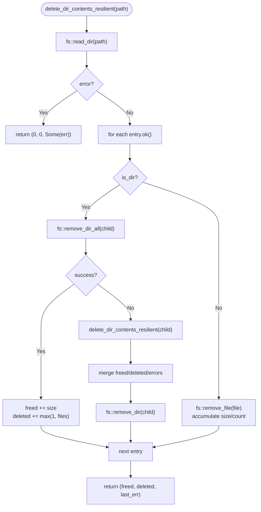
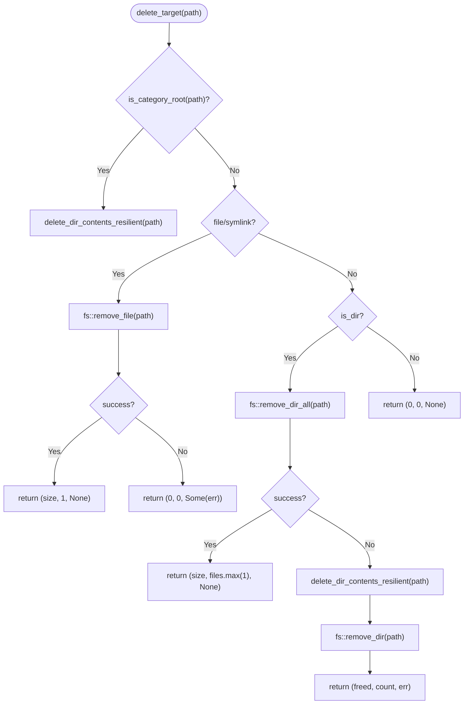
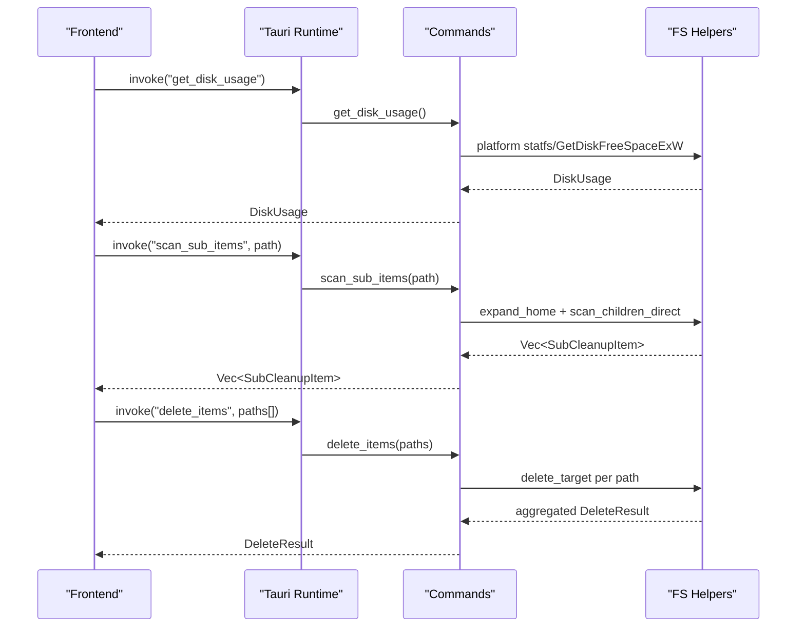
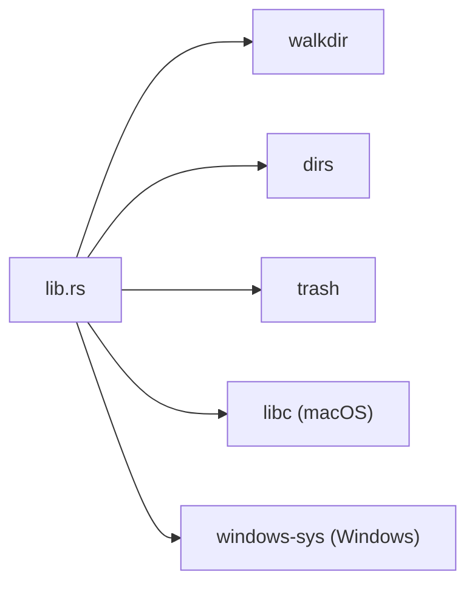

# File System Operations

<cite>
**Referenced Files in This Document**
- [lib.rs](file://src-tauri/src/lib.rs)
- [Cargo.toml](file://src-tauri/Cargo.toml)
</cite>

## Table of Contents
1. [Introduction](#introduction)
2. [Project Structure](#project-structure)
3. [Core Components](#core-components)
4. [Architecture Overview](#architecture-overview)
5. [Detailed Component Analysis](#detailed-component-analysis)
6. [Dependency Analysis](#dependency-analysis)
7. [Performance Considerations](#performance-considerations)
8. [Troubleshooting Guide](#troubleshooting-guide)
9. [Conclusion](#conclusion)

## Introduction
This document explains the file system operations implemented in the FreeSpaceMacos backend, focusing on directory scanning, size calculation, path expansion, resilient deletion, error handling, and performance characteristics. The implementation is written in Rust for a Tauri-based application and uses walkdir for recursive traversal. It provides safe cleanup workflows for macOS and Windows with platform-specific disk usage queries and scan targets.

## Project Structure
The file system logic resides in the Tauri library crate:
- Library entry point and commands are defined in lib.rs.
- Dependencies (including walkdir, trash, dirs, libc, windows-sys) are declared in Cargo.toml.

**Diagram sources**
- [lib.rs:1-5](file://src-tauri/src/lib.rs#L1-L5)
- [Cargo.toml:15-29](file://src-tauri/Cargo.toml#L15-L29)

**Section sources**
- [lib.rs:1-66](file://src-tauri/src/lib.rs#L1-L66)
- [Cargo.toml:1-29](file://src-tauri/Cargo.toml#L1-L29)

## Core Components
- Data models for scan results and deletions: SafetyLevel, SubCleanupItem, CleanupItem, DiskUsage, ScanResult, DeleteResult.
- Directory size calculator using walkdir with depth limiting.
- Path expansion utility supporting tilde (~) expansion to the user’s home directory.
- One-level directory enumeration helper that filters known macOS artifacts and sorts by size.
- Resilient deletion routines that attempt fast removals and fall back to recursive content deletion when necessary.
- Tauri commands exposing disk usage, scanning, sub-item enumeration, and batch deletion.

Key responsibilities:
- get_dir_size: recursively compute total size and file count up to a maximum depth.
- expand_home: normalize paths starting with “~/”.
- scan_children_direct: enumerate immediate children, compute sizes, detect nested directories, and sort by size.
- delete_target: route deletion based on whether the target is a category root, file/symlink, or directory.
- delete_dir_contents_resilient: robustly remove contents, aggregating freed bytes and errors.

**Section sources**
- [lib.rs:8-66](file://src-tauri/src/lib.rs#L8-L66)
- [lib.rs:70-97](file://src-tauri/src/lib.rs#L70-L97)
- [lib.rs:99-106](file://src-tauri/src/lib.rs#L99-L106)
- [lib.rs:108-161](file://src-tauri/src/lib.rs#L108-L161)
- [lib.rs:261-324](file://src-tauri/src/lib.rs#L261-L324)

## Architecture Overview
The backend exposes Tauri commands that orchestrate scanning and deletion. Scanning builds a list of locations categorized as Safe or NeedsReview, computing sizes via get_dir_size and enumerating top-level children via scan_children_direct. Deletion routes through delete_target, which delegates to either direct removal or delete_dir_contents_resilient depending on the target type and category rules.

**Diagram sources**
- [lib.rs:163-201](file://src-tauri/src/lib.rs#L163-L201)
- [lib.rs:261-324](file://src-tauri/src/lib.rs#L261-L324)
- [lib.rs:1056-1082](file://src-tauri/src/lib.rs#L1056-L1082)

## Detailed Component Analysis

### Directory Size Calculation: get_dir_size
Purpose:
- Compute total size and file count for a given path.
- Treat files directly; otherwise, traverse directories recursively.

Algorithm highlights:
- Early return if path does not exist.
- If path is a file, read metadata length and return (size, 1).
- Otherwise, use walkdir with max_depth(10) to traverse and sum file sizes while counting files.
- Errors during iteration are filtered out to keep traversal resilient.

Complexity:
- Time: O(N) where N is the number of entries visited up to depth 10.
- Space: O(D) recursion stack limited by depth.

Error handling:
- Ignores unreadable entries via filter_map(|e| e.ok()).
- Skips metadata failures gracefully.

**Diagram sources**
- [lib.rs:70-97](file://src-tauri/src/lib.rs#L70-L97)

**Section sources**
- [lib.rs:70-97](file://src-tauri/src/lib.rs#L70-L97)

### Path Expansion Utilities: expand_home
Purpose:
- Normalize paths beginning with “~/” to absolute paths under the user’s home directory.

Behavior:
- If the input starts with “~/”, resolve the home directory via dirs::home_dir and append the remainder.
- Otherwise, treat the input as-is.

Edge cases:
- If home directory cannot be resolved, returns the original path unchanged.

**Section sources**
- [lib.rs:99-106](file://src-tauri/src/lib.rs#L99-L106)

### One-Level Directory Enumeration: scan_children_direct
Purpose:
- Enumerate immediate children of a directory, compute their sizes, and determine if they contain further children.

Processing steps:
- Validate existence and directory type.
- Read directory entries, skipping known macOS artifacts (.DS_Store, .localized).
- For each child:
  - Determine if it is a directory.
  - Compute size:
    - Directories: call get_dir_size.
    - Files: read metadata length.
  - Skip zero-size, zero-count entries.
  - Detect has_children by checking if the directory contains any entries.
- Build SubCleanupItem records and sort by size descending.

Performance considerations:
- Uses std::fs::read_dir for one-level enumeration.
- Calls fs::read_dir again to check has_children; this adds overhead but avoids full traversal.

**Diagram sources**
- [lib.rs:108-161](file://src-tauri/src/lib.rs#L108-L161)

**Section sources**
- [lib.rs:108-161](file://src-tauri/src/lib.rs#L108-L161)

### Location Scanner: scan_location
Purpose:
- Construct a CleanupItem for a specific location, including size, file count, existence, and children.

Flow:
- Expand home path.
- Check existence.
- Compute size and file count via get_dir_size if present.
- Enumerate children via scan_children_direct if directory.
- Populate fields like id, name, category, icon, safety_level, description, safety_tip.

**Section sources**
- [lib.rs:163-201](file://src-tauri/src/lib.rs#L163-L201)

### Category Root Detection: is_category_root
Purpose:
- Identify whether a path corresponds to a predefined category root used to decide deletion behavior.

Normalization:
- Replace backslashes with forward slashes and convert to lowercase for cross-platform comparison.

Roots include macOS and Windows cache/temp/log locations.

**Section sources**
- [lib.rs:203-259](file://src-tauri/src/lib.rs#L203-L259)

### Resilient Deletion: delete_dir_contents_resilient
Purpose:
- Remove all contents within a directory, aggregating freed bytes and deleted counts, and capturing the last encountered error.

Strategy:
- Attempt to read directory entries.
- For each entry:
  - If directory:
    - Try remove_dir_all first.
    - On failure, recurse into delete_dir_contents_resilient to clean contents, then try removing the empty directory.
  - If file:
    - Remove file and accumulate size/count.
- Aggregate freed_bytes, deleted_count, and last_err.

Error handling:
- Returns an optional error string if reading the directory fails.
- Accumulates the last error encountered during recursive cleanup.

**Diagram sources**
- [lib.rs:261-299](file://src-tauri/src/lib.rs#L261-L299)

**Section sources**
- [lib.rs:261-299](file://src-tauri/src/lib.rs#L261-L299)

### Target Deletion Router: delete_target
Purpose:
- Route deletion based on target type and category rules.

Routing logic:
- If path matches a category root:
  - Use delete_dir_contents_resilient to safely clear contents.
- Else if file or symlink:
  - Remove file and return size/count.
- Else if directory:
  - Try remove_dir_all; on failure, fall back to delete_dir_contents_resilient and then remove the empty directory.
- Otherwise:
  - No-op.

Error aggregation:
- Returns an optional error message when removal fails.

**Diagram sources**
- [lib.rs:301-324](file://src-tauri/src/lib.rs#L301-L324)

**Section sources**
- [lib.rs:301-324](file://src-tauri/src/lib.rs#L301-L324)

### Tauri Commands and Entry Point
- get_disk_usage: platform-specific disk usage query (macOS via libc::statfs, Windows via GetDiskFreeSpaceExW).
- scan_sub_items: asynchronous command to enumerate sub-items for a given path.
- scan_system: builds lists of safe and review-needed locations, computes totals, and returns ScanResult.
- delete_items: batch deletion command aggregating results across multiple paths.
- run: registers commands and starts the Tauri app.

**Diagram sources**
- [lib.rs:328-399](file://src-tauri/src/lib.rs#L328-L399)
- [lib.rs:401-408](file://src-tauri/src/lib.rs#L401-L408)
- [lib.rs:410-744](file://src-tauri/src/lib.rs#L410-L744)
- [lib.rs:1056-1082](file://src-tauri/src/lib.rs#L1056-L1082)
- [lib.rs:1086-1099](file://src-tauri/src/lib.rs#L1086-L1099)

**Section sources**
- [lib.rs:328-399](file://src-tauri/src/lib.rs#L328-L399)
- [lib.rs:401-408](file://src-tauri/src/lib.rs#L401-L408)
- [lib.rs:410-744](file://src-tauri/src/lib.rs#L410-L744)
- [lib.rs:1056-1082](file://src-tauri/src/lib.rs#L1056-L1082)
- [lib.rs:1086-1099](file://src-tauri/src/lib.rs#L1086-L1099)

## Dependency Analysis
External crates and their roles:
- walkdir: recursive directory traversal with configurable depth.
- dirs: home directory resolution for path expansion.
- trash: available for moving items to OS trash (declared but not used in the analyzed code).
- libc (macOS): low-level statfs for disk usage.
- windows-sys (Windows): Win32 API for disk space queries.

**Diagram sources**
- [Cargo.toml:15-29](file://src-tauri/Cargo.toml#L15-L29)
- [lib.rs:1-5](file://src-tauri/src/lib.rs#L1-L5)

**Section sources**
- [Cargo.toml:15-29](file://src-tauri/Cargo.toml#L15-L29)
- [lib.rs:1-5](file://src-tauri/src/lib.rs#L1-L5)

## Performance Considerations
- Depth-limited traversal: get_dir_size uses WalkDir with max_depth(10) to prevent excessive recursion and reduce I/O pressure.
- Filtering invalid entries: filter_map(|e| e.ok()) ensures traversal continues despite permission or IO errors.
- One-level enumeration: scan_children_direct uses std::fs::read_dir for shallow listing, minimizing overhead compared to deep traversal.
- Sorting by size: items are sorted descending by size to prioritize larger targets in UI.
- Batch deletion: delete_items aggregates results across multiple paths, reducing round-trips and enabling efficient reporting.

Optimization opportunities:
- Parallelization: consider parallelizing directory scans for large trees using rayon or similar, with careful synchronization of counters.
- Metadata caching: cache metadata for repeated access patterns to avoid redundant syscalls.
- Avoid double reads: replace has_children detection with a single pass that tracks non-empty directories.

[No sources needed since this section provides general guidance]

## Troubleshooting Guide
Common issues and strategies:
- Permission denied:
  - delete_dir_contents_resilient captures and reports the last error encountered; callers can surface these messages to users.
  - Some system locations may require elevated privileges; ensure appropriate permissions before deletion.
- Symlinks and broken links:
  - delete_target treats symlinks similarly to files; verify link targets if unexpected behavior occurs.
- Zero-size entries:
  - scan_children_direct skips entries with size == 0 and file_count == 0 to avoid cluttering UI with empty placeholders.
- Path normalization:
  - expand_home handles “~/” prefixes; ensure paths passed to commands are correctly expanded.

Operational tips:
- Inspect DeleteResult.errors to identify problematic paths and reasons.
- Use scan_sub_items to preview subdirectories and sizes before deletion.
- Prefer deleting category roots via delete_target to leverage resilient cleanup logic.

**Section sources**
- [lib.rs:261-324](file://src-tauri/src/lib.rs#L261-L324)
- [lib.rs:1056-1082](file://src-tauri/src/lib.rs#L1056-L1082)

## Conclusion
The FreeSpaceMacos backend implements robust file system operations centered around safe directory scanning and resilient deletion. It leverages walkdir for controlled recursive traversal, provides utilities for path expansion and one-level enumeration, and offers platform-aware disk usage queries. Error handling is integrated throughout to maintain resilience, and the design supports both macOS and Windows environments. The documented functions and flows provide a solid foundation for safe cleanup workflows and scalable performance.

[No sources needed since this section summarizes without analyzing specific files]