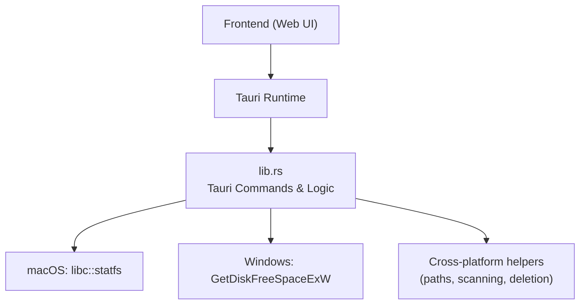
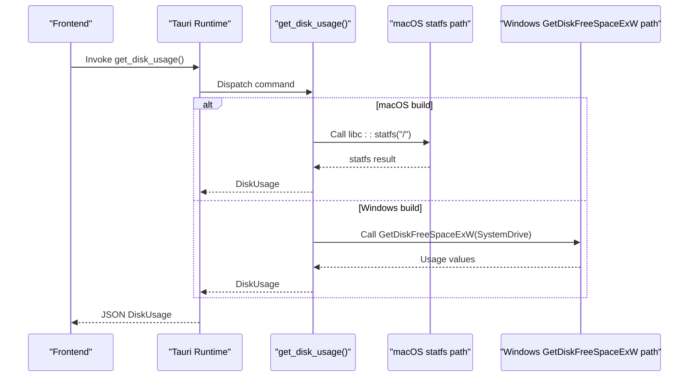
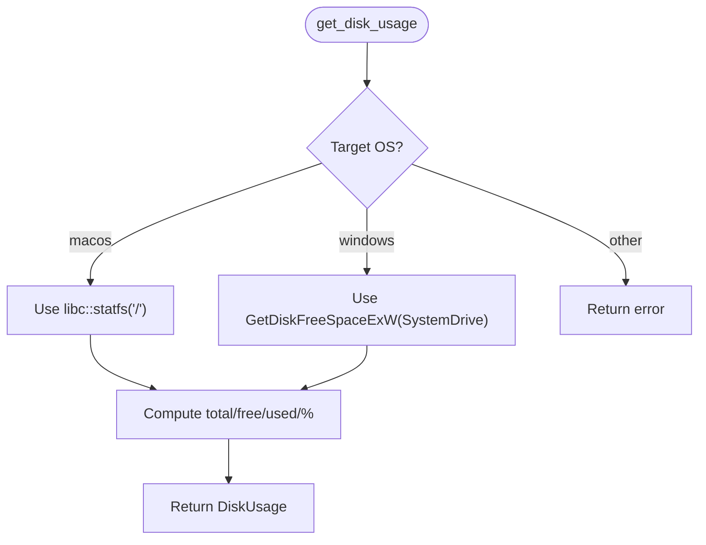
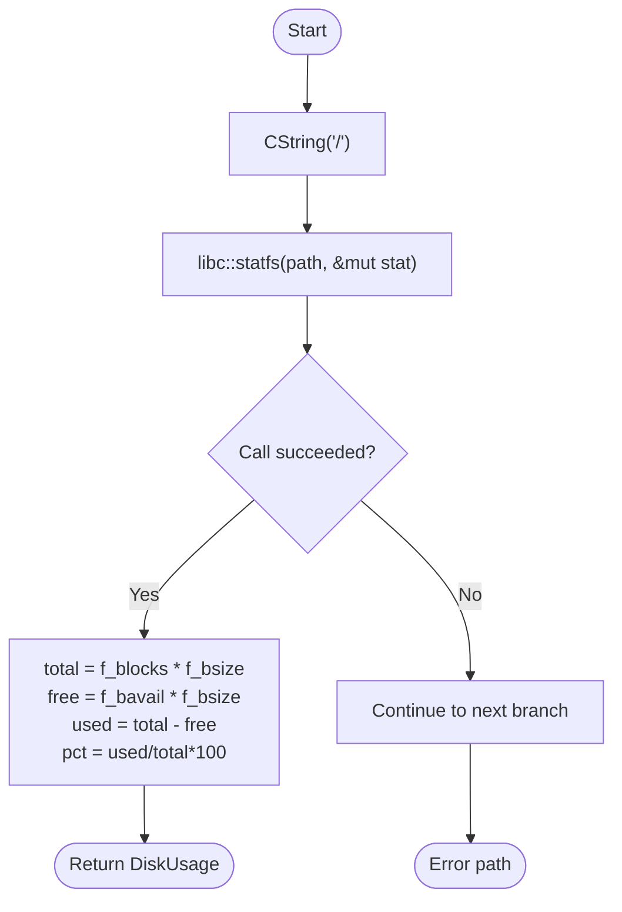
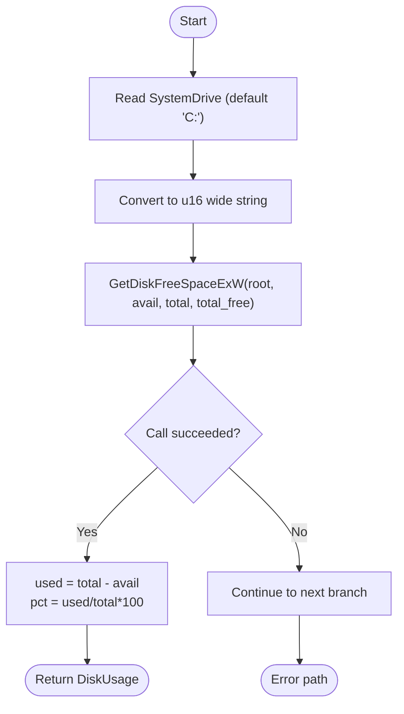
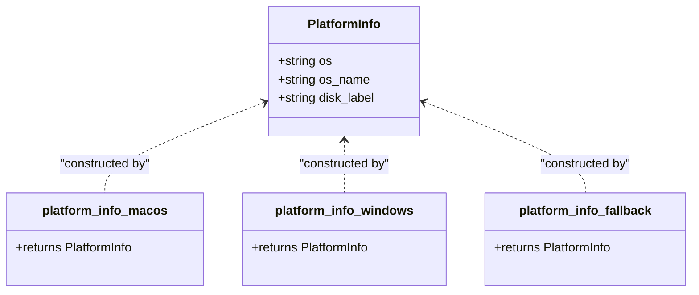
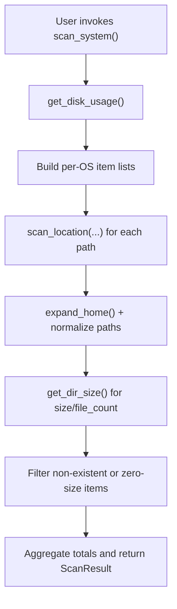
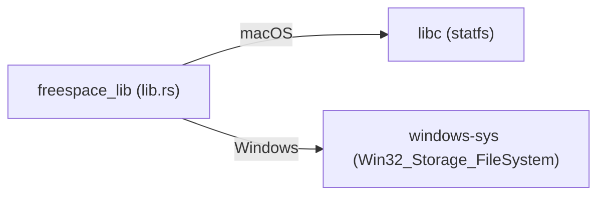

# Platform-Specific Implementations

<cite>
**Referenced Files in This Document**
- [lib.rs](file://src-tauri/src/lib.rs)
- [main.rs](file://src-tauri/src/main.rs)
- [Cargo.toml](file://src-tauri/Cargo.toml)
</cite>

## Table of Contents
1. [Introduction](#introduction)
2. [Project Structure](#project-structure)
3. [Core Components](#core-components)
4. [Architecture Overview](#architecture-overview)
5. [Detailed Component Analysis](#detailed-component-analysis)
6. [Dependency Analysis](#dependency-analysis)
7. [Performance Considerations](#performance-considerations)
8. [Troubleshooting Guide](#troubleshooting-guide)
9. [Conclusion](#conclusion)

## Introduction
This document explains the platform-specific implementations in FreeSpaceMacos, focusing on how the codebase uses conditional compilation to provide consistent behavior across macOS and Windows. It covers:
- Conditional compilation strategy using Rust’s #[cfg(target_os = ...)] attributes
- macOS disk statistics retrieval via libc::statfs
- Windows disk usage retrieval via GetDiskFreeSpaceExW
- Platform detection through platform_info variants
- Cross-platform abstractions that unify behavior
- Examples of platform detection, native API integration, and fallback mechanisms for unsupported platforms

## Project Structure
The platform logic is primarily implemented in the Tauri backend library. The main entry point delegates to the library’s run function, which registers Tauri commands exposed to the frontend.

**Diagram sources**
- [main.rs:4-6](file://src-tauri/src/main.rs#L4-L6)
- [lib.rs:1194-1207](file://src-tauri/src/lib.rs#L1194-L1207)

**Section sources**
- [main.rs:1-6](file://src-tauri/src/main.rs#L1-L6)
- [lib.rs:1194-1207](file://src-tauri/src/lib.rs#L1194-L1207)

## Core Components
- DiskUsage: Represents total, used, free space and percentage used.
- ScanResult: Aggregates disk usage with safe and review cleanup items.
- CleanupItem/SubCleanupItem: Represent directories/files eligible for cleanup.
- DeleteResult: Reports deletion outcomes.
- PlatformInfo: Encapsulates OS identity and a user-facing disk label.

Key responsibilities:
- get_disk_usage: Returns current disk usage using platform-native APIs.
- scan_system: Provides per-OS lists of safe and review-needed cleanup targets.
- platform_info/get_platform_info: Exposes platform metadata to the frontend.

**Section sources**
- [lib.rs:43-73](file://src-tauri/src/lib.rs#L43-L73)
- [lib.rs:335-406](file://src-tauri/src/lib.rs#L335-L406)
- [lib.rs:417-751](file://src-tauri/src/lib.rs#L417-L751)
- [lib.rs:755-793](file://src-tauri/src/lib.rs#L755-L793)
- [lib.rs:797-1162](file://src-tauri/src/lib.rs#L797-L1162)
- [lib.rs:1164-1190](file://src-tauri/src/lib.rs#L1164-L1190)

## Architecture Overview
The application exposes Tauri commands to the frontend. At runtime, the command handler selects the appropriate implementation based on the target OS at compile time.

**Diagram sources**
- [lib.rs:335-406](file://src-tauri/src/lib.rs#L335-L406)

## Detailed Component Analysis

### Conditional Compilation Strategy
The codebase uses #[cfg(target_os = "...")] to include or exclude platform-specific blocks:
- In get_disk_usage:
  - macOS block calls libc::statfs to compute total, free, used, and percentage.
  - Windows block calls GetDiskFreeSpaceExW to retrieve usage metrics.
- In scan_system:
  - macOS variant enumerates macOS-specific cache and developer directories.
  - Windows variant enumerates Windows-specific temp, browser caches, and system folders.
- In platform_info:
  - macOS returns fixed OS name and disk label.
  - Windows reads SystemDrive environment variable to construct a friendly disk label.
  - Fallback for other OSes uses std::env::consts::OS.

**Diagram sources**
- [lib.rs:335-406](file://src-tauri/src/lib.rs#L335-L406)

**Section sources**
- [lib.rs:335-406](file://src-tauri/src/lib.rs#L335-L406)
- [lib.rs:417-751](file://src-tauri/src/lib.rs#L417-L751)
- [lib.rs:797-1162](file://src-tauri/src/lib.rs#L797-L1162)
- [lib.rs:755-793](file://src-tauri/src/lib.rs#L755-L793)

### macOS Disk Statistics via libc::statfs
- Uses libc::statfs on root path "/" to obtain filesystem stats.
- Computes:
  - total = f_blocks * f_bsize
  - free = f_bavail * f_bsize
  - used = total - free
  - percentage_used = used / total * 100 (with division-by-zero guard)
- Returns DiskUsage on success; otherwise falls through to error handling.

**Diagram sources**
- [lib.rs:337-363](file://src-tauri/src/lib.rs#L337-L363)

**Section sources**
- [lib.rs:337-363](file://src-tauri/src/lib.rs#L337-L363)

### Windows Disk Statistics via GetDiskFreeSpaceExW
- Reads SystemDrive environment variable (defaults to "C:") to form the root path.
- Converts the path to UTF-16 wide string for the Windows API.
- Calls GetDiskFreeSpaceExW to retrieve available, total, and total free bytes.
- Computes used and percentage similarly to macOS.
- Returns DiskUsage on success; otherwise falls through to error handling.

**Diagram sources**
- [lib.rs:365-403](file://src-tauri/src/lib.rs#L365-L403)

**Section sources**
- [lib.rs:365-403](file://src-tauri/src/lib.rs#L365-L403)

### Platform Detection: platform_info Variants
Three variants are compiled depending on the target OS:
- macOS: os="macos", os_name="macOS", disk_label="Macintosh HD"
- Windows: os="windows", os_name="Windows", disk_label="Local Disk ({SystemDrive})"
- Other OSes: os=os constant, os_name=os constant, disk_label="Disk"

Exposed via get_platform_info Tauri command.

**Diagram sources**
- [lib.rs:755-793](file://src-tauri/src/lib.rs#L755-L793)

**Section sources**
- [lib.rs:755-793](file://src-tauri/src/lib.rs#L755-L793)

### Cross-Platform Abstractions
Several utilities provide consistent behavior across platforms:
- Path normalization and home expansion:
  - expand_home handles "~/" prefix resolution.
  - is_category_root normalizes separators and case to match both macOS and Windows roots.
- Directory traversal and size calculation:
  - get_dir_size walks directories up to a depth limit and aggregates file sizes and counts.
- Deletion logic:
  - delete_target and delete_dir_contents_resilient handle files, directories, and symlinks with resilient fallbacks.

These abstractions allow scan_system to reuse common logic while only changing the list of paths per platform.

**Diagram sources**
- [lib.rs:106-113](file://src-tauri/src/lib.rs#L106-L113)
- [lib.rs:210-266](file://src-tauri/src/lib.rs#L210-L266)
- [lib.rs:77-104](file://src-tauri/src/lib.rs#L77-L104)
- [lib.rs:268-331](file://src-tauri/src/lib.rs#L268-L331)
- [lib.rs:170-208](file://src-tauri/src/lib.rs#L170-L208)

**Section sources**
- [lib.rs:77-104](file://src-tauri/src/lib.rs#L77-L104)
- [lib.rs:106-113](file://src-tauri/src/lib.rs#L106-L113)
- [lib.rs:170-208](file://src-tauri/src/lib.rs#L170-L208)
- [lib.rs:210-266](file://src-tauri/src/lib.rs#L210-L266)
- [lib.rs:268-331](file://src-tauri/src/lib.rs#L268-L331)

### Fallback Mechanisms for Unsupported Platforms
- get_disk_usage: If neither macOS nor Windows branches succeed, it returns an error indicating inability to get disk usage.
- platform_info: For any OS not explicitly handled, it falls back to std::env::consts::OS for identification and a generic disk label.

These ensure the app remains usable even when platform-specific features are unavailable.

**Section sources**
- [lib.rs:335-406](file://src-tauri/src/lib.rs#L335-L406)
- [lib.rs:781-788](file://src-tauri/src/lib.rs#L781-L788)

## Dependency Analysis
Platform-specific dependencies are declared conditionally:
- macOS: libc crate provides statfs.
- Windows: windows-sys crate provides GetDiskFreeSpaceExW.

**Diagram sources**
- [Cargo.toml:24-28](file://src-tauri/Cargo.toml#L24-L28)

**Section sources**
- [Cargo.toml:15-28](file://src-tauri/Cargo.toml#L15-L28)

## Performance Considerations
- Directory scanning depth: get_dir_size limits recursion depth to avoid excessive traversal.
- Filtering: Items with zero size or nonexistent paths are filtered early to reduce overhead.
- Native APIs: Using libc::statfs and GetDiskFreeSpaceExW avoids expensive full-disk scans for usage metrics.

[No sources needed since this section provides general guidance]

## Troubleshooting Guide
Common issues and resolutions:
- Unable to get disk usage:
  - On macOS, verify libc::statfs call succeeds and permissions allow reading root filesystem stats.
  - On Windows, ensure SystemDrive is set and GetDiskFreeSpaceExW has access to the drive.
- Permission errors during deletion:
  - Some system directories may require elevated privileges; consider running with appropriate permissions.
- Unexpected empty results:
  - Ensure paths exist and are readable; check expand_home behavior for "~/" expansion.

**Section sources**
- [lib.rs:335-406](file://src-tauri/src/lib.rs#L335-L406)
- [lib.rs:1164-1190](file://src-tauri/src/lib.rs#L1164-L1190)

## Conclusion
FreeSpaceMacos achieves cross-platform consistency by leveraging Rust’s conditional compilation to select platform-specific implementations for disk statistics and cleanup targets. The design cleanly separates platform concerns (macOS statfs vs. Windows GetDiskFreeSpaceExW) behind shared abstractions, providing a uniform API to the frontend while maintaining robust fallbacks for unsupported platforms.

[No sources needed since this section summarizes without analyzing specific files]