# Frontend Architecture (TypeScript)

<cite>
**Referenced Files in This Document**
- [README.md](file://README.md)
- [package.json](file://package.json)
- [index.html](file://index.html)
- [src/main.ts](file://src/main.ts)
- [src/styles.css](file://src/styles.css)
</cite>

## Update Summary
**Changes Made**
- Updated Tabbed Interface section to document the new three-tab architecture
- Added Size-Sorted Directory Tree component documentation
- Added Large Files Scanner component documentation  
- Enhanced Tauri Command Integration patterns with new backend commands
- Updated Event Handling section with tab switching logic
- Added new sections for tree visualization and file scanning workflows

## Table of Contents
1. [Introduction](#introduction)
2. [Project Structure](#project-structure)
3. [Core Components](#core-components)
4. [Architecture Overview](#architecture-overview)
5. [Detailed Component Analysis](#detailed-component-analysis)
6. [Dependency Analysis](#dependency-analysis)
7. [Performance Considerations](#performance-considerations)
8. [Troubleshooting Guide](#troubleshooting-guide)
9. [Conclusion](#conclusion)

## Introduction
This document explains the frontend architecture of FreeSpaceMacos, a macOS storage cleanup and disk analyzer built with Tauri 2, TypeScript, HTML5, and CSS. The application features a modern tabbed interface with three main views: Cleanup (hierarchical tree navigation), Size Tree (directory visualization), and Large Files (file discovery). It scans system caches and developer artifacts, presents results in interactive trees, supports safe and review categories, and performs deletions via Tauri IPC. It uses glassmorphism styling, responsive design, toast notifications, and confirmation dialogs to provide clear user feedback.

Key goals:
- Explain state management for hierarchical tree navigation and parent-child selection logic.
- Detail UI rendering components including dynamic tree generation, confirmation dialogs, and toast notifications.
- Document Tauri command integration patterns for IPC between frontend and backend.
- Describe glassmorphism CSS styling, responsive design, and visual feedback mechanisms.
- Provide examples of event handling, state synchronization, and component composition through code paths.
- Address user interaction flows, accessibility considerations, and cross-browser compatibility approaches.

[No sources needed since this section summarizes without analyzing specific files]

## Project Structure
The frontend is a single-page app driven by an HTML entry point and a TypeScript module that manages state, DOM rendering, and IPC calls across multiple tabs.

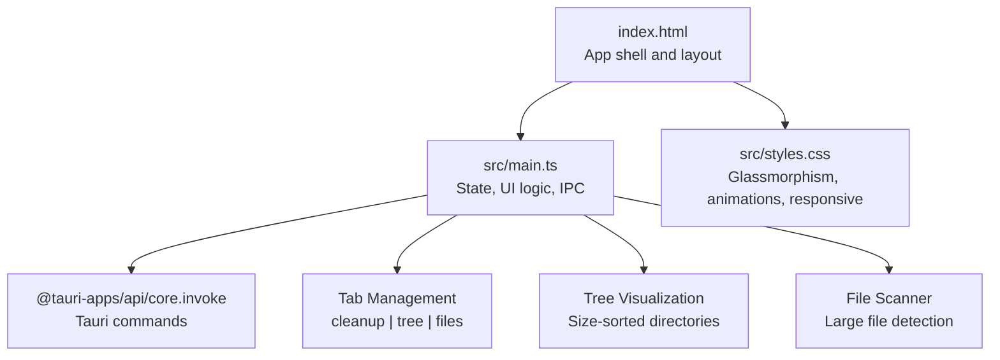

**Diagram sources**
- [index.html:1-10](file://index.html#L1-L10)
- [src/main.ts:1-10](file://src/main.ts#L1-L10)
- [src/styles.css:1-45](file://src/styles.css#L1-L45)

**Section sources**
- [README.md:35-40](file://README.md#L35-L40)
- [package.json:12-19](file://package.json#L12-L19)
- [index.html:1-10](file://index.html#L1-L10)

## Core Components
- **State model**: Hierarchical TreeNode structure with selection states (selected, indeterminate), expansion flags, and parent/child links.
- **Tab State Management**: Three-tab architecture with lazy loading for heavy operations.
- **Data models**: ScanResult, DiskUsage, DeleteResult, PlatformInfo, SubCleanupItem, LargeFile, and related interfaces define the contract with the backend.
- **UI components**:
  - Disk usage ring and stats.
  - Results sections for Safe and Review categories.
  - Dynamic tree nodes and sub-items.
  - Confirmation dialog overlay.
  - Toast notification container.
  - Size-sorted directory tree with progress bars.
  - Large file scanner with reveal functionality.
- **IPC layer**: invoke() calls to scan_system, delete_items, get_platform_info, get_disk_usage, scan_sub_items, get_tree_root, scan_large_files, and reveal_path.

**Section sources**
- [src/main.ts:5-91](file://src/main.ts#L5-L91)
- [src/main.ts:95-109](file://src/main.ts#L95-L109)
- [src/main.ts:87-97](file://src/main.ts#L87-L97)
- [index.html:25-180](file://index.html#L25-L180)

## Architecture Overview
The frontend orchestrates scanning, selection, deletion, and file discovery workflows while keeping the UI reactive to state changes across multiple tabs.

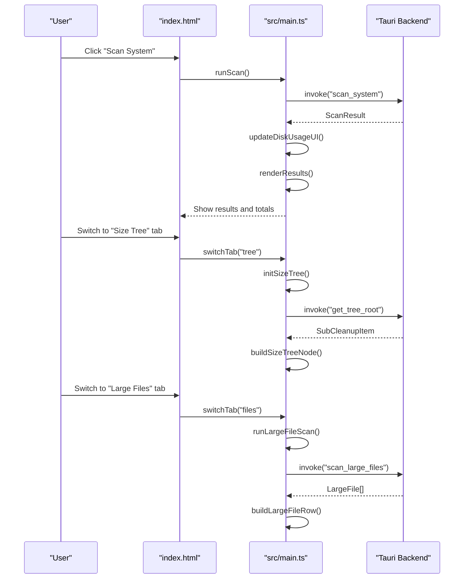

**Diagram sources**
- [src/main.ts:850-909](file://src/main.ts#L850-L909)
- [src/main.ts:958-979](file://src/main.ts#L958-L979)
- [src/main.ts:983-1016](file://src/main.ts#L983-L1016)
- [src/main.ts:1112-1152](file://src/main.ts#L1112-L1152)

## Detailed Component Analysis

### Tabbed Interface Architecture
The application implements a three-tab system with lazy loading for performance optimization.

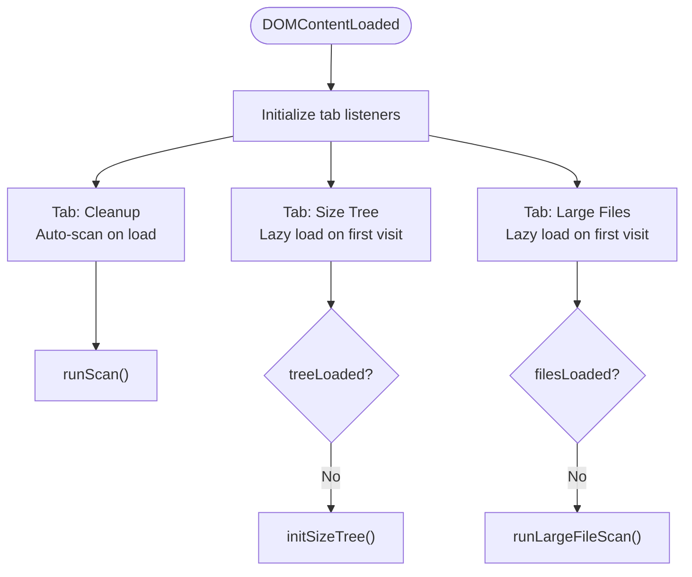

**Diagram sources**
- [src/main.ts:958-979](file://src/main.ts#L958-L979)
- [src/main.ts:1250-1266](file://src/main.ts#L1250-L1266)

**Section sources**
- [src/main.ts:104-109](file://src/main.ts#L104-L109)
- [src/main.ts:958-979](file://src/main.ts#L958-L979)
- [index.html:25-30](file://index.html#L25-L30)

### State Management Patterns for Hierarchical Tree Navigation
- Node model: TreeNode includes selection state (selected, indeterminate), expansion state (expanded), parent reference, and children array.
- Selection propagation:
  - Downward: When a node is selected/deselected, all descendants are updated accordingly.
  - Upward: Ancestors compute their state based on children's selection status, supporting tri-state checkboxes.
- Lazy loading: Children are fetched on demand via Tauri when expanding a node; once loaded, they are cached in memory.

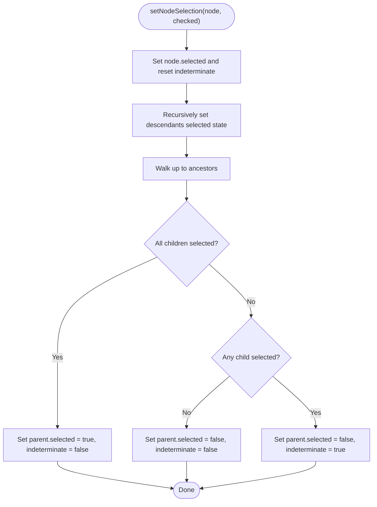

**Diagram sources**
- [src/main.ts:289-323](file://src/main.ts#L289-L323)

**Section sources**
- [src/main.ts:65-84](file://src/main.ts#L65-L84)
- [src/main.ts:289-323](file://src/main.ts#L289-L323)
- [src/main.ts:325-349](file://src/main.ts#L325-L349)
- [src/main.ts:351-427](file://src/main.ts#L351-L427)

### Size-Sorted Directory Tree Component
The size tree provides a visual representation of directory structures with proportional size indicators.

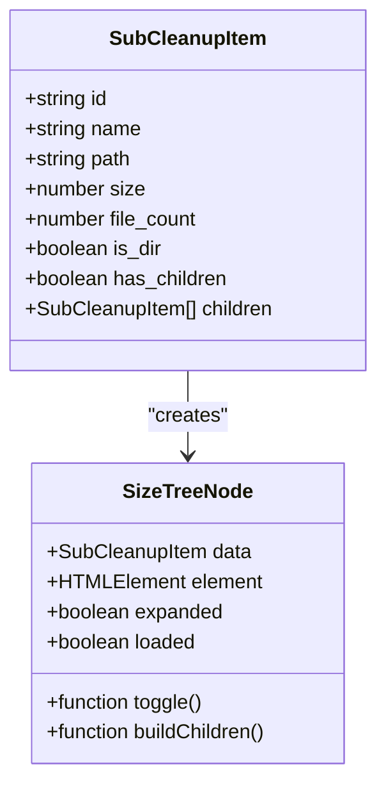

**Diagram sources**
- [src/main.ts:5-14](file://src/main.ts#L5-L14)
- [src/main.ts:1018-1108](file://src/main.ts#L1018-L1108)

**Section sources**
- [src/main.ts:983-1016](file://src/main.ts#L983-L1016)
- [src/main.ts:1018-1108](file://src/main.ts#L1018-L1108)

### Large Files Scanner Component
The large files scanner identifies and displays oversized files with system integration capabilities.

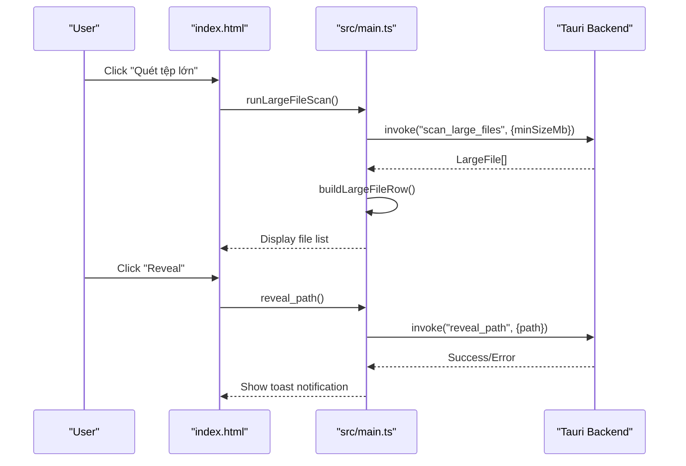

**Diagram sources**
- [src/main.ts:1112-1152](file://src/main.ts#L1112-L1152)
- [src/main.ts:1154-1182](file://src/main.ts#L1154-L1182)

**Section sources**
- [src/main.ts:1112-1152](file://src/main.ts#L1112-L1152)
- [src/main.ts:1154-1182](file://src/main.ts#L1154-L1182)

### UI Rendering Components
- Dynamic tree structure generation:
  - Top-level category nodes rendered via createTopLevelItemElement.
  - Sub-item nodes rendered via createSubItemElement.
  - Expansion toggles lazy-load children using invoke("scan_sub_items").
- Confirmation dialogs:
  - showConfirmCleanupDialog builds a modal overlay with safe/review breakdowns and total reclaimable space.
- Toast notifications:
  - showToast creates transient messages with success/error/info types and auto-dismiss after delay.

```mermaid
classDiagram
class TreeNode {
+string id
+string name
+string path
+number size
+number file_count
+boolean is_dir
+boolean has_children
+string icon
+string description
+string safety_tip
+string safety_level
+boolean is_top_level
+TreeNode parent
+TreeNode[] children
+boolean childrenLoaded
+boolean selected
+boolean indeterminate
+boolean expanded
}
class ScanResult {
+DiskUsage disk_usage
+CleanupItem[] safe_items
+CleanupItem[] review_items
+number total_safe_size
+number total_review_size
}
class ConfirmDetails {
+number totalSize
+number pathsCount
+{name,size,path}[] safeItems
+{name,size,path}[] reviewItems
}
class DeleteResult {
+boolean success
+number deleted_count
+number freed_bytes
+string[] errors
}
ScanResult --> CleanupItem : "contains"
ConfirmDetails --> TreeNode : "derived from selection"
```

**Diagram sources**
- [src/main.ts:5-91](file://src/main.ts#L5-L91)
- [src/main.ts:289-323](file://src/main.ts#L289-L323)
- [src/main.ts:159-256](file://src/main.ts#L159-L256)

**Section sources**
- [src/main.ts:485-571](file://src/main.ts#L485-L571)
- [src/main.ts:573-637](file://src/main.ts#L573-L637)
- [src/main.ts:639-709](file://src/main.ts#L639-L709)
- [src/main.ts:713-846](file://src/main.ts#L713-L846)
- [src/main.ts:159-256](file://src/main.ts#L159-L256)

### Tauri Command Integration Patterns
- Commands used:
  - scan_system: Returns ScanResult including disk usage and categorized items.
  - delete_items: Deletes selected paths and returns DeleteResult.
  - get_platform_info: Returns platform details to adapt UI labels.
  - get_disk_usage: Returns current disk usage metrics.
  - scan_sub_items: Returns nested items for a given directory path.
  - get_tree_root: Returns root directory for size tree visualization.
  - scan_large_files: Finds large files above specified threshold.
  - reveal_path: Opens file location in system file manager.
- Invocation pattern:
  - Use invoke<T>(commandName, payload?) to call backend functions.
  - Handle errors with try/catch and display toast notifications.

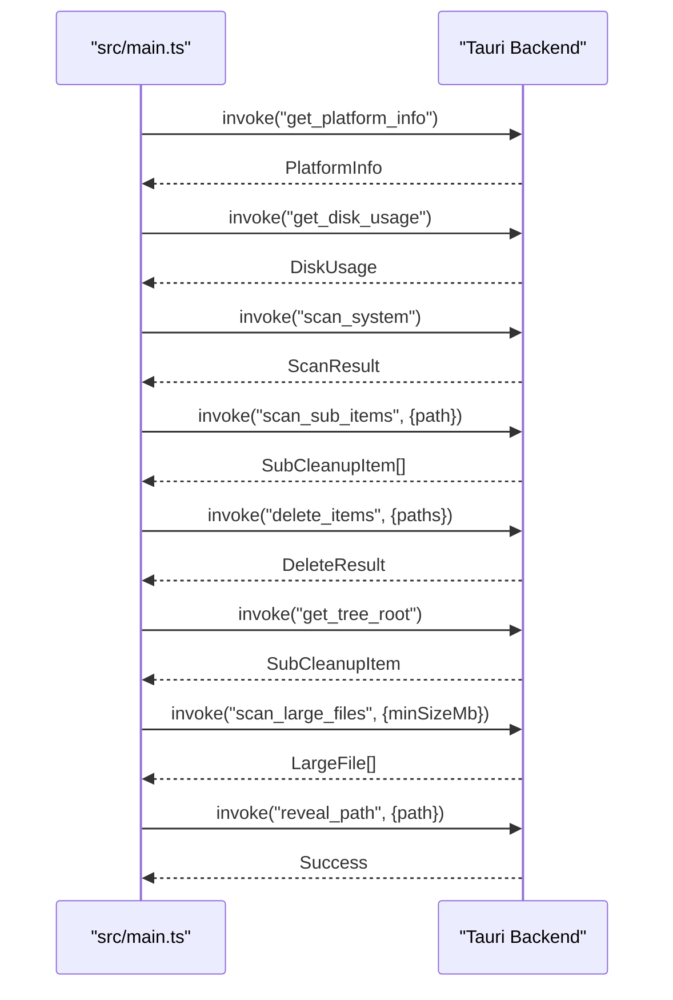

**Diagram sources**
- [src/main.ts:850-909](file://src/main.ts#L850-L909)
- [src/main.ts:913-954](file://src/main.ts#L913-L954)
- [src/main.ts:983-1016](file://src/main.ts#L983-L1016)
- [src/main.ts:1112-1152](file://src/main.ts#L1112-L1152)

**Section sources**
- [src/main.ts:1-10](file://src/main.ts#L1-L10)
- [src/main.ts:850-909](file://src/main.ts#L850-L909)
- [src/main.ts:913-954](file://src/main.ts#L913-L954)
- [src/main.ts:983-1016](file://src/main.ts#L983-L1016)
- [src/main.ts:1112-1152](file://src/main.ts#L1112-L1152)

### Glassmorphism CSS Styling and Responsive Design
- Glassmorphism approach:
  - Semi-transparent backgrounds with backdrop-filter blur for cards, action bar, toasts, and dialogs.
  - Subtle borders and shadows to enhance depth.
- Visual feedback:
  - Hover and active states for buttons and rows.
  - Tri-state custom checkboxes with distinct styles for checked and indeterminate states.
  - Animations for slide-up, fade-in, spin, pulse, and staggered item entrance.
- Responsive patterns:
  - Media queries adjust layout for small screens.
  - Flexible containers and text truncation ensure readability.

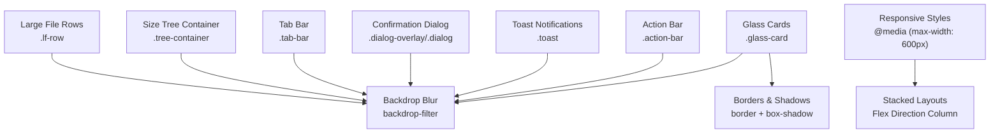

**Diagram sources**
- [src/styles.css:134-143](file://src/styles.css#L134-L143)
- [src/styles.css:753-825](file://src/styles.css#L753-L825)
- [src/styles.css:827-880](file://src/styles.css#L827-L880)
- [src/styles.css:987-1175](file://src/styles.css#L987-L1175)
- [src/styles.css:1176-1188](file://src/styles.css#L1176-L1188)
- [src/styles.css:1299-1343](file://src/styles.css#L1299-L1343)
- [src/styles.css:1418-1454](file://src/styles.css#L1418-L1454)
- [src/styles.css:1455-1554](file://src/styles.css#L1455-L1554)

**Section sources**
- [src/styles.css:1-45](file://src/styles.css#L1-L45)
- [src/styles.css:134-143](file://src/styles.css#L134-L143)
- [src/styles.css:753-825](file://src/styles.css#L753-L825)
- [src/styles.css:827-880](file://src/styles.css#L827-L880)
- [src/styles.css:987-1175](file://src/styles.css#L987-L1175)
- [src/styles.css:1176-1188](file://src/styles.css#L1176-L1188)
- [src/styles.css:1299-1343](file://src/styles.css#L1299-L1343)
- [src/styles.css:1418-1454](file://src/styles.css#L1418-L1454)
- [src/styles.css:1455-1554](file://src/styles.css#L1455-L1554)

### Event Handling, State Synchronization, and Component Composition
- Event handling:
  - Button clicks trigger runScan and runClean.
  - Row and chevron clicks handle expand and selection updates.
  - Select All buttons toggle all nodes within Safe or Review categories.
  - Tab switching triggers lazy loading for heavy components.
- State synchronization:
  - setNodeSelection updates both model and DOM via updateAllCheckboxesDOM.
  - updateSelectionUI recalculates counts, sizes, and visibility of the action bar.
  - Tab state management controls visibility and initialization of different panels.
- Component composition:
  - createTopLevelItemElement composes row elements with icons, badges, and metadata.
  - createSubItemElement composes nested items with optional expand chevrons.
  - buildSizeTreeNode creates visual representations with progress bars.
  - buildLargeFileRow generates file entries with system integration.

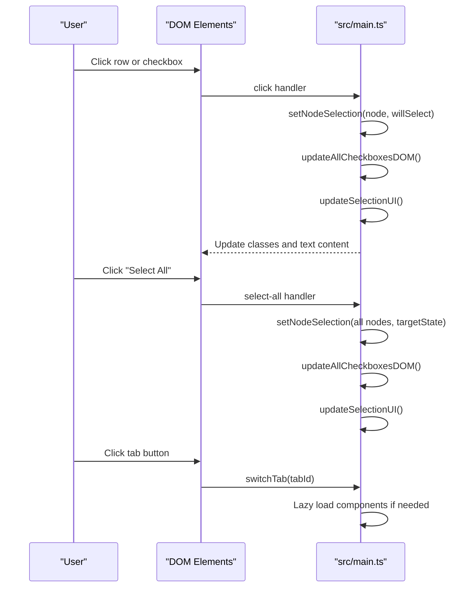

**Diagram sources**
- [src/main.ts:614-621](file://src/main.ts#L614-L621)
- [src/main.ts:686-693](file://src/main.ts#L686-L693)
- [src/main.ts:1224-1245](file://src/main.ts#L1224-L1245)
- [src/main.ts:958-979](file://src/main.ts#L958-L979)

**Section sources**
- [src/main.ts:614-621](file://src/main.ts#L614-L621)
- [src/main.ts:686-693](file://src/main.ts#L686-L693)
- [src/main.ts:1224-1245](file://src/main.ts#L1224-L1245)
- [src/main.ts:958-979](file://src/main.ts#L958-L979)

### User Interaction Flows
- Initial load:
  - Auto-detect platform info and initial disk usage.
  - Auto-trigger scan on startup.
- Scanning flow:
  - Disable scan button, show scanning overlay with rotating status texts.
  - On completion, update disk usage UI, render results, and show toast.
- Deletion flow:
  - Build confirmation dialog with safe/review breakdowns.
  - If confirmed, call delete_items, show success/error toast, then re-scan.
- Tab switching flow:
  - Toggle active tab button and panel visibility.
  - Lazy initialize heavy components on first access.

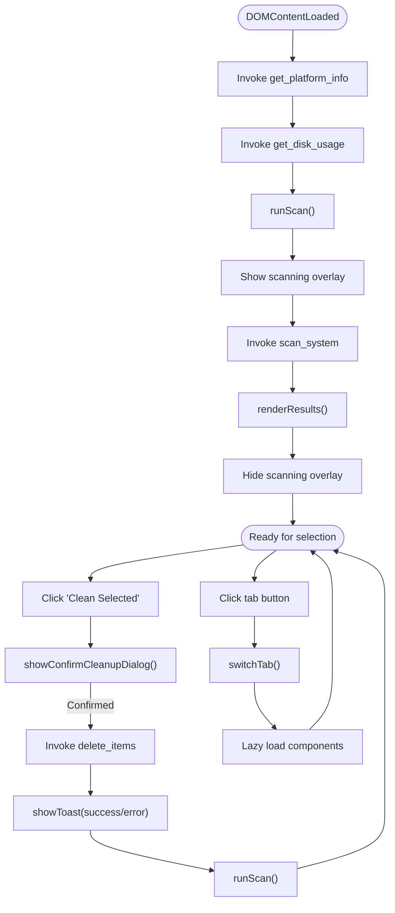

**Diagram sources**
- [src/main.ts:1186-1266](file://src/main.ts#L1186-L1266)
- [src/main.ts:850-909](file://src/main.ts#L850-L909)
- [src/main.ts:913-954](file://src/main.ts#L913-L954)
- [src/main.ts:958-979](file://src/main.ts#L958-L979)

**Section sources**
- [src/main.ts:1186-1266](file://src/main.ts#L1186-L1266)
- [src/main.ts:850-909](file://src/main.ts#L850-L909)
- [src/main.ts:913-954](file://src/main.ts#L913-L954)
- [src/main.ts:958-979](file://src/main.ts#L958-L979)

### Accessibility Considerations
- Keyboard and focus:
  - Buttons and interactive rows should be reachable via keyboard; consider adding tabindex and focus styles.
- Semantic markup:
  - Use semantic tags (section, header, main) already present in index.html.
- ARIA attributes:
  - Add aria-checked for custom checkboxes to reflect tri-state behavior.
  - Add aria-expanded for expandable nodes.
- Color contrast:
  - Ensure sufficient contrast for text and badges against dark backgrounds.
- Screen readers:
  - Provide descriptive titles and alt text for icons where applicable.

[No sources needed since this section provides general guidance]

### Cross-Browser Compatibility Approaches
- Backdrop filter support:
  - Uses -webkit-backdrop-filter fallback alongside standard backdrop-filter.
- Scrollbar styling:
  - Custom scrollbar styles use WebKit pseudo-elements; consider non-WebKit fallbacks if targeting other browsers.
- Font smoothing:
  - Uses -webkit-font-smoothing and -moz-osx-font-smoothing for consistent typography across platforms.
- Viewport meta:
  - Includes viewport meta tag for mobile responsiveness.

**Section sources**
- [src/styles.css:38-45](file://src/styles.css#L38-L45)
- [src/styles.css:117-132](file://src/styles.css#L117-L132)
- [index.html:1-10](file://index.html#L1-L10)

## Dependency Analysis
Frontend dependencies include Tauri API modules for IPC and opener plugin. The build pipeline uses Vite and TypeScript.

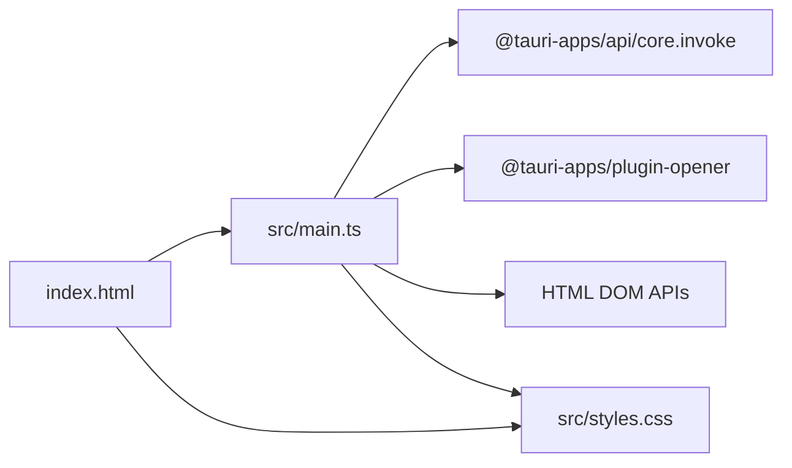

**Diagram sources**
- [package.json:12-19](file://package.json#L12-L19)
- [src/main.ts:1-10](file://src/main.ts#L1-L10)
- [index.html:1-10](file://index.html#L1-L10)

**Section sources**
- [package.json:12-19](file://package.json#L12-L19)
- [src/main.ts:1-10](file://src/main.ts#L1-L10)

## Performance Considerations
- Lazy loading of sub-items reduces initial payload and improves perceived performance.
- DOM updates are batched via targeted class toggles and selective innerHTML replacements.
- Avoid unnecessary re-renders by checking existing children before appending.
- Debounce or throttle repeated interactions if needed for large trees.
- Tab-based lazy loading prevents heavy operations until components are accessed.
- Progress bars in size tree provide visual feedback during large directory scans.

[No sources needed since this section provides general guidance]

## Troubleshooting Guide
- Scan failures:
  - Errors from scan_system are caught and displayed via toast; check backend logs and permissions.
- Deletion failures:
  - delete_items may return partial success; inspect DeleteResult.errors and freed_bytes.
- Platform detection issues:
  - get_platform_info errors fall back to default labels; verify Tauri configuration and capabilities.
- Tree expansion errors:
  - scan_sub_items failures show error messages in the tree; verify path validity and permissions.
- Size tree load errors:
  - get_tree_root failures display error messages; check Home directory permissions.
- Large file scan errors:
  - scan_large_files failures show error messages; verify minimum size threshold and permissions.
- Reveal path errors:
  - reveal_path failures show toast notifications; check file existence and system permissions.

**Section sources**
- [src/main.ts:897-900](file://src/main.ts#L897-L900)
- [src/main.ts:947-950](file://src/main.ts#L947-L950)
- [src/main.ts:1008-1012](file://src/main.ts#L1008-L1012)
- [src/main.ts:1144-1148](file://src/main.ts#L1144-L1148)
- [src/main.ts:1174-1177](file://src/main.ts#L1174-L1177)

## Conclusion
FreeSpaceMacos frontend implements a robust, reactive architecture centered around a hierarchical TreeNode state model, dynamic DOM rendering, and Tauri IPC for backend operations. The modern tabbed interface provides three distinct views: cleanup operations with hierarchical selection, size-sorted directory visualization, and large file discovery with system integration. The glassmorphism design provides a modern macOS aesthetic with responsive layouts and clear visual feedback. By following the documented patterns for event handling, state synchronization, and component composition, developers can extend functionality while maintaining clarity and performance across all three primary views.

[No sources needed since this section summarizes without analyzing specific files]