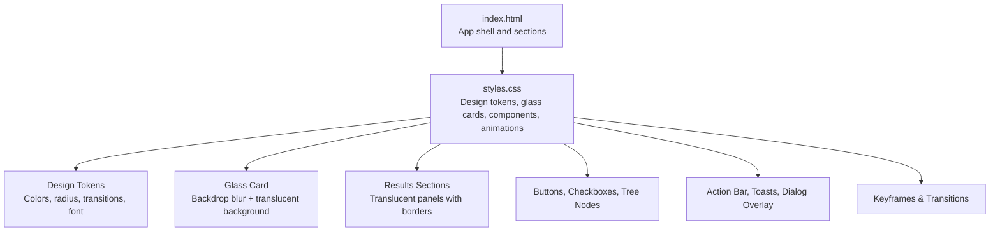
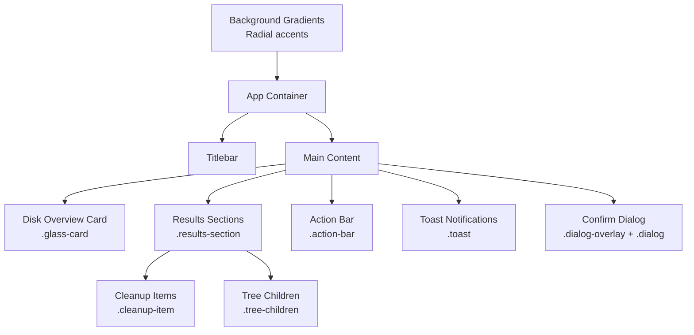
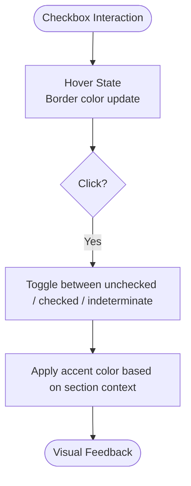
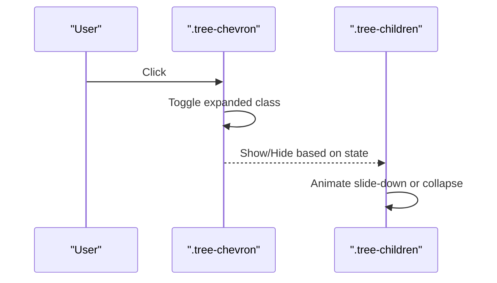
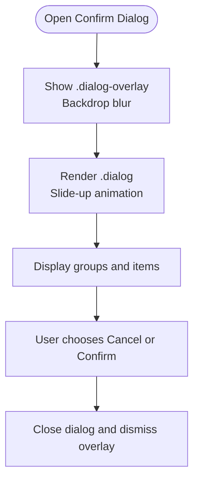
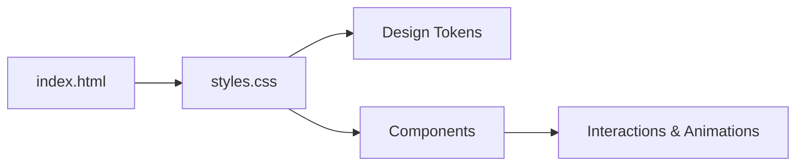

# Glassmorphism Styling & Visual Design

<cite>
**Referenced Files in This Document**
- [styles.css](file://src/styles.css)
- [index.html](file://index.html)
- [README.md](file://README.md)
</cite>

## Table of Contents
1. [Introduction](#introduction)
2. [Project Structure](#project-structure)
3. [Core Components](#core-components)
4. [Architecture Overview](#architecture-overview)
5. [Detailed Component Analysis](#detailed-component-analysis)
6. [Dependency Analysis](#dependency-analysis)
7. [Performance Considerations](#performance-considerations)
8. [Troubleshooting Guide](#troubleshooting-guide)
9. [Conclusion](#conclusion)
10. [Appendices](#appendices)

## Introduction
This document explains the glassmorphism styling system used by the FreeSpaceMacos application. It covers visual design principles (backdrop-filter effects, transparency layers, modern UI aesthetics), responsive patterns, color scheme, typography, spacing conventions, and animation/transition behaviors for interactive elements such as checkboxes, tree nodes, and modal dialogs. It also provides guidance on customizing the theme, adding new components while maintaining consistency, and handling browser compatibility with fallback strategies.

The app is a macOS desktop utility built with Tauri 2 and uses vanilla CSS for its glassmorphism look and animations. The README confirms the dark mode glassmorphism design and vibrancy styling approach.

**Section sources**
- [README.md:29-40](file://README.md#L29-L40)

## Project Structure
The visual layer is primarily implemented in a single stylesheet and an HTML entry point:
- index.html defines the page structure and loads the stylesheet.
- styles.css contains all design tokens, layout rules, glassmorphism components, animations, and responsive adjustments.

**Diagram sources**
- [index.html:1-141](file://index.html#L1-L141)
- [styles.css:1-1298](file://src/styles.css#L1-L1298)

**Section sources**
- [index.html:1-141](file://index.html#L1-L141)
- [styles.css:1-1298](file://src/styles.css#L1-L1298)

## Core Components
- Design tokens define colors, spacing radii, transition timings, and fonts at the root level.
- Glass card component applies translucent backgrounds and backdrop blur to create frosted-glass panels.
- Results sections use the same glass effect for grouped content.
- Action bar and toast notifications apply glass-like overlays for contextual feedback.
- Confirm dialog overlay uses a blurred backdrop to focus attention.

Key implementation references:
- Design tokens and base reset: [styles.css:1-58](file://src/styles.css#L1-L58)
- Glass card: [styles.css:134-143](file://src/styles.css#L134-L143)
- Results sections: [styles.css:352-359](file://src/styles.css#L352-L359)
- Action bar: [styles.css:754-769](file://src/styles.css#L754-L769)
- Toasts: [styles.css:827-880](file://src/styles.css#L827-L880)
- Confirm dialog overlay and panel: [styles.css:987-1013](file://src/styles.css#L987-L1013)

**Section sources**
- [styles.css:1-58](file://src/styles.css#L1-L58)
- [styles.css:134-143](file://src/styles.css#L134-L143)
- [styles.css:352-359](file://src/styles.css#L352-L359)
- [styles.css:754-769](file://src/styles.css#L754-L769)
- [styles.css:827-880](file://src/styles.css#L827-L880)
- [styles.css:987-1013](file://src/styles.css#L987-L1013)

## Architecture Overview
The visual architecture centers on a layered composition:
- Background gradients provide subtle color depth.
- Glass panels float above the background using backdrop blur and semi-transparent fills.
- Interactive controls (buttons, checkboxes, tree chevrons) use consistent transitions and hover states.
- Overlays (action bar, toasts, confirm dialog) maintain visual hierarchy with z-indexing and blur.

**Diagram sources**
- [styles.css:54-68](file://src/styles.css#L54-L68)
- [styles.css:134-143](file://src/styles.css#L134-L143)
- [styles.css:352-359](file://src/styles.css#L352-L359)
- [styles.css:419-460](file://src/styles.css#L419-L460)
- [styles.css:564-580](file://src/styles.css#L564-L580)
- [styles.css:754-769](file://src/styles.css#L754-L769)
- [styles.css:827-880](file://src/styles.css#L827-L880)
- [styles.css:987-1013](file://src/styles.css#L987-L1013)

## Detailed Component Analysis

### Color Scheme and Typography
- Colors are centralized via CSS variables for primary, secondary, card backgrounds, accent hues, and text tones.
- Accent palette includes blue, green, amber, red, and purple with dimmed variants for subtle highlights.
- Typography uses system fonts optimized for macOS, with antialiasing and consistent line height.

References:
- Color tokens and text variables: [styles.css:3-25](file://src/styles.css#L3-L25)
- Font stack and defaults: [styles.css:38-45](file://src/styles.css#L38-L45)

**Section sources**
- [styles.css:3-25](file://src/styles.css#L3-L25)
- [styles.css:38-45](file://src/styles.css#L38-L45)

### Spacing and Radius Conventions
- Spacing and border radii are defined as tokens to ensure consistent rounding across components.
- Common radii include small, medium, large, and extra-large values.

References:
- Radius tokens: [styles.css:27-31](file://src/styles.css#L27-L31)

**Section sources**
- [styles.css:27-31](file://src/styles.css#L27-L31)

### Backdrop Filter and Transparency Layers
- Glassmorphism is achieved through translucent backgrounds combined with backdrop blur.
- Applied consistently to cards, results sections, action bar, toasts, and dialog overlays.

References:
- Glass card: [styles.css:134-143](file://src/styles.css#L134-L143)
- Results sections: [styles.css:352-359](file://src/styles.css#L352-L359)
- Action bar: [styles.css:754-769](file://src/styles.css#L754-L769)
- Toasts: [styles.css:827-880](file://src/styles.css#L827-L880)
- Dialog overlay: [styles.css:987-999](file://src/styles.css#L987-L999)

**Section sources**
- [styles.css:134-143](file://src/styles.css#L134-L143)
- [styles.css:352-359](file://src/styles.css#L352-L359)
- [styles.css:754-769](file://src/styles.css#L754-L769)
- [styles.css:827-880](file://src/styles.css#L827-L880)
- [styles.css:987-999](file://src/styles.css#L987-L999)

### Responsive Design Patterns
- A media query adjusts layout for narrow screens by stacking stats and headers vertically.
- The main content area scrolls smoothly and reserves bottom space for the fixed action bar.

References:
- Responsive breakpoint: [styles.css:1176-1188](file://src/styles.css#L1176-L1188)
- Smooth scrolling and padding: [styles.css:108-114](file://src/styles.css#L108-L114)

**Section sources**
- [styles.css:1176-1188](file://src/styles.css#L1176-L1188)
- [styles.css:108-114](file://src/styles.css#L108-L114)

### Animation and Transition Effects
- Global transitions are defined via tokens for fast, normal, and slow durations with smooth easing.
- Keyframe animations include slide-up, fade-in, spin, pulse, toast entrance/exit, and item staggered entry.
- Buttons and interactive elements use transform and shadow changes for hover/active states.

References:
- Transition tokens: [styles.css:33-36](file://src/styles.css#L33-L36)
- Button hover/active: [styles.css:271-287](file://src/styles.css#L271-L287), [styles.css:812-825](file://src/styles.css#L812-L825)
- Keyframes: [styles.css:902-985](file://src/styles.css#L902-L985)

**Section sources**
- [styles.css:33-36](file://src/styles.css#L33-L36)
- [styles.css:271-287](file://src/styles.css#L271-L287)
- [styles.css:812-825](file://src/styles.css#L812-L825)
- [styles.css:902-985](file://src/styles.css#L902-L985)

### Interactive Elements

#### Custom Checkbox (Tri-State)
- The checkbox supports checked and indeterminate states with distinct visuals and transitions.
- Hover state updates border color; selected states apply accent colors.

References:
- Checkbox base and states: [styles.css:504-562](file://src/styles.css#L504-L562)

**Diagram sources**
- [styles.css:504-562](file://src/styles.css#L504-L562)

**Section sources**
- [styles.css:504-562](file://src/styles.css#L504-L562)

#### Tree Nodes and Chevron
- Tree chevron rotates when expanded, with hover feedback and placeholder visibility control.
- Tree children container animates open/close with a slide-down effect and nested indentation.

References:
- Chevron styles and rotation: [styles.css:466-502](file://src/styles.css#L466-L502)
- Tree children container and collapse: [styles.css:564-580](file://src/styles.css#L564-L580)
- Sub-item hover/select/partial states: [styles.css:582-617](file://src/styles.css#L582-L617)

**Diagram sources**
- [styles.css:466-502](file://src/styles.css#L466-L502)
- [styles.css:564-580](file://src/styles.css#L564-L580)

**Section sources**
- [styles.css:466-502](file://src/styles.css#L466-L502)
- [styles.css:564-580](file://src/styles.css#L564-L580)
- [styles.css:582-617](file://src/styles.css#L582-L617)

#### Modal Dialogs (Confirm Dialog)
- The confirm dialog overlay blurs the background and focuses attention on the dialog panel.
- The dialog panel uses a translucent background, rounded corners, and a slide-up entrance animation.
- Internal lists and highlight cards follow the same glass aesthetic.

References:
- Overlay and panel: [styles.css:987-1013](file://src/styles.css#L987-L1013)
- Highlight card and list container: [styles.css:1029-1071](file://src/styles.css#L1029-L1071)
- Footer actions and button styles: [styles.css:1142-1174](file://src/styles.css#L1142-L1174)

**Diagram sources**
- [styles.css:987-1013](file://src/styles.css#L987-L1013)
- [styles.css:1029-1071](file://src/styles.css#L1029-L1071)
- [styles.css:1142-1174](file://src/styles.css#L1142-L1174)

**Section sources**
- [styles.css:987-1013](file://src/styles.css#L987-L1013)
- [styles.css:1029-1071](file://src/styles.css#L1029-L1071)
- [styles.css:1142-1174](file://src/styles.css#L1142-L1174)

### Layout and Structural Components
- Titlebar and app icon/title layout: [styles.css:70-106](file://src/styles.css#L70-L106)
- Main content scroll area and scrollbar styling: [styles.css:108-132](file://src/styles.css#L108-L132)
- Scan button and scanning overlay: [styles.css:241-338](file://src/styles.css#L241-L338)
- Results sections and meta information: [styles.css:340-416](file://src/styles.css#L340-L416)
- Item rows and metadata: [styles.css:419-751](file://src/styles.css#L419-L751)
- Action bar and clean button: [styles.css:754-825](file://src/styles.css#L754-L825)

**Section sources**
- [styles.css:70-106](file://src/styles.css#L70-L106)
- [styles.css:108-132](file://src/styles.css#L108-L132)
- [styles.css:241-338](file://src/styles.css#L241-L338)
- [styles.css:340-416](file://src/styles.css#L340-L416)
- [styles.css:419-751](file://src/styles.css#L419-L751)
- [styles.css:754-825](file://src/styles.css#L754-L825)

## Dependency Analysis
The CSS file is self-contained and does not import other stylesheets. The HTML file links to this stylesheet and provides the DOM structure that the CSS targets. There are no circular dependencies within the CSS.

**Diagram sources**
- [index.html:1-141](file://index.html#L1-L141)
- [styles.css:1-1298](file://src/styles.css#L1-L1298)

**Section sources**
- [index.html:1-141](file://index.html#L1-L141)
- [styles.css:1-1298](file://src/styles.css#L1-L1298)

## Performance Considerations
- Backdrop blur can be GPU-intensive on lower-end devices. Use it judiciously and avoid excessive nesting of blurred layers.
- Prefer hardware-accelerated properties like transform and opacity for animations to minimize reflows.
- Limit the number of simultaneously animated elements; staggered animations help distribute rendering load.
- Keep blur radii moderate (e.g., 8–20px) to balance visual quality and performance.

[No sources needed since this section provides general guidance]

## Troubleshooting Guide
- If glass effects appear flat or missing, verify that backdrop-filter is supported and not disabled by user settings or platform constraints.
- Ensure that translucent backgrounds are applied to elements directly behind the glass panels so the blur has content to render.
- For older browsers without backdrop-filter support, consider providing solid or lightly tinted backgrounds as fallbacks.
- If animations feel choppy, reduce the number of concurrent animations and prefer transform-based transitions.

[No sources needed since this section provides general guidance]

## Conclusion
The FreeSpaceMacos application employs a cohesive glassmorphism design system centered on CSS variables, backdrop blur, and translucent layers. Consistent typography, spacing, and transition tokens ensure a unified look across components. Interactive elements like checkboxes, tree nodes, and modals leverage smooth animations and clear visual states. The system is responsive and accessible, with thoughtful fallback considerations for environments where advanced CSS features are unavailable.

[No sources needed since this section summarizes without analyzing specific files]

## Appendices

### Theme Customization Guidelines
- Update design tokens in the root selector to change colors, radii, and transitions globally.
- Maintain contrast ratios for readability, especially when adjusting text and background variables.
- Extend accent colors with dimmed variants for subtle highlights on selection and partial states.

References:
- Root tokens: [styles.css:1-45](file://src/styles.css#L1-L45)

**Section sources**
- [styles.css:1-45](file://src/styles.css#L1-L45)

### Adding New Visual Components
- Reuse existing glass card patterns for new panels: translucent background, border, radius, and backdrop blur.
- Follow established spacing and typography scales from the design tokens.
- Add hover and active states using the provided transition tokens for consistent motion.

References:
- Glass card pattern: [styles.css:134-143](file://src/styles.css#L134-L143)
- Transition tokens: [styles.css:33-36](file://src/styles.css#L33-L36)

**Section sources**
- [styles.css:134-143](file://src/styles.css#L134-L143)
- [styles.css:33-36](file://src/styles.css#L33-L36)

### Browser Compatibility and Fallback Strategies
- Provide non-blurred fallback backgrounds for older browsers lacking backdrop-filter support.
- Test on platforms where -webkit-backdrop-filter may behave differently and adjust vendor prefixes if necessary.
- Validate accessibility by ensuring sufficient contrast even when blur is not applied.

[No sources needed since this section provides general guidance]