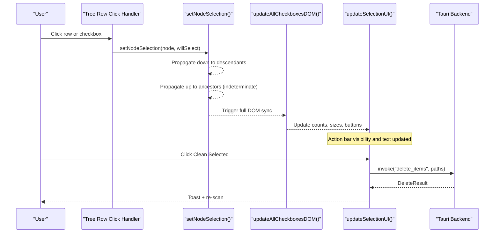
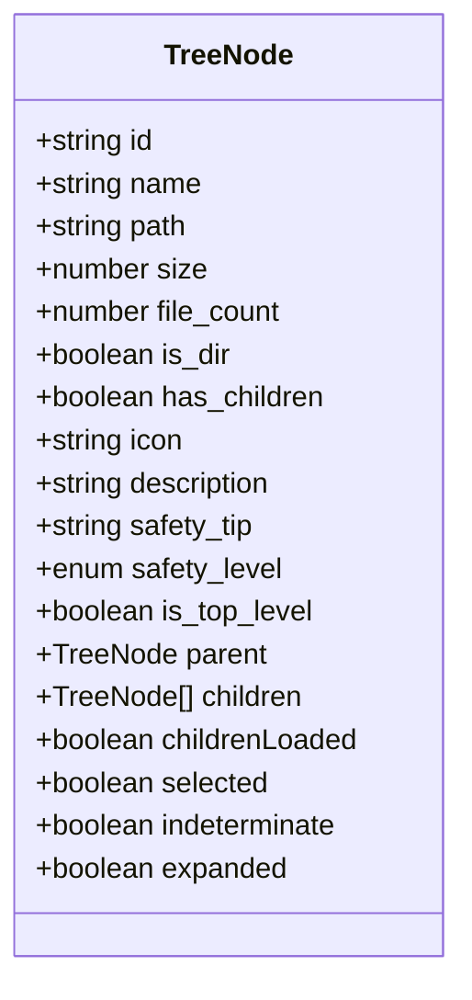
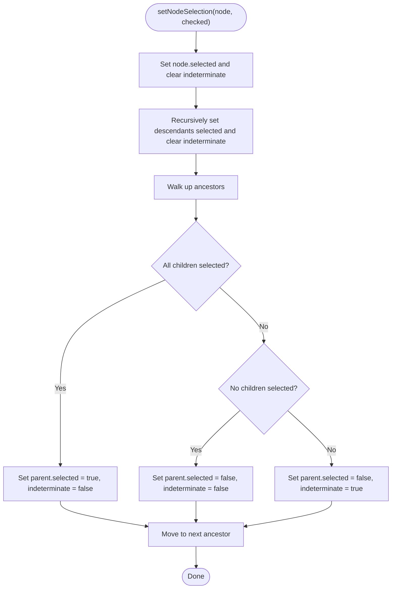
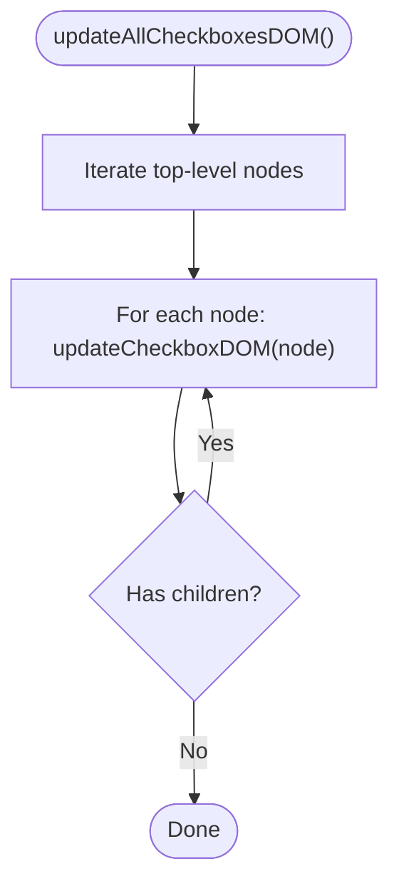
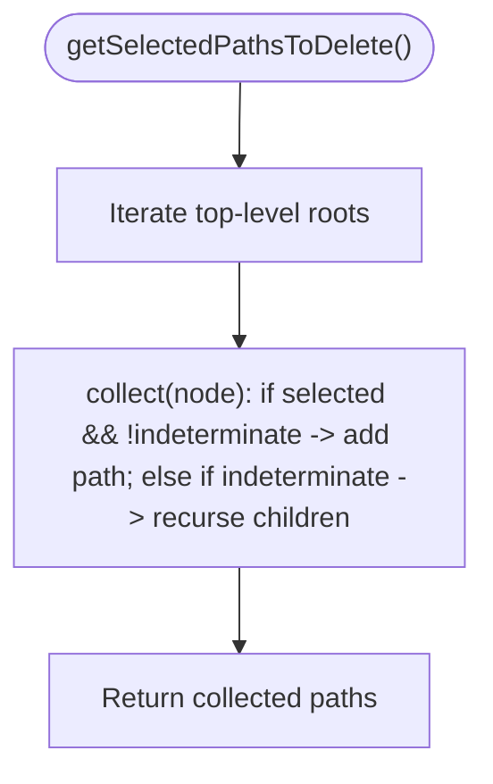
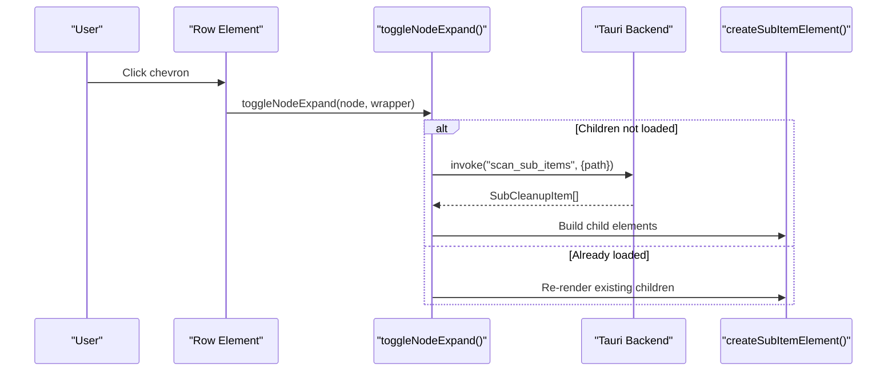
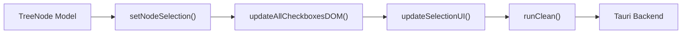

# State Management & Hierarchical Selection

<cite>
**Referenced Files in This Document**
- [main.ts](file://src/main.ts)
</cite>

## Table of Contents
1. [Introduction](#introduction)
2. [Project Structure](#project-structure)
3. [Core Components](#core-components)
4. [Architecture Overview](#architecture-overview)
5. [Detailed Component Analysis](#detailed-component-analysis)
6. [Dependency Analysis](#dependency-analysis)
7. [Performance Considerations](#performance-considerations)
8. [Troubleshooting Guide](#troubleshooting-guide)
9. [Conclusion](#conclusion)

## Introduction
This document explains the frontend state management system for FreeSpaceMacos, focusing on hierarchical tree navigation and selection propagation. It covers:
- The TreeNode interface and parent-child relationship management
- Selection propagation logic with setNodeSelection (downward to descendants and upward to ancestors), including indeterminate states
- UI synchronization via updateAllCheckboxesDOM and updateCheckboxDOM
- Selection calculation methods: getSelectedPathsToDelete, getSelectedSize, getSelectedBreakdown
- Real-world scenarios: partial selections, bulk operations, and real-time UI updates
- Performance considerations for large directory structures and memory management strategies

## Project Structure
The application is a Tauri app where the frontend is implemented in TypeScript within src/main.ts. The backend Rust code is not part of this document’s scope. The frontend manages:
- Data models for scan results and disk usage
- A hierarchical tree model built from scan results
- User interactions for expanding nodes and selecting items
- Synchronization between the model and DOM elements

```mermaid
graph TB
subgraph "Frontend"
TS["TypeScript Logic<br/>src/main.ts"]
DOM["DOM Elements<br/>(checkboxes, rows, action bar)"]
end
subgraph "Tauri Backend"
RS["Rust Commands<br/>(scan_system, delete_items, etc.)"]
end
TS --> |invoke()| RS
RS --> |ScanResult / DeleteResult| TS
TS --> |updateAllCheckboxesDOM()<br/>updateSelectionUI()| DOM
```

**Diagram sources**
- [main.ts:837-896](file://src/main.ts#L837-L896)
- [main.ts:900-941](file://src/main.ts#L900-L941)
- [main.ts:945-1008](file://src/main.ts#L945-L1008)

**Section sources**
- [main.ts:1-120](file://src/main.ts#L1-L120)
- [main.ts:837-896](file://src/main.ts#L837-L896)
- [main.ts:900-941](file://src/main.ts#L900-L941)
- [main.ts:945-1008](file://src/main.ts#L945-L1008)

## Core Components
- TreeNode interface defines the hierarchical node structure, including selection state, expansion state, parent/child links, and metadata such as size and safety level.
- Global arrays safeNodes and reviewNodes hold top-level categories; each category contains child nodes representing directories or files.
- Selection functions manage bidirectional propagation across the tree and keep the DOM synchronized.
- Calculation functions derive actionable data from the current selection state.

Key responsibilities:
- Model construction: renderResults builds TreeNode trees from ScanResult.
- Interaction handling: toggleNodeExpand handles lazy loading and rendering; row click handlers call setNodeSelection.
- UI sync: updateAllCheckboxesDOM and updateCheckboxDOM reflect selected/indeterminate states.
- Aggregation: getSelectedPathsToDelete, getSelectedSize, getSelectedBreakdown compute deletion targets and summaries.

**Section sources**
- [main.ts:59-78](file://src/main.ts#L59-L78)
- [main.ts:87-97](file://src/main.ts#L87-L97)
- [main.ts:270-414](file://src/main.ts#L270-L414)
- [main.ts:470-696](file://src/main.ts#L470-L696)
- [main.ts:700-833](file://src/main.ts#L700-L833)

## Architecture Overview
The selection system follows a clear flow: user interaction triggers state changes, which propagate through the tree and update the UI.



**Diagram sources**
- [main.ts:600-608](file://src/main.ts#L600-L608)
- [main.ts:672-680](file://src/main.ts#L672-L680)
- [main.ts:276-310](file://src/main.ts#L276-L310)
- [main.ts:326-336](file://src/main.ts#L326-L336)
- [main.ts:418-453](file://src/main.ts#L418-L453)
- [main.ts:900-941](file://src/main.ts#L900-L941)

## Detailed Component Analysis

### TreeNode Interface and Parent-Child Relationships
- TreeNode includes fields for identity, display info, hierarchy (parent, children), status flags (selected, indeterminate, expanded), and metadata (size, file_count, safety_level).
- Parent references are established when constructing child nodes, enabling upward propagation during selection changes.
- Children are lazily loaded via toggleNodeExpand, preserving selection state by copying the parent’s selected flag into newly created children.



**Diagram sources**
- [main.ts:59-78](file://src/main.ts#L59-L78)

**Section sources**
- [main.ts:59-78](file://src/main.ts#L59-L78)
- [main.ts:512-528](file://src/main.ts#L512-L528)

### Selection Propagation Logic (setNodeSelection)
- Downward propagation: sets selected and clears indeterminate for all descendants recursively.
- Upward propagation: walks ancestors and computes their state based on children:
  - All children fully selected → parent selected, not indeterminate
  - No children selected → parent unselected, not indeterminate
  - Mixed selection → parent unselected, indeterminate = true



**Diagram sources**
- [main.ts:276-310](file://src/main.ts#L276-L310)

**Section sources**
- [main.ts:276-310](file://src/main.ts#L276-L310)

### UI Synchronization (updateAllCheckboxesDOM and updateCheckboxDOM)
- updateCheckboxDOM maps a single TreeNode to its DOM element using data-node-id and toggles classes for checked, indeterminate, selected, and partial states.
- updateAllCheckboxesDOM traverses all top-level nodes and recursively updates their checkboxes, ensuring consistency after any selection change.



**Diagram sources**
- [main.ts:312-336](file://src/main.ts#L312-L336)

**Section sources**
- [main.ts:312-336](file://src/main.ts#L312-L336)

### Selection Calculation Methods
- getSelectedPathsToDelete: collects paths to delete. If a node is fully selected (not indeterminate), include its path directly; if indeterminate, recurse into children to collect only selected leaves.
- getSelectedSize: sums sizes of fully selected nodes; recurses into indeterminate nodes to aggregate leaf selections.
- getSelectedBreakdown: categorizes selected items into safeItems and reviewItems based on safety_level, recursing into indeterminate nodes.



**Diagram sources**
- [main.ts:338-361](file://src/main.ts#L338-L361)

**Section sources**
- [main.ts:338-361](file://src/main.ts#L338-L361)
- [main.ts:363-383](file://src/main.ts#L363-L383)
- [main.ts:385-414](file://src/main.ts#L385-L414)

### Tree Node Rendering and Expansion
- toggleNodeExpand toggles expanded state, shows/hides children container, and lazily loads sub-items via Tauri invoke("scan_sub_items").
- createSubItemElement and createTopLevelItemElement build DOM rows with chevron, checkbox, metadata, and event listeners that trigger selection changes and UI updates.



**Diagram sources**
- [main.ts:472-558](file://src/main.ts#L472-L558)
- [main.ts:560-624](file://src/main.ts#L560-L624)
- [main.ts:626-696](file://src/main.ts#L626-L696)

**Section sources**
- [main.ts:472-558](file://src/main.ts#L472-L558)
- [main.ts:560-624](file://src/main.ts#L560-L624)
- [main.ts:626-696](file://src/main.ts#L626-L696)

### Example Scenarios

#### Partial Selections
- When some but not all children are selected, parents become indeterminate.
- Indeterminate parents do not contribute their own path to deletion; instead, the algorithm recurses to collect only selected descendants.

Relevant implementation:
- Upward propagation sets indeterminate for mixed states.
- Collection functions skip indeterminate nodes and traverse children.

**Section sources**
- [main.ts:292-310](file://src/main.ts#L292-L310)
- [main.ts:338-361](file://src/main.ts#L338-L361)

#### Bulk Operations
- Select All Safe/Review toggles all top-level nodes in each category, propagating selection down and updating UI.
- The action bar reflects total count and size, enabling bulk cleanup.

Relevant implementation:
- Event listeners for select-all buttons iterate nodes and call setNodeSelection.
- updateSelectionUI computes paths and sizes and updates button text and visibility.

**Section sources**
- [main.ts:982-1004](file://src/main.ts#L982-L1004)
- [main.ts:418-453](file://src/main.ts#L418-L453)

#### Real-Time UI Updates
- After every selection change, updateAllCheckboxesDOM refreshes visual states, and updateSelectionUI recalculates totals and enables/disables the clean button.

Relevant implementation:
- Row click handlers call setNodeSelection, then updateAllCheckboxesDOM and updateSelectionUI.

**Section sources**
- [main.ts:600-608](file://src/main.ts#L600-L608)
- [main.ts:672-680](file://src/main.ts#L672-L680)
- [main.ts:326-336](file://src/main.ts#L326-L336)
- [main.ts:418-453](file://src/main.ts#L418-L453)

## Dependency Analysis
The selection system depends on:
- TreeNode model for state representation
- DOM elements for rendering and user input
- Tauri backend for scanning and deleting items



**Diagram sources**
- [main.ts:276-310](file://src/main.ts#L276-L310)
- [main.ts:326-336](file://src/main.ts#L326-L336)
- [main.ts:418-453](file://src/main.ts#L418-L453)
- [main.ts:900-941](file://src/main.ts#L900-L941)

**Section sources**
- [main.ts:270-414](file://src/main.ts#L270-L414)
- [main.ts:900-941](file://src/main.ts#L900-L941)

## Performance Considerations
- Lazy Loading: Children are fetched on demand via toggleNodeExpand, reducing initial load time and memory footprint for large directory trees.
- DOM Updates: updateAllCheckboxesDOM performs a full traversal; consider batching updates or limiting re-renders to visible nodes for very large trees.
- Memory Management: Each TreeNode holds parent references and children arrays; ensure nodes are removed or dereferenced when categories are refreshed to avoid leaks.
- Computation Efficiency: getSelectedPathsToDelete, getSelectedSize, and getSelectedBreakdown traverse the tree; caching computed aggregates can help if selection state changes frequently without re-rendering.

[No sources needed since this section provides general guidance]

## Troubleshooting Guide
- Indeterminate States Not Reflecting: Verify that updateAllCheckboxesDOM is called after setNodeSelection and that DOM selectors match data-node-id attributes.
- Missing Paths in Deletion: Ensure indeterminate nodes are recursed correctly in getSelectedPathsToDelete; confirm that parent selection does not override child selections unintentionally.
- UI Stale After Bulk Operations: Confirm that select-all handlers call updateAllCheckboxesDOM and updateSelectionUI consistently.
- Backend Errors During Cleanup: Inspect toast messages and console logs; verify that runClean invokes delete_items with correct paths and handles errors gracefully.

**Section sources**
- [main.ts:312-336](file://src/main.ts#L312-L336)
- [main.ts:338-361](file://src/main.ts#L338-L361)
- [main.ts:900-941](file://src/main.ts#L900-L941)

## Conclusion
FreeSpaceMacos implements a robust hierarchical selection system centered around the TreeNode interface. The setNodeSelection function ensures consistent selection propagation both downward and upward, including indeterminate states for partial selections. UI synchronization is handled by updateAllCheckboxesDOM and updateCheckboxDOM, while selection calculations provide accurate data for bulk operations. Lazy loading and careful DOM updates support performance on large directory structures. By following the patterns outlined here, developers can extend and maintain the selection system effectively.

[No sources needed since this section summarizes without analyzing specific files]