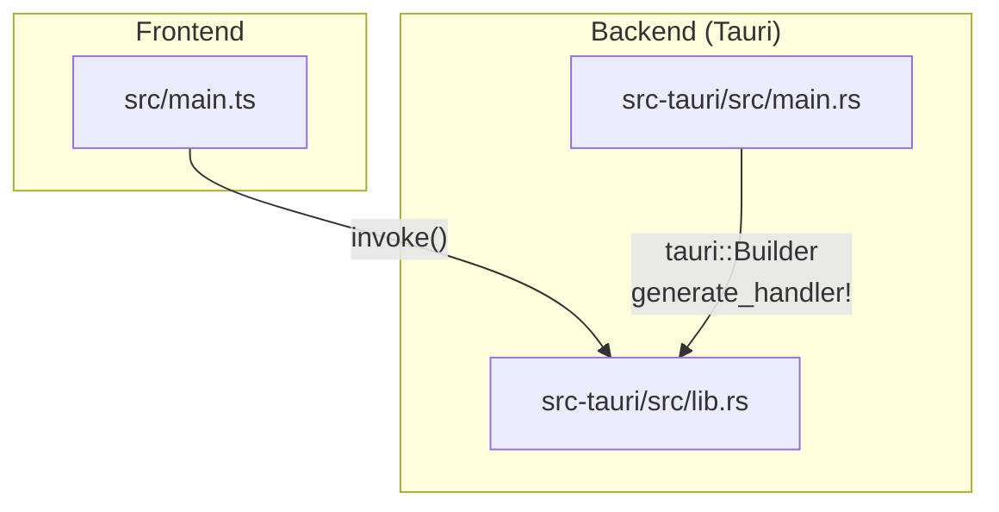
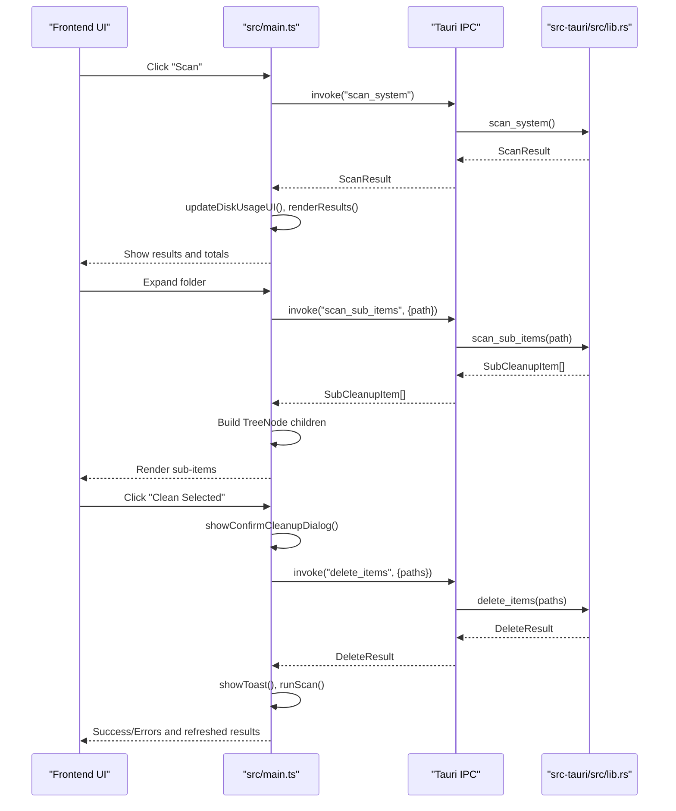
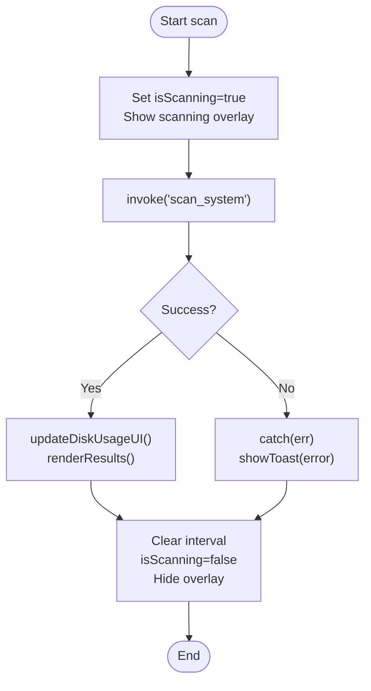
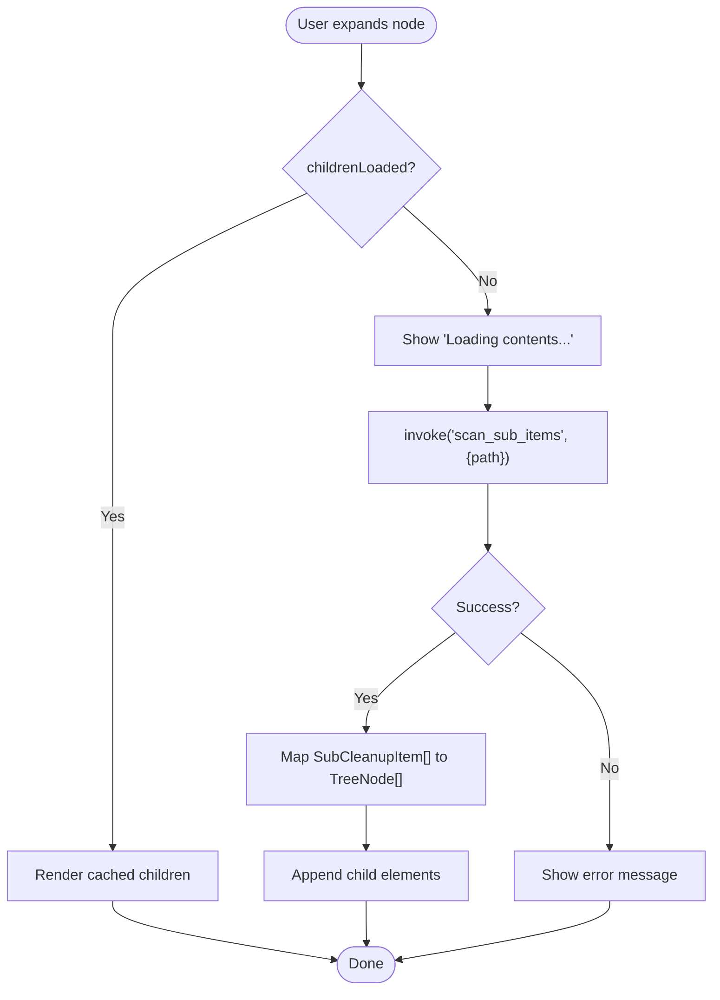
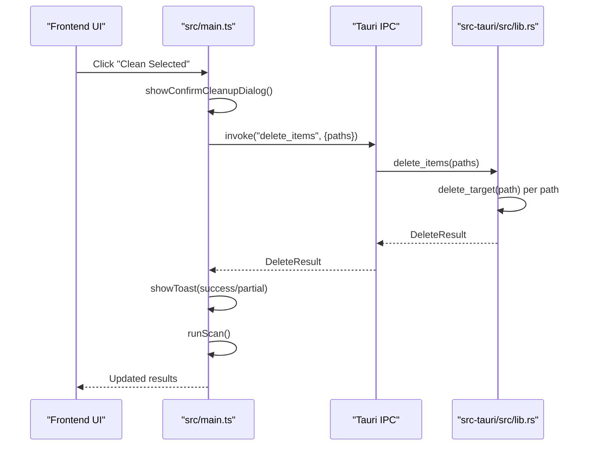
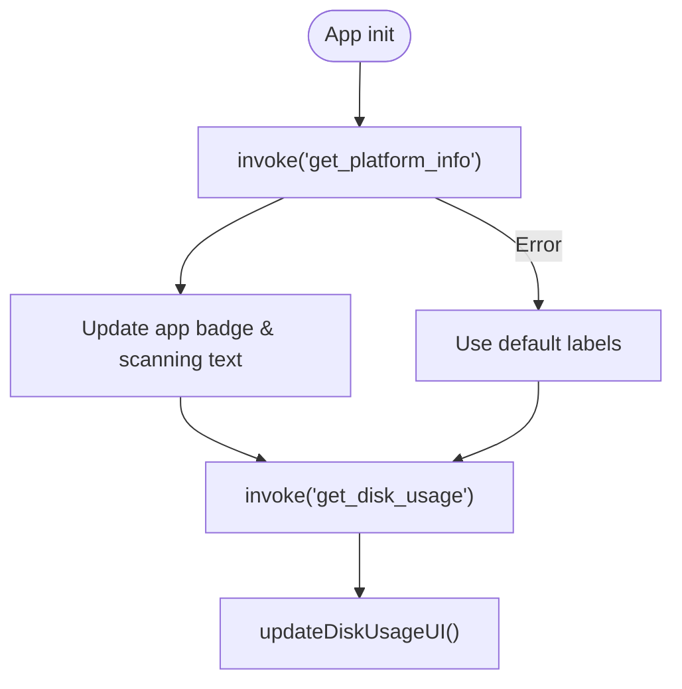
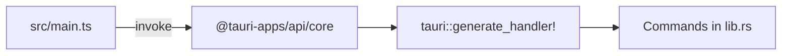

# Tauri Command Integration

<cite>
**Referenced Files in This Document**   
- [main.ts](file://src/main.ts)
- [lib.rs](file://src-tauri/src/lib.rs)
- [main.rs](file://src-tauri/src/main.rs)
- [README.md](file://README.md)
</cite>

## Table of Contents
1. [Introduction](#introduction)
2. [Project Structure](#project-structure)
3. [Core Components](#core-components)
4. [Architecture Overview](#architecture-overview)
5. [Detailed Component Analysis](#detailed-component-analysis)
6. [Dependency Analysis](#dependency-analysis)
7. [Performance Considerations](#performance-considerations)
8. [Troubleshooting Guide](#troubleshooting-guide)
9. [Security Considerations and Best Practices](#security-considerations-and-best-practices)
10. [Conclusion](#conclusion)

## Introduction
This document explains how the FreeSpaceMacos frontend integrates with the Rust backend through Tauri’s IPC layer. It focuses on:
- How the frontend uses `invoke` to call backend commands such as `scan_system`, `scan_sub_items`, and deletion-related operations.
- The TypeScript interfaces that mirror Rust data structures for type safety, including `CleanupItem`, `SubCleanupItem`, `ScanResult`, and `DiskUsage`.
- Error handling strategies around async IPC calls.
- Platform detection and its effect on UI behavior.
- Examples of loading states, data transformation, and safe cleanup workflows.

The project is a macOS-focused storage cleanup app built with Tauri 2, Rust, and TypeScript.

**Section sources**
- [README.md:1-74](file://README.md#L1-L74)

## Project Structure
At a high level:
- Frontend entry point: `src/main.ts`
- Backend library and Tauri commands: `src-tauri/src/lib.rs`
- Application bootstrap: `src-tauri/src/main.rs`

**Diagram sources**
- [main.ts:1-57](file://src/main.ts#L1-L57)
- [lib.rs:1194-1210](file://src-tauri/src/lib.rs#L1194-L1210)
- [main.rs:4-6](file://src-tauri/src/main.rs#L4-L6)

**Section sources**
- [main.ts:1-57](file://src/main.ts#L1-L57)
- [lib.rs:1194-1210](file://src-tauri/src/lib.rs#L1194-L1210)
- [main.rs:4-6](file://src-tauri/src/main.rs#L4-L6)

## Core Components
This section documents the key types and their roles across the IPC boundary.

### Data Types Mirroring Rust Structures
- `SubCleanupItem`: Represents a single file or directory item returned by scanning. Includes identifiers, paths, sizes, file counts, directory flags, and optional nested children.
- `CleanupItem`: Represents a top-level cleanup category with metadata, safety classification, description, tip, file count, existence flag, and child items.
- `DiskUsage`: Aggregates total, used, free space and percentage used.
- `ScanResult`: Combines disk usage with categorized cleanup items and totals.
- `DeleteResult`: Reports success status, deleted count, freed bytes, and error messages.

These TypeScript interfaces align with Rust structs and enums in the backend to ensure consistent serialization and type-safe communication.

**Section sources**
- [main.ts:5-57](file://src/main.ts#L5-L57)
- [lib.rs:8-66](file://src-tauri/src/lib.rs#L8-L66)

### Invoke Usage Patterns
- Scanning system caches and logs:
  - Frontend calls `invoke<ScanResult>("scan_system")` to retrieve categorized cleanup items and disk usage.
- Loading sub-items for directories:
  - Frontend calls `invoke<SubCleanupItem[]>("scan_sub_items", { path })` when expanding a node.
- Deleting selected items:
  - Frontend calls `invoke<DeleteResult>("delete_items", { paths })` after user confirmation.

These patterns are consistently wrapped in try-catch blocks to handle errors gracefully and update UI state accordingly.

**Section sources**
- [main.ts:876-895](file://src/main.ts#L876-L895)
- [main.ts:508-549](file://src/main.ts#L508-L549)
- [main.ts:921-940](file://src/main.ts#L921-L940)

## Architecture Overview
The Tauri command integration follows a clear separation of concerns:
- Frontend handles UI, selection model, and user interactions.
- Backend performs filesystem operations and returns structured results.
- IPC is mediated by Tauri’s `invoke` mechanism.

**Diagram sources**
- [main.ts:876-895](file://src/main.ts#L876-L895)
- [main.ts:508-549](file://src/main.ts#L508-L549)
- [main.ts:921-940](file://src/main.ts#L921-L940)
- [lib.rs:518-852](file://src-tauri/src/lib.rs#L518-L852)
- [lib.rs:408-415](file://src-tauri/src/lib.rs#L408-L415)
- [lib.rs:1164-1190](file://src-tauri/src/lib.rs#L1164-L1190)

## Detailed Component Analysis

### Scan Workflow: `scan_system`
- Purpose: Gather disk usage and categorized cleanup items (safe vs needs review).
- Frontend flow:
  - Set scanning state and show overlay.
  - Call `invoke<ScanResult>("scan_system")`.
  - Update disk usage UI and render results.
  - Handle errors via try-catch and display toast notifications.
- Backend flow:
  - Compute disk usage using platform-specific APIs.
  - Build lists of safe and review items based on predefined locations.
  - Return `ScanResult` with totals and categorized items.

**Diagram sources**
- [main.ts:837-895](file://src/main.ts#L837-L895)
- [lib.rs:518-852](file://src-tauri/src/lib.rs#L518-L852)

**Section sources**
- [main.ts:837-895](file://src/main.ts#L837-L895)
- [lib.rs:518-852](file://src-tauri/src/lib.rs#L518-L852)

### Sub-item Expansion: `scan_sub_items`
- Purpose: Load immediate children of a directory when a user expands a node.
- Frontend flow:
  - Detect expansion and set loading state.
  - Call `invoke<SubCleanupItem[]>("scan_sub_items", { path })`.
  - Transform backend items into frontend `TreeNode` objects.
  - Render children or show empty/error state.
- Backend flow:
  - Expand home paths and validate directory existence.
  - Read directory entries, compute sizes and file counts.
  - Sort by size and return list of `SubCleanupItem`.

**Diagram sources**
- [main.ts:472-558](file://src/main.ts#L472-L558)
- [lib.rs:408-415](file://src-tauri/src/lib.rs#L408-L415)

**Section sources**
- [main.ts:472-558](file://src/main.ts#L472-L558)
- [lib.rs:408-415](file://src-tauri/src/lib.rs#L408-L415)

### Deletion Workflow: `delete_items`
- Purpose: Permanently remove selected files/directories and report outcomes.
- Frontend flow:
  - Collect selected paths and compute breakdown.
  - Confirm with user via dialog.
  - Call `invoke<DeleteResult>("delete_items", { paths })`.
  - Display success or partial failure messages; refresh scan results.
- Backend flow:
  - Iterate over provided paths.
  - For each path, determine if it is a category root, file/symlink, or directory.
  - Use resilient deletion logic to collect freed bytes and count deletions.
  - Aggregate errors and return `DeleteResult`.

**Diagram sources**
- [main.ts:900-940](file://src/main.ts#L900-L940)
- [lib.rs:1164-1190](file://src-tauri/src/lib.rs#L1164-L1190)
- [lib.rs:308-331](file://src-tauri/src/lib.rs#L308-L331)

**Section sources**
- [main.ts:900-940](file://src/main.ts#L900-L940)
- [lib.rs:1164-1190](file://src-tauri/src/lib.rs#L1164-L1190)
- [lib.rs:308-331](file://src-tauri/src/lib.rs#L308-L331)

### Platform Detection and UI Behavior
- Frontend:
  - Calls `invoke<PlatformInfo>("get_platform_info")` at startup.
  - Updates app badge text and scanning status copy based on OS.
  - Falls back to defaults if platform info retrieval fails.
- Backend:
  - Provides `get_platform_info` returning OS name and disk label.
  - Uses conditional compilation to tailor platform-specific values.

**Diagram sources**
- [main.ts:945-970](file://src/main.ts#L945-L970)
- [lib.rs:854-894](file://src-tauri/src/lib.rs#L854-L894)

**Section sources**
- [main.ts:945-970](file://src/main.ts#L945-L970)
- [lib.rs:854-894](file://src-tauri/src/lib.rs#L854-L894)

## Dependency Analysis
The frontend depends on Tauri’s core API to invoke backend commands. The backend exposes commands via Tauri’s handler generation.

**Diagram sources**
- [main.ts:1-1](file://src/main.ts#L1-L1)
- [lib.rs:1194-1210](file://src-tauri/src/lib.rs#L1194-L1210)

**Section sources**
- [main.ts:1-1](file://src/main.ts#L1-L1)
- [lib.rs:1194-1210](file://src-tauri/src/lib.rs#L1194-L1210)

## Performance Considerations
- Avoid redundant scans:
  - Reuse previously scanned results where possible.
  - Debounce repeated expansions if needed.
- Efficient sub-item loading:
  - Only load immediate children when nodes expand.
  - Cache loaded children in memory (`childrenLoaded` flag).
- Large directory traversal:
  - Backend limits recursion depth and filters hidden/system directories.
- UI responsiveness:
  - Use loading overlays and status updates during long-running scans.
  - Keep UI updates minimal after receiving results.

[No sources needed since this section provides general guidance]

## Troubleshooting Guide
Common issues and resolutions:
- Scan failures:
  - Ensure backend has permissions to read directories.
  - Check network-independent operations; no external dependencies required.
  - Inspect console logs for error messages from try-catch blocks.
- Sub-item loading errors:
  - Verify path validity and existence.
  - Confirm backend returns an empty array for non-existent paths.
- Deletion errors:
  - Some paths may require elevated privileges.
  - Review aggregated error messages in `DeleteResult.errors`.
  - After partial failures, re-run scan to reflect current state.

**Section sources**
- [main.ts:884-886](file://src/main.ts#L884-L886)
- [main.ts:542-549](file://src/main.ts#L542-L549)
- [main.ts:934-936](file://src/main.ts#L934-L936)
- [lib.rs:1164-1190](file://src-tauri/src/lib.rs#L1164-L1190)

## Security Considerations and Best Practices
- Least privilege:
  - Restrict backend commands to only necessary filesystem paths.
  - Validate and sanitize input paths before processing.
- Safe defaults:
  - Classify potentially risky deletions under “NeedsReview” and require explicit user confirmation.
- Error transparency:
  - Surface actionable error messages to users without exposing sensitive internal details.
- IPC security:
  - Limit exposed commands to those defined in the handler.
  - Avoid passing arbitrary user-controlled paths directly to destructive operations without validation.
- Platform differences:
  - Use conditional compilation to apply platform-specific behaviors safely.
  - Provide fallbacks for unsupported platforms.

[No sources needed since this section provides general guidance]

## Conclusion
FreeSpaceMacos demonstrates a robust Tauri IPC integration pattern:
- Clear separation between frontend UI logic and backend filesystem operations.
- Type-safe data exchange using aligned TypeScript interfaces and Rust structs.
- Comprehensive error handling and user feedback mechanisms.
- Platform-aware behavior ensuring consistent UX across macOS and Windows.

By following these patterns, developers can extend the application with new commands while maintaining safety, clarity, and performance.

[No sources needed since this section summarizes without analyzing specific files]