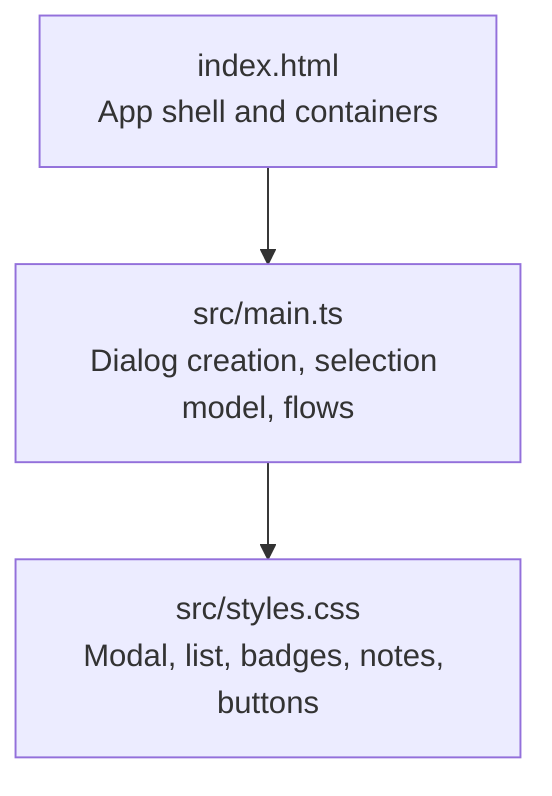
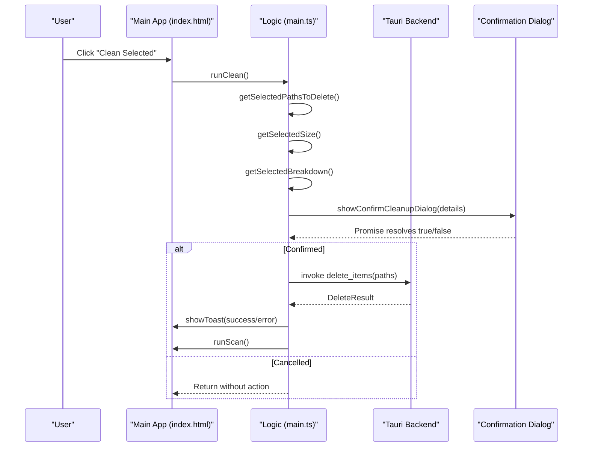
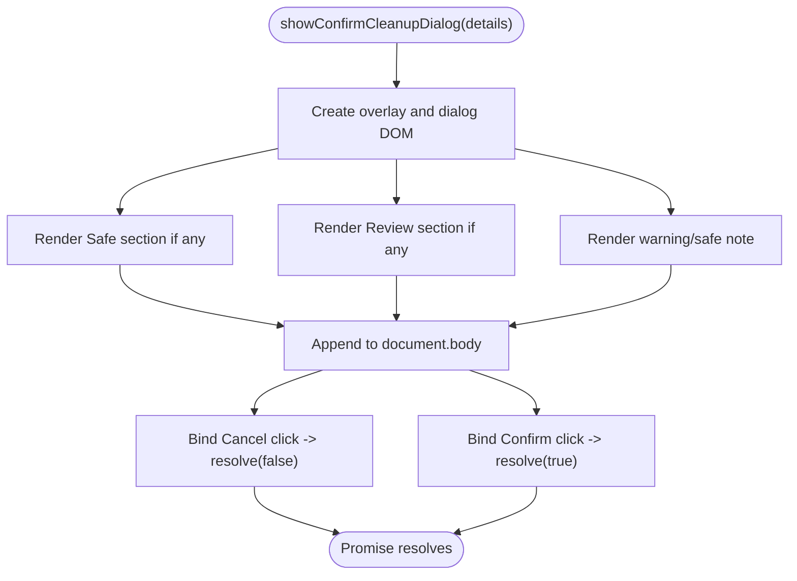
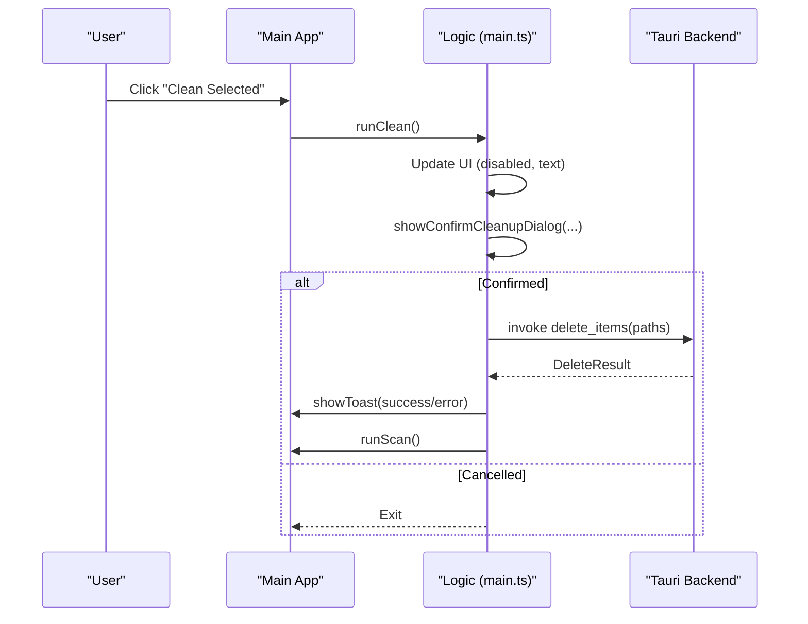
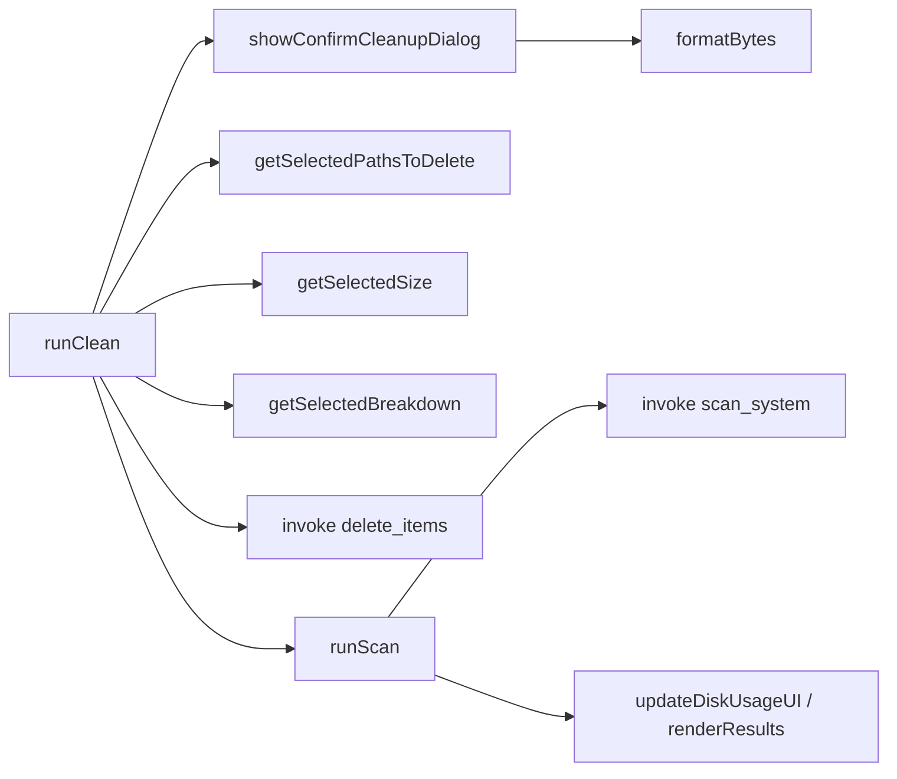

# Confirmation Dialogs

<cite>
**Referenced Files in This Document**
- [main.ts](file://src/main.ts)
- [styles.css](file://src/styles.css)
- [index.html](file://index.html)
</cite>

## Table of Contents
1. [Introduction](#introduction)
2. [Project Structure](#project-structure)
3. [Core Components](#core-components)
4. [Architecture Overview](#architecture-overview)
5. [Detailed Component Analysis](#detailed-component-analysis)
6. [Dependency Analysis](#dependency-analysis)
7. [Performance Considerations](#performance-considerations)
8. [Troubleshooting Guide](#troubleshooting-guide)
9. [Conclusion](#conclusion)

## Introduction
This document explains the confirmation dialog system used to safely perform disk cleanup operations. It focuses on how the dialog presents safety classifications (Safe vs Needs Review), how users interact with it, how progress and errors are handled, and how dynamic content is generated from selected items. It also covers modal presentation, backdrop behavior, keyboard navigation considerations, responsive design, and security aspects for destructive actions.

## Project Structure
The confirmation dialog is implemented as a lightweight overlay rendered into the DOM when the user initiates cleanup. The UI structure is defined in the HTML shell, while the logic and styling live in TypeScript and CSS files.

**Diagram sources**
- [index.html:1-141](file://index.html#L1-L141)
- [main.ts:146-243](file://src/main.ts#L146-L243)
- [styles.css:987-1174](file://src/styles.css#L987-L1174)

**Section sources**
- [index.html:1-141](file://index.html#L1-L141)
- [main.ts:146-243](file://src/main.ts#L146-L243)
- [styles.css:987-1174](file://src/styles.css#L987-L1174)

## Core Components
- showConfirmCleanupDialog: Creates and renders the confirmation modal, populates safe/review sections, and returns a Promise<boolean] resolved by Cancel or Confirm.
- runClean: Orchestrates cleanup flow—collects selected paths, computes sizes, shows the confirmation dialog, invokes backend deletion, and refreshes results.
- Selection utilities: getSelectedPathsToDelete, getSelectedSize, getSelectedBreakdown compute what will be deleted and how much space can be reclaimed.
- Toast notifications: Provide success/error/info feedback after scan/clean operations.

Key responsibilities:
- Safety classification display: Separate Safe and Needs Review groups with totals and itemized lists.
- User interaction: Cancel/Confirm actions; disabled state management during operations.
- Progress feedback: Scanning and cleaning states update UI text and disable controls.
- Error handling: Errors from backend calls surface via toast messages and console logs.

**Section sources**
- [main.ts:146-243](file://src/main.ts#L146-L243)
- [main.ts:900-941](file://src/main.ts#L900-L941)
- [main.ts:338-414](file://src/main.ts#L338-L414)
- [main.ts:123-142](file://src/main.ts#L123-L142)

## Architecture Overview
The confirmation dialog integrates with the main application flow:

**Diagram sources**
- [main.ts:900-941](file://src/main.ts#L900-L941)
- [main.ts:146-243](file://src/main.ts#L146-L243)

## Detailed Component Analysis

### Confirmation Dialog Implementation
The dialog is dynamically created and appended to the document body. It includes:
- A header and a highlighted reclaimable space card.
- Two grouped sections: Safe to Clean and Needs Review, each with a group badge showing total size and an explanatory subtitle.
- An itemized list per group with name and formatted size.
- A contextual note that changes based on whether any review items are present.
- Footer text indicating the number of items/folders to be removed.
- Action buttons: Cancel and Confirm.

**Diagram sources**
- [main.ts:146-243](file://src/main.ts#L146-L243)

#### Safety Classification Display
- Safe items: Grouped under a green-labeled section with a badge showing total size and a subtitle explaining that these are temporary caches/logs automatically recreated by the system.
- Needs Review items: Grouped under an amber-labeled section with a badge and subtitle describing build artifacts, simulators, downloads, AI models, etc., which may need reinstallation or rebuilding.
- Contextual note: If review items exist, a warning note appears advising users to unselect important files before deletion. Otherwise, a safe note reassures users that all selected items are safe.

Visual indicators:
- Group badges use color-coded labels (green for Safe, amber for Needs Review).
- Item rows show file names and sizes.
- Highlight card prominently displays the total reclaimable space.

**Section sources**
- [main.ts:146-243](file://src/main.ts#L146-L243)
- [styles.css:1073-1121](file://src/styles.css#L1073-L1121)
- [styles.css:1123-1140](file://src/styles.css#L1123-L1140)
- [styles.css:1272-1298](file://src/styles.css#L1272-L1298)

#### User Interaction Patterns
- Cancel: Removes the overlay and resolves the promise with false, aborting cleanup.
- Confirm: Removes the overlay and resolves the promise with true, proceeding to deletion.
- Disabled states: During scanning or deleting, the clean button is disabled and its label updates to reflect progress.

Keyboard navigation support:
- The current implementation does not include explicit focus trapping, Escape key handling, or tab order management within the dialog. Keyboard accessibility should be enhanced by adding focus management and Escape-to-cancel behavior.

Backdrop handling:
- The overlay uses a fixed-position backdrop with blur and semi-transparent background. There is no built-in handler to close the dialog by clicking the backdrop; only the Cancel and Confirm buttons trigger closure.

Responsive design:
- The dialog container has max-width and width constraints, and the list container scrolls vertically. Responsive styles adjust layout at smaller screen widths.

Security considerations:
- The dialog clearly communicates the destructive nature of the operation and separates safe vs risky items.
- Users must explicitly confirm before deletion occurs.
- For improved security UX, consider additional confirmation steps (e.g., typing a keyword) when review items are included.

**Section sources**
- [main.ts:146-243](file://src/main.ts#L146-L243)
- [styles.css:987-1174](file://src/styles.css#L987-L1174)
- [styles.css:1176-1188](file://src/styles.css#L1176-L1188)

### Cleanup Flow and Progress Feedback
The cleanup flow coordinates UI states and backend operations:

Progress feedback:
- Scanning: Shows a scanning overlay with rotating status messages and disables the scan button.
- Cleaning: Disables the clean button and updates its text to indicate ongoing work.
- Results: After successful cleanup, the app re-scans and refreshes disk usage and results.

Error handling:
- Scan errors: Caught and displayed via toast with error type.
- Clean errors: Caught and displayed via toast with error type; partial successes still refresh results.

**Section sources**
- [main.ts:837-896](file://src/main.ts#L837-L896)
- [main.ts:900-941](file://src/main.ts#L900-L941)

### Dynamic Content Generation and Summaries
- Selected paths: Computed by traversing the tree and collecting fully selected nodes or recursing through indeterminate nodes.
- Size calculation: Aggregates sizes of selected nodes similarly to path collection.
- Breakdown: Separates selected items into safe and review categories with their respective sizes and paths.
- Summary UI: Updates selected count and total size in the action bar; toggles visibility based on selections.

Complexity:
- Path and size collection traverse the tree once per operation; time complexity is O(N) where N is the number of nodes visited.
- Breakdown computation is also O(N) due to single traversal.

Optimization opportunities:
- Cache computed totals and counts when selection changes incrementally rather than recomputing from scratch.
- Debounce heavy computations if many nodes are updated rapidly.

**Section sources**
- [main.ts:338-414](file://src/main.ts#L338-L414)
- [main.ts:418-468](file://src/main.ts#L418-L468)

### Modal Presentation and Styling
- Overlay: Fixed position, full-screen, with backdrop blur and fade-in animation.
- Dialog box: Centered, constrained width, scrollable list area, styled header, highlight card, grouped sections, footer text, and action buttons.
- Buttons: Cancel is subtle; Confirm uses a gradient red style with hover effects.
- Accessibility: Missing focus trap and Escape handling; consider adding these for better keyboard navigation.

Responsive adaptations:
- Dialog width adapts to viewport with percentage width and max-width.
- List container scrolls vertically to accommodate long item lists.
- Media queries adjust layout for small screens.

**Section sources**
- [styles.css:987-1174](file://src/styles.css#L987-L1174)
- [styles.css:1176-1188](file://src/styles.css#L1176-L1188)

## Dependency Analysis
The confirmation dialog depends on:
- Selection model functions to compute what will be deleted.
- Formatting utilities to display human-readable sizes.
- Toast system for feedback.
- Backend Tauri commands for scanning and deletion.

**Diagram sources**
- [main.ts:146-243](file://src/main.ts#L146-L243)
- [main.ts:338-414](file://src/main.ts#L338-L414)
- [main.ts:837-896](file://src/main.ts#L837-L896)
- [main.ts:900-941](file://src/main.ts#L900-L941)

**Section sources**
- [main.ts:146-243](file://src/main.ts#L146-L243)
- [main.ts:338-414](file://src/main.ts#L338-L414)
- [main.ts:837-896](file://src/main.ts#L837-L896)
- [main.ts:900-941](file://src/main.ts#L900-L941)

## Performance Considerations
- Tree traversal for selection and breakdown is linear in the number of nodes; ensure large trees are paginated or lazily loaded where possible.
- Avoid unnecessary DOM rebuilds by updating only changed elements.
- Debounce rapid selection changes to reduce repeated calculations.
- Use efficient string formatting and avoid excessive allocations in tight loops.

[No sources needed since this section provides general guidance]

## Troubleshooting Guide
Common issues and resolutions:
- Dialog does not close on backdrop click: Add a click handler on the overlay to cancel the operation.
- Keyboard navigation not supported: Implement focus trapping inside the dialog and handle Escape to cancel.
- No visual feedback during long operations: Ensure scanning and cleaning states update UI promptly and provide clear status messages.
- Errors not surfaced to user: Verify toast notifications are triggered on both success and failure branches.

Operational checks:
- Confirm that getSelectedPathsToDelete returns expected paths.
- Validate getSelectedSize matches the sum of individual item sizes.
- Ensure getSelectedBreakdown correctly categorizes items by safety level.

**Section sources**
- [main.ts:123-142](file://src/main.ts#L123-L142)
- [main.ts:837-896](file://src/main.ts#L837-L896)
- [main.ts:900-941](file://src/main.ts#L900-L941)

## Conclusion
The confirmation dialog provides a clear, safety-focused interface for destructive cleanup operations. It separates safe and review items, displays totals and itemized details, and guides users through consent before deletion. While the current implementation lacks some accessibility features like focus trapping and Escape handling, it offers solid foundations for safe user interactions. Enhancements should prioritize keyboard navigation, backdrop dismissal, and incremental performance optimizations for large datasets.

[No sources needed since this section summarizes without analyzing specific files]