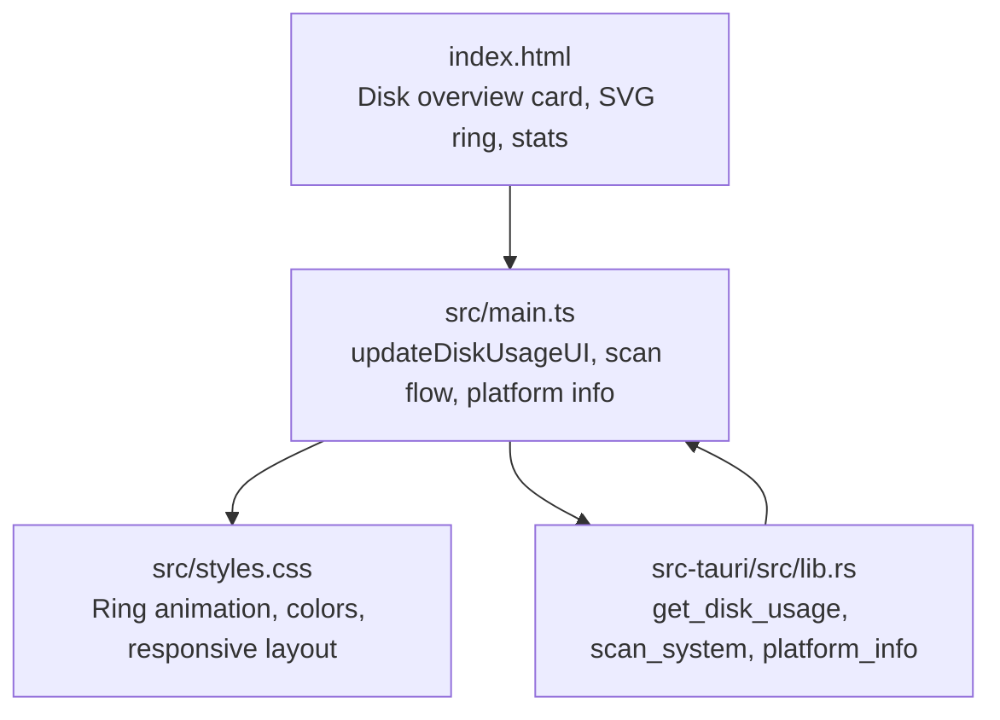
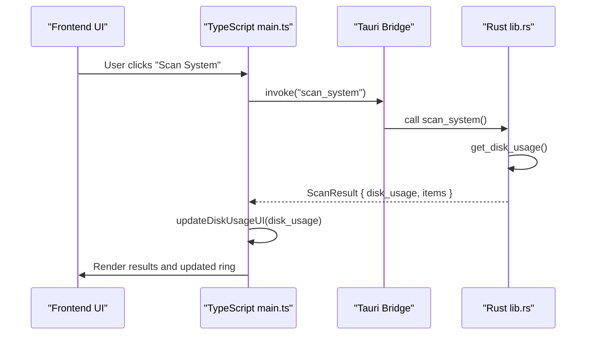
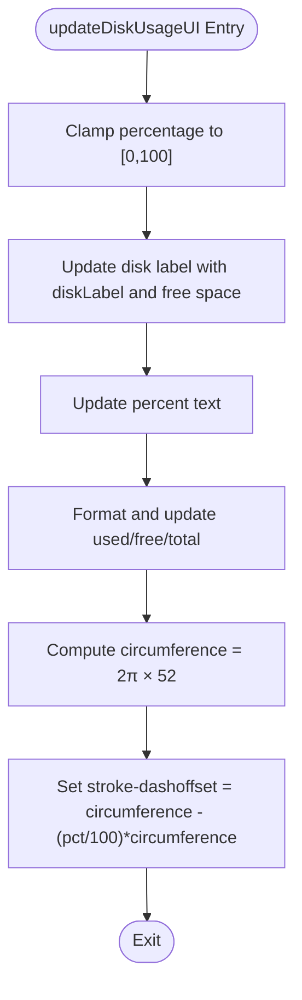
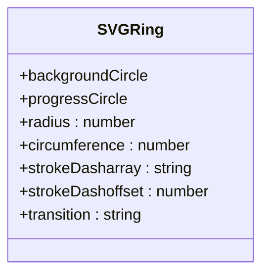
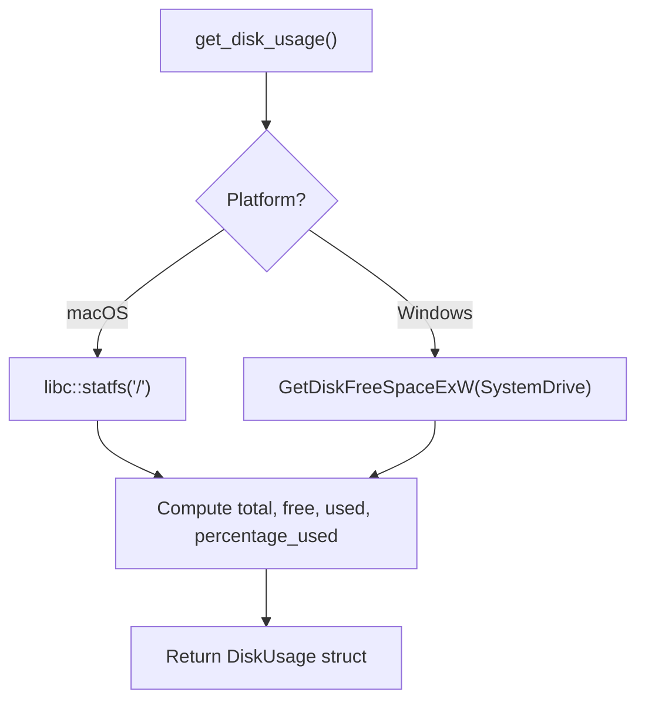
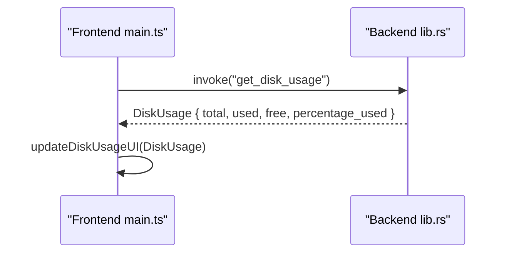
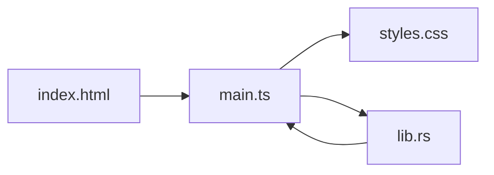

# Disk Usage Visualization

<cite>
**Referenced Files in This Document**
- [index.html](file://index.html)
- [main.ts](file://src/main.ts)
- [styles.css](file://src/styles.css)
- [lib.rs](file://src-tauri/src/lib.rs)
- [README.md](file://README.md)
</cite>

## Table of Contents
1. [Introduction](#introduction)
2. [Project Structure](#project-structure)
3. [Core Components](#core-components)
4. [Architecture Overview](#architecture-overview)
5. [Detailed Component Analysis](#detailed-component-analysis)
6. [Dependency Analysis](#dependency-analysis)
7. [Performance Considerations](#performance-considerations)
8. [Troubleshooting Guide](#troubleshooting-guide)
9. [Conclusion](#conclusion)

## Introduction
This document explains the disk usage visualization system used by the FreeSpace application. It focuses on:
- The frontend `updateDiskUsageUI` function that updates labels, statistics, and an SVG ring progress indicator.
- Real-time disk space monitoring via the Tauri backend command `get_disk_usage`.
- Percentage calculations, data binding between backend metrics and frontend visuals, and responsive scaling.
- Cross-platform differences for macOS and Windows, including disk label detection and storage unit formatting.
- Performance optimizations for frequent updates and accessibility considerations for data representation.

The app is a Tauri 2 desktop application with a Rust backend and a TypeScript/HTML/CSS frontend.

**Section sources**
- [README.md:1-74](file://README.md#L1-L74)

## Project Structure
The disk usage visualization spans both frontend and backend layers:
- Frontend HTML defines the disk overview card, SVG ring, percentage text, and stat values.
- Frontend TypeScript handles UI updates, platform info retrieval, scanning workflow, and data binding.
- Backend Rust implements platform-specific disk usage queries and exposes them through Tauri commands.
- CSS styles define the visual appearance, animations, and responsive behavior of the ring and stats.

**Diagram sources**
- [index.html:25-57](file://index.html#L25-L57)
- [main.ts:247-268](file://src/main.ts#L247-L268)
- [styles.css:170-208](file://src/styles.css#L170-L208)
- [lib.rs:335-406](file://src-tauri/src/lib.rs#L335-L406)

**Section sources**
- [index.html:25-57](file://index.html#L25-L57)
- [main.ts:247-268](file://src/main.ts#L247-L268)
- [styles.css:170-208](file://src/styles.css#L170-L208)
- [lib.rs:335-406](file://src-tauri/src/lib.rs#L335-L406)

## Core Components
- `updateDiskUsageUI(usage: DiskUsage)` updates:
  - Disk label with available space.
  - Percentage text.
  - Used, free, and total bytes formatted to human-readable units.
  - SVG ring progress using stroke-dashoffset based on percentage.
- `get_disk_usage()` (Tauri command) returns platform-specific disk statistics:
  - macOS uses libc `statfs`.
  - Windows uses Win32 `GetDiskFreeSpaceExW`.
- Platform info (`get_platform_info`) provides OS name and disk label for UI adaptation.
- Scan workflow invokes `scan_system`, which includes disk usage and cleanup categories; after scan, `updateDiskUsageUI` is called with the returned disk usage.

Key responsibilities:
- Data acquisition: backend computes total, used, free, and percentage_used.
- Data binding: frontend formats and renders metrics into DOM elements.
- Visual feedback: SVG ring animates smoothly to reflect current usage.

**Section sources**
- [main.ts:247-268](file://src/main.ts#L247-L268)
- [lib.rs:335-406](file://src-tauri/src/lib.rs#L335-L406)
- [lib.rs:854-894](file://src-tauri/src/lib.rs#L854-L894)
- [main.ts:945-970](file://src/main.ts#L945-L970)
- [main.ts:837-896](file://src/main.ts#L837-L896)

## Architecture Overview
The disk usage visualization follows a clear request-response pattern between frontend and backend:

**Diagram sources**
- [main.ts:837-896](file://src/main.ts#L837-L896)
- [lib.rs:518-852](file://src-tauri/src/lib.rs#L518-L852)
- [lib.rs:896-1162](file://src-tauri/src/lib.rs#L896-L1162)
- [lib.rs:335-406](file://src-tauri/src/lib.rs#L335-L406)

## Detailed Component Analysis

### updateDiskUsageUI Function
Responsibilities:
- Clamp percentage to [0, 100].
- Update disk label with platform disk label and available space.
- Format and display used/free/total values.
- Compute SVG circumference and set stroke-dashoffset to visualize percentage.

Data binding:
- Reads from DOM elements by ID: disk-label, disk-percent, stat-used, stat-free, stat-total, ring-progress.
- Uses formatBytes utility for consistent unit conversion across all displayed sizes.

SVG ring mechanics:
- Radius is 52; circumference = 2π × 52.
- stroke-dasharray is set in CSS to full circumference.
- stroke-dashoffset is animated via CSS transition to create smooth progress.

Accessibility:
- The percentage text element provides screen-reader-friendly numeric information alongside the visual ring.
- Labels and stat dots are paired with descriptive text for clarity.

**Diagram sources**
- [main.ts:247-268](file://src/main.ts#L247-L268)
- [styles.css:188-197](file://src/styles.css#L188-L197)

**Section sources**
- [main.ts:247-268](file://src/main.ts#L247-L268)
- [index.html:32-38](file://index.html#L32-L38)
- [styles.css:170-208](file://src/styles.css#L170-L208)

### SVG Ring Progress Indicator
Visual design:
- Two circles: background ring and progress ring.
- Background ring uses a neutral color; progress ring uses an accent color with rounded linecap.
- CSS sets stroke-dasharray to full circumference and applies a smooth cubic-bezier transition for dashoffset changes.

Responsive scaling:
- The container is sized at 100px width/height; the SVG scales proportionally within it.
- On small screens, the stats stack vertically for better readability.

Animations:
- Transition duration and easing provide a fluid feel when percentage changes frequently.

**Diagram sources**
- [index.html:33-36](file://index.html#L33-L36)
- [styles.css:176-197](file://src/styles.css#L176-L197)

**Section sources**
- [index.html:33-36](file://index.html#L33-L36)
- [styles.css:176-197](file://src/styles.css#L176-L197)

### Real-Time Disk Space Monitoring and Percentage Calculations
Backend implementation:
- macOS path:
  - Uses libc `statfs` to read block size and block counts.
  - Computes total, free, used, and percentage_used.
- Windows path:
  - Uses Win32 `GetDiskFreeSpaceExW` to retrieve available, total, and total free bytes.
  - Computes used and percentage_used similarly.

Percentage calculation:
- percentage_used = (used / total) × 100 if total > 0; otherwise 0.

Integration with frontend:
- Initial load calls `get_disk_usage` and updates UI immediately.
- After each scan, `scan_system` returns disk_usage, which is passed to `updateDiskUsageUI`.

**Diagram sources**
- [lib.rs:335-406](file://src-tauri/src/lib.rs#L335-L406)

**Section sources**
- [lib.rs:335-406](file://src-tauri/src/lib.rs#L335-L406)
- [main.ts:945-970](file://src/main.ts#L945-L970)
- [main.ts:837-896](file://src/main.ts#L837-L896)

### Color-Coded Status Indicators
Current implementation:
- The ring uses CSS variables for background and progress colors.
- Stat dots use distinct colors for used, free, and total.
- No explicit threshold-based color switching is implemented in the code analyzed.

Recommendations:
- Introduce thresholds (e.g., green < 60%, yellow 60–85%, red > 85%) and update CSS classes or variables dynamically in `updateDiskUsageUI`.
- Ensure contrast ratios meet accessibility guidelines for color-blind users.

**Section sources**
- [styles.css:182-197](file://src/styles.css#L182-L197)
- [styles.css:221-229](file://src/styles.css#L221-L229)

### Integration with get_disk_usage Tauri Command
Flow:
- Frontend invokes `get_disk_usage` during initial load and optionally refreshes after cleanup.
- Backend returns a structured object with total, used, free, and percentage_used.
- Frontend binds these values to DOM elements and updates the SVG ring.

**Diagram sources**
- [main.ts:965-970](file://src/main.ts#L965-L970)
- [lib.rs:335-406](file://src-tauri/src/lib.rs#L335-L406)

**Section sources**
- [main.ts:965-970](file://src/main.ts#L965-L970)
- [lib.rs:335-406](file://src-tauri/src/lib.rs#L335-L406)

### Data Binding Between Backend Metrics and Frontend Visualization
Binding points:
- Disk label: combines platform disk label and formatted free space.
- Percent text: displays integer percentage.
- Stats: used/free/total formatted via formatBytes.
- SVG ring: stroke-dashoffset computed from percentage.

Formatting:
- formatBytes converts bytes to human-readable units (B, KB, MB, GB, TB, PB).

**Section sources**
- [main.ts:100-107](file://src/main.ts#L100-L107)
- [main.ts:247-268](file://src/main.ts#L247-L268)

### Cross-Platform Differences in Disk Label Detection
Platform info:
- macOS: disk_label is "Macintosh HD".
- Windows: disk_label is "Local Disk (X:)" where X is the system drive letter.
- Other platforms: generic "Disk".

Frontend adaptation:
- Badge text switches between "macOS Cleaner" and "Windows Cleaner".
- Scanning status messages adapt per platform.

**Section sources**
- [lib.rs:854-894](file://src-tauri/src/lib.rs#L854-L894)
- [main.ts:945-970](file://src/main.ts#L945-L970)

### Storage Unit Conversions
formatBytes:
- Converts raw byte counts into readable strings with appropriate units.
- Handles zero bytes and decimal precision.

Usage:
- Applied consistently across disk label, stats, selection totals, and confirmation dialogs.

**Section sources**
- [main.ts:100-107](file://src/main.ts#L100-L107)
- [main.ts:418-453](file://src/main.ts#L418-L453)

## Dependency Analysis
Component relationships:
- index.html defines the DOM structure consumed by main.ts.
- main.ts orchestrates Tauri invocations and updates the DOM and SVG.
- styles.css provides styling and animations for the ring and stats.
- lib.rs exposes Tauri commands used by main.ts.

**Diagram sources**
- [index.html:25-57](file://index.html#L25-L57)
- [main.ts:247-268](file://src/main.ts#L247-L268)
- [styles.css:170-208](file://src/styles.css#L170-L208)
- [lib.rs:335-406](file://src-tauri/src/lib.rs#L335-L406)

**Section sources**
- [index.html:25-57](file://index.html#L25-L57)
- [main.ts:247-268](file://src/main.ts#L247-L268)
- [styles.css:170-208](file://src/styles.css#L170-L208)
- [lib.rs:335-406](file://src-tauri/src/lib.rs#L335-L406)

## Performance Considerations
- Frequent updates:
  - The SVG ring uses CSS transitions; avoid excessive reflows by batching DOM updates.
  - Debounce or throttle repeated scans if real-time polling is introduced.
- Formatting overhead:
  - Reuse formatBytes results where possible to reduce redundant computations.
- SVG rendering:
  - Keep radius constant; only change stroke-dashoffset to minimize repaints.
- Network/backend calls:
  - Avoid invoking `get_disk_usage` too often; rely on scan-driven updates.

[No sources needed since this section provides general guidance]

## Troubleshooting Guide
Common issues:
- SVG ring not updating:
  - Verify ring-progress element exists and has correct radius.
  - Check that stroke-dasharray matches circumference and stroke-dashoffset is being set.
- Incorrect percentages:
  - Ensure percentage_used is clamped to [0,100].
  - Confirm backend total > 0 before computing percentage.
- Platform label mismatch:
  - Validate get_platform_info returns expected disk_label for the target OS.
- Formatting anomalies:
  - Confirm formatBytes handles zero and large values correctly.

**Section sources**
- [main.ts:247-268](file://src/main.ts#L247-L268)
- [lib.rs:335-406](file://src-tauri/src/lib.rs#L335-L406)
- [lib.rs:854-894](file://src-tauri/src/lib.rs#L854-L894)

## Conclusion
The disk usage visualization system integrates a robust backend query mechanism with a responsive, animated SVG ring on the frontend. The `updateDiskUsageUI` function cleanly binds backend metrics to user-facing elements, while platform-specific logic ensures accurate disk statistics and labels across macOS and Windows. With careful attention to performance and accessibility, the system delivers a smooth and informative experience for monitoring disk space.

[No sources needed since this section summarizes without analyzing specific files]