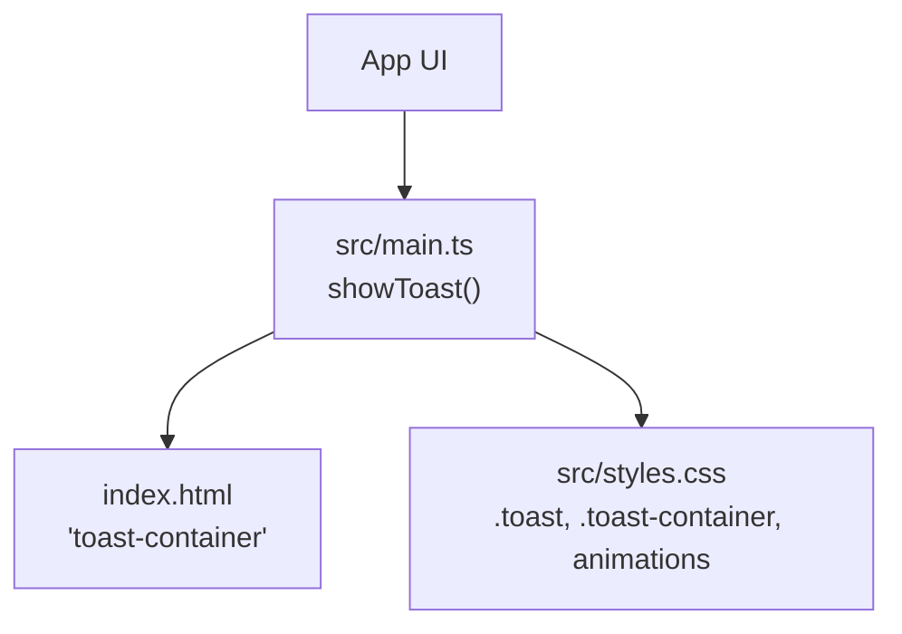
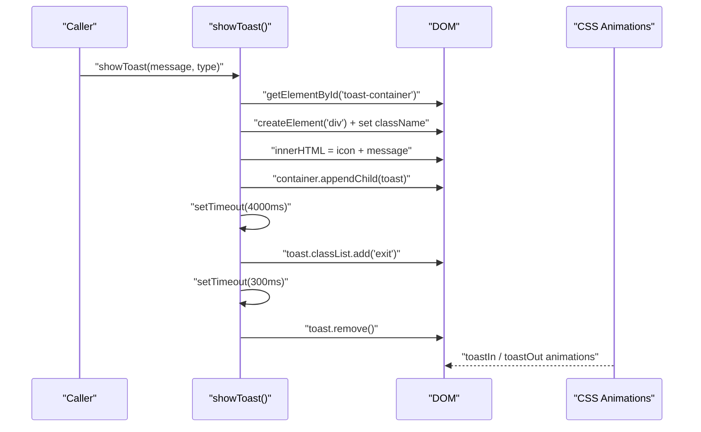
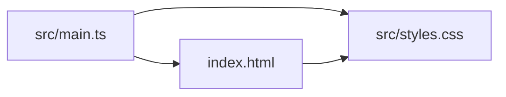

# Toast Notifications

<cite>
**Referenced Files in This Document**
- [main.ts](file://src/main.ts)
- [styles.css](file://src/styles.css)
- [index.html](file://index.html)
</cite>

## Table of Contents
1. [Introduction](#introduction)
2. [Project Structure](#project-structure)
3. [Core Components](#core-components)
4. [Architecture Overview](#architecture-overview)
5. [Detailed Component Analysis](#detailed-component-analysis)
6. [Dependency Analysis](#dependency-analysis)
7. [Performance Considerations](#performance-considerations)
8. [Troubleshooting Guide](#troubleshooting-guide)
9. [Conclusion](#conclusion)

## Introduction
This document explains the toast notification system implemented via the showToast function. It covers how notifications are created, styled, animated, and automatically dismissed; how different types (success, error, info) are visually differentiated; and how multiple notifications stack. It also provides guidance on extending the system for manual dismissal, accessibility enhancements, cross-browser compatibility, and performance optimization when triggering rapid sequences.

## Project Structure
The toast feature is composed of:
- A JavaScript function that creates and manages toasts
- CSS styles defining layout, colors, and animations
- An HTML container element where toasts are appended

**Diagram sources**
- [main.ts:123-142](file://src/main.ts#L123-L142)
- [index.html:136-137](file://index.html#L136-L137)
- [styles.css:828-880](file://src/styles.css#L828-L880)

**Section sources**
- [main.ts:123-142](file://src/main.ts#L123-L142)
- [index.html:136-137](file://index.html#L136-L137)
- [styles.css:828-880](file://src/styles.css#L828-L880)

## Core Components
- showToast(message, type): Creates a toast DOM node, appends it to the container, and schedules automatic dismissal with an exit animation.
- Toast container: A fixed-position container at the top-right corner that stacks new toasts vertically.
- Styling and animations: CSS defines layout, type-based left border accents, and slide-in/out keyframes.

Key behaviors:
- Automatic positioning: The container is positioned at the top-right; each toast stacks below the previous one using flex column layout.
- Animation effects: Each toast animates in from the right and fades out to the right before removal.
- Lifecycle management: After creation, a timer triggers the exit animation after a delay, then removes the element.

**Section sources**
- [main.ts:123-142](file://src/main.ts#L123-L142)
- [styles.css:828-880](file://src/styles.css#L828-L880)

## Architecture Overview
The toast flow is straightforward:
1. Application code calls showToast with a message and optional type.
2. showToast locates the toast container by ID.
3. A new toast div is created with a type-specific class and icon.
4. The toast is appended to the container.
5. A timeout adds an exit class to start the fade-out animation.
6. After the animation completes, the toast element is removed from the DOM.

**Diagram sources**
- [main.ts:123-142](file://src/main.ts#L123-L142)
- [styles.css:939-959](file://src/styles.css#L939-L959)

## Detailed Component Analysis

### showToast Function
Responsibilities:
- Locate the toast container
- Create a toast element with type-specific styling
- Append to container
- Schedule auto-dismiss with exit animation
- Remove element after animation

Behavioral details:
- Default type is "info" if omitted
- Icon selection depends on type: success uses a sparkle, error uses a cross, info uses an information symbol
- Auto-dismiss delay is 4 seconds; exit animation duration is 300 ms

Usage examples in the app:
- Scan completion shows an info toast
- Scan failure shows an error toast
- Cleanup success shows a success toast
- Cleanup errors show error toasts

Accessibility considerations:
- Current implementation does not include ARIA attributes or screen reader announcements. To improve accessibility, consider adding role="alert" and aria-live="polite" to the toast container, and role="status" or role="alert" to individual toasts depending on urgency.

Manual dismissal:
- Not currently implemented. You can add a close button inside the toast and remove the auto-dismiss timer when the user clicks it.

Stacking behavior:
- Multiple toasts stack vertically due to the container’s flex-direction: column and gap. There is no limit enforced; very long queues may overflow the viewport.

Cross-browser compatibility:
- Uses backdrop-filter and -webkit-backdrop-filter for glass effect; ensure vendor prefix support as present.
- Uses CSS animations defined with @keyframes; widely supported across modern browsers.

Performance notes:
- Creating and removing DOM nodes per toast is lightweight but frequent rapid calls can cause layout thrashing if many toasts appear quickly. Consider debouncing or limiting visible toasts.

**Section sources**
- [main.ts:123-142](file://src/main.ts#L123-L142)
- [main.ts:880-886](file://src/main.ts#L880-L886)
- [main.ts:924-936](file://src/main.ts#L924-L936)

### Toast Container and Positioning
- The container is a fixed-position element placed near the top-right of the viewport.
- It uses flexbox column layout with spacing between items.
- z-index ensures toasts appear above other content.

Positioning specifics:
- Top offset and right offset define placement.
- Flex direction and gap control vertical stacking.

Overflow handling:
- No explicit max-height or scroll behavior is applied; many toasts will push beyond the viewport unless constrained.

**Section sources**
- [styles.css:828-837](file://src/styles.css#L828-L837)
- [index.html:136-137](file://index.html#L136-L137)

### Visual Styling and Types
Types and visual differentiation:
- success: green left border accent
- error: red left border accent
- info: blue left border accent

Common styling:
- Glass-like background with backdrop blur
- Rounded corners, subtle border, shadow
- Icon and message layout with consistent spacing and typography

Icons:
- Success: sparkle emoji
- Error: cross emoji
- Info: information emoji

Typography:
- Message text uses secondary text color and readable line height.

**Section sources**
- [styles.css:839-876](file://src/styles.css#L839-L876)
- [main.ts:130-134](file://src/main.ts#L130-L134)

### Animation Effects
- Entry animation: toast slides in from the right while fading in and scaling slightly.
- Exit animation: toast slides out to the right while fading out and scaling down.
- Duration: entry ~0.4s; exit ~0.3s.

Implementation:
- Entry animation is applied immediately upon creation.
- Exit animation is triggered by adding the "exit" class after the auto-dismiss delay.

**Section sources**
- [styles.css:939-959](file://src/styles.css#L939-L959)
- [main.ts:138-141](file://src/main.ts#L138-L141)

### Lifecycle Management
Lifecycle stages:
- Creation: DOM node created and appended
- Display: entry animation plays
- Auto-dismiss: after a delay, exit animation starts
- Removal: DOM node removed after exit animation

Current limitations:
- No manual dismissal
- No pause/resume on hover
- No queue limits or deduplication

Recommended improvements:
- Add a close button to manually dismiss
- Pause exit animation on hover and resume on mouse leave
- Limit visible toasts (e.g., max 3–5), pushing older ones out
- Debounce rapid notifications to avoid excessive DOM churn

**Section sources**
- [main.ts:123-142](file://src/main.ts#L123-L142)

### Usage Examples in the App
- On successful scan: info toast showing reclaimable space summary
- On failed scan: error toast with error details
- On successful cleanup: success toast with freed space and item count
- On cleanup issues: error toast with first error message

These usages demonstrate how to trigger toasts from application events and format messages dynamically.

**Section sources**
- [main.ts:880-886](file://src/main.ts#L880-L886)
- [main.ts:924-936](file://src/main.ts#L924-L936)

## Dependency Analysis
The toast system has minimal dependencies:
- main.ts: implements showToast and invokes it from event handlers
- index.html: provides the toast container element
- styles.css: defines container layout, toast appearance, and animations

**Diagram sources**
- [main.ts:123-142](file://src/main.ts#L123-L142)
- [index.html:136-137](file://index.html#L136-L137)
- [styles.css:828-880](file://src/styles.css#L828-L880)

**Section sources**
- [main.ts:123-142](file://src/main.ts#L123-L142)
- [index.html:136-137](file://index.html#L136-L137)
- [styles.css:828-880](file://src/styles.css#L828-L880)

## Performance Considerations
- Rapid sequences: Frequent showToast calls can create many DOM nodes and timers. Consider:
  - Debouncing duplicate messages within a short time window
  - Limiting the number of visible toasts (e.g., keep only the latest N)
  - Reusing a small pool of toast elements instead of creating new ones each time
- Animation cost: Keep animations simple; avoid heavy filters or transforms on large elements.
- Memory: Ensure toasts are removed after animations to prevent memory leaks.

[No sources needed since this section provides general guidance]

## Troubleshooting Guide
Common issues and resolutions:
- Toast container missing: If the container element is not present in the DOM, showToast returns early without rendering. Ensure index.html includes the toast container.
- Toast not appearing: Verify the container exists and is not hidden by CSS. Check z-index and visibility.
- Animation not playing: Confirm CSS animations are loaded and not overridden. Inspect computed styles for .toast and .toast.exit.
- Too many toasts overlapping: Increase container gap or constrain the maximum number of visible toasts.
- Accessibility concerns: Add ARIA roles and live regions to announce messages to screen readers.

**Section sources**
- [main.ts:123-126](file://src/main.ts#L123-L126)
- [styles.css:828-880](file://src/styles.css#L828-L880)

## Conclusion
The toast notification system is a lightweight, type-aware feedback mechanism that automatically positions, animates, and dismisses messages. It integrates cleanly with the app’s UI and styling. For production use, consider adding manual dismissal, accessibility attributes, queue limits, and debouncing to handle rapid sequences gracefully.

[No sources needed since this section summarizes without analyzing specific files]