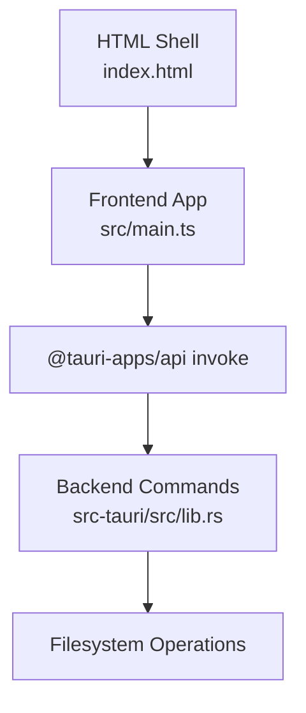
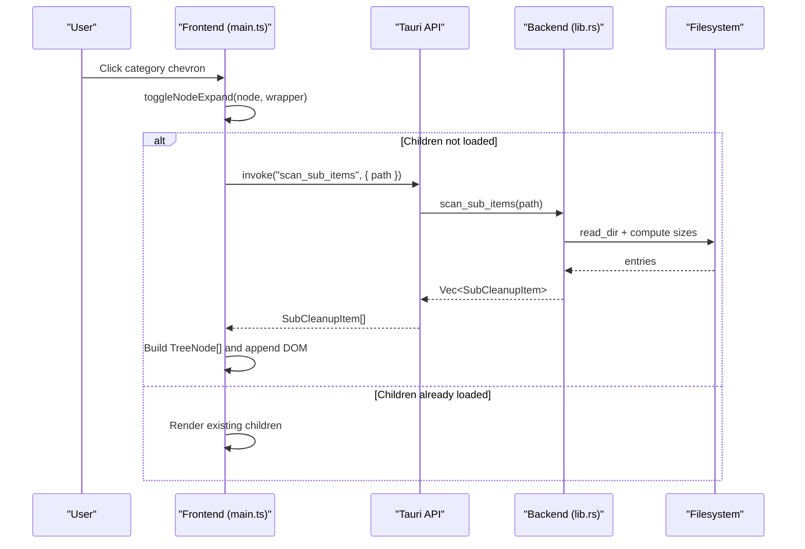
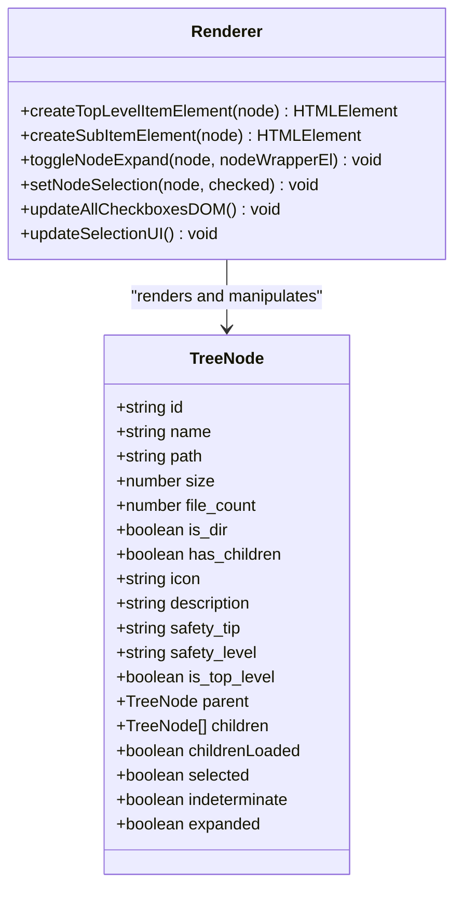
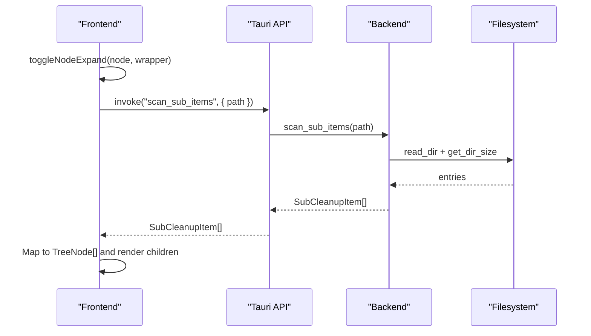
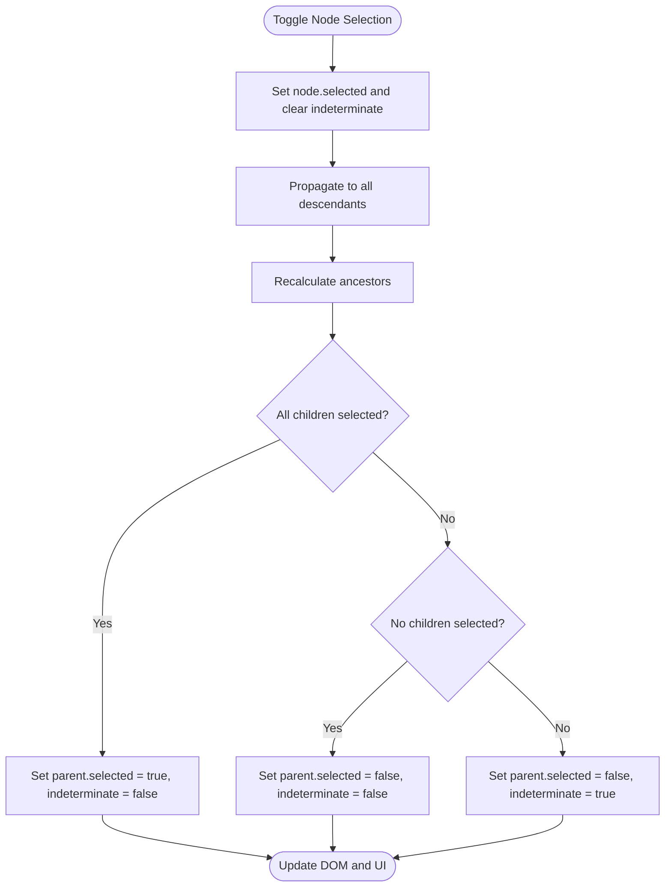
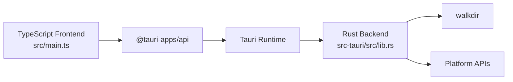

# Tree Rendering System

<cite>
**Referenced Files in This Document**
- [main.ts](file://src/main.ts)
- [index.html](file://index.html)
- [lib.rs](file://src-tauri/src/lib.rs)
- [package.json](file://package.json)
</cite>

## Table of Contents
1. [Introduction](#introduction)
2. [Project Structure](#project-structure)
3. [Core Components](#core-components)
4. [Architecture Overview](#architecture-overview)
5. [Detailed Component Analysis](#detailed-component-analysis)
6. [Dependency Analysis](#dependency-analysis)
7. [Performance Considerations](#performance-considerations)
8. [Troubleshooting Guide](#troubleshooting-guide)
9. [Conclusion](#conclusion)

## Introduction
This document explains the hierarchical tree rendering system used by FreeSpaceMacos to present disk cleanup categories and their contents. It focuses on:
- Top-level category rendering with safety classification indicators and expand/collapse behavior
- Sub-item rendering for files and folders with selection states and size information
- Lazy loading via the Tauri command scan_sub_items
- Parent-child selection propagation, indeterminate state handling, and DOM manipulation patterns
- Event delegation strategies, performance optimizations for large datasets, and accessibility considerations

The system is implemented in TypeScript (frontend) and Rust (Tauri backend), with an HTML shell that mounts the UI.

## Project Structure
The frontend renders a two-tier tree:
- Top-level nodes represent cleanup categories (Safe to Clean and Needs Review). Each top-level node can be expanded to reveal sub-items.
- Sub-items are individual cache files or folders under each category. They may also be expandable if they are directories with children.

**Diagram sources**
- [index.html:1-141](file://index.html#L1-L141)
- [main.ts:1-1009](file://src/main.ts#L1-L1009)
- [lib.rs:1-1211](file://src-tauri/src/lib.rs#L1-L1211)

**Section sources**
- [index.html:1-141](file://index.html#L1-L141)
- [package.json:1-22](file://package.json#L1-L22)

## Core Components
Key responsibilities:
- Data model: TreeNode represents both top-level categories and sub-items with selection, expansion, and hierarchy metadata.
- Rendering functions: createTopLevelItemElement and createSubItemElement build interactive DOM elements.
- Expansion logic: toggleNodeExpand handles lazy loading via scan_sub_items and manages child container visibility.
- Selection model: setNodeSelection propagates selections up and down the tree and computes indeterminate states.
- UI updates: updateAllCheckboxesDOM and updateSelectionUI keep checkboxes and action bar consistent.

**Section sources**
- [main.ts:59-78](file://src/main.ts#L59-L78)
- [main.ts:272-414](file://src/main.ts#L272-L414)
- [main.ts:472-696](file://src/main.ts#L472-L696)

## Architecture Overview
The tree rendering pipeline integrates frontend DOM generation with backend scanning commands.

**Diagram sources**
- [main.ts:472-558](file://src/main.ts#L472-L558)
- [lib.rs:408-415](file://src-tauri/src/lib.rs#L408-L415)

## Detailed Component Analysis

### createTopLevelItemElement
Purpose:
- Renders a top-level category row with:
  - Expand/collapse chevron (if it has children)
  - Safety badge indicating Safe or Needs Review
  - Icon, name, description, safety tip, total size, and file count
- Attaches event listeners for chevron click (expansion) and row/checkbox click (selection)
- If already expanded, pre-renders its children using createSubItemElement

Key behaviors:
- Safety classification drives badge class and text
- Chevron presence depends on has_children or preloaded children length
- Row click toggles selection and triggers parent-child propagation and UI updates

Accessibility notes:
- Chevron buttons include titles for screen readers
- Checkbox elements carry data-node-id for association; ensure aria attributes are added for full accessibility

**Section sources**
- [main.ts:626-696](file://src/main.ts#L626-L696)

#### Class Diagram: Node Model and Rendering Functions

**Diagram sources**
- [main.ts:59-78](file://src/main.ts#L59-L78)
- [main.ts:472-696](file://src/main.ts#L472-L696)

### createSubItemElement
Purpose:
- Renders individual cache files and folders within a category
- Displays:
  - Optional chevron for expandable directories
  - Checkbox reflecting selection state (including indeterminate)
  - File/folder icon based on type
  - Name and path tooltips
  - Size and file count metadata
- Binds:
  - Chevron click to toggleNodeExpand
  - Row click to toggle selection and propagate changes

Key behaviors:
- Directory detection uses is_dir and has_children/children.length
- Icon selection uses getFileIcon for non-directory items
- Pre-renders nested children if node.expanded and children exist

Accessibility notes:
- Chevron button includes title
- Ensure checkbox elements have accessible labels or ARIA roles for screen readers

**Section sources**
- [main.ts:560-624](file://src/main.ts#L560-L624)

### toggleNodeExpand
Purpose:
- Manages node expansion state and lazy loading of sub-items
- On collapse: hides children container
- On expand:
  - Creates children container if missing
  - Shows loading indicator while fetching sub-items
  - Invokes Tauri command scan_sub_items with node.path
  - Builds TreeNode[] from SubCleanupItem[], sets parent references, and inherits selection state
  - Renders empty state or child rows via createSubItemElement
  - Handles errors gracefully with user-visible feedback

Lazy loading integration:
- Uses invoke("scan_sub_items", { path }) to fetch directory contents only when needed
- Marks node.childrenLoaded = true after successful load to avoid repeated scans

Error handling:
- Catches invocation errors and displays a failure message inside the children container

**Section sources**
- [main.ts:472-558](file://src/main.ts#L472-L558)
- [lib.rs:408-415](file://src-tauri/src/lib.rs#L408-L415)

#### Sequence Diagram: Lazy Loading Flow

**Diagram sources**
- [main.ts:499-549](file://src/main.ts#L499-L549)
- [lib.rs:115-168](file://src-tauri/src/lib.rs#L115-L168)

### Selection Propagation and Indeterminate State Handling
Parent-child selection propagation:
- When a node is selected/deselected:
  - All descendants are set to the same selection state and cleared of indeterminate
  - Ancestors are recalculated:
    - Fully selected children -> parent selected, not indeterminate
    - No selected children -> parent deselected, not indeterminate
    - Mixed selection -> parent deselected but marked indeterminate

Indeterminate state:
- Used to indicate partial selection at a node level
- Visualized via CSS classes on checkbox and row elements
- Affects deletion logic: indeterminate nodes recurse into children to collect only fully selected leaves

DOM synchronization:
- updateCheckboxDOM toggles .checked and .indeterminate classes on the checkbox element
- updateAllCheckboxesDOM walks all top-level nodes and recurses to sync DOM with model

Deletion and size aggregation:
- getSelectedPathsToDelete collects paths for deletion, skipping indeterminate nodes and recursing into them
- getSelectedSize sums sizes of fully selected nodes, recursing through indeterminate nodes
- getSelectedBreakdown separates safe vs review items for confirmation dialog

**Section sources**
- [main.ts:272-414](file://src/main.ts#L272-L414)

#### Flowchart: Selection Propagation

**Diagram sources**
- [main.ts:276-310](file://src/main.ts#L276-L310)

### DOM Manipulation Patterns
- Element creation: createElement for wrappers, rows, and containers
- Attribute binding: data-node-id and data-parent-id for reliable querying
- Class toggling: selected/partial for rows; checked/indeterminate for checkboxes
- Conditional rendering:
  - Empty state when no sub-items
  - Loading spinner during lazy load
  - Error fallback with descriptive message
- Event attachment:
  - Chevron click handlers prevent default propagation and call toggleNodeExpand
  - Row click handlers toggle selection and refresh UI

**Section sources**
- [main.ts:472-696](file://src/main.ts#L472-L696)

### Event Delegation Strategy
Current implementation attaches per-element event listeners for chevrons and rows. For large trees:
- Prefer delegating events to a common ancestor (e.g., results container) and routing based on data-node-id
- Benefits:
  - Fewer listener instances
  - Easier removal/recreation during re-renders
  - Reduced memory overhead for large datasets

Recommendation:
- Replace per-row listeners with a single delegated handler that inspects e.target.closest("[data-node-id]") and dispatches actions accordingly

[No sources needed since this section provides general guidance]

### Accessibility Considerations
- Add role="tree" to the root list and role="treeitem" to rows
- Use aria-expanded on chevron buttons to reflect expanded state
- Associate checkboxes with labels or add aria-label describing item name and size
- Ensure keyboard navigation:
  - Arrow keys move focus between nodes
  - Enter/Space toggles selection
  - Arrow Right/Left expands/collapses nodes
- Provide aria-checked on checkboxes to reflect selected/indeterminate states

[No sources needed since this section provides general guidance]

## Dependency Analysis
Frontend dependencies:
- @tauri-apps/api for invoking backend commands
- Vite for development/build tooling
- TypeScript for type safety

Backend dependencies:
- Tauri framework for exposing commands
- walkdir for recursive directory traversal
- Platform-specific crates for disk usage queries

**Diagram sources**
- [package.json:12-19](file://package.json#L12-L19)
- [lib.rs:1-5](file://src-tauri/src/lib.rs#L1-L5)
- [lib.rs:1194-1210](file://src-tauri/src/lib.rs#L1194-L1210)

**Section sources**
- [package.json:1-22](file://package.json#L1-L22)
- [lib.rs:1194-1210](file://src-tauri/src/lib.rs#L1194-L1210)

## Performance Considerations
- Lazy loading: Only fetch sub-items when a node is expanded, reducing initial payload and DOM size
- Avoid redundant scans: Mark node.childrenLoaded to prevent repeated invocations
- Batch DOM updates:
  - Reuse existing children containers when possible
  - Minimize innerHTML replacements; prefer targeted insertions
- Virtualization for large lists:
  - Render only visible nodes within expanded sections
  - Recycle DOM nodes as user scrolls
- Debounce rapid expansions:
  - Prevent multiple concurrent scans for the same node
- Efficient selection updates:
  - Update only affected branches instead of walking entire tree when possible
- Optimize size calculations:
  - Cache computed sizes and file counts where feasible

[No sources needed since this section provides general guidance]

## Troubleshooting Guide
Common issues and resolutions:
- Sub-items fail to load:
  - Check console for invoke errors
  - Verify path validity and permissions
  - Confirm scan_sub_items command is registered in backend
- Chevro n does not expand:
  - Ensure has_children or children.length > 0
  - Validate data-node-id matches across DOM and model
- Selection state mismatch:
  - Re-run updateAllCheckboxesDOM after programmatic changes
  - Verify indeterminate logic for mixed selections
- Action bar not updating:
  - Ensure updateSelectionUI is called after selection changes
  - Confirm getSelectedPathsToDelete and getSelectedSize traverse correctly

**Section sources**
- [main.ts:472-558](file://src/main.ts#L472-L558)
- [main.ts:272-414](file://src/main.ts#L272-L414)

## Conclusion
FreeSpaceMacos implements a robust hierarchical tree renderer that balances interactivity with performance:
- Top-level categories display safety classifications and support expansion
- Sub-items show detailed metadata and selection states
- Lazy loading via scan_sub_items minimizes upfront cost
- Selection propagation ensures consistent parent-child relationships with indeterminate states
- With event delegation, virtualization, and careful DOM management, the system scales well to large datasets
- Accessibility enhancements will improve usability for screen reader users