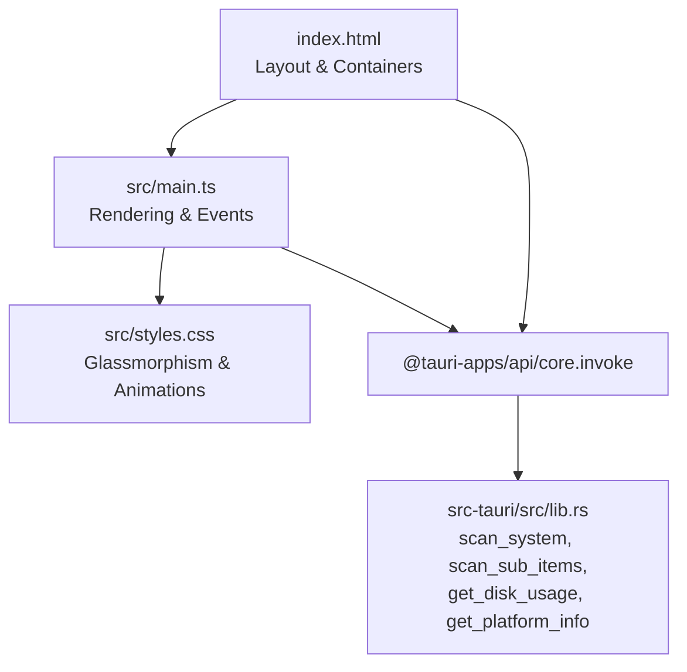
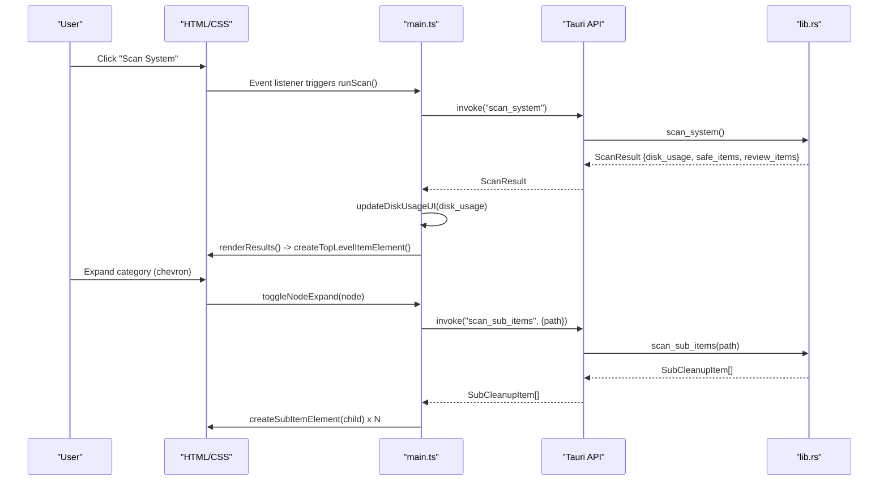
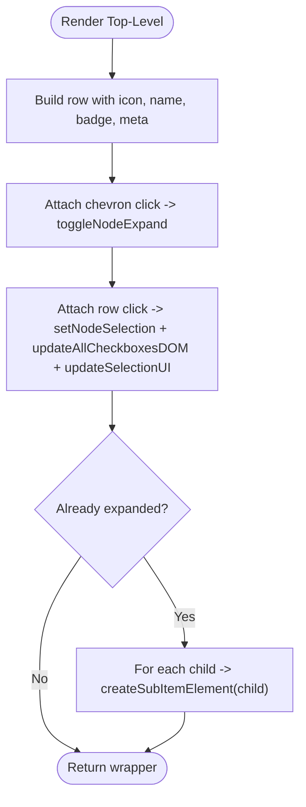
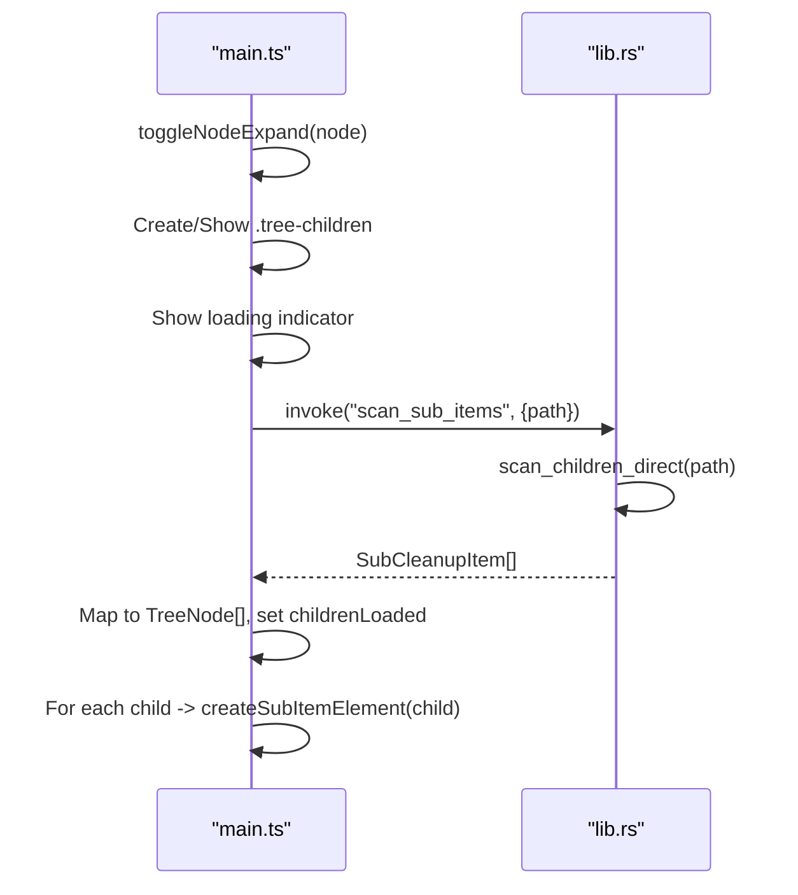
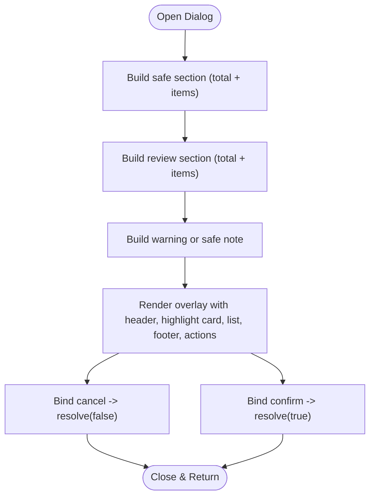
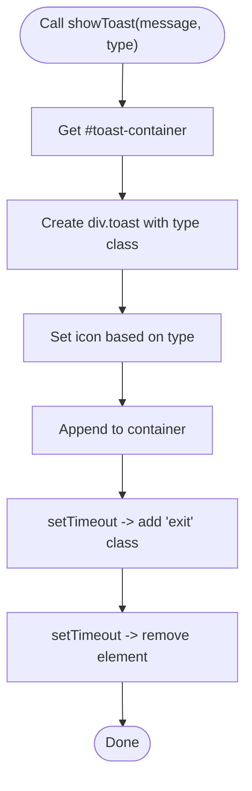
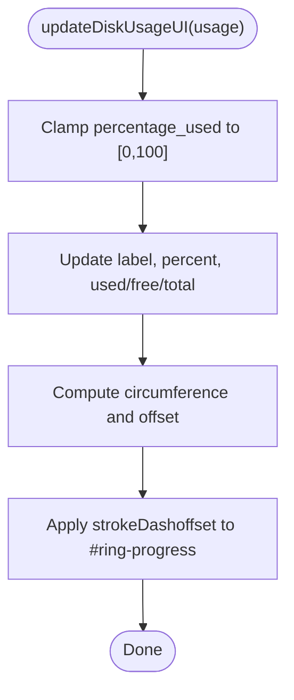
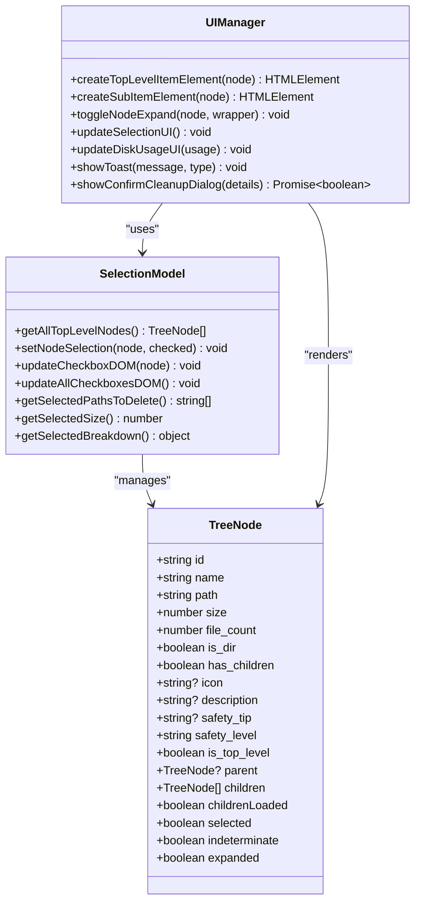
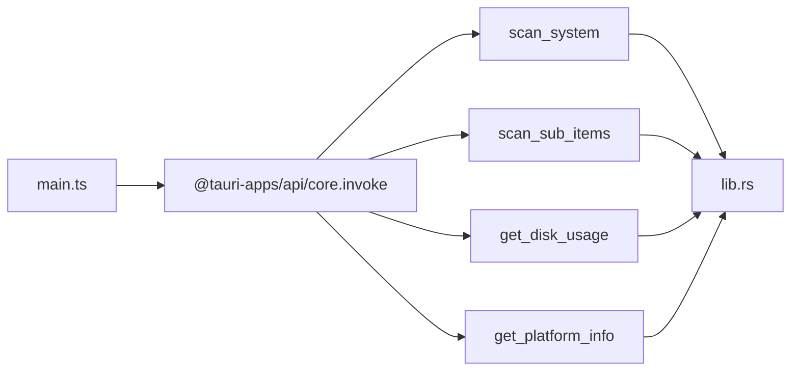

# UI Components & Rendering System

<cite>
**Referenced Files in This Document**
- [main.ts](file://src/main.ts)
- [index.html](file://index.html)
- [styles.css](file://src/styles.css)
- [lib.rs](file://src-tauri/src/lib.rs)
- [tauri.conf.json](file://src-tauri/tauri.conf.json)
- [README.md](file://README.md)
</cite>

## Table of Contents
1. [Introduction](#introduction)
2. [Project Structure](#project-structure)
3. [Core Components](#core-components)
4. [Architecture Overview](#architecture-overview)
5. [Detailed Component Analysis](#detailed-component-analysis)
6. [Dependency Analysis](#dependency-analysis)
7. [Performance Considerations](#performance-considerations)
8. [Troubleshooting Guide](#troubleshooting-guide)
9. [Conclusion](#conclusion)

## Introduction
This document explains the dynamic UI rendering system in FreeSpaceMacos, focusing on how interactive tree structures are created and updated, lazy loading of sub-items via Tauri commands, confirmation dialogs with safety classification, toast notifications, disk usage visualization, event handling patterns, accessibility considerations, and cross-browser compatibility approaches. The system is built with TypeScript (Vanilla DOM), CSS glassmorphism styling, and a Rust backend exposed through Tauri commands.

## Project Structure
The application consists of:
- Frontend HTML shell that defines layout regions for disk usage, scan controls, results lists, action bar, and toast container.
- A TypeScript module that owns state, renders trees, handles user interactions, and calls Tauri commands.
- CSS styles defining glassmorphism cards, ring progress indicators, tree nodes, checkboxes, and animations.
- A Rust backend exposing commands for scanning, disk usage, platform info, and sub-item enumeration.

**Diagram sources**
- [index.html:1-141](file://index.html#L1-L141)
- [main.ts:1-1009](file://src/main.ts#L1-L1009)
- [styles.css:1-800](file://src/styles.css#L1-L800)
- [lib.rs:328-408](file://src-tauri/src/lib.rs#L328-L408)

**Section sources**
- [index.html:1-141](file://index.html#L1-L141)
- [main.ts:1-1009](file://src/main.ts#L1-L1009)
- [styles.css:1-800](file://src/styles.css#L1-L800)
- [lib.rs:328-408](file://src-tauri/src/lib.rs#L328-L408)

## Core Components
- Tree node rendering functions:
  - createTopLevelItemElement: builds top-level category rows with icons, safety badges, metadata, and chevron expansion.
  - createSubItemElement: builds nested items under expanded categories, including file/folder icons, paths, sizes, and per-row selection.
- Lazy loading mechanism:
  - toggleNodeExpand: toggles expansion state, creates or reveals children containers, and invokes scan_sub_items to fetch sub-items when needed.
- Confirmation dialog:
  - showConfirmCleanupDialog: renders an overlay with safe vs review item breakdowns, totals, warnings, and confirm/cancel actions.
- Toast notification system:
  - showToast: dynamically creates toast elements with type-based icons and auto-dismiss behavior.
- Disk usage visualization:
  - updateDiskUsageUI: updates label, stats, percentage text, and SVG ring progress using stroke-dashoffset animation.

**Section sources**
- [main.ts:472-696](file://src/main.ts#L472-L696)
- [main.ts:123-142](file://src/main.ts#L123-L142)
- [main.ts:146-243](file://src/main.ts#L146-L243)
- [main.ts:247-268](file://src/main.ts#L247-L268)

## Architecture Overview
The frontend orchestrates user interactions and renders the UI, while the backend provides data and performs filesystem operations. Key flows:
- Initial load: detect platform, fetch disk usage, render disk gauge, then run initial scan.
- Scan flow: invoke scan_system, update disk usage UI, render results as hierarchical trees.
- Expansion flow: on chevron click, toggleNodeExpand lazily loads sub-items via scan_sub_items.
- Cleanup flow: collect selected paths, show confirmation dialog, call delete_items, refresh UI.

**Diagram sources**
- [main.ts:837-896](file://src/main.ts#L837-L896)
- [main.ts:472-558](file://src/main.ts#L472-L558)
- [lib.rs:401-408](file://src-tauri/src/lib.rs#L401-L408)
- [lib.rs:410-744](file://src-tauri/src/lib.rs#L410-L744)

## Detailed Component Analysis

### Tree Node Rendering Functions
- createTopLevelItemElement
  - Builds a top-level row with chevron, checkbox, icon, name, safety badge, description, size, and file count.
  - Attaches chevron click handler to toggleNodeExpand and row click handler to set node selection and update UI.
  - If already expanded, recursively renders child elements via createSubItemElement.
- createSubItemElement
  - Builds a nested row with chevron (if directory with children), checkbox, icon, name/path, size, and optional file count.
  - Handles chevron click to expand further and row click to toggle selection and propagate state up/down.
  - Renders nested children if previously expanded.

**Diagram sources**
- [main.ts:626-696](file://src/main.ts#L626-L696)
- [main.ts:560-624](file://src/main.ts#L560-L624)

**Section sources**
- [main.ts:626-696](file://src/main.ts#L626-L696)
- [main.ts:560-624](file://src/main.ts#L560-L624)

### Lazy Loading Mechanism via toggleNodeExpand and scan_sub_items
- toggleNodeExpand
  - Flips node.expanded and toggles chevron class.
  - Creates or reveals .tree-children container.
  - On first expansion, shows a loading indicator, then invokes scan_sub_items with node.path.
  - Maps backend SubCleanupItem[] into TreeNode[], sets childrenLoaded flag, and populates DOM with createSubItemElement.
  - Handles errors by showing a failure message in the children container.
- scan_sub_items (backend)
  - Expands home path, reads directory entries, computes size/file_count, determines has_children, filters hidden files, sorts by size.

**Diagram sources**
- [main.ts:472-558](file://src/main.ts#L472-L558)
- [lib.rs:108-161](file://src-tauri/src/lib.rs#L108-L161)
- [lib.rs:401-408](file://src-tauri/src/lib.rs#L401-L408)

**Section sources**
- [main.ts:472-558](file://src/main.ts#L472-L558)
- [lib.rs:108-161](file://src-tauri/src/lib.rs#L108-L161)
- [lib.rs:401-408](file://src-tauri/src/lib.rs#L401-L408)

### Confirmation Dialog System (showConfirmCleanupDialog)
- Renders an overlay with:
  - Safe section: total size and list of safe items with a “Safe to Clean” badge and explanatory note.
  - Review section: total size and list of review items with a “Needs Review” badge and cautionary note.
  - Warning or safe note depending on presence of review items.
  - Footer indicating number of items/folders to be removed.
  - Cancel and Confirm buttons; returns Promise<boolean>.
- Integration:
  - Called from runClean after collecting selected paths and breakdown.
  - If confirmed, proceeds to delete_items and refreshes UI.

**Diagram sources**
- [main.ts:146-243](file://src/main.ts#L146-L243)
- [main.ts:900-941](file://src/main.ts#L900-L941)

**Section sources**
- [main.ts:146-243](file://src/main.ts#L146-L243)
- [main.ts:900-941](file://src/main.ts#L900-L941)

### Toast Notification System (showToast)
- Dynamically creates a toast element with type-specific icon and message.
- Appends to #toast-container and schedules removal after delay with exit animation.
- Used for scan completion, cleanup success/failure, and error messages.

**Diagram sources**
- [main.ts:123-142](file://src/main.ts#L123-L142)

**Section sources**
- [main.ts:123-142](file://src/main.ts#L123-L142)

### Disk Usage Visualization (updateDiskUsageUI)
- Updates:
  - Disk label with free space.
  - Percentage text.
  - Used/free/total stat values.
  - SVG ring progress via stroke-dashoffset calculation.
- Uses CSS transitions for smooth animation.

**Diagram sources**
- [main.ts:247-268](file://src/main.ts#L247-L268)
- [index.html:26-57](file://index.html#L26-L57)
- [styles.css:170-208](file://src/styles.css#L170-L208)

**Section sources**
- [main.ts:247-268](file://src/main.ts#L247-L268)
- [index.html:26-57](file://index.html#L26-L57)
- [styles.css:170-208](file://src/styles.css#L170-L208)

### Event Handling and DOM Manipulation Patterns
- Event delegation and direct binding:
  - Chevron buttons use stopPropagation to prevent row selection.
  - Row clicks toggle selection and update UI state.
- State propagation:
  - setNodeSelection propagates selection down to descendants and up to ancestors, supporting tri-state (checked/indeterminate/unselected).
- DOM updates:
  - updateAllCheckboxesDOM synchronizes visual states across all nodes.
  - updateSelectionUI updates counts, sizes, and action bar visibility.

**Diagram sources**
- [main.ts:59-78](file://src/main.ts#L59-L78)
- [main.ts:272-414](file://src/main.ts#L272-L414)
- [main.ts:418-468](file://src/main.ts#L418-L468)
- [main.ts:472-696](file://src/main.ts#L472-L696)

**Section sources**
- [main.ts:272-414](file://src/main.ts#L272-L414)
- [main.ts:418-468](file://src/main.ts#L418-L468)
- [main.ts:472-696](file://src/main.ts#L472-L696)

### Responsive Design Considerations
- CSS variables define consistent spacing, colors, and transitions.
- Flexbox layouts for titlebar, main content, and sections.
- Glassmorphism cards with backdrop-filter for modern look.
- Custom scrollbar styling for main content area.
- Animations for slide-up, fade-in, spinner rotation, and tree expansion.

**Section sources**
- [styles.css:1-45](file://src/styles.css#L1-L45)
- [styles.css:60-114](file://src/styles.css#L60-L114)
- [styles.css:134-143](file://src/styles.css#L134-L143)
- [styles.css:170-208](file://src/styles.css#L170-L208)
- [styles.css:241-292](file://src/styles.css#L241-L292)
- [styles.css:298-338](file://src/styles.css#L298-L338)
- [styles.css:340-416](file://src/styles.css#L340-L416)
- [styles.css:418-700](file://src/styles.css#L418-L700)
- [styles.css:753-800](file://src/styles.css#L753-L800)

### Accessibility Features
- Semantic structure: headings, paragraphs, and descriptive titles for tooltips.
- Keyboard-friendly interaction: buttons for chevrons and actions; custom checkboxes styled but still clickable.
- Visual cues: color-coded safety badges and indeterminate states.
- Tooltips via title attributes on names and paths.

**Section sources**
- [index.html:1-141](file://index.html#L1-L141)
- [styles.css:466-502](file://src/styles.css#L466-L502)
- [styles.css:504-562](file://src/styles.css#L504-L562)

### Cross-Browser Compatibility Approaches
- Use of standard DOM APIs and CSS features widely supported in modern browsers.
- Backdrop-filter with vendor prefix fallback (-webkit-backdrop-filter).
- CSS transitions and transforms for animations.
- Avoidance of experimental features; stable CSS properties and selectors.

**Section sources**
- [styles.css:134-143](file://src/styles.css#L134-L143)
- [styles.css:170-208](file://src/styles.css#L170-L208)
- [styles.css:241-292](file://src/styles.css#L241-L292)

## Dependency Analysis
Frontend dependencies:
- @tauri-apps/api/core.invoke for calling backend commands.
- DOM APIs for rendering and event handling.
- CSS for styling and animations.

Backend dependencies:
- Tauri command macros to expose functions to frontend.
- Filesystem libraries (walkdir, dirs, libc/windows-sys) for scanning and disk metrics.

**Diagram sources**
- [main.ts:1-2](file://src/main.ts#L1-L2)
- [lib.rs:328-408](file://src-tauri/src/lib.rs#L328-L408)
- [lib.rs:410-744](file://src-tauri/src/lib.rs#L410-L744)
- [lib.rs:783-786](file://src-tauri/src/lib.rs#L783-L786)

**Section sources**
- [main.ts:1-2](file://src/main.ts#L1-L2)
- [lib.rs:328-408](file://src-tauri/src/lib.rs#L328-L408)
- [lib.rs:410-744](file://src-tauri/src/lib.rs#L410-L744)
- [lib.rs:783-786](file://src-tauri/src/lib.rs#L783-L786)

## Performance Considerations
- Lazy loading reduces initial payload by fetching sub-items only when expanding nodes.
- Efficient DOM updates:
  - Reuse existing containers and toggle classes rather than re-rendering entire trees.
  - Batch updates via updateAllCheckboxesDOM and updateSelectionUI.
- Animation performance:
  - CSS transitions for smooth UI changes without heavy JS animation loops.
- Backend efficiency:
  - Directory scanning limited to depth and filtered entries to avoid unnecessary work.

[No sources needed since this section provides general guidance]

## Troubleshooting Guide
- Scan failures:
  - Errors from scan_system are caught and shown via showToast with error type.
- Sub-item loading failures:
  - toggleNodeExpand catches errors and displays a failure message within the children container.
- Cleanup issues:
  - delete_items may return partial success; UI reflects freed bytes and errors via toast.
- Platform detection:
  - get_platform_info errors are logged; defaults remain unchanged.

**Section sources**
- [main.ts:876-896](file://src/main.ts#L876-L896)
- [main.ts:542-549](file://src/main.ts#L542-L549)
- [main.ts:921-941](file://src/main.ts#L921-L941)
- [main.ts:945-970](file://src/main.ts#L945-L970)

## Conclusion
FreeSpaceMacos implements a robust dynamic UI rendering system with interactive tree nodes, lazy-loaded sub-items, clear safety classifications, and responsive feedback through toasts and confirmation dialogs. The architecture cleanly separates frontend rendering and state management from backend scanning and filesystem operations, ensuring scalability and maintainability. Styling leverages modern CSS techniques for a polished macOS-like experience while maintaining cross-browser compatibility.

[No sources needed since this section summarizes without analyzing specific files]