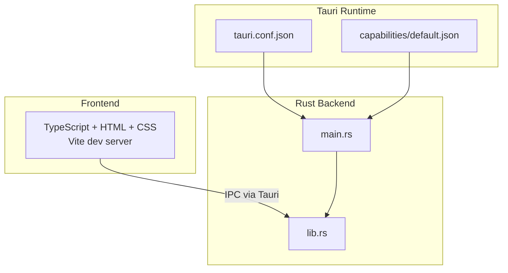
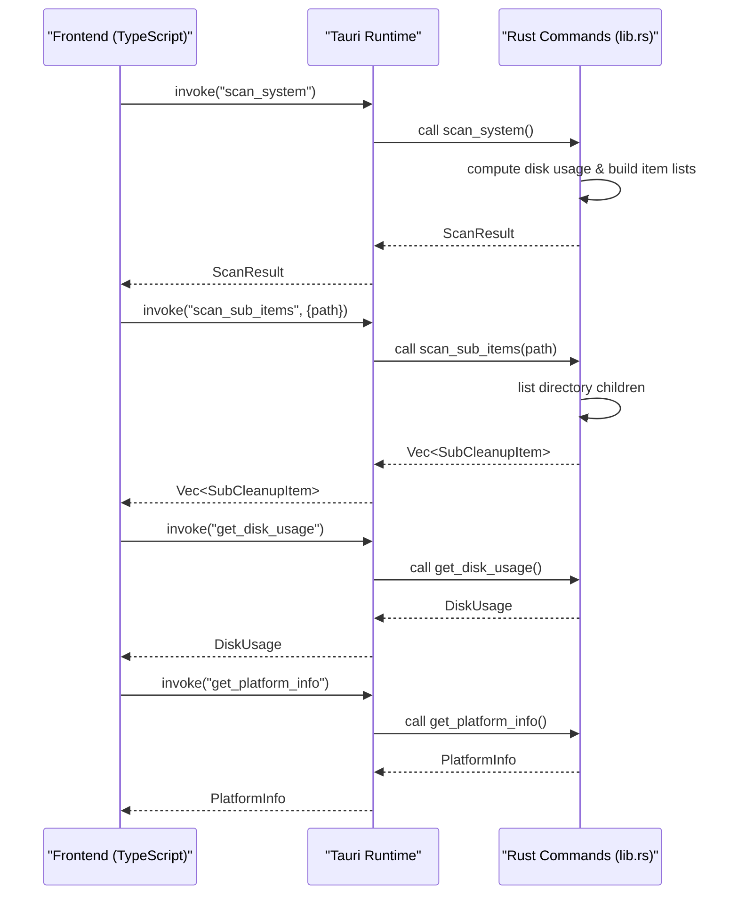
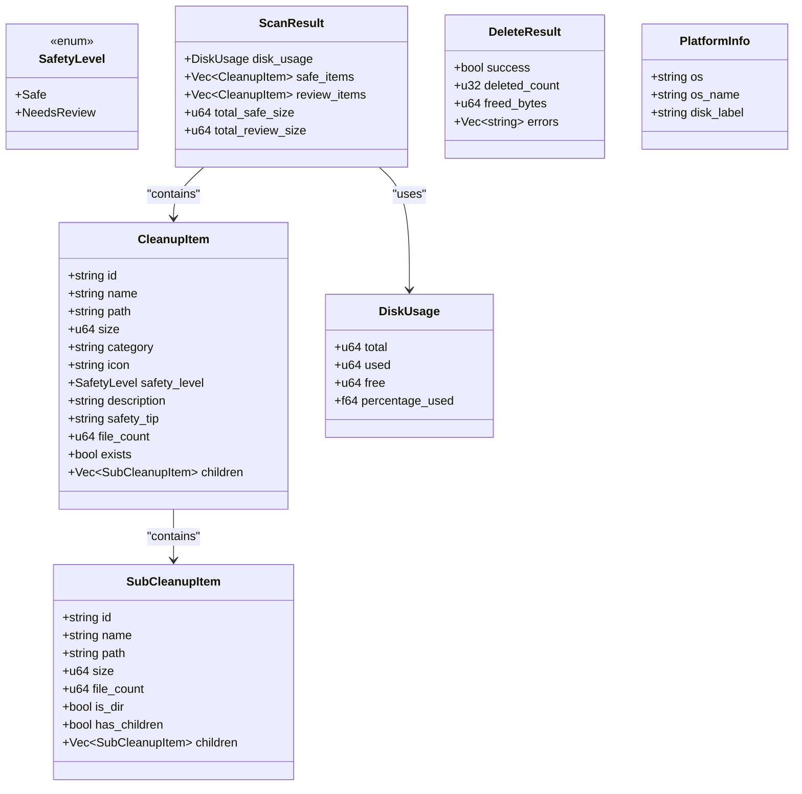
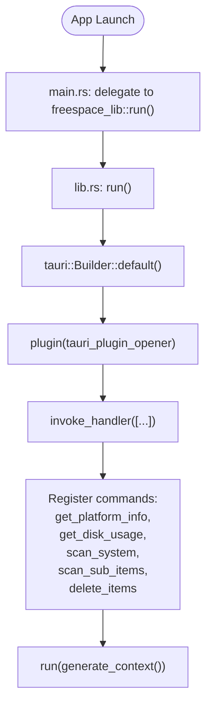
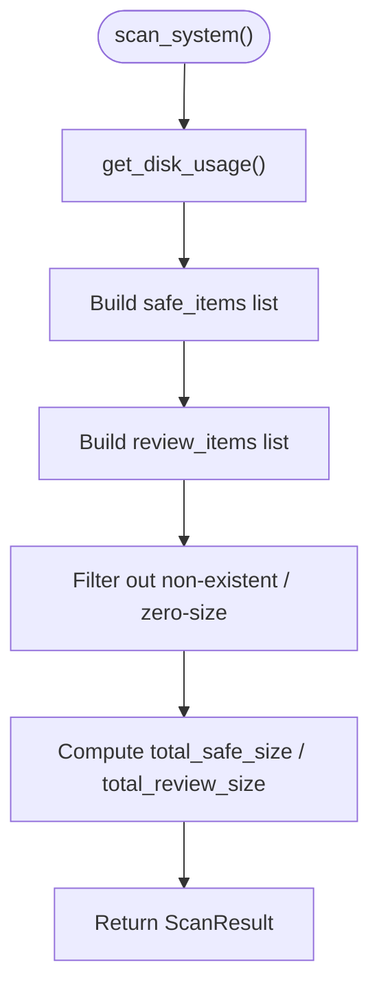
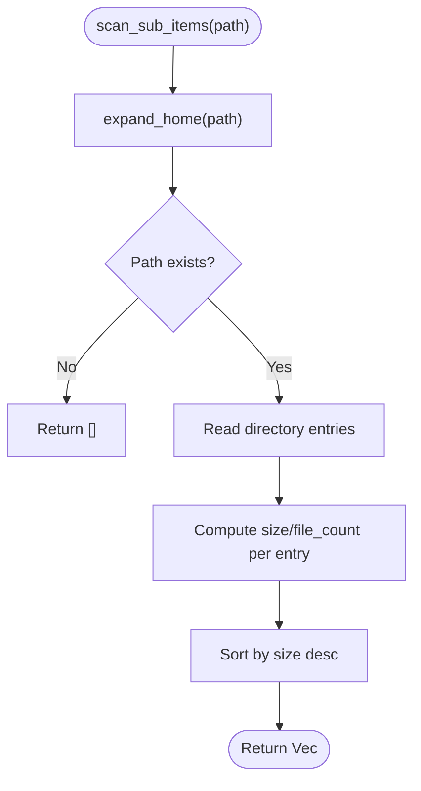
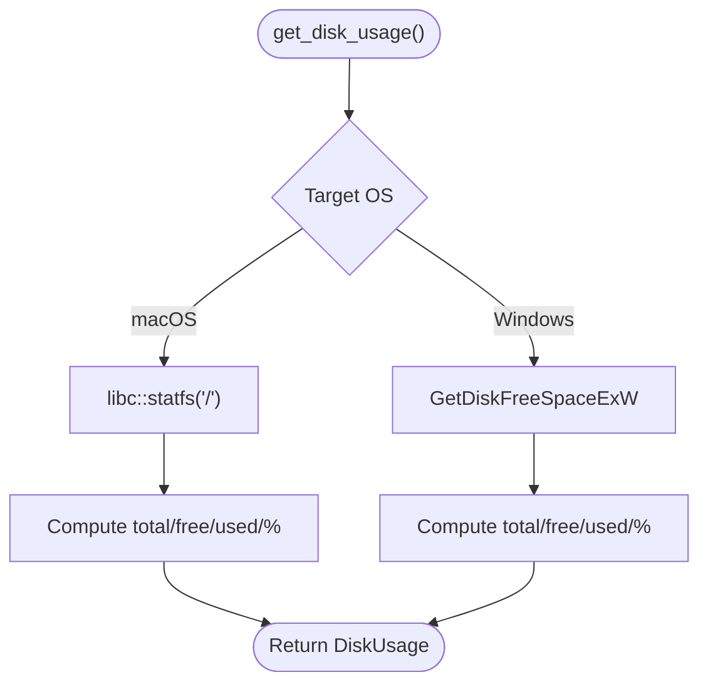
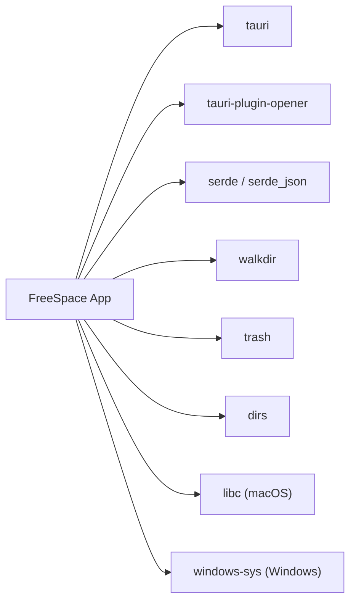

# Tauri Integration Layer

<cite>
**Referenced Files in This Document**
- [README.md](file://README.md)
- [Cargo.toml](file://src-tauri/Cargo.toml)
- [tauri.conf.json](file://src-tauri/tauri.conf.json)
- [default.json](file://src-tauri/capabilities/default.json)
- [main.rs](file://src-tauri/src/main.rs)
- [lib.rs](file://src-tauri/src/lib.rs)
</cite>

## Table of Contents
1. [Introduction](#introduction)
2. [Project Structure](#project-structure)
3. [Core Components](#core-components)
4. [Architecture Overview](#architecture-overview)
5. [Detailed Component Analysis](#detailed-component-analysis)
6. [Dependency Analysis](#dependency-analysis)
7. [Performance Considerations](#performance-considerations)
8. [Troubleshooting Guide](#troubleshooting-guide)
9. [Conclusion](#conclusion)

## Introduction
This document explains the Tauri integration layer for the FreeSpace macOS application, focusing on the bridge between the Rust backend and the TypeScript frontend. It covers:
- The four core Tauri commands: scan_system(), scan_sub_items(), get_disk_usage(), and get_platform_info()
- IPC communication patterns, security configuration, and permission model
- Command registration, async handling, and data serialization
- Frontend invocation examples, response processing, and error propagation
- Debugging techniques, logging strategies, and performance monitoring guidance

The project is a Tauri 2 app with a Rust backend and a TypeScript/HTML/CSS frontend built with Vite.

**Section sources**
- [README.md:1-74](file://README.md#L1-L74)

## Project Structure
At a high level:
- The frontend is served by Vite during development and bundled into dist for production.
- The Tauri backend is implemented in Rust under src-tauri.
- The Tauri entry point delegates to a library module that registers commands and runs the app.

**Diagram sources**
- [tauri.conf.json:1-46](file://src-tauri/tauri.conf.json#L1-L46)
- [default.json:1-11](file://src-tauri/capabilities/default.json#L1-L11)
- [main.rs:1-7](file://src-tauri/src/main.rs#L1-L7)
- [lib.rs:1084-1099](file://src-tauri/src/lib.rs#L1084-L1099)

**Section sources**
- [README.md:35-68](file://README.md#L35-L68)
- [tauri.conf.json:1-46](file://src-tauri/tauri.conf.json#L1-L46)
- [default.json:1-11](file://src-tauri/capabilities/default.json#L1-L11)
- [main.rs:1-7](file://src-tauri/src/main.rs#L1-L7)
- [lib.rs:1084-1099](file://src-tauri/src/lib.rs#L1084-L1099)

## Core Components
This section documents the four requested Tauri commands, their parameters, return types, and error behavior.

- scan_system()
  - Purpose: Scans system directories and returns categorized cleanup items along with disk usage.
  - Parameters: None.
  - Return type: ScanResult (includes disk_usage, safe_items, review_items, total_safe_size, total_review_size).
  - Error handling: Returns an error string if platform-specific operations fail; otherwise returns Ok(ScanResult).
  - Notes: Platform-specific implementations exist for macOS and Windows.

- scan_sub_items(path: String)
  - Purpose: Lists immediate children of a given path with size and metadata.
  - Parameters: path (string, supports ~ expansion).
  - Return type: Vec<SubCleanupItem>.
  - Error handling: Returns an empty list if the path does not exist or cannot be read; no error string is returned for missing paths.

- get_disk_usage()
  - Purpose: Retrieves total, used, free space and percentage used for the root drive.
  - Parameters: None.
  - Return type: DiskUsage.
  - Error handling: Returns an error string when unable to query OS APIs.

- get_platform_info()
  - Purpose: Returns platform details such as OS name and disk label.
  - Parameters: None.
  - Return type: PlatformInfo.
  - Error handling: Never fails; always returns a valid PlatformInfo.

These commands are registered in the Tauri builder’s invoke handler.

**Section sources**
- [lib.rs:328-399](file://src-tauri/src/lib.rs#L328-L399)
- [lib.rs:401-408](file://src-tauri/src/lib.rs#L401-L408)
- [lib.rs:410-744](file://src-tauri/src/lib.rs#L410-L744)
- [lib.rs:783-786](file://src-tauri/src/lib.rs#L783-L786)
- [lib.rs:1084-1099](file://src-tauri/src/lib.rs#L1084-L1099)

## Architecture Overview
The Tauri integration follows a clear separation of concerns:
- Frontend invokes Tauri commands via the Tauri client API.
- Tauri runtime deserializes arguments and calls the corresponding Rust function.
- Rust functions perform filesystem and OS queries, serialize results, and return them back to the frontend.

**Diagram sources**
- [lib.rs:328-399](file://src-tauri/src/lib.rs#L328-L399)
- [lib.rs:401-408](file://src-tauri/src/lib.rs#L401-L408)
- [lib.rs:410-744](file://src-tauri/src/lib.rs#L410-L744)
- [lib.rs:783-786](file://src-tauri/src/lib.rs#L783-L786)

## Detailed Component Analysis

### Data Model and Serialization
The backend defines strongly typed structures for IPC payloads. All models derive Serialize and Deserialize for JSON serialization across the IPC boundary.

Key models:
- SafetyLevel: Enum indicating whether an item is safe to delete or needs review.
- SubCleanupItem: Represents a single child item with size, file count, directory flags, and optional nested children.
- CleanupItem: Represents a top-level category with metadata, safety classification, description, tip, and children.
- DiskUsage: Aggregated disk metrics including total, used, free, and percentage used.
- ScanResult: Aggregates disk usage and categorized cleanup items with totals.
- DeleteResult: Reports deletion outcomes including success flag, counts, freed bytes, and errors.
- PlatformInfo: Describes OS and disk label.

**Diagram sources**
- [lib.rs:8-66](file://src-tauri/src/lib.rs#L8-L66)
- [lib.rs:43-58](file://src-tauri/src/lib.rs#L43-L58)
- [lib.rs:748-753](file://src-tauri/src/lib.rs#L748-L753)

**Section sources**
- [lib.rs:8-66](file://src-tauri/src/lib.rs#L8-L66)
- [lib.rs:43-58](file://src-tauri/src/lib.rs#L43-L58)
- [lib.rs:748-753](file://src-tauri/src/lib.rs#L748-L753)

### Command Registration and Invocation Flow
Commands are registered in the Tauri builder’s invoke handler. The main.rs entrypoint delegates to lib.rs run(), which sets up plugins and registers commands.

**Diagram sources**
- [main.rs:1-7](file://src-tauri/src/main.rs#L1-L7)
- [lib.rs:1084-1099](file://src-tauri/src/lib.rs#L1084-L1099)

**Section sources**
- [main.rs:1-7](file://src-tauri/src/main.rs#L1-L7)
- [lib.rs:1084-1099](file://src-tauri/src/lib.rs#L1084-L1099)

### Command Details

#### scan_system()
- Behavior:
  - Computes disk usage.
  - Builds two categories of items: safe and needs-review.
  - Filters out non-existent or zero-size items.
  - Aggregates totals for safe and review sizes.
- Return:
  - ScanResult containing disk usage and categorized items.
- Errors:
  - If disk usage retrieval fails, defaults are used; overall command still succeeds unless other failures occur.

**Diagram sources**
- [lib.rs:328-399](file://src-tauri/src/lib.rs#L328-L399)
- [lib.rs:410-744](file://src-tauri/src/lib.rs#L410-L744)

**Section sources**
- [lib.rs:328-399](file://src-tauri/src/lib.rs#L328-L399)
- [lib.rs:410-744](file://src-tauri/src/lib.rs#L410-L744)

#### scan_sub_items(path: String)
- Behavior:
  - Expands home directory prefix (~).
  - Reads direct children, computes sizes and file counts.
  - Sorts by size descending.
- Return:
  - Vec<SubCleanupItem>.
- Errors:
  - Returns an empty vector if the path does not exist or cannot be read.

**Diagram sources**
- [lib.rs:99-106](file://src-tauri/src/lib.rs#L99-L106)
- [lib.rs:108-161](file://src-tauri/src/lib.rs#L108-L161)
- [lib.rs:401-408](file://src-tauri/src/lib.rs#L401-L408)

**Section sources**
- [lib.rs:99-106](file://src-tauri/src/lib.rs#L99-L106)
- [lib.rs:108-161](file://src-tauri/src/lib.rs#L108-L161)
- [lib.rs:401-408](file://src-tauri/src/lib.rs#L401-L408)

#### get_disk_usage()
- Behavior:
  - On macOS: uses libc statfs to compute total, free, used, and percentage.
  - On Windows: uses Win32 GetDiskFreeSpaceExW to compute metrics.
- Return:
  - DiskUsage.
- Errors:
  - Returns an error string if OS calls fail.

**Diagram sources**
- [lib.rs:328-399](file://src-tauri/src/lib.rs#L328-L399)

**Section sources**
- [lib.rs:328-399](file://src-tauri/src/lib.rs#L328-L399)

#### get_platform_info()
- Behavior:
  - Returns OS name and disk label based on target OS.
- Return:
  - PlatformInfo.
- Errors:
  - Never fails.

**Section sources**
- [lib.rs:748-786](file://src-tauri/src/lib.rs#L748-L786)

### IPC Communication Patterns
- Invocation:
  - Frontend calls Tauri’s invoke API with the command name and payload.
- Serialization:
  - Arguments are deserialized from JSON into Rust types.
  - Results are serialized back to JSON for the frontend.
- Async:
  - Some commands are async (e.g., scan_sub_items, scan_system), allowing I/O-bound work without blocking the UI thread.

Typical frontend flow:
- Call invoke("scan_system").
- Await result and render UI with ScanResult fields.
- For errors, display user-friendly messages derived from the error string.

**Section sources**
- [lib.rs:401-408](file://src-tauri/src/lib.rs#L401-L408)
- [lib.rs:410-744](file://src-tauri/src/lib.rs#L410-L744)

### Security Configuration and Permission Model
- Tauri configuration:
  - CSP is disabled in app.security.csp.
  - Global Tauri object is enabled.
- Capabilities:
  - The default capability grants core:default and opener:default permissions to the main window.
- Implications:
  - With core:default, standard Tauri core functionality is available.
  - Filesystem access is performed directly in Rust; there is no explicit filesystem permission granted in capabilities here.
  - The opener plugin is initialized and available.

Recommendations:
- Restrict capabilities to only what is needed.
- Enable CSP for stricter content security.
- Use granular permissions where possible.

**Section sources**
- [tauri.conf.json:12-32](file://src-tauri/tauri.conf.json#L12-L32)
- [default.json:1-11](file://src-tauri/capabilities/default.json#L1-L11)

### Error Handling and Propagation
- Rust side:
  - Commands return Result<T, String>. Errors are propagated as strings to the frontend.
  - For scan_sub_items, missing paths return an empty list rather than an error.
  - For get_disk_usage, OS call failures return an error string.
- Frontend side:
  - Handle both successful responses and error strings.
  - Display actionable messages to users.

Error propagation example:
- Frontend catches error strings from Tauri and shows a toast or dialog.

**Section sources**
- [lib.rs:328-399](file://src-tauri/src/lib.rs#L328-L399)
- [lib.rs:401-408](file://src-tauri/src/lib.rs#L401-L408)

## Dependency Analysis
External dependencies relevant to the Tauri integration:
- tauri: Core runtime and command infrastructure.
- tauri-plugin-opener: Opens external links/files.
- serde/serde_json: Serialization/deserialization for IPC.
- walkdir: Recursive directory traversal for size computation.
- trash: Deletion utilities (declared but not used in the analyzed commands).
- dirs: Home directory resolution.
- Platform-specific crates:
  - libc on macOS for statfs.
  - windows-sys on Windows for GetDiskFreeSpaceExW.

**Diagram sources**
- [Cargo.toml:15-28](file://src-tauri/Cargo.toml#L15-L28)

**Section sources**
- [Cargo.toml:15-28](file://src-tauri/Cargo.toml#L15-L28)

## Performance Considerations
- Directory scanning:
  - Uses walkdir with a max depth limit to avoid excessive recursion.
  - Children scanning sorts by size; consider lazy loading for large trees.
- Disk usage queries:
  - Direct OS calls are efficient; ensure they are not called excessively.
- Asynchronous commands:
  - Async commands prevent UI blocking during I/O.
- Recommendations:
  - Debounce repeated scans.
  - Cache results where appropriate.
  - Stream progress updates using Tauri events if scans become long-running.

[No sources needed since this section provides general guidance]

## Troubleshooting Guide
- Development workflow:
  - Use npm run tauri dev to start the dev server and Tauri app with hot reload.
- Common issues:
  - Missing paths: scan_sub_items returns an empty list; verify path expansion and existence.
  - Disk usage errors: check OS-specific code paths and permissions.
  - Capability errors: ensure required permissions are granted in capabilities.
- Logging and debugging:
  - Add console logs in the frontend around invoke calls to inspect payloads and errors.
  - In Rust, use eprintln! or a logging crate to print diagnostic information during development.
- Performance profiling:
  - Profile slow scans by measuring time spent in directory traversal and OS calls.
  - Reduce unnecessary re-scans by caching results.

**Section sources**
- [README.md:44-68](file://README.md#L44-L68)
- [lib.rs:401-408](file://src-tauri/src/lib.rs#L401-L408)
- [lib.rs:328-399](file://src-tauri/src/lib.rs#L328-L399)

## Conclusion
The Tauri integration layer cleanly separates frontend and backend responsibilities while providing robust commands for system scanning, disk usage, and platform detection. Strongly typed data models ensure reliable serialization across the IPC boundary. Security is configured via Tauri’s capabilities and CSP settings, and async commands keep the UI responsive. By following the recommended practices for error handling, logging, and performance optimization, developers can maintain a stable and efficient FreeSpace application.

[No sources needed since this section summarizes without analyzing specific files]