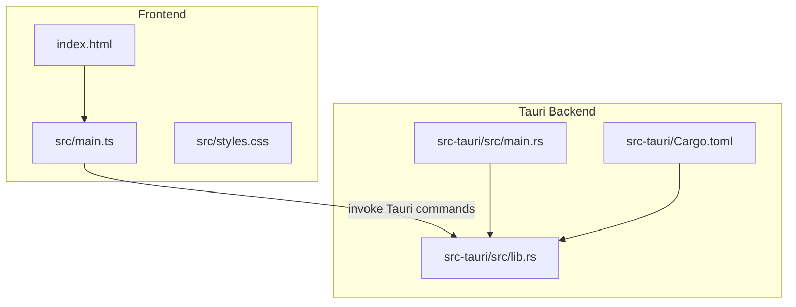
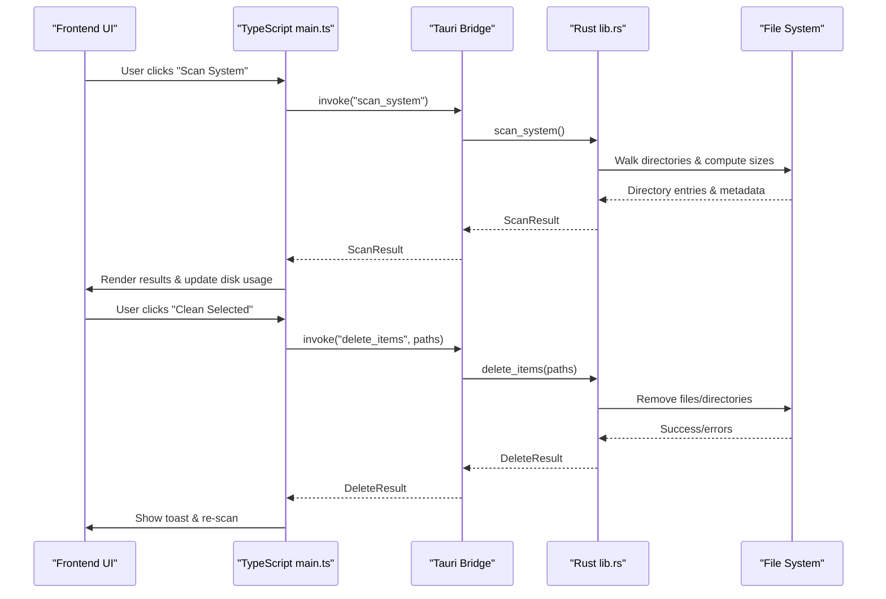
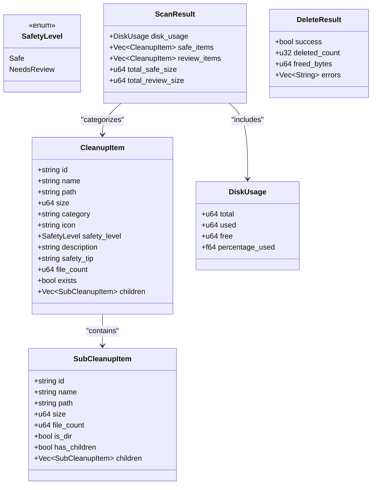
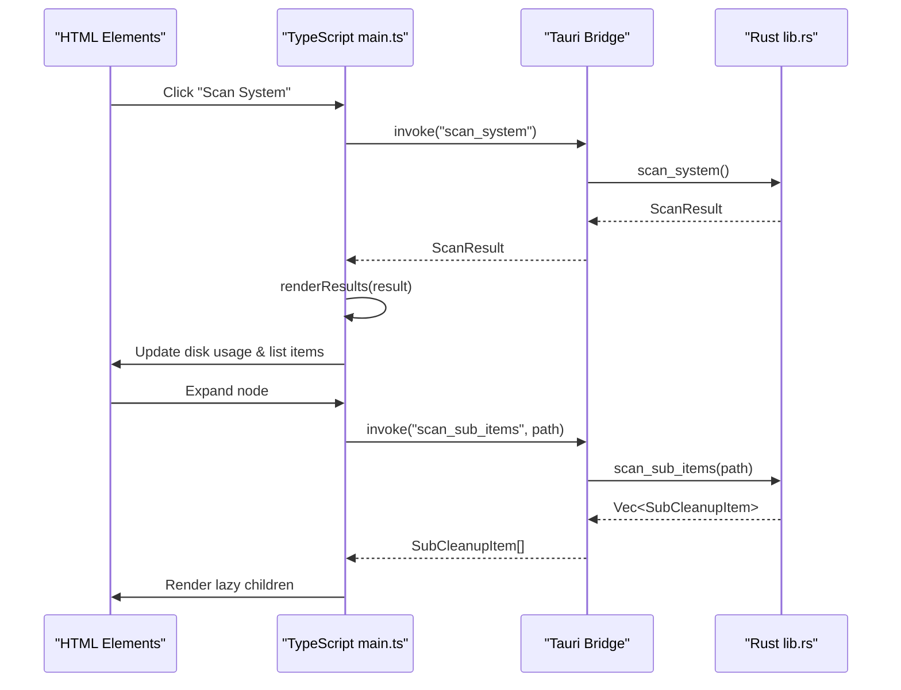
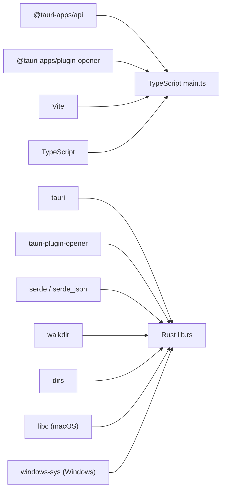

# Technical Implementation Details

<cite>
**Referenced Files in This Document**
- [README.md](file://README.md)
- [Cargo.toml](file://src-tauri/Cargo.toml)
- [package.json](file://package.json)
- [main.rs](file://src-tauri/src/main.rs)
- [lib.rs](file://src-tauri/src/lib.rs)
- [main.ts](file://src/main.ts)
- [index.html](file://index.html)
- [styles.css](file://src/styles.css)
</cite>

## Table of Contents
1. [Introduction](#introduction)
2. [Project Structure](#project-structure)
3. [Core Components](#core-components)
4. [Architecture Overview](#architecture-overview)
5. [Detailed Component Analysis](#detailed-component-analysis)
6. [Dependency Analysis](#dependency-analysis)
7. [Performance Considerations](#performance-considerations)
8. [Troubleshooting Guide](#troubleshooting-guide)
9. [Conclusion](#conclusion)

## Introduction
FreeSpaceMacos is a modern storage cleanup and disk analyzer application built with Tauri 2, combining a Rust backend for safe and efficient file system operations with a TypeScript frontend that provides an interactive macOS-style UI. The app scans user caches, logs, developer artifacts, and other reclaimable directories, categorizes them by safety level, and allows users to selectively delete items while showing real-time disk usage and progress feedback.

The project uses:
- Rust for the Tauri backend, including platform-specific logic for macOS and Windows
- TypeScript and vanilla CSS for the frontend
- Vite as the bundler
- walkdir for directory traversal and libc/Windows APIs for disk usage queries

**Section sources**
- [README.md:1-74](file://README.md#L1-L74)

## Project Structure
The repository is organized into a Tauri application layout:
- Frontend assets under src (TypeScript entry point and styles)
- Tauri backend under src-tauri (Rust library and binary)
- Configuration files for both Node/Tauri tooling and Rust dependencies



**Diagram sources**
- [index.html:1-141](file://index.html#L1-L141)
- [main.ts:1-1009](file://src/main.ts#L1-L1009)
- [styles.css:1-800](file://src/styles.css#L1-L800)
- [main.rs:1-7](file://src-tauri/src/main.rs#L1-L7)
- [lib.rs:1-1100](file://src-tauri/src/lib.rs#L1-L1100)
- [Cargo.toml:1-29](file://src-tauri/Cargo.toml#L1-L29)

**Section sources**
- [index.html:1-141](file://index.html#L1-L141)
- [main.ts:1-1009](file://src/main.ts#L1-L1009)
- [styles.css:1-800](file://src/styles.css#L1-L800)
- [main.rs:1-7](file://src-tauri/src/main.rs#L1-L7)
- [lib.rs:1-1100](file://src-tauri/src/lib.rs#L1-L1100)
- [Cargo.toml:1-29](file://src-tauri/Cargo.toml#L1-L29)

## Core Components
This section documents the primary data models and processing logic used across the backend and frontend.

### Data Models
- SafetyLevel: Enumerates whether a cleanup target is safe or needs review.
- SubCleanupItem: Represents a single child item within a scanned directory, including size, file count, directory flags, and optional nested children.
- CleanupItem: Represents a top-level scan category with metadata such as name, path, size, category, icon, safety level, description, tip, file count, existence flag, and children.
- DiskUsage: Aggregates total, used, free space and percentage used.
- ScanResult: Combines disk usage with categorized cleanup items and totals.
- DeleteResult: Reports success status, deleted count, freed bytes, and errors.

These models are defined in the Rust backend and mirrored in TypeScript interfaces for type-safe communication via Tauri commands.

**Section sources**
- [lib.rs:8-66](file://src-tauri/src/lib.rs#L8-L66)
- [main.ts:5-57](file://src/main.ts#L5-L57)

### File System Operations
- Directory size calculation: Uses recursive traversal with depth limits to sum file sizes and count files.
- Child scanning: Reads direct children, filters OS-specific hidden entries, computes sizes, and determines if directories have further contents.
- Deletion strategies:
  - For known “category roots,” deletes contents resiliently, recursing into subdirectories when necessary.
  - For files/symlinks, removes individual files.
  - For general directories, attempts full removal; falls back to resilient content deletion if needed.

Key algorithms include:
- get_dir_size(path): Traverses up to a maximum depth, accumulating size and file counts.
- scan_children_direct(path): Lists immediate children, computes sizes, and builds SubCleanupItem structures.
- delete_target(path): Dispatches deletion based on path type and category rules.
- delete_dir_contents_resilient(path): Iteratively removes files and directories, tracking freed bytes and errors.

**Section sources**
- [lib.rs:70-97](file://src-tauri/src/lib.rs#L70-L97)
- [lib.rs:108-161](file://src-tauri/src/lib.rs#L108-L161)
- [lib.rs:261-324](file://src-tauri/src/lib.rs#L261-L324)

### Platform-Specific Implementations
- macOS:
  - Disk usage via libc::statfs on root path.
  - Default scan targets include user caches, logs, crash reports, trash, Safari cache, Xcode IB support, Python uv cache, Chrome cache, npm/cargo/pip caches, etc.
- Windows:
  - Disk usage via GetDiskFreeSpaceExW using SystemDrive environment variable.
  - Default scan targets include temp folders, browser caches, DirectX shader cache, error reports, crash dumps, package manager caches, Docker data, VS Code cache, Spotify storage, Yarn cache, etc.
- Platform info: Provides OS identifier, display name, and disk label.

**Section sources**
- [lib.rs:328-399](file://src-tauri/src/lib.rs#L328-L399)
- [lib.rs:410-744](file://src-tauri/src/lib.rs#L410-L744)
- [lib.rs:748-786](file://src-tauri/src/lib.rs#L748-L786)
- [lib.rs:790-1054](file://src-tauri/src/lib.rs#L790-L1054)

## Architecture Overview
The application follows a layered architecture:
- Frontend (TypeScript + HTML + CSS) renders the UI, manages state, and invokes Tauri commands.
- Backend (Rust) exposes commands for disk usage, scanning, sub-item enumeration, and deletion.
- Platform-specific code handles OS differences for disk metrics and default scan paths.



**Diagram sources**
- [main.ts:837-896](file://src/main.ts#L837-L896)
- [main.ts:900-941](file://src/main.ts#L900-L941)
- [lib.rs:410-744](file://src-tauri/src/lib.rs#L410-L744)
- [lib.rs:1056-1082](file://src-tauri/src/lib.rs#L1056-L1082)

## Detailed Component Analysis

### Rust Backend: Data Models and Commands
- Data models define the contract between frontend and backend, ensuring consistent serialization and deserialization.
- Commands exposed:
  - get_platform_info: Returns OS details and disk label.
  - get_disk_usage: Queries OS-specific disk metrics.
  - scan_system: Builds lists of safe and review-needed cleanup items, computing sizes and file counts.
  - scan_sub_items: Lazily enumerates directory contents for a given path.
  - delete_items: Performs deletion with resilience and returns aggregated results.



**Diagram sources**
- [lib.rs:8-66](file://src-tauri/src/lib.rs#L8-L66)

**Section sources**
- [lib.rs:8-66](file://src-tauri/src/lib.rs#L8-L66)
- [lib.rs:328-399](file://src-tauri/src/lib.rs#L328-L399)
- [lib.rs:410-744](file://src-tauri/src/lib.rs#L410-L744)
- [lib.rs:748-786](file://src-tauri/src/lib.rs#L748-L786)
- [lib.rs:790-1054](file://src-tauri/src/lib.rs#L790-L1054)
- [lib.rs:1056-1082](file://src-tauri/src/lib.rs#L1056-L1082)

### Rust Backend: Algorithms and Processing Logic
- Directory traversal algorithm:
  - Uses walkdir with max depth to avoid excessive recursion.
  - Accumulates file sizes and counts efficiently.
- Child scanning algorithm:
  - Filters out OS-specific hidden files.
  - Computes size and file count per child.
  - Determines presence of nested children without deep traversal.
- Deletion algorithm:
  - Categorization-based strategy: category roots trigger content-only deletion.
  - Resilient fallback ensures partial deletions still report accurate freed space and collect errors.

```mermaid
flowchart TD
Start(["Start delete operation"]) --> CheckPath["Check path exists"]
CheckPath --> Exists{"Exists?"}
Exists --> |No| Skip["Skip non-existent path"]
Exists --> |Yes| Classify["Classify path type"]
Classify --> IsCategoryRoot{"Is category root?"}
IsCategoryRoot --> |Yes| DeleteContents["delete_dir_contents_resilient(path)"]
IsCategoryRoot --> |No| IsFileOrSymlink{"Is file or symlink?"}
IsFileOrSymlink --> |Yes| RemoveFile["Remove file and record size/count"]
IsFileOrSymlink --> |No| IsDir{"Is directory?"}
IsDir --> |Yes| TryRemoveAll["Try remove_dir_all(path)"]
TryRemoveAll --> RemoveAllOk{"Success?"}
RemoveAllOk --> |Yes| RecordSize["Record size/file count"]
RemoveAllOk --> |No| FallbackDelete["Fallback to resilient delete"]
IsDir --> |No| End(["End"])
DeleteContents --> Aggregate["Aggregate freed bytes & errors"]
RemoveFile --> Aggregate
RecordSize --> Aggregate
FallbackDelete --> Aggregate
Aggregate --> End
Skip --> End
```

**Diagram sources**
- [lib.rs:261-324](file://src-tauri/src/lib.rs#L261-L324)

**Section sources**
- [lib.rs:70-97](file://src-tauri/src/lib.rs#L70-L97)
- [lib.rs:108-161](file://src-tauri/src/lib.rs#L108-L161)
- [lib.rs:261-324](file://src-tauri/src/lib.rs#L261-L324)

### TypeScript Frontend: State Management and UI Rendering
- State management:
  - Global arrays hold safe and review nodes.
  - TreeNode model represents hierarchical selection state, including selected, indeterminate, expanded, and childrenLoaded flags.
  - Selection propagation updates ancestors and descendants consistently.
- UI rendering:
  - renderResults converts backend ScanResult into frontend TreeNode trees.
  - createTopLevelItemElement and createSubItemElement build DOM elements dynamically.
  - Lazy loading: toggleNodeExpand fetches sub-items only when expanding a node.
- Tauri command integration:
  - runScan calls invoke("scan_system"), updates disk usage UI, and renders results.
  - runClean calls invoke("delete_items"), shows confirmation dialog, and refreshes after completion.



**Diagram sources**
- [main.ts:472-558](file://src/main.ts#L472-L558)
- [main.ts:700-833](file://src/main.ts#L700-L833)
- [main.ts:837-896](file://src/main.ts#L837-L896)
- [lib.rs:401-408](file://src-tauri/src/lib.rs#L401-L408)

**Section sources**
- [main.ts:59-86](file://src/main.ts#L59-L86)
- [main.ts:87-119](file://src/main.ts#L87-L119)
- [main.ts:121-143](file://src/main.ts#L121-L143)
- [main.ts:144-243](file://src/main.ts#L144-L243)
- [main.ts:245-268](file://src/main.ts#L245-L268)
- [main.ts:270-414](file://src/main.ts#L270-L414)
- [main.ts:416-468](file://src/main.ts#L416-L468)
- [main.ts:470-696](file://src/main.ts#L470-L696)
- [main.ts:698-833](file://src/main.ts#L698-L833)
- [main.ts:835-941](file://src/main.ts#L835-L941)
- [main.ts:943-1009](file://src/main.ts#L943-L1009)

### Glassmorphism Styling and Responsive Design
- Glassmorphism approach:
  - Semi-transparent backgrounds with backdrop-filter blur for cards and action bar.
  - Subtle borders and gradients to enhance depth.
- Responsive patterns:
  - Flexbox layouts for sections and lists.
  - Custom scrollbars and smooth scrolling.
  - Animations for slide-up, fade-in, spinner, and tree expansion.
- Design tokens:
  - Centralized CSS variables for colors, spacing, transitions, and typography.

**Section sources**
- [styles.css:1-45](file://src/styles.css#L1-L45)
- [styles.css:60-114](file://src/styles.css#L60-L114)
- [styles.css:134-143](file://src/styles.css#L134-L143)
- [styles.css:145-239](file://src/styles.css#L145-L239)
- [styles.css:241-338](file://src/styles.css#L241-L338)
- [styles.css:340-700](file://src/styles.css#L340-L700)
- [styles.css:702-800](file://src/styles.css#L702-L800)

## Dependency Analysis
The project’s dependencies are split between frontend and backend:
- Frontend:
  - @tauri-apps/api for invoking backend commands
  - @tauri-apps/plugin-opener for opening external links/files
  - Vite for development and building
  - TypeScript for type safety
- Backend:
  - tauri and tauri-plugin-opener for app lifecycle and opener functionality
  - serde and serde_json for serialization
  - walkdir for directory traversal
  - trash for moving items to trash (available but not used in current commands)
  - dirs for home directory resolution
  - libc for macOS statfs
  - windows-sys for Windows GetDiskFreeSpaceExW



**Diagram sources**
- [package.json:12-20](file://package.json#L12-L20)
- [Cargo.toml:15-29](file://src-tauri/Cargo.toml#L15-L29)

**Section sources**
- [package.json:1-22](file://package.json#L1-L22)
- [Cargo.toml:1-29](file://src-tauri/Cargo.toml#L1-L29)

## Performance Considerations
- Lazy loading of directory contents:
  - Sub-items are fetched only when a node is expanded, reducing initial load time and memory usage.
- Efficient directory traversal:
  - Depth-limited traversal prevents excessive recursion and I/O overhead.
  - Filtering out hidden files reduces unnecessary processing.
- Memory management:
  - Frontend maintains lightweight TreeNode structures with explicit flags to track loaded state.
  - Backend avoids deep recursion during deletion by falling back to resilient content deletion.
- UI responsiveness:
  - Scanning overlay with rotating status messages keeps users informed during long operations.
  - Toast notifications provide immediate feedback without blocking the UI.

[No sources needed since this section provides general guidance]

## Troubleshooting Guide
Common issues and debugging approaches:
- Scan failures:
  - Frontend catches errors from invoke("scan_system") and displays error toasts.
  - Console logs capture detailed error messages for developers.
- Clean failures:
  - Errors from delete_items are aggregated and reported via DeleteResult.errors.
  - Partial successes are handled gracefully, allowing subsequent re-scans to reflect changes.
- Platform detection:
  - If get_platform_info fails, defaults to macOS behavior; check console logs for platform info errors.
- Initial disk usage errors:
  - If get_disk_usage fails, UI retains previous values; inspect console logs for underlying errors.

Recommended steps:
- Open developer tools in the Tauri window to view console logs.
- Verify permissions for sensitive directories (e.g., Windows admin-required paths).
- Re-run scan after cleanup to ensure UI reflects updated disk usage.

**Section sources**
- [main.ts:837-896](file://src/main.ts#L837-L896)
- [main.ts:900-941](file://src/main.ts#L900-L941)
- [main.ts:943-1009](file://src/main.ts#L943-L1009)
- [lib.rs:1056-1082](file://src-tauri/src/lib.rs#L1056-L1082)

## Conclusion
FreeSpaceMacos combines a robust Rust backend with a responsive TypeScript frontend to deliver a safe, efficient, and user-friendly storage cleanup experience. The architecture leverages platform-specific optimizations, lazy loading, and resilient deletion strategies to ensure performance and reliability. The glassmorphism UI enhances usability with clear visual feedback and intuitive interactions. By following the documented implementation details, developers can extend scan categories, improve error handling, and optimize performance further.

[No sources needed since this section summarizes without analyzing specific files]